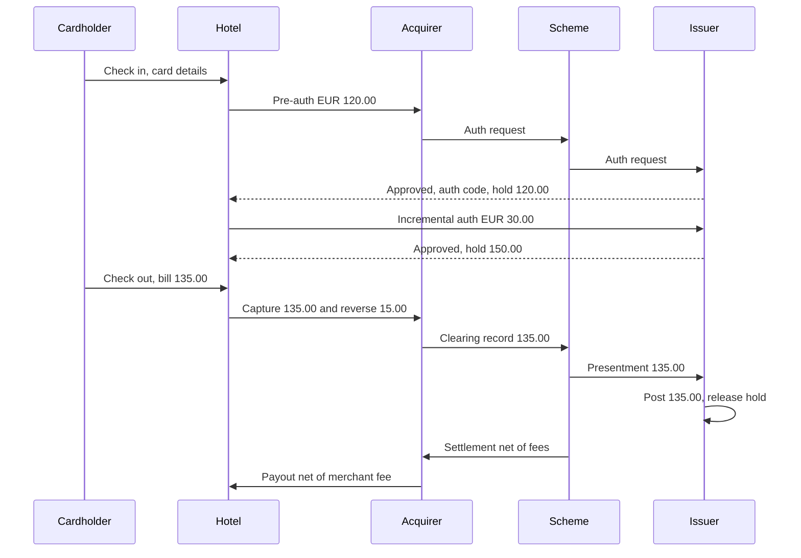

# Card payment

A card payment is not one event but a chain: the issuer first **authorises** the payment and blocks
the money, later the merchant's bank sends the final amount in **clearing**, and then the money
really moves in **settlement**. This page follows one payment through the four-party model and
explains where reversals, refunds and chargebacks fit — the places where most card defects live.

## How it works

### The four-party model

- **Cardholder** — the person who pays with the card.
- **Merchant** — the shop, hotel or website that accepts the card.
- **Acquirer** — the merchant's bank (or payment provider) that accepts card payments for the merchant.
- **Card scheme** (also called card network) — Visa, Mastercard and others; they run the network and write the rules.
- **Issuer** — the cardholder's bank that issued the card and holds the account.

Strictly speaking the scheme is the "hub", so the model is called four-party (cardholder,
merchant, acquirer, issuer) with the scheme in the middle.

### Step 1 — Authorisation

The merchant asks the issuer, through the acquirer and the scheme, "can this card pay
EUR 120.00?". This is the **authorisation request**. The issuer checks the card status, expiry,
security data (CVV, PIN or chip cryptogram), available funds, limits and fraud rules, and answers
with an **authorisation response**: approved (with an **authorisation code**, a short code that
proves the approval) or declined with a **decline reason** (for example insufficient funds,
expired card, suspected fraud). Exact response codes differ by scheme.

An approval does not move money. The issuer puts a **hold** (blocked funds) on the account:
the **ledger balance** (booked balance) stays the same, the **available balance** goes down.

- **Final authorisation** — the amount is known (a web shop order).
- **Pre-authorisation** (Visa calls it *Estimated Authorization*) — the final amount is not known
  yet (hotel, car rental). The merchant authorises an estimate.
- **Incremental authorisation** — an extra authorisation linked to the first one when the estimate
  is not enough (an extra night). Visa requires the same transaction identifier as the original.
- **Partial authorisation** — the issuer approves less than requested (for example the rest of a
  prepaid card balance) and the merchant collects the difference another way. Support depends on
  the scheme, region and merchant type.

**Authorisation expiry.** An approval is valid only for a limited time, set by scheme rules and
depending on the transaction type. For example, the Visa rules give 30 calendar days for an
estimated authorisation at lodging, cruise and vehicle rental merchants and 10 calendar days for
an ordinary cardholder-initiated card-absent payment; Stripe documents 7 days for most online card
payments. After expiry the hold is released, and a late capture may be declined or later disputed.
In the EEA, PSD2 Article 75 adds that for a card payment started by the merchant where the exact
amount is unknown, funds may be blocked only if the payer agreed to the exact blocked amount, and
must be released without undue delay once the exact amount is known — at the latest immediately
after the payment order arrives.

### Step 2 — Capture and clearing

**Capture** is the merchant's instruction "charge this approved payment for the final amount".
The acquirer collects captures into files and sends them to the scheme — this is **clearing**
(also called **presentment**). The scheme passes each record to the issuer, which matches it to
the original authorisation, **posts** the transaction (ledger balance goes down) and releases the
hold. The captured amount may be lower than the authorised amount; then the merchant must reverse
the unused part (Visa: within 24 hours of completing the transaction).

### Step 3 — Settlement and fees

**Settlement** is the real movement of money between banks. The scheme calculates net positions:
the issuer pays the scheme, the scheme pays the acquirer, the acquirer pays the merchant.
On the way, fees are taken:

- **Interchange fee** — paid by the acquirer to the issuer for each purchase. In the EEA it is
  capped for consumer cards by the Interchange Fee Regulation (EU) 2015/751: 0.2% of the
  transaction value for debit cards and 0.3% for credit cards (Member States may set lower caps
  for domestic transactions).
- **Scheme fees** — paid by both banks to the scheme.
- **Merchant service charge** — what the acquirer charges the merchant; it covers the above plus
  the acquirer's margin.

How many days settlement takes depends on the scheme, the acquirer and the merchant contract;
do not assume a fixed "T+1".

### Corrections: reversal, refund, chargeback

| | Reversal | Refund | Chargeback |
|---|---|---|---|
| Who starts it | Merchant or acquirer | Merchant | Issuer, usually after a cardholder complaint |
| When | Before clearing (the payment is only authorised) | After clearing (money was charged) | After clearing, within scheme time limits |
| What it does | Cancels all or part of the authorisation, releases the hold | New credit transaction that sends money back | Takes money back from the acquirer, who debits the merchant |
| Cardholder sees | The pending payment disappears or shrinks | The charge stays, a separate credit appears | A credit after the dispute, decided by the issuer |
| Merchant's consent | Its own decision | Its own decision | Not needed; merchant can only defend with evidence |
| Cost | Usually none or low | Fees of the original payment are often not returned | Dispute fee plus the amount if lost |

Providers blur the line in their APIs: Stripe documents that a refund issued shortly after the
charge may be processed as a reversal, and Adyen offers one "reversal" request that cancels an
uncaptured payment or refunds a captured one. So the same API call can produce either.

### Chargeback lifecycle

1. **Dispute / chargeback** — the issuer raises it under a reason; the amount is debited from the
   acquirer and then from the merchant.
2. **Representment** — the merchant defends with evidence (Visa calls this *Dispute Response*,
   Mastercard *second presentment*).
3. **Pre-arbitration** — the issuer does not accept the defence and tries once more. (In Visa's
   fraud and authorisation categories there is no Dispute Response: the acquirer answers the
   dispute directly with a pre-arbitration attempt.)
4. **Arbitration** — the scheme itself decides who is liable; extra scheme fees apply.

Visa groups disputes into four categories: **fraud** (10), **authorisation** (11), **processing
errors** (12) and **consumer disputes** (13). Mastercard uses its own reason codes and a similar
cycle: first chargeback, second presentment, then a pre-arbitration or arbitration case. Time
limits differ by scheme and reason; Stripe notes that card networks typically allow 120 days.

### 3-D Secure and SCA

For online payments in the EEA the issuer usually requires Strong Customer Authentication,
mostly through 3-D Secure, before approving. When a payment is authenticated this way, liability
for some fraud chargebacks can shift from the merchant to the issuer. Details are in area 08
(regulation).

### Currency conversion

The **transaction currency** is what the merchant charges (EUR); the **billing currency** is what
the cardholder's account is in (for example PLN). Normally the scheme converts and the issuer bills
the converted amount — the rate at authorisation and at clearing may differ, so the posted amount
may differ from the held amount. With **Dynamic Currency Conversion (DCC)** the merchant offers to
charge in the cardholder's currency at its own rate; Visa rules require that the cardholder is told
DCC is optional and agrees to it explicitly.

### Timeouts and duplicates

If the merchant sends an authorisation and gets no answer, it does not know whether the issuer
approved. Holding money twice or charging twice is the risk. Usual protections: the acquirer
sends a **reversal** for an authorisation without a response (Visa rules require an issuer to
reverse an authorised transaction when it receives a reversal), and APIs use an
**idempotency key** — a unique request id, so a retry returns the first result instead of creating
a second payment.

### Worked example: hotel stay

Cardholder's debit card account, EUR. Ledger balance before the stay: EUR 1,000.00.

| Date and time (CET) | Event | Ledger balance | Holds | Available balance |
|---|---|---|---|---|
| 12 Nov 2026 15:00 | Check-in, pre-authorisation 120.00 approved | 1,000.00 | 120.00 | 880.00 |
| 13 Nov 2026 21:10 | Extra night booked, incremental authorisation 30.00 | 1,000.00 | 150.00 | 850.00 |
| 14 Nov 2026 11:00 | Check-out, final bill 135.00; hotel captures 135.00 and reverses 15.00 | 1,000.00 | 135.00 | 865.00 |
| 15 Nov 2026 06:00 | Clearing record 135.00 matched, posted, hold released | 865.00 | 0.00 | 865.00 |
| 18 Nov 2026 10:30 | Hotel refunds 20.00 for a minibar item charged by mistake; credit posted | 885.00 | 0.00 | 885.00 |

Points to notice:

- The reversal of 15.00 matters to the customer: without it 15.00 stays blocked until the
  clearing record is matched (or until the authorisation expires, if the issuer does not release
  the unused part on matching), and meanwhile the customer sees 850.00 instead of 865.00.
- The refund is a new credit transaction; it does not "undo" the clearing record. The statement
  shows −135.00 and +20.00. When the credit reaches the account depends on the issuer.
- If the issuer released the hold on 14 Nov but the clearing record arrived only on 15 Nov,
  the customer would briefly see 1,000.00 available and could overspend.

## Participants and money flows

| Participant | Role | Sends / receives and when | Risk carried |
|---|---|---|---|
| Cardholder | Pays | Gives card data; sees a hold at authorisation, a debit at posting, a credit at refund or won dispute | Holds that are not released; double charges; wrong FX amount |
| Merchant | Sells | Sends authorisation, capture, reversal, refund; receives payout after settlement minus merchant service charge; is debited on chargebacks | Fraud chargebacks without SCA liability shift; late capture after expiry; lost disputes |
| Acquirer | Merchant's bank | Forwards authorisations; sends clearing files; receives settlement from the scheme and pays the merchant; pays interchange and scheme fees | Merchant insolvency: if the merchant cannot repay chargebacks, the acquirer pays |
| Card scheme | Network and rules | Routes messages; calculates net settlement positions; charges scheme fees; runs arbitration | Operational; sets rules and penalties for others |
| Issuer | Cardholder's bank | Approves or declines; holds funds; posts on clearing; pays settlement to the scheme; receives interchange; starts chargebacks | Approved fraud (when liability is on the issuer); credit risk on credit cards; posting a clearing that has no matching authorisation |

Money moves only at settlement: issuer → scheme → acquirer → merchant, net of interchange and
fees. Authorisation and holds are information, not money.

## Business risks

### Company (issuer, acquirer, merchant, PSP)

- **Double charges** after a timeout retry without idempotency → refunds, complaints, chargebacks
  with dispute fees.
- **Holds not released** (missing reversal, unmatched clearing) → customers cannot spend their own
  money; complaints and possible regulatory findings.
- **Late capture** after the authorisation has expired → declined capture or a dispute in the
  authorisation category; lost revenue.
- **Wrong fee or interchange calculation** → systematic money loss that grows with volume.
- **Excess chargebacks** → scheme monitoring programmes and penalties for the acquirer and merchant.
- **Reconciliation breaks** between authorisations, clearing, settlement reports and the ledger →
  money that nobody can explain at month end.

### Customer

- Available balance lower than it should be; a later payment is declined wrongly.
- Refund promised but not visible because it was issued as a reversal or not sent at all.
- Charged in an unexpected currency (DCC chosen by default).

### Regulator / compliance

- PSD2 Article 75: blocking an amount the payer did not agree to, or not releasing it promptly.
- PSD2 Articles 76–77: right to a refund for payee-initiated payments where the amount was not
  specified and exceeded what the payer could reasonably expect (request within eight weeks of
  the debit; the provider refunds or justifies a refusal within 10 business days).
- Scheme rules (DCC disclosure, reversal timeframes) — breaches can lead to fines from the scheme.

## What to test

- [ ] Every decline reason is returned for the right condition, and the first failing check wins.
- [ ] An approval returns an authorisation code and creates a hold; a decline creates no hold.
- [ ] Available balance = ledger balance − active holds, after every step.
- [ ] Pre-authorisation, incremental authorisation and capture are linked by the same transaction id.
- [ ] Capture lower than authorised releases the rest (partial reversal).
- [ ] Capture higher than authorised is rejected unless the rules allow it.
- [ ] Capture after authorisation expiry is rejected or flagged.
- [ ] Holds expire and are released at the right time (time zone, day boundary).
- [ ] Clearing record without a matching authorisation is posted and flagged, not lost.
- [ ] Reversal before clearing cancels the hold; refund after clearing creates a credit.
- [ ] Total refunds cannot exceed the captured amount.
- [ ] Refund on an expired or replaced card still reaches the cardholder.
- [ ] Retry with the same idempotency key returns the first result and charges once.
- [ ] Same key with a different body is rejected.
- [ ] Timeout from a downstream service leaves no half-made payment and allows a safe retry.
- [ ] Parallel payments cannot overdraw the account.
- [ ] Amount, currency and FX rate are shown correctly in transaction and billing currency.
- [ ] Chargeback debits the merchant and links to the original payment; a won representment credits it back.
- [ ] Daily reconciliation: authorisations ↔ clearing ↔ settlement ↔ ledger totals match.

| ID | Condition / steps | Expected result |
|---|---|---|
| CP-01 | Balance 100.00, pay 100.00 with fee 0.00 | Approved; available 0.00 (boundary: exact balance) |
| CP-02 | Daily limit 100.00, spent 60.00, pay 40.00 | Approved — total equals the limit |
| CP-03 | Pre-auth 120.00, incremental 30.00, capture 135.00 | Posted 135.00; holds 0.00; 15.00 released |
| CP-04 | Pre-auth 120.00, no capture until the expiry date passes | Hold released after expiry; later capture rejected or flagged for review |
| CP-05 | Capture 135.00, refund 100.00, refund 40.00 | Second refund rejected: total 140.00 > 135.00 |
| CP-06 | Authorisation sent, response times out, merchant retries with the same idempotency key | One hold, one payment; retry returns the first result |
| CP-07 | Two parallel payments of 60.00 on balance 100.00 | Exactly one approved, the other declined for insufficient funds |
| CP-08 | Authorisation at 23:59:59 UTC, clearing next day | Counted in the daily limit of the authorisation day; no double count after clearing |
| CP-09 | Clearing file contains a record with no matching authorisation | Posted per rules and listed on the reconciliation exceptions report |
| CP-10 | Chargeback of 135.00 received, merchant already refunded 20.00 | Disputed amount and refund are both visible; no double credit to the cardholder |

## Typical defects

1. **Off-by-one at a limit.** A payment that brings the total exactly to the limit is declined
   (`>=` instead of `>`). Catch with boundary values: limit −0.01, limit, limit +0.01. Seen in
   card-wallet: [BUG-02](https://github.com/Tomullya/card-wallet/blob/main/docs/qa/bug-reports/BUG-02.md).
2. **Fee rule partly implemented.** A minimum fee or rounding rule is missed, so small payments are
   undercharged. Catch with a table of amounts around the minimum. Seen in card-wallet:
   [BUG-01](https://github.com/Tomullya/card-wallet/blob/main/docs/qa/bug-reports/BUG-01.md).
3. **Hold never released.** Partial capture without a reversal, or a clearing that is not matched
   to its authorisation. Catch by checking available balance after capture and after clearing.
4. **Double charge on retry.** The client retries after a timeout and a second payment is created.
   Catch by replaying the same request with the same idempotency key, also in parallel.
5. **Timeout treated as decline.** A slow downstream call (fraud check, issuer) is reported as a
   decline while the other side approved, or it blocks worker threads. Catch with a stub that
   answers late. Related in card-wallet:
   [BUG-16](https://github.com/Tomullya/card-wallet/blob/main/docs/qa/bug-reports/BUG-16.md).
6. **Sensitive data in technical storage.** CVV or full card number ends up in logs or in a stored
   request hash. Catch by searching logs and idempotency tables for test card data. Seen in
   card-wallet: [BUG-11](https://github.com/Tomullya/card-wallet/blob/main/docs/qa/bug-reports/BUG-11.md).
7. **Refund over the captured amount.** Several partial refunds together exceed the capture.
   Catch with a sequence of partial refunds that crosses the total.
8. **Day boundary in the wrong time zone.** Limits or expiry use local time while the rule says
   UTC. Catch with transactions just before and after midnight UTC.

## In card-wallet

[card-wallet](https://github.com/Tomullya/card-wallet) models a card payment as one step:
**authorise and post immediately** — there is no hold, no separate capture, no clearing.

- Checks run in a fixed order and the first failure gives the decline reason (block, expiry,
  CVV, funds including fee, daily limit, anti-fraud): BR-PAY-02 in
  [BR-payments.md](https://github.com/Tomullya/card-wallet/blob/main/docs/requirements/BR-payments.md).
- Commission 1%, minimum 0.50 (BR-PAY-03); daily limit per card per UTC day, exact limit allowed
  (BR-PAY-04).
- Idempotency key required; same key and body replays the response, different body gives
  `409 IDEMPOTENCY_KEY_REUSED` (BR-PAY-07):
  [idempotency.py](https://github.com/Tomullya/card-wallet/blob/main/wallet-api/app/services/idempotency.py),
  [test_idempotency.py](https://github.com/Tomullya/card-wallet/blob/main/tests/api/test_idempotency.py).
- Anti-fraud check over gRPC with a 2-second timeout; on timeout nothing is saved and the key can
  be reused (BR-PAY-08):
  [fraud_client.py](https://github.com/Tomullya/card-wallet/blob/main/wallet-api/app/fraud_client.py),
  [BR-fraud.md](https://github.com/Tomullya/card-wallet/blob/main/docs/requirements/BR-fraud.md).
- Row locking so parallel payments cannot overdraw (BR-PAY-09):
  [payments.py](https://github.com/Tomullya/card-wallet/blob/main/wallet-api/app/services/payments.py),
  [test_concurrency.py](https://github.com/Tomullya/card-wallet/blob/main/tests/api/test_concurrency.py).
- Payment tests, including boundaries and decline order:
  [test_payments.py](https://github.com/Tomullya/card-wallet/blob/main/tests/api/test_payments.py).

Could be added (honest gaps — card-wallet is a simplified demo):

- Two-step flow: authorisation with a hold, then capture; available vs ledger balance; hold expiry.
- Pre-authorisation and incremental authorisation for a hotel-style merchant.
- Reversal and refund endpoints with "total refunds ≤ captured" rules.
- A simulated clearing file and a chargeback with representment, plus a reconciliation report.

## Sources

- [Visa Core Rules and Visa Product and Service Rules, public edition 24 October 2026 (PDF)](https://www.visa.co.uk/content/dam/VCOM/download/about-visa/visa-rules-public.pdf) — estimated and incremental authorisation, approval validity timeframes, authorisation reversal timeframe, partial authorisation, DCC, dispute categories and stages.
- [Mastercard Developers: Mastercom second presentment](https://developer.mastercard.com/mastercom/documentation/use-cases/secondpresentment) — Mastercard dispute cycle: first chargeback, second presentment with evidence, pre-arbitration or arbitration case.
- [Stripe: Place a hold on a payment method](https://docs.stripe.com/payments/place-a-hold-on-a-payment-method) — separate authorisation and capture, partial capture releases the rest, authorisation validity windows.
- [Stripe: Refund and cancel payments](https://docs.stripe.com/refunds) — cancel before capture vs refund after, early refunds processed as reversals, refund limits.
- [Stripe: How disputes work](https://docs.stripe.com/disputes/how-disputes-work) — dispute lifecycle, typical 120-day window, funds debited during the dispute.
- [Stripe: Idempotent requests](https://docs.stripe.com/api/idempotent_requests) — idempotency keys, replay of the saved response, error on different parameters.
- [Adyen: Authorisation adjustment](https://docs.adyen.com/online-payments/adjust-authorisation) — pre-authorisation and adjustment for hotels, validity differences by scheme.
- [Adyen: Reverse a payment](https://docs.adyen.com/online-payments/reversal) — one request that cancels an uncaptured payment or refunds a captured one.
- [Directive (EU) 2015/2366 (PSD2)](https://eur-lex.europa.eu/eli/dir/2015/2366/oj) — Article 75 on blocking funds when the amount is unknown; Articles 76–77 on refunds of payee-initiated payments.
- [Regulation (EU) 2015/751 (Interchange Fee Regulation)](https://eur-lex.europa.eu/eli/reg/2015/751/oj) — interchange caps for consumer debit and credit cards in the EEA.
