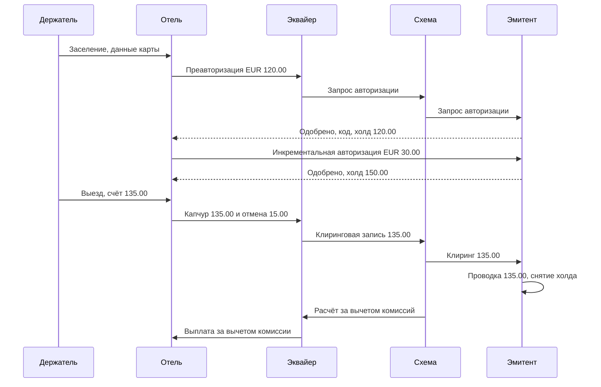

# Карточный платёж

Карточный платёж — не одно событие, а цепочка: сначала эмитент **авторизует** платёж и блокирует
деньги, позже банк мерчанта присылает итоговую сумму в **клиринге**, и только потом деньги
действительно двигаются в **расчётах**. Эта страница проводит один платёж через четырёхстороннюю
модель и объясняет, где находятся отмена авторизации, возврат и чарджбэк — именно там живёт
большинство карточных дефектов.

## Как это работает

### Четырёхсторонняя модель

- **Держатель карты (cardholder)** — человек, который платит картой.
- **Мерчант (merchant; торгово-сервисное предприятие, ТСП)** — магазин, отель или сайт, который принимает карту.
- **Эквайер (acquirer)** — банк мерчанта (или платёжный провайдер), принимающий карточные платежи для мерчанта.
- **Платёжная система, или схема (card scheme, card network)** — Visa, Mastercard и другие; они ведут сеть и пишут правила.
- **Эмитент (issuer)** — банк держателя, который выпустил карту и ведёт счёт.

Строго говоря, платёжная система — это «центр», поэтому модель называют четырёхсторонней
(держатель, мерчант, эквайер, эмитент), а схема стоит посередине.

### Шаг 1 — Авторизация

Мерчант через эквайера и платёжную систему спрашивает эмитента: «может ли эта карта оплатить
EUR 120.00?». Это **запрос авторизации (authorisation request)**. Эмитент проверяет статус и срок
карты, данные безопасности (CVV, PIN или криптограмму чипа), доступные средства, лимиты и
антифрод-правила и отвечает **ответом на авторизацию (authorisation response)**: одобрено (с
**кодом авторизации (authorisation code)** — коротким кодом-подтверждением) или отказ с
**причиной отказа (decline reason)**, например недостаточно средств, карта просрочена,
подозрение на мошенничество. Точные коды ответов различаются по платёжным системам.

Одобрение не двигает деньги. Эмитент ставит **холд (hold, блокировку средств)**:
**учётный баланс (ledger balance)** не меняется, **доступный баланс (available balance)** уменьшается.

- **Финальная авторизация (final authorisation)** — сумма известна (заказ в интернет-магазине).
- **Преавторизация (pre-authorisation)**, у Visa — *Estimated Authorization* — итоговая сумма
  ещё не известна (отель, прокат авто). Мерчант авторизует оценку.
- **Инкрементальная авторизация (incremental authorisation)** — дополнительная авторизация,
  связанная с первой, когда оценки не хватает (ещё одна ночь). Visa требует тот же идентификатор
  транзакции, что и у исходной.
- **Частичная авторизация (partial authorisation)** — эмитент одобряет меньше запрошенного
  (например, остаток на предоплаченной карте), а разницу мерчант получает иначе. Поддержка
  зависит от платёжной системы, региона и типа мерчанта.

**Срок действия авторизации (authorisation expiry).** Одобрение действует ограниченное время,
которое задают правила платёжной системы в зависимости от типа операции. Например, правила Visa
дают 30 календарных дней для преавторизации у отелей, круизных компаний и проката авто и
10 календарных дней для обычного платежа без присутствия карты, инициированного держателем;
Stripe указывает 7 дней для большинства онлайн-платежей картой. После истечения холд снимается,
а поздний капчур могут отклонить или позже оспорить. В ЕЭЗ статья 75 PSD2 добавляет: если
карточный платёж инициирует мерчант и точная сумма неизвестна, средства можно заблокировать, только
если плательщик согласился на точную сумму блокировки, и снять блокировку нужно без неоправданной
задержки, как только известна точная сумма, — не позднее чем сразу после получения платёжного
поручения.

### Шаг 2 — Капчур и клиринг

**Капчур (capture, списание)** — указание мерчанта «спиши этот одобренный платёж на итоговую
сумму». Эквайер собирает капчуры в файлы и отправляет их в платёжную систему — это **клиринг
(clearing; презентмент, presentment)**. Схема передаёт каждую запись эмитенту, тот
сопоставляет её с исходной авторизацией, **проводит (posts)** операцию (учётный баланс
уменьшается) и снимает холд. Списанная сумма может быть меньше авторизованной; тогда мерчант
обязан отменить неиспользованную часть (у Visa — в течение 24 часов после завершения операции).

### Шаг 3 — Расчёты и комиссии

**Расчёты (settlement)** — реальное движение денег между банками. Схема считает нетто-позиции:
эмитент платит схеме, схема — эквайеру, эквайер — мерчанту. По пути удерживаются комиссии:

- **Интерчейндж (interchange fee; межбанковское вознаграждение, МБВ)** — платит эквайер эмитенту за каждую покупку. В ЕЭЗ он ограничен
  для потребительских карт Регламентом об интерчейндж-комиссиях (EU) 2015/751: 0.2% суммы
  операции для дебетовых и 0.3% для кредитных карт (государства-члены могут установить более
  низкие потолки для внутренних операций).
- **Комиссии платёжной системы (scheme fees)** — платят оба банка схеме.
- **Комиссия за эквайринг (merchant service charge)** — то, что эквайер берёт с мерчанта; она
  покрывает всё перечисленное плюс маржу эквайера.

Сколько дней занимают расчёты, зависит от платёжной системы, эквайера и договора с мерчантом;
не стоит предполагать фиксированный «T+1».

### Исправления: отмена, возврат, чарджбэк

| | Отмена авторизации (reversal) | Возврат (refund) | Чарджбэк (chargeback) |
|---|---|---|---|
| Кто запускает | Мерчант или эквайер | Мерчант | Эмитент, обычно после жалобы держателя |
| Когда | До клиринга (платёж только авторизован) | После клиринга (деньги списаны) | После клиринга, в сроки правил схемы |
| Что делает | Отменяет всю авторизацию или часть, снимает холд | Новая кредитовая операция, возвращающая деньги | Забирает деньги у эквайера, а тот — у мерчанта |
| Что видит держатель | Ожидающий платёж исчезает или уменьшается | Списание остаётся, появляется отдельное зачисление | Зачисление после спора по решению эмитента |
| Согласие мерчанта | Его собственное решение | Его собственное решение | Не нужно; мерчант может только защищаться доказательствами |
| Стоимость | Обычно нулевая или низкая | Комиссии исходного платежа часто не возвращаются | Комиссия за спор плюс сумма, если спор проигран |

Провайдеры размывают границу в своих API: Stripe пишет, что возврат вскоре после списания может
пройти как reversal, а у Adyen есть один запрос «reversal», который отменяет платёж до капчура
или возвращает уже списанный. Поэтому один и тот же вызов API может дать и то, и другое.

### Жизненный цикл чарджбэка

1. **Спор / чарджбэк (dispute / chargeback)** — эмитент открывает его по определённой причине;
   сумма списывается с эквайера, а затем с мерчанта.
2. **Повторное представление (representment)** — мерчант защищается доказательствами (у Visa это
   *Dispute Response*, у Mastercard — *second presentment*). Не путать: в русских правилах
   эквайринга «опротестованием» часто называют сам чарджбэк.
3. **Преарбитраж (pre-arbitration)** — эмитент не принимает защиту и делает ещё одну попытку.
   (В категориях Visa «мошенничество» и «авторизация» этапа Dispute Response нет: эквайер сразу
   отвечает на спор попыткой преарбитража.)
4. **Арбитраж (arbitration)** — ответственность определяет сама платёжная система; применяются
   дополнительные комиссии схемы.

Visa делит споры на четыре категории: **мошенничество (fraud)** (10), **авторизация
(authorisation)** (11), **ошибки обработки (processing errors)** (12) и **потребительские споры
(consumer disputes)** (13). У Mastercard свои коды причин (reason codes) и похожий цикл: первый
чарджбэк (first chargeback), повторное представление (second presentment), затем дело о
преарбитраже или арбитраже. Сроки зависят от схемы и причины; Stripe отмечает, что платёжные
системы обычно дают 120 дней.

### 3-D Secure и SCA

Для онлайн-платежей в ЕЭЗ эмитент обычно требует строгую аутентификацию клиента (SCA, Strong
Customer Authentication), чаще всего через 3-D Secure, прежде чем одобрить платёж. Если платёж
аутентифицирован так, ответственность (liability) по части мошеннических чарджбэков может перейти
с мерчанта на эмитента. Подробно — в области 08 (регулирование).

### Конвертация валют

**Валюта операции (transaction currency)** — то, в чём выставляет счёт мерчант (EUR); **валюта
счёта (billing currency)** — валюта счёта держателя (например, PLN). Обычно конвертирует
платёжная система, и эмитент списывает пересчитанную сумму — курс на момент авторизации и на
момент клиринга может отличаться, поэтому проведённая сумма может не совпасть с суммой холда.
При **динамической конвертации валюты (DCC, Dynamic Currency Conversion)** мерчант предлагает
списать сумму в валюте держателя по своему курсу; правила Visa требуют сообщить держателю, что DCC
необязательна, и получить его явное согласие.

### Таймауты и дубли

Если мерчант отправил авторизацию и не получил ответа, он не знает, одобрил ли эмитент.
Риск — заблокировать или списать деньги дважды. Обычная защита: эквайер отправляет **отмену
(reversal)** для авторизации без ответа (правила Visa требуют от эмитента отменить авторизованную
операцию при получении reversal), а API используют **ключ идемпотентности (idempotency key)** —
уникальный идентификатор запроса, чтобы повтор вернул первый результат, а не создал второй платёж.

### Пример с числами: проживание в отеле

Дебетовая карта держателя, счёт в EUR. Учётный баланс до поездки: EUR 1,000.00.

| Дата и время (CET) | Событие | Учётный баланс | Холды | Доступный баланс |
|---|---|---|---|---|
| 12 ноя 2026 15:00 | Заселение, преавторизация 120.00 одобрена | 1,000.00 | 120.00 | 880.00 |
| 13 ноя 2026 21:10 | Продлили на ночь, инкрементальная авторизация 30.00 | 1,000.00 | 150.00 | 850.00 |
| 14 ноя 2026 11:00 | Выезд, итоговый счёт 135.00; отель списывает 135.00 и отменяет 15.00 | 1,000.00 | 135.00 | 865.00 |
| 15 ноя 2026 06:00 | Клиринговая запись 135.00 сопоставлена, проведена, холд снят | 865.00 | 0.00 | 865.00 |
| 18 ноя 2026 10:30 | Отель возвращает 20.00 за ошибочно начисленный мини-бар; зачисление проведено | 885.00 | 0.00 | 885.00 |

На что обратить внимание:

- Отмена 15.00 важна для клиента: без неё 15.00 остаются заблокированными до сопоставления
  клиринговой записи (или до истечения авторизации, если эмитент не снимает неиспользованную
  часть при сопоставлении), и всё это время клиент видит 850.00 вместо 865.00.
- Возврат — это новая кредитовая операция, он не «отменяет» клиринговую запись. В выписке
  видно −135.00 и +20.00. Когда зачисление дойдёт до счёта, зависит от эмитента.
- Если бы эмитент снял холд 14 ноября, а клиринговая запись пришла только 15-го, клиент на
  короткое время увидел бы 1,000.00 доступными и мог бы потратить лишнее.

## Участники и потоки денег

| Участник | Роль | Что отправляет / получает и когда | Какой риск несёт |
|---|---|---|---|
| Держатель карты | Платит | Даёт данные карты; видит холд при авторизации, списание при проводке, зачисление при возврате или выигранном споре | Неснятые холды; двойные списания; неверная сумма при конвертации |
| Мерчант | Продаёт | Отправляет авторизацию, капчур, отмену, возврат; получает выплату после расчётов за вычетом комиссии; с него списывают чарджбэки | Мошеннические чарджбэки без переноса ответственности по SCA; поздний капчур после истечения; проигранные споры |
| Эквайер | Банк мерчанта | Передаёт авторизации; отправляет клиринговые файлы; получает расчёт от схемы и платит мерчанту; платит интерчейндж и комиссии схемы | Банкротство мерчанта: если мерчант не может вернуть чарджбэки, платит эквайер |
| Платёжная система | Сеть и правила | Маршрутизирует сообщения; считает нетто-позиции; берёт комиссии; проводит арбитраж | Операционный; задаёт правила и штрафы для остальных |
| Эмитент | Банк держателя | Одобряет или отклоняет; блокирует средства; проводит по клирингу; платит схеме по расчётам; получает интерчейндж; открывает чарджбэки | Одобренное мошенничество (когда ответственность на эмитенте); кредитный риск по кредиткам; проводка клиринга без авторизации |

Деньги движутся только при расчётах: эмитент → схема → эквайер → мерчант, за вычетом
интерчейнджа и комиссий. Авторизация и холды — это информация, а не деньги.

## Бизнес-риски

### Компания (эмитент, эквайер, мерчант, платёжный провайдер)

- **Двойные списания** после повтора по таймауту без идемпотентности → возвраты, жалобы,
  чарджбэки с комиссиями за спор.
- **Неснятые холды** (нет отмены, клиринг не сопоставлен) → клиенты не могут тратить свои деньги;
  жалобы и возможные замечания регулятора.
- **Поздний капчур** после истечения авторизации → отказ в капчуре или спор в категории
  «авторизация»; потерянная выручка.
- **Неверный расчёт комиссий или интерчейнджа** → систематические потери, растущие с объёмом.
- **Слишком много чарджбэков** → программы мониторинга платёжных систем и штрафы для эквайера и мерчанта.
- **Расхождения при сверке** авторизаций, клиринга, отчётов о расчётах и главной книги (ledger) →
  деньги, которые никто не может объяснить при закрытии месяца.

### Клиент

- Доступный баланс меньше, чем должен быть; следующий платёж ошибочно отклонён.
- Возврат обещан, но не виден, потому что прошёл как отмена или вообще не отправлен.
- Списание в неожиданной валюте (DCC выбрана по умолчанию).

### Регулятор / комплаенс

- Статья 75 PSD2: блокировка суммы, на которую плательщик не соглашался, или несвоевременное снятие блокировки.
- Статьи 76–77 PSD2: право на возврат по платежам, инициированным получателем, если сумма не
  была указана и превысила разумные ожидания плательщика (запрос в течение восьми недель с
  даты списания; провайдер возвращает деньги или обосновывает отказ в течение 10 рабочих дней).
- Правила платёжных систем (раскрытие DCC, сроки отмены) — нарушения ведут к штрафам от схемы.

## Что тестировать

- [ ] Каждая причина отказа возвращается при своём условии, и побеждает первая неуспешная проверка.
- [ ] Одобрение возвращает код авторизации и создаёт холд; отказ холд не создаёт.
- [ ] Доступный баланс = учётный баланс − активные холды, после каждого шага.
- [ ] Преавторизация, инкрементальная авторизация и капчур связаны одним идентификатором транзакции.
- [ ] Капчур меньше авторизованного снимает остаток (частичная отмена).
- [ ] Капчур больше авторизованного отклоняется, если правила этого не разрешают.
- [ ] Капчур после истечения авторизации отклоняется или помечается.
- [ ] Холды истекают и снимаются в правильное время (часовой пояс, граница суток).
- [ ] Клиринговая запись без авторизации проводится и помечается, а не теряется.
- [ ] Отмена до клиринга снимает холд; возврат после клиринга создаёт зачисление.
- [ ] Сумма возвратов не может превысить списанную сумму.
- [ ] Возврат на просроченную или перевыпущенную карту всё равно доходит до держателя.
- [ ] Повтор с тем же ключом идемпотентности возвращает первый результат и списывает один раз.
- [ ] Тот же ключ с другим телом запроса отклоняется.
- [ ] Таймаут смежного сервиса не оставляет полусозданный платёж и позволяет безопасно повторить.
- [ ] Параллельные платежи не могут увести счёт в минус.
- [ ] Сумма, валюта и курс правильно показаны в валюте операции и валюте счёта.
- [ ] Чарджбэк списывается с мерчанта и связан с исходным платежом; выигранное повторное представление возвращает деньги.
- [ ] Ежедневная сверка: итоги авторизаций ↔ клиринга ↔ расчётов ↔ главной книги совпадают.

| ID | Условие / шаги | Ожидаемый результат |
|---|---|---|
| CP-01 | Баланс 100.00, платёж 100.00 с комиссией 0.00 | Одобрено; доступно 0.00 (граница: ровно весь баланс) |
| CP-02 | Дневной лимит 100.00, потрачено 60.00, платёж 40.00 | Одобрено — сумма ровно равна лимиту |
| CP-03 | Преавторизация 120.00, инкрементальная 30.00, капчур 135.00 | Проведено 135.00; холды 0.00; 15.00 освобождены |
| CP-04 | Преавторизация 120.00, капчура нет до даты истечения | Холд снят после истечения; поздний капчур отклонён или отправлен на проверку |
| CP-05 | Капчур 135.00, возврат 100.00, возврат 40.00 | Второй возврат отклонён: итого 140.00 > 135.00 |
| CP-06 | Авторизация отправлена, ответ по таймауту не пришёл, мерчант повторяет с тем же ключом идемпотентности | Один холд, один платёж; повтор возвращает первый результат |
| CP-07 | Два параллельных платежа по 60.00 при балансе 100.00 | Ровно один одобрен, второй отклонён из-за недостатка средств |
| CP-08 | Авторизация в 23:59:59 UTC, клиринг на следующий день | Учтена в дневном лимите дня авторизации; нет двойного учёта после клиринга |
| CP-09 | В клиринговом файле запись без соответствующей авторизации | Проведена по правилам и попала в отчёт об исключениях сверки |
| CP-10 | Получен чарджбэк на 135.00, мерчант уже вернул 20.00 | Видны и спорная сумма, и возврат; держатель не получает деньги дважды |

## Типичные дефекты

1. **Ошибка на единицу у лимита (off-by-one).** Платёж, после которого сумма ровно равна лимиту,
   отклоняется (`>=` вместо `>`). Ловится граничными значениями: лимит −0.01, лимит, лимит +0.01.
   Есть в card-wallet: [BUG-02](https://github.com/Tomullya/card-wallet/blob/main/docs/qa/bug-reports/BUG-02.md).
2. **Правило комиссии реализовано частично.** Пропущена минимальная комиссия или правило
   округления, и с мелких платежей берут меньше. Ловится таблицей сумм вокруг минимума. Есть в
   card-wallet: [BUG-01](https://github.com/Tomullya/card-wallet/blob/main/docs/qa/bug-reports/BUG-01.md).
3. **Холд не снимается.** Частичный капчур без отмены или клиринг, не сопоставленный с
   авторизацией. Ловится проверкой доступного баланса после капчура и после клиринга.
4. **Двойное списание при повторе.** Клиент повторяет запрос после таймаута, и создаётся второй
   платёж. Ловится повтором того же запроса с тем же ключом идемпотентности, в том числе параллельно.
5. **Таймаут считается отказом.** Медленный вызов смежной системы (антифрод, эмитент) выдаётся
   за отказ, хотя другая сторона одобрила, или занимает рабочие потоки. Ловится заглушкой,
   отвечающей с задержкой. Похожее в card-wallet:
   [BUG-16](https://github.com/Tomullya/card-wallet/blob/main/docs/qa/bug-reports/BUG-16.md).
6. **Чувствительные данные в техническом хранилище.** CVV или полный номер карты попадают в логи
   или в сохранённый хэш запроса. Ловится поиском тестовых данных карты в логах и таблицах
   идемпотентности. Есть в card-wallet:
   [BUG-11](https://github.com/Tomullya/card-wallet/blob/main/docs/qa/bug-reports/BUG-11.md).
7. **Возврат больше списанного.** Несколько частичных возвратов вместе превышают капчур.
   Ловится серией частичных возвратов, переходящей через итог.
8. **Граница суток не в том часовом поясе.** Лимиты или срок действия считаются по местному
   времени, хотя правило говорит UTC. Ловится операциями прямо до и после полуночи UTC.

## В card-wallet

[card-wallet](https://github.com/Tomullya/card-wallet) моделирует карточный платёж как один шаг:
**авторизовать и сразу провести** — нет холда, нет отдельного капчура, нет клиринга.

- Проверки идут в фиксированном порядке, первая неуспешная даёт причину отказа (блокировка, срок,
  CVV, средства с учётом комиссии, дневной лимит, антифрод): BR-PAY-02 в
  [BR-payments.md](https://github.com/Tomullya/card-wallet/blob/main/docs/requirements/BR-payments.md).
- Комиссия 1%, минимум 0.50 (BR-PAY-03); дневной лимит на карту за сутки UTC, ровно лимит
  разрешён (BR-PAY-04).
- Ключ идемпотентности обязателен; тот же ключ и тело повторяют ответ, другое тело даёт
  `409 IDEMPOTENCY_KEY_REUSED` (BR-PAY-07):
  [idempotency.py](https://github.com/Tomullya/card-wallet/blob/main/wallet-api/app/services/idempotency.py),
  [test_idempotency.py](https://github.com/Tomullya/card-wallet/blob/main/tests/api/test_idempotency.py).
- Антифрод-проверка по gRPC с таймаутом 2 секунды; при таймауте ничего не сохраняется и ключ можно
  использовать снова (BR-PAY-08):
  [fraud_client.py](https://github.com/Tomullya/card-wallet/blob/main/wallet-api/app/fraud_client.py),
  [BR-fraud.md](https://github.com/Tomullya/card-wallet/blob/main/docs/requirements/BR-fraud.md).
- Блокировка строк, чтобы параллельные платежи не увели баланс в минус (BR-PAY-09):
  [payments.py](https://github.com/Tomullya/card-wallet/blob/main/wallet-api/app/services/payments.py),
  [test_concurrency.py](https://github.com/Tomullya/card-wallet/blob/main/tests/api/test_concurrency.py).
- Тесты платежей, включая границы и порядок отказов:
  [test_payments.py](https://github.com/Tomullya/card-wallet/blob/main/tests/api/test_payments.py).

Можно добавить (честно о пробелах — card-wallet упрощённое демо):

- Двухшаговый поток: авторизация с холдом, затем капчур; доступный и учётный баланс; истечение холда.
- Преавторизация и инкрементальная авторизация для мерчанта вроде отеля.
- Эндпоинты отмены и возврата с правилом «сумма возвратов ≤ списанной».
- Имитация клирингового файла и чарджбэк с повторным представлением, плюс отчёт сверки.

## Источники

- [Visa Core Rules and Visa Product and Service Rules, публичная редакция от 24 октября 2026 (PDF)](https://www.visa.co.uk/content/dam/VCOM/download/about-visa/visa-rules-public.pdf) — преавторизация и инкрементальная авторизация, сроки действия одобрения, срок отмены авторизации, частичная авторизация, DCC, категории и этапы споров.
- [Mastercard Developers: Mastercom second presentment](https://developer.mastercard.com/mastercom/documentation/use-cases/secondpresentment) — цикл спора Mastercard: первый чарджбэк, second presentment с доказательствами, дело о преарбитраже или арбитраже.
- [Stripe: Place a hold on a payment method](https://docs.stripe.com/payments/place-a-hold-on-a-payment-method) — раздельные авторизация и капчур, частичный капчур освобождает остаток, сроки действия авторизации.
- [Stripe: Refund and cancel payments](https://docs.stripe.com/refunds) — отмена до капчура и возврат после, ранние возвраты как reversal, ограничение суммы возвратов.
- [Stripe: How disputes work](https://docs.stripe.com/disputes/how-disputes-work) — жизненный цикл спора, типичное окно 120 дней, списание средств на время спора.
- [Stripe: Idempotent requests](https://docs.stripe.com/api/idempotent_requests) — ключи идемпотентности, повтор сохранённого ответа, ошибка при других параметрах.
- [Adyen: Authorisation adjustment](https://docs.adyen.com/online-payments/adjust-authorisation) — преавторизация и её корректировка для отелей, различия сроков по схемам.
- [Adyen: Reverse a payment](https://docs.adyen.com/online-payments/reversal) — один запрос, который отменяет платёж до капчура или возвращает списанный.
- [Директива (EU) 2015/2366 (PSD2)](https://eur-lex.europa.eu/eli/dir/2015/2366/oj) — статья 75 о блокировке средств при неизвестной сумме; статьи 76–77 о возвратах по платежам, инициированным получателем.
- [Регламент (EU) 2015/751 (об интерчейндж-комиссиях)](https://eur-lex.europa.eu/eli/reg/2015/751/oj) — потолки интерчейнджа для потребительских дебетовых и кредитных карт в ЕЭЗ.
