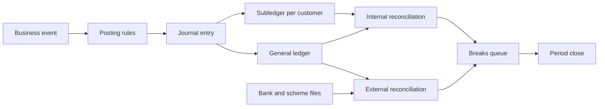

# Accounting for testers

Every payment product is, underneath, a ledger: a record of who owes whom how much. This page
builds the accounting a tester needs from zero — debit and credit, the chart of accounts of an
e-money institution, posting rules, period close, reconciliation, FX, rounding and
safeguarding — so that you can test a payment ledger and recognise when money "disappears".

## How it works

### Double-entry bookkeeping in five rules

1. **Account** — a named bucket in the ledger (for example "Customer funds" or "Fee income").
   It is not the same as a customer's bank account; a ledger has many internal accounts.
2. **Entry (posting)** — one line that changes one account: account, amount, currency, side.
   The side is **debit (Dr)** or **credit (Cr)**. These are just "left" and "right"; they do not
   mean "good" or "bad".
3. **Journal entry (transaction)** — a group of ≥ 2 entries that describe one business event.
   Money never appears from nowhere: if one account goes up, another account must explain why.
4. **Balancing rule** — in each journal entry, total debits = total credits, per currency.
   If we write debits as positive and credits as negative numbers, **the sum of the entries is
   zero**. This is the first invariant to test.
5. **Account balance** — the sum of all entries ever posted to the account. A stored "balance"
   column is only a cache of that sum. Second invariant: **balance = sum of postings**.

### Which side increases which account

Accounts belong to five types (the IFRS Conceptual Framework defines the elements assets,
liabilities, equity, income and expenses):

| Type | What it is | Increases with | Example for a wallet company |
|---|---|---|---|
| Asset | What the company has or is owed | Debit | Money in its bank accounts |
| Liability | What the company owes to others | Credit | E-money it owes its customers |
| Equity | Owners' stake | Credit | Share capital |
| Income | Earnings | Credit | Card payment fees |
| Expense | Costs | Debit | Scheme fees, FX losses |

Assets and expenses are **debit-normal**; liabilities, equity and income are **credit-normal**.

### The confusing part: whose point of view?

On your bank statement, a deposit is shown as a "credit" and feels like *your* asset. That is
correct — **from the customer's side**. The bank or e-money institution keeps **its own**
books, and in its books your EUR 200.00 is money it **owes you**: a **liability**. So the same
top-up is:

- for the customer: my asset grew;
- for the institution: its bank account (asset) grew by EUR 200.00 — **debit** — and its debt
  to the customer (liability) grew by EUR 200.00 — **credit**.

When the institution "credits your account", it increases its liability to you. The statement
the customer sees is a view of the institution's liability account, which is why a top-up is a
"credit" on it. In this page all postings are **from the institution's point of view**.

### Chart of accounts of a small e-money / payment institution

A **chart of accounts** is the list of all ledger accounts. The numbers below are illustrative;
every company designs its own.

| No. | Account | Type | What it holds |
|---|---|---|---|
| 1010 | Safeguarding bank account EUR | Asset | Customer money held at a bank, kept apart from company money |
| 1020 | Operating bank account EUR | Asset | The company's own money |
| 1300 | Chargeback receivable | Asset | Money the card scheme is expected to return after a dispute |
| 1500 | FX position (one per currency) | Technical (asset or liability) | Links the two currencies of a conversion; its result is revalued at period end |
| 1900 | Suspense / transit | Asset or liability | Money in flight or not yet identified; must be empty at close |
| 2100 | Customer e-money accounts | Liability | Control account: total owed to all customers |
| 2200 | Scheme settlement payable | Liability | Card payments approved, not yet paid to the scheme |
| 4000 | Fee income | Income | Commission charged to customers |
| 5100 | FX gains and losses | Expense or income | Revaluation results |
| 5200 | Rounding differences | Expense or income | Cents left by rounding |

### General ledger and subledgers

The **general ledger (GL)** holds the accounts above, with totals. It does not know Anna or Ben.
The **subledger** holds detail — one balance per customer wallet. Account 2100 in the GL is a
**control account**: its balance must equal the sum of all customer balances in the subledger.
Checking that is **internal reconciliation**.

### Posting rules with worked examples

A **posting rule** maps a business event to journal entries. Below: customer Anna, EUR wallet,
fee 1 % of the payment amount, rounded half-up to cents, minimum EUR 0.50 (the card-wallet rule).
Dr is shown as `+`, Cr as `−`.

**1. Top-up** — Mon 2 Nov 2026, 09:12. Anna sends EUR 200.00 by bank transfer; it arrives on the
safeguarding account.

| Account | Dr | Cr |
|---|---|---|
| 1010 Safeguarding bank | +200.00 | |
| 2100 Customer — Anna | | −200.00 |
| **Sum** | | **0.00** |

**2. Card payment with fee** — Mon 2 Nov, 14:05. Anna pays EUR 100.00 at a shop. Fee = 1 % of
100.00 = 1.00 (above the 0.50 minimum).

| Account | Dr | Cr |
|---|---|---|
| 2100 Customer — Anna | +101.00 | |
| 2200 Scheme settlement payable | | −100.00 |
| 4000 Fee income | | −1.00 |
| **Sum** | | **0.00** |

A payment of EUR 10.00 gives 1 % = 0.10, so the minimum applies: Dr Customer 10.50, Cr Scheme
10.00, Cr Fee income 0.50.

**3. Settlement with the scheme** — Tue 3 Nov. The institution pays the scheme EUR 100.00 from
the safeguarding account and moves its earned fee to its own account (fee income is company
money and should not stay mixed with customer money).

| Account | Dr | Cr |
|---|---|---|
| 2200 Scheme settlement payable | +100.00 | |
| 1010 Safeguarding bank | | −100.00 |
| 1020 Operating bank | +1.00 | |
| 1010 Safeguarding bank | | −1.00 |
| **Sum** | | **0.00** |

**4. Refund** — Thu 5 Nov. The shop refunds EUR 100.00. A refund is a **new** transaction,
linked to the original; it does not edit it. Whether the fee is returned is a product rule;
here it is kept.

| Account | Dr | Cr |
|---|---|---|
| 2200 Scheme settlement payable | +100.00 | |
| 2100 Customer — Anna | | −100.00 |
| **Sum** | | **0.00** |

The scheme pays the refund money during a later settlement: Dr 1010, Cr 2200.

**5. Chargeback** — Anna disputes another EUR 100.00 payment (fee 1.00). If the product gives a
provisional credit while the dispute runs (rules differ by scheme and product), the issuer posts:

| Account | Dr | Cr |
|---|---|---|
| 1300 Chargeback receivable | +100.00 | |
| 2100 Customer — Anna | | −100.00 |
| **Sum** | | **0.00** |

If the dispute is won, the scheme pays: Dr 1010, Cr 1300. If it is lost, the provisional credit
is reversed: Dr 2100, Cr 1300.

**6. Reversal of an error** — a technical retry posted payment 2 twice. The fix is a **reversing
entry**: the exact mirror of the wrong one, with a reference to it.

| Account | Dr | Cr |
|---|---|---|
| 2200 Scheme settlement payable | +100.00 | |
| 4000 Fee income | +1.00 | |
| 2100 Customer — Anna | | −101.00 |
| **Sum** | | **0.00** |

**Reversal symmetry:** original + reversal = 0 on every account. Note: a card *authorisation*
reversal (area 01) usually only releases a hold on the available balance; in many designs a
hold is not a GL posting at all.

### Immutability

Posted entries are never updated or deleted. Corrections are new entries (reversal, then a
correct posting). This keeps an audit trail and makes a closed period reproducible.

### Booking date, value date, cut-off and close

- **Booking date** — when the entry is recorded. **Value date** — when the money actually
  counts (for example, when it settles at the bank). A payment booked on Fri 30 Oct can have a
  value date of Mon 2 Nov.
- **Cut-off** — the moment that separates "today" from "tomorrow" for posting. It must be
  defined in one time zone. A payment at 00:30 CET on Tue 1 Dec 2026 is 23:30 UTC on Mon 30 Nov:
  November or December depends on the rule, and both reports must use the same one.
- **End of day (EOD)** — accruals, fee batches, reconciliations, balance snapshots.
- **End of month (EOM)** — EOD plus revaluation, suspense review, a trial balance (all debits =
  all credits), then the period is **locked**; late items are posted in the open period.

### Reconciliation

- **Internal**: GL control account 2100 = sum of customer subledger balances; GL account
  = sum of its postings.
- **External**: GL 1010 vs the safeguarding bank statement; GL 2200 vs the card scheme
  settlement report; customer top-ups vs incoming bank transfers.
- A **break** is an unmatched or unequal item. Typical causes: timing (the bank books it
  tomorrow), missing or duplicate postings, wrong amount, wrong account. Each break gets an
  owner, an age and a reason; unidentified money sits in suspense 1900 until explained.

### FX: several currencies

Each journal entry must balance **in each currency**. Anna converts EUR 100.00 to USD at an
illustrative customer rate of 1 EUR = 1.0800 USD:

| Account | Currency | Dr | Cr |
|---|---|---|---|
| 2100 Customer — Anna EUR | EUR | +100.00 | |
| 1500 FX position EUR | EUR | | −100.00 |
| 1500 FX position USD | USD | +108.00 | |
| 2100 Customer — Anna USD | USD | | −108.00 |

At the end of each reporting period, foreign-currency monetary items (cash, receivables,
payables) are translated at the closing rate (IAS 21, paragraph 23). Example: the company owns
USD 1,080.00 booked as EUR 1,000.00 (at 1.0800); at a closing rate of 1 EUR = 1.1000 USD it is
worth 1,080.00 / 1.1000 = EUR 981.82, so the revaluation entry is Dr 5100 FX loss 18.18, Cr the
USD asset account 18.18 (in EUR).

### Rounding

Rounding happens at fee calculation, FX conversion, splitting amounts, and interest. Each
rounding loses or gains up to half a cent, and over many operations cents drift. Example with a
1 % fee and no minimum: 100 payments of EUR 1.25 give 0.0125 → 0.01 each, EUR 1.00 total; 1 % of
the daily total 125.00 is EUR 1.25. If the fee report uses one method and the ledger the other,
they differ by EUR 0.25. The rule: decide *where* rounding happens, post leftovers to a rounding
account, and never let a journal entry be "almost" balanced.

### Safeguarding

E-money and payment institutions must protect customer funds. In the EU, PSD2 Article 10 lets a
payment institution either segregate the funds (never mix them with other money; funds still held
at the end of the business day after receipt go to a separate account at a credit institution
or into secure, liquid, low-risk assets defined by the competent authority; the funds are
shielded from other creditors, especially in insolvency) or cover them with an insurance policy
or comparable guarantee from an insurer or credit institution outside the group. EMD2 Article 7
applies these safeguarding rules to funds received for issued e-money (it refers to PSD1
Article 9; references to PSD1 are now read as references to PSD2). Funds paid by a payment
instrument such as a card need not be safeguarded until they reach the institution's payment
account, but no later than five business days after the e-money is issued. National rules and regulators differ: for example, the UK FCA
requires internal and external safeguarding reconciliations at least once each reconciliation
day. For testers this means account 1010 must always cover account 2100.

## Participants and money flows

| Participant | Role | Sends / receives and when | Who carries the risk |
|---|---|---|---|
| Customer | Holds e-money | Sends top-ups; receives refunds and chargeback credits | Customer, if funds are not safeguarded and the firm fails |
| E-money institution | Owns the ledger and the posting rules | Posts every event in real time; pays the scheme at settlement; keeps fees | The institution — every unbalanced or missing posting is its loss |
| Safeguarding bank | Holds customer money | Receives top-ups; pays settlements; sends daily statements | The institution, until the statement is reconciled |
| Card scheme / settlement bank | Clears and settles card payments | Sends settlement reports; nets payments, refunds and chargebacks | The institution between authorisation and settlement |
| Merchant and acquirer | Other side of card payments | Receive payment; send refunds; answer disputes | The merchant for lost chargebacks |
| Finance / reconciliation team | Closes periods, handles breaks | Works the breaks queue daily and at month end | Operational risk if breaks age |
| Auditor and regulator | Check books and safeguarding | Receive reports, reconciliations, audit trail | — |

## Business risks

**Company**
- Unbalanced or missing postings: money paid to the scheme with no matching customer debit is a
  direct loss.
- Fee not charged or wrong minimum (as in BUG-01): small loss per payment, large in total.
- Breaks found late: older items are harder to recover from banks and schemes.
- FX revaluation wrong or missing: wrong profit and loss in reports.

**Customer**
- Wrong balance shown: double debit, missing refund, chargeback credit not reversed or reversed
  twice.
- Statement does not match the account history after a correction was made by editing rows.

**Regulator / compliance**
- Safeguarding shortfall (1010 less than 2100) or late reconciliation: a breach of
  safeguarding rules.
- No audit trail because entries were edited or deleted.
- Reports for a closed period change after the close.

## What to test

- [ ] Every journal entry has ≥ 2 entries and sums to zero per currency.
- [ ] Account balance equals the sum of its postings, for every account.
- [ ] GL control account 2100 equals the sum of customer subledger balances.
- [ ] Each event type (top-up, payment, fee, refund, chargeback, reversal) maps to the documented accounts and sides.
- [ ] Fee: 1 %, half-up rounding, 0.50 minimum, posted to fee income, not lost.
- [ ] Posting is idempotent: the same event ID or idempotency key never posts twice.
- [ ] Reversal is the exact mirror of the original and references it; original + reversal = 0.
- [ ] Posted entries cannot be updated or deleted (API and database permissions).
- [ ] Declined operations create no postings.
- [ ] No negative balance on accounts where it is not allowed (customer wallets).
- [ ] Cut-off uses one documented time zone; booking date and value date are stored separately.
- [ ] A closed period cannot be posted into; late items go to the open period.
- [ ] Internal and external reconciliations detect injected breaks (missing, duplicate, amount, timing).
- [ ] Suspense account is empty or explained at close.
- [ ] Multi-currency entries balance per currency; revaluation uses the closing rate.
- [ ] Rounding leftovers go to a rounding account; totals of reports match the ledger.
- [ ] Safeguarding: funds in 1010 ≥ customer liabilities 2100 at each reconciliation point.

| ID | Condition / steps | Expected result |
|---|---|---|
| AC-01 | Card payment EUR 100.00 | Entries: Dr 2100 101.00, Cr 2200 100.00, Cr 4000 1.00; sum 0.00 |
| AC-02 | Card payment EUR 10.00 (1 % is below the minimum) | Fee 0.50, not 0.10; Dr 2100 10.50 |
| AC-03 | Payment declined for insufficient funds | No entries; balances unchanged |
| AC-04 | Send the same payment twice in parallel with one idempotency key | One journal entry; second call returns the first result |
| AC-05 | Reverse the payment from AC-01 | Mirror entry linked to the original; every account nets to 0.00; original row unchanged |
| AC-06 | Try `UPDATE` / `DELETE` on a posted entry | Rejected; audit log records the attempt |
| AC-07 | Payment at 00:30 CET on 1 Dec 2026 (23:30 UTC on 30 Nov) | Falls into the period defined by the documented cut-off; GL and statement agree |
| AC-08 | Post into November after the November close | Rejected or posted with December booking date |
| AC-09 | Remove one line from the scheme settlement file and run external reconciliation | One break with amount, reference and age; nothing silently auto-matched |
| AC-10 | 100 payments of EUR 1.25 with a 1 % fee and no minimum | Fee total in reports = fee income in GL; rounding difference, if any, posted to 5200 |

## Typical defects

- **Fee posted to the customer but not to fee income.** Catch: sum of entries per journal ≠ 0;
  run a nightly SQL check over all journals.
- **Minimum fee not applied** — card-wallet
  [BUG-01](https://github.com/Tomullya/card-wallet/blob/main/docs/qa/bug-reports/BUG-01.md).
  Catch: boundary tests at 49.49, 50.49 and 50.50 (expected fee 0.50, 0.50, 0.51).
- **Retry posts twice.** Catch: concurrency test with one idempotency key; count journals per
  event ID.
- **Correction made by editing a row.** Catch: database permissions test; compare snapshots of
  a closed period before and after.
- **Reversal not symmetric** (fee or currency forgotten). Catch: for each reversal, assert
  original + reversal = 0 per account and currency.
- **Cut-off in two time zones** — GL in UTC, statement in local time. Catch: transactions
  around midnight on the last day of the month.
- **Rounding drift** between fee report and GL. Catch: compare totals over many small payments.
- **Suspense account never cleared.** Catch: alert on items older than the agreed age.

## In card-wallet

[card-wallet](https://github.com/Tomullya/card-wallet) is a simplified demo and **not a
double-entry ledger**. What it has:

- [wallet-api/app/models.py](https://github.com/Tomullya/card-wallet/blob/main/wallet-api/app/models.py)
  — one `transactions` table (each row belongs to an account) with types `TOP_UP`, `PAYMENT`,
  `COMMISSION` and status `APPROVED` / `DECLINED`; a stored `balance` on the account; `parent_id` links the commission to its payment.
- [wallet-api/app/services/payments.py](https://github.com/Tomullya/card-wallet/blob/main/wallet-api/app/services/payments.py)
  — the commission is saved as a **separate transaction**; the balance changes in the same
  database transaction together with the idempotency record; declined payments are saved as
  `DECLINED` rows but change no balance.
- [wallet-api/app/services/money.py](https://github.com/Tomullya/card-wallet/blob/main/wallet-api/app/services/money.py)
  — `Decimal`, half-up rounding, 1 % with a 0.50 minimum
  ([BR-PAY-03](https://github.com/Tomullya/card-wallet/blob/main/docs/requirements/BR-payments.md),
  [NFR-01](https://github.com/Tomullya/card-wallet/blob/main/docs/requirements/NFR.md)).
- [tests/db/test_balance_consistency.py](https://github.com/Tomullya/card-wallet/blob/main/tests/db/test_balance_consistency.py)
  — the invariant "balance = sum of approved transactions" checked in SQL
  ([BR-STM-04](https://github.com/Tomullya/card-wallet/blob/main/docs/requirements/BR-statement.md)).
- [BUG-01](https://github.com/Tomullya/card-wallet/blob/main/docs/qa/bug-reports/BUG-01.md) —
  minimum commission not applied.

What is missing: every transaction touches only the customer's account (single entry), so there
is no counter-account for fee income or the scheme; no refunds, chargebacks or reversals; no
period close. Could be added:

- a mini general ledger: `journal_entries` and `postings` tables with signed amounts and a
  database check that each journal sums to zero; payment = 3 postings;
- a reconciliation job comparing the GL control account with the sum of wallet balances and
  with a fake bank statement CSV, writing breaks to a table;
- a reversal endpoint that creates a mirror journal linked to the original;
- an EOD job with a UTC cut-off and a closed-period lock.

## Sources

- [IFRS Foundation — Conceptual Framework for Financial Reporting](https://www.ifrs.org/issued-standards/list-of-standards/conceptual-framework/)
  — defines the elements assets, liabilities, equity, income and expenses.
- [IFRS Foundation — IAS 21 The Effects of Changes in Foreign Exchange Rates](https://www.ifrs.org/issued-standards/list-of-standards/ias-21-the-effects-of-changes-in-foreign-exchange-rates/)
  — accounting for foreign currency transactions and period-end exchange rates.
- [IFRS Foundation — staff paper on foreign currency accounting (2011)](https://www.ifrs.org/content/dam/ifrs/meetings/2011/december/eeg/ap1d-111208-eeg-foreign-currency-accounting.pdf)
  — quotes IAS 21.23(a): at the end of each reporting period, foreign currency monetary items are translated at the closing rate.
- [EUR-Lex — Directive (EU) 2015/2366 (PSD2)](https://eur-lex.europa.eu/eli/dir/2015/2366/oj)
  — Article 10: safeguarding methods and insolvency protection.
- [EUR-Lex — Directive 2009/110/EC (EMD2)](https://eur-lex.europa.eu/eli/dir/2009/110/oj)
  — Article 7(1): safeguarding of funds received for e-money; funds paid by payment instrument safeguarded no later than five business days after issuance.
- [FCA — Safeguarding requirements for payment and e-money institutions](https://www.fca.org.uk/firms/emi-payment-institutions-safeguarding-requirements)
  — UK example: segregation or insurance, internal and external reconciliations each reconciliation day.
- [OpenStax — Principles of Accounting, Vol. 1, section 3.1](https://openstax.org/books/principles-financial-accounting/pages/3-1-describe-principles-assumptions-and-concepts-of-accounting-and-their-relationship-to-financial-statements)
  — open textbook (Rice University): debits and credits, normal balance of each account type.
- [Stripe Docs — Balance summary report](https://docs.stripe.com/reports/balance)
  — a PSP report used to reconcile a balance at month end like a bank statement.
