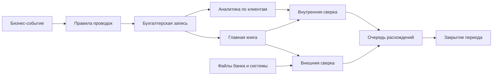

# Учёт для тестировщиков

Любой платёжный продукт внутри — это учётная книга, или леджер (ledger): запись о том, кто кому сколько должен.
Эта страница с нуля объясняет учёт, который нужен тестировщику: дебет и кредит, план счетов
эмитента электронных денег, правила проводок, закрытие периода, сверку, валюту, округление и
защиту средств клиентов (safeguarding) — чтобы тестировать платёжный леджер и замечать, когда
деньги «пропадают».

## Как это работает

### Двойная запись в пяти правилах

1. **Счёт (account)** — именованная «корзина» в леджере (например, «Средства клиентов» или
   «Комиссионный доход»). Это не банковский счёт клиента: во внутреннем леджере много
   технических счетов.
2. **Проводка (entry, posting)** — одна строка, меняющая один счёт: счёт, сумма, валюта,
   сторона. Сторона — **дебет (debit, Dr)** или **кредит (credit, Cr)**. Это просто «лево» и
   «право», а не «хорошо» и «плохо».
3. **Бухгалтерская запись (journal entry)** — группа из ≥ 2 проводок, описывающая одно бизнес-
   событие. Деньги не берутся из ниоткуда: если один счёт вырос, другой счёт объясняет почему.
4. **Правило баланса** — в каждой записи сумма дебетов = сумме кредитов, отдельно по каждой
   валюте. Если писать дебет как плюс, а кредит как минус, **сумма проводок равна нулю**. Это
   первый инвариант для тестов.
5. **Остаток счёта (balance)** — сумма всех проводок по счёту за всё время. Хранимая колонка
   `balance` — лишь кэш этой суммы. Второй инвариант: **остаток = сумма проводок**.

### Какая сторона увеличивает какой счёт

Счета бывают пяти типов (элементы — активы, обязательства, капитал, доходы и расходы —
определены в Концептуальных основах МСФО, IFRS Conceptual Framework):

| Тип | Что это | Растёт по | Пример для кошелька |
|---|---|---|---|
| Актив (asset) | Что у компании есть или что ей должны | Дебету | Деньги на её банковских счетах |
| Обязательство (liability) | Что компания должна другим | Кредиту | Электронные деньги, которые она должна клиентам |
| Капитал (equity) | Доля владельцев | Кредиту | Уставный капитал |
| Доход (income) | Заработок | Кредиту | Комиссии за оплату картой |
| Расход (expense) | Затраты | Дебету | Сборы платёжной системы, курсовые убытки |

Активы и расходы — **дебетовые по природе (debit-normal)**; обязательства, капитал и доходы —
**кредитовые (credit-normal)**.

### Самое запутанное: с чьей точки зрения?

В выписке клиента пополнение показано как «кредит» и ощущается как *ваш* актив. Это верно —
**со стороны клиента**. Но банк или эмитент электронных денег ведёт **свои** книги, и в них
ваши EUR 200.00 — это деньги, которые он **вам должен**, то есть **обязательство**. Одно и то же
пополнение:

- для клиента: мой актив вырос;
- для компании: её банковский счёт (актив) вырос на EUR 200.00 — **дебет**, и её долг перед
  клиентом (обязательство) вырос на EUR 200.00 — **кредит**.

Когда компания «кредитует ваш счёт», она увеличивает своё обязательство перед вами. Выписка,
которую видит клиент, — это вид на счёт обязательства компании, поэтому пополнение в ней
«кредит». На этой странице все проводки — **с точки зрения компании**.

### План счетов небольшого эмитента электронных денег / платёжного института

**План счетов (chart of accounts)** — список всех счетов леджера. Номера ниже условные; каждая
компания строит свой.

| № | Счёт | Тип | Что на нём |
|---|---|---|---|
| 1010 | Защищённый банковский счёт EUR (safeguarding account) | Актив | Деньги клиентов в банке, отдельно от денег компании |
| 1020 | Операционный банковский счёт EUR | Актив | Собственные деньги компании |
| 1300 | Дебиторская задолженность по чарджбэкам (chargeback receivable) | Актив | Деньги, которые платёжная система должна вернуть после спора |
| 1500 | Валютная позиция (FX position, по одной на валюту) | Технический (актив или обязательство) | Связывает две валюты обмена; её результат переоценивается на конец периода |
| 1900 | Счёт невыясненных / транзитных сумм (suspense / transit) | Актив или обязательство | Деньги «в пути» или не опознанные; к закрытию должен быть пуст |
| 2100 | Счета электронных денег клиентов | Обязательство | Контрольный счёт: сколько всего должны всем клиентам |
| 2200 | Расчёты с платёжной системой (scheme settlement payable) | Обязательство | Одобренные оплаты картой, ещё не перечисленные системе |
| 4000 | Комиссионный доход (fee income) | Доход | Комиссии с клиентов |
| 5100 | Курсовые разницы (FX gains and losses) | Расход или доход | Результат переоценки |
| 5200 | Разницы округления | Расход или доход | Центы, оставшиеся от округлений |

### Главная книга и аналитический учёт

**Главная книга (general ledger, GL)** хранит счета выше с итогами. Она не знает Анну или
Бена. **Аналитический учёт (субсчета, subledger)** хранит детали — остаток по каждому кошельку клиента. Счёт 2100
в GL — **контрольный счёт (control account)**: его остаток должен равняться сумме остатков
всех клиентов в аналитическом учёте. Проверка этого — **внутренняя сверка**.

### Правила проводок на примерах

**Правило проводок (posting rule)** превращает бизнес-событие в бухгалтерскую запись. Ниже:
клиентка Анна, кошелёк в EUR, комиссия 1 % от суммы оплаты, округление half-up до центов,
минимум EUR 0.50 (правило из card-wallet). Дебет — `+`, кредит — `−`.

**1. Пополнение (top-up)** — пн, 2 ноября 2026, 09:12. Анна отправляет EUR 200.00 банковским
переводом; деньги приходят на защищённый счёт.

| Счёт | Дт | Кт |
|---|---|---|
| 1010 Защищённый счёт | +200.00 | |
| 2100 Клиент — Анна | | −200.00 |
| **Сумма** | | **0.00** |

**2. Оплата картой с комиссией** — пн, 2 ноября, 14:05. Анна платит EUR 100.00 в магазине.
Комиссия = 1 % от 100.00 = 1.00 (больше минимума 0.50).

| Счёт | Дт | Кт |
|---|---|---|
| 2100 Клиент — Анна | +101.00 | |
| 2200 Расчёты с платёжной системой | | −100.00 |
| 4000 Комиссионный доход | | −1.00 |
| **Сумма** | | **0.00** |

Оплата EUR 10.00 даёт 1 % = 0.10, поэтому применяется минимум: Дт Клиент 10.50, Кт Система
10.00, Кт Комиссионный доход 0.50.

**3. Расчёт с платёжной системой (settlement)** — вт, 3 ноября. Компания перечисляет системе
EUR 100.00 с защищённого счёта и переводит заработанную комиссию на свой счёт (комиссия —
деньги компании, их нельзя держать вперемешку с деньгами клиентов).

| Счёт | Дт | Кт |
|---|---|---|
| 2200 Расчёты с платёжной системой | +100.00 | |
| 1010 Защищённый счёт | | −100.00 |
| 1020 Операционный счёт | +1.00 | |
| 1010 Защищённый счёт | | −1.00 |
| **Сумма** | | **0.00** |

**4. Возврат платежа (refund)** — чт, 5 ноября. Магазин возвращает EUR 100.00. Возврат — это
**новая** операция со ссылкой на исходную; исходная не редактируется. Возвращать ли комиссию —
продуктовое правило; здесь она остаётся у компании.

| Счёт | Дт | Кт |
|---|---|---|
| 2200 Расчёты с платёжной системой | +100.00 | |
| 2100 Клиент — Анна | | −100.00 |
| **Сумма** | | **0.00** |

Деньги по возврату система перечисляет при одном из следующих расчётов: Дт 1010, Кт 2200.

**5. Чарджбэк (chargeback)** — Анна оспаривает другую оплату EUR 100.00 (комиссия 1.00). Если
продукт даёт предварительное зачисление на время спора (правила различаются по платёжным
системам и продуктам), эмитент проводит:

| Счёт | Дт | Кт |
|---|---|---|
| 1300 Дебиторская задолженность по чарджбэкам | +100.00 | |
| 2100 Клиент — Анна | | −100.00 |
| **Сумма** | | **0.00** |

Если спор выигран, система платит: Дт 1010, Кт 1300. Если проигран, предварительное зачисление
сторнируется: Дт 2100, Кт 1300.

**6. Сторно ошибки (reversal)** — из-за технического повтора оплата 2 проведена дважды.
Исправление — **сторнирующая запись**: точное зеркало ошибочной, со ссылкой на неё.

| Счёт | Дт | Кт |
|---|---|---|
| 2200 Расчёты с платёжной системой | +100.00 | |
| 4000 Комиссионный доход | +1.00 | |
| 2100 Клиент — Анна | | −101.00 |
| **Сумма** | | **0.00** |

**Симметрия сторно:** исходная запись + сторно = 0 по каждому счёту. Важно: отмена
*авторизации* по карте (authorisation reversal, область 01) обычно лишь снимает холд с
доступного остатка; во многих системах холд вообще не является проводкой в GL.

### Неизменяемость (immutability)

Проведённые записи никогда не изменяются и не удаляются. Исправления — новые записи (сторно,
затем верная проводка). Так сохраняется аудиторский след (audit trail), а закрытый период можно
воспроизвести.

### Дата проводки, дата валютирования, отсечка и закрытие

- **Дата проводки (booking date)** — когда запись сделана. **Дата валютирования (value date)** —
  когда деньги реально «считаются» (например, когда прошёл расчёт в банке). Оплата, проведённая
  в пт 30 октября, может иметь дату валютирования пн 2 ноября.
- **Отсечка (cut-off)** — момент, отделяющий «сегодня» от «завтра» для проводок. Она должна
  быть задана в одном часовом поясе. Оплата в 00:30 CET во вт 1 декабря 2026 — это 23:30 UTC
  в пн 30 ноября: ноябрь это или декабрь, зависит от правила, и все отчёты должны использовать
  одно и то же.
- **Закрытие дня (end of day, EOD)** — начисления, пакеты комиссий, сверки, снимки остатков.
- **Закрытие месяца (end of month, EOM)** — EOD плюс переоценка, разбор счёта невыясненных
  сумм, оборотно-сальдовая ведомость (trial balance: все дебеты = все кредиты), затем период
  **блокируется**; опоздавшие операции проводятся в открытом периоде.

### Сверка (reconciliation)

- **Внутренняя**: контрольный счёт GL 2100 = сумма остатков клиентов в аналитическом учёте; остаток
  счёта GL = сумма его проводок.
- **Внешняя**: GL 1010 против выписки банка по защищённому счёту; GL 2200 против отчёта о
  расчётах платёжной системы (settlement report); пополнения клиентов против входящих переводов.
- **Расхождение (break)** — несопоставленная или неравная позиция. Типичные причины: время
  (банк проведёт завтра), пропущенная или задвоенная проводка, неверная сумма, неверный счёт.
  У каждого расхождения есть ответственный, возраст и причина; неопознанные деньги лежат на
  счёте невыясненных сумм 1900, пока их не объяснят.

### Валюта: несколько валют

Каждая бухгалтерская запись должна сходиться **в каждой валюте отдельно**. Анна меняет EUR
100.00 на USD по условному клиентскому курсу 1 EUR = 1.0800 USD:

| Счёт | Валюта | Дт | Кт |
|---|---|---|---|
| 2100 Клиент — Анна EUR | EUR | +100.00 | |
| 1500 Валютная позиция EUR | EUR | | −100.00 |
| 1500 Валютная позиция USD | USD | +108.00 | |
| 2100 Клиент — Анна USD | USD | | −108.00 |

На конец каждого отчётного периода монетарные статьи в иностранной валюте (денежные средства,
дебиторская и кредиторская задолженность) пересчитываются по курсу на отчётную дату (closing
rate, МСФО (IAS) 21, пункт 23). Пример: у компании есть собственные USD 1,080.00, учтённые как
EUR 1,000.00 (по 1.0800); по курсу на конец периода 1 EUR = 1.1000 USD они стоят
1,080.00 / 1.1000 = EUR 981.82, и запись переоценки (revaluation): Дт 5100 курсовой убыток
18.18, Кт счёт актива в USD 18.18 (в EUR).

### Округление

Округление происходит при расчёте комиссии, конвертации валют, делении сумм и начислении
процентов. Каждое округление теряет или добавляет до полуцента, и на множестве операций центы
«уплывают». Пример с комиссией 1 % без минимума: 100 оплат по EUR 1.25 дают 0.0125 → 0.01
каждая, итого EUR 1.00; а 1 % от дневного итога 125.00 — EUR 1.25. Если отчёт по комиссиям
считает одним способом, а леджер другим, разница EUR 0.25. Правило: решить, *где* происходит
округление, относить остатки на счёт разниц округления и никогда не допускать «почти»
сбалансированную запись.

### Защита средств клиентов (safeguarding)

Эмитенты электронных денег и платёжные институты обязаны защищать средства клиентов. В ЕС
статья 10 PSD2 разрешает платёжному институту либо обособить средства (никогда не смешивать их с
другими деньгами; средства, остающиеся у него к концу рабочего дня, следующего за днём
получения, — на отдельный счёт в кредитной организации или в надёжные ликвидные низкорисковые
активы, определённые компетентным органом; средства ограждены от требований других
кредиторов, особенно при банкротстве), либо покрыть их страховым полисом или сопоставимой
гарантией страховщика или кредитной организации вне группы. Статья 7 EMD2 применяет эти
правила к средствам, полученным за выпущенные электронные деньги (она ссылается на статью 9
PSD1; ссылки на PSD1 теперь читаются как ссылки на PSD2). Средства, оплаченные платёжным
инструментом, например картой, можно не защищать, пока они не поступили на платёжный счёт
учреждения, но не позднее пяти рабочих дней после выпуска электронных денег. Национальные
правила и регуляторы различаются: например, британский FCA требует внутренней и внешней сверки
защищённых средств как минимум раз в каждый день сверки. Для тестировщика это значит: счёт 1010
всегда должен покрывать счёт 2100.

## Участники и потоки денег

| Участник | Роль | Что отправляет / получает и когда | Кто несёт риск |
|---|---|---|---|
| Клиент | Держит электронные деньги | Отправляет пополнения; получает возвраты и зачисления по чарджбэкам | Клиент — если средства не защищены, а компания обанкротилась |
| Эмитент электронных денег | Владеет леджером и правилами проводок | Проводит каждое событие в реальном времени; платит системе при расчёте; оставляет себе комиссии | Компания — каждая несбалансированная или пропущенная проводка — её убыток |
| Банк защищённого счёта | Хранит деньги клиентов | Получает пополнения; проводит расчёты; присылает ежедневные выписки | Компания — пока выписка не сверена |
| Платёжная система / расчётный банк | Клиринг и расчёты по картам | Присылает отчёты о расчётах; неттирует оплаты, возвраты и чарджбэки | Компания — между авторизацией и расчётом |
| Мерчант и эквайер | Другая сторона оплаты картой | Получают оплату; отправляют возвраты; отвечают на споры | Мерчант — по проигранным чарджбэкам |
| Финансы / команда сверки | Закрывают периоды, разбирают расхождения | Работают с очередью расхождений ежедневно и на конец месяца | Операционный риск, если расхождения «стареют» |
| Аудитор и регулятор | Проверяют учёт и защиту средств | Получают отчёты, сверки, аудиторский след | — |

## Бизнес-риски

**Компания**
- Несбалансированные или пропущенные проводки: деньги ушли системе без соответствующего
  списания с клиента — прямой убыток.
- Комиссия не взята или неверный минимум (как в BUG-01): маленький убыток на каждой оплате,
  большой в сумме.
- Расхождения найдены поздно: старые позиции труднее вернуть от банков и систем.
- Переоценка валют неверна или не сделана: неверная прибыль и убыток в отчётах.

**Клиент**
- Неверный остаток: двойное списание, потерянный возврат, зачисление по чарджбэку не
  сторнировано или сторнировано дважды.
- Выписка не совпадает с историей счёта после исправления «правкой строк».

**Регулятор / комплаенс**
- Недостача защищённых средств (1010 меньше 2100) или сверка не вовремя — нарушение правил
  safeguarding.
- Нет аудиторского следа, потому что записи правили или удаляли.
- Отчёты за закрытый период меняются после закрытия.

## Что тестировать

- [ ] Каждая бухгалтерская запись содержит ≥ 2 проводки и в сумме даёт ноль по каждой валюте.
- [ ] Остаток каждого счёта равен сумме его проводок.
- [ ] Контрольный счёт GL 2100 равен сумме остатков клиентов в аналитическом учёте.
- [ ] Каждый тип события (пополнение, оплата, комиссия, возврат, чарджбэк, сторно) попадает на задокументированные счета и стороны.
- [ ] Комиссия: 1 %, округление half-up, минимум 0.50, проведена в комиссионный доход и не потеряна.
- [ ] Проведение идемпотентно: одно и то же событие или ключ идемпотентности (idempotency key) никогда не проводится дважды.
- [ ] Сторно — точное зеркало исходной записи и ссылается на неё; исходная + сторно = 0.
- [ ] Проведённые записи нельзя изменить или удалить (через API и права в базе данных).
- [ ] Отклонённые операции не создают проводок.
- [ ] Нет отрицательных остатков там, где они запрещены (кошельки клиентов).
- [ ] Отсечка в одном задокументированном часовом поясе; дата проводки и дата валютирования хранятся отдельно.
- [ ] В закрытый период нельзя провести запись; опоздавшие операции идут в открытый период.
- [ ] Внутренняя и внешняя сверка находят внедрённые расхождения (пропуск, дубль, сумма, время).
- [ ] Счёт невыясненных сумм к закрытию пуст или каждая позиция объяснена.
- [ ] Мультивалютные записи сходятся по каждой валюте; переоценка — по курсу на конец периода.
- [ ] Остатки округления идут на счёт разниц округления; итоги отчётов совпадают с леджером.
- [ ] Safeguarding: средства на 1010 ≥ обязательств перед клиентами 2100 в каждой точке сверки.

| ID | Условие / шаги | Ожидаемый результат |
|---|---|---|
| AC-01 | Оплата картой EUR 100.00 | Проводки: Дт 2100 101.00, Кт 2200 100.00, Кт 4000 1.00; сумма 0.00 |
| AC-02 | Оплата картой EUR 10.00 (1 % меньше минимума) | Комиссия 0.50, а не 0.10; Дт 2100 10.50 |
| AC-03 | Оплата отклонена из-за нехватки средств | Нет проводок; остатки не изменились |
| AC-04 | Одна и та же оплата дважды параллельно с одним ключом идемпотентности | Одна бухгалтерская запись; второй вызов возвращает результат первого |
| AC-05 | Сторно оплаты из AC-01 | Зеркальная запись со ссылкой на исходную; каждый счёт в сумме 0.00; исходная строка не изменена |
| AC-06 | Попытка `UPDATE` / `DELETE` проведённой записи | Отказ; попытка записана в журнал аудита |
| AC-07 | Оплата в 00:30 CET 1 декабря 2026 (23:30 UTC 30 ноября) | Попадает в период по задокументированной отсечке; GL и выписка совпадают |
| AC-08 | Проводка в ноябрь после закрытия ноября | Отказ или проводка с датой декабря |
| AC-09 | Удалить одну строку из файла расчётов платёжной системы и запустить внешнюю сверку | Одно расхождение с суммой, ссылкой и возрастом; ничего не сопоставлено «молча» |
| AC-10 | 100 оплат по EUR 1.25 с комиссией 1 % без минимума | Итог комиссий в отчётах = комиссионный доход в GL; разница округления, если есть, — на 5200 |

## Типичные дефекты

- **Комиссия списана с клиента, но не проведена в доход.** Как поймать: сумма проводок по
  записи ≠ 0; ночная SQL-проверка всех записей.
- **Минимальная комиссия не применяется** — card-wallet
  [BUG-01](https://github.com/Tomullya/card-wallet/blob/main/docs/qa/bug-reports/BUG-01.md).
  Как поймать: граничные тесты на 49.49, 50.49 и 50.50 (ожидаемая комиссия 0.50, 0.50, 0.51).
- **Повтор запроса проводит операцию дважды.** Как поймать: тест конкурентности с одним ключом
  идемпотентности; подсчёт записей на один ID события.
- **Исправление «правкой строки».** Как поймать: тест прав в базе данных; сравнение снимков
  закрытого периода до и после.
- **Несимметричное сторно** (забыта комиссия или валюта). Как поймать: для каждого сторно
  проверять, что исходная + сторно = 0 по каждому счёту и валюте.
- **Отсечка в двух часовых поясах** — GL в UTC, выписка в местном времени. Как поймать:
  операции около полуночи в последний день месяца.
- **«Уплывание» округления** между отчётом по комиссиям и GL. Как поймать: сравнить итоги на
  множестве мелких оплат.
- **Счёт невыясненных сумм никогда не очищается.** Как поймать: алерт на позиции старше
  согласованного срока.

## В card-wallet

[card-wallet](https://github.com/Tomullya/card-wallet) — упрощённое демо и **не леджер с двойной
записью**. Что в нём есть:

- [wallet-api/app/models.py](https://github.com/Tomullya/card-wallet/blob/main/wallet-api/app/models.py)
  — одна таблица `transactions` (каждая строка относится к счёту) с типами `TOP_UP`, `PAYMENT`,
  `COMMISSION` и статусом `APPROVED` / `DECLINED`; хранимый `balance` у счёта; `parent_id` связывает комиссию с её оплатой.
- [wallet-api/app/services/payments.py](https://github.com/Tomullya/card-wallet/blob/main/wallet-api/app/services/payments.py)
  — комиссия сохраняется **отдельной транзакцией**; остаток меняется в той же транзакции базы
  данных, что и запись идемпотентности; отклонённые оплаты сохраняются строками `DECLINED`, но
  остаток не меняют.
- [wallet-api/app/services/money.py](https://github.com/Tomullya/card-wallet/blob/main/wallet-api/app/services/money.py)
  — `Decimal`, округление half-up, 1 % с минимумом 0.50
  ([BR-PAY-03](https://github.com/Tomullya/card-wallet/blob/main/docs/requirements/BR-payments.md),
  [NFR-01](https://github.com/Tomullya/card-wallet/blob/main/docs/requirements/NFR.md)).
- [tests/db/test_balance_consistency.py](https://github.com/Tomullya/card-wallet/blob/main/tests/db/test_balance_consistency.py)
  — инвариант «остаток = сумма одобренных транзакций», проверяемый SQL-запросом
  ([BR-STM-04](https://github.com/Tomullya/card-wallet/blob/main/docs/requirements/BR-statement.md)).
- [BUG-01](https://github.com/Tomullya/card-wallet/blob/main/docs/qa/bug-reports/BUG-01.md) —
  минимальная комиссия не применяется.

Чего нет: каждая транзакция затрагивает только счёт клиента (одинарная запись), поэтому нет
корреспондирующего счёта для комиссионного дохода или платёжной системы; нет возвратов,
чарджбэков и сторно; нет закрытия периода. Можно добавить:

- мини-главную книгу: таблицы `journal_entries` и `postings` со знаковыми суммами и проверкой
  в базе данных, что каждая запись в сумме даёт ноль; оплата = 3 проводки;
- задачу сверки: сравнивать контрольный счёт GL с суммой остатков кошельков и с тестовой
  выпиской банка в CSV, записывать расхождения в таблицу;
- эндпоинт сторно, создающий зеркальную запись со ссылкой на исходную;
- задачу закрытия дня с отсечкой по UTC и блокировкой закрытого периода.

## Источники

- [IFRS Foundation — Conceptual Framework for Financial Reporting](https://www.ifrs.org/issued-standards/list-of-standards/conceptual-framework/)
  — определяет элементы: активы, обязательства, капитал, доходы и расходы.
- [IFRS Foundation — IAS 21 The Effects of Changes in Foreign Exchange Rates](https://www.ifrs.org/issued-standards/list-of-standards/ias-21-the-effects-of-changes-in-foreign-exchange-rates/)
  — учёт операций в иностранной валюте и курсы на конец периода.
- [IFRS Foundation — материал сотрудников о валютном учёте (2011)](https://www.ifrs.org/content/dam/ifrs/meetings/2011/december/eeg/ap1d-111208-eeg-foreign-currency-accounting.pdf)
  — цитирует IAS 21.23(a): на конец каждого отчётного периода монетарные статьи в иностранной валюте пересчитываются по курсу на отчётную дату.
- [EUR-Lex — Директива (ЕС) 2015/2366 (PSD2)](https://eur-lex.europa.eu/eli/dir/2015/2366/oj)
  — статья 10: способы защиты средств и защита при банкротстве.
- [EUR-Lex — Директива 2009/110/EC (EMD2)](https://eur-lex.europa.eu/eli/dir/2009/110/oj)
  — статья 7(1): защита средств, полученных за электронные деньги; средства, оплаченные платёжным инструментом, — не позднее пяти рабочих дней после выпуска.
- [FCA — Safeguarding requirements for payment and e-money institutions](https://www.fca.org.uk/firms/emi-payment-institutions-safeguarding-requirements)
  — пример Великобритании: обособление или страхование, внутренняя и внешняя сверка в каждый день сверки.
- [OpenStax — Principles of Accounting, Vol. 1, section 3.1](https://openstax.org/books/principles-financial-accounting/pages/3-1-describe-principles-assumptions-and-concepts-of-accounting-and-their-relationship-to-financial-statements)
  — открытый учебник (Rice University): дебет и кредит, нормальное сальдо каждого типа счёта.
- [Stripe Docs — Balance summary report](https://docs.stripe.com/reports/balance)
  — отчёт PSP для сверки остатка на конец месяца, как с банковской выпиской.
