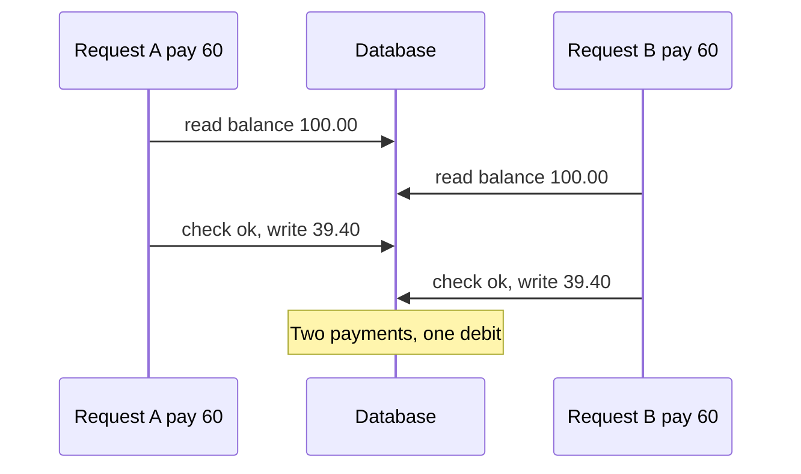
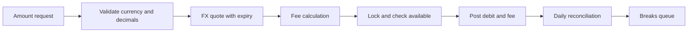

# Money: balances, rounding, fees, FX

Area 02 showed how money is *booked*. This page is about how money is *computed and shown* in
a product: how an amount lives in code, how it is rounded and split, how fees and currency
conversions are calculated, what "balance" means, and how locks, idempotency and daily
reconciliation keep the numbers honest. Most money defects are one cent wrong — repeated a
million times.

## How it works

### Representing an amount

An **amount** is always a pair: a number and a **currency**. "100" means nothing; "EUR 100.00"
does.

1. **Never use binary floating point (`float`, `double`) for money.** A float cannot store 0.1
   exactly: in Python `0.1 + 0.2` gives `0.30000000000000004`, and `round(2.675, 2)` gives
   `2.67`, not `2.68`. Use a **decimal** type (Python `Decimal`, Java `BigDecimal`, SQL
   `NUMERIC`) or integers.
2. **Or store minor units as integers.** The **minor unit** is the smallest unit of a currency
   (cent, grosz). EUR 10.99 is stored as `1099`. Stripe's API works this way.
3. **Know each currency's exponent.** ISO 4217, the standard for currency codes, gives every
   currency a three-letter code (EUR), a numeric code (978) and the number of minor-unit digits
   (the **exponent**):

| Currency | ISO numeric | Minor-unit digits | Integer 100 in minor units means |
|---|---|---|---|
| EUR, USD, PLN | 978, 840, 985 | 2 | 1.00 |
| JPY, KRW | 392, 410 | 0 | 100 yen / won |
| BHD, KWD, JOD | 048, 414, 400 | 3 | 0.100 |
| ISK | 352 | 0 in ISO 4217 | Stripe still expects two decimals ending in `00` |

The ISK row is a real trap: the standard and a provider's API can disagree, so "major ↔ minor
units" belongs in one tested place, per partner. Code that hard-codes "divide by 100" shows
JPY 500 as JPY 5.00 and BHD 1.250 as BHD 12.50.

**At the API boundary** amounts travel as strings (`"100.00"`) or integers in minor units, not
JSON floats. Validation decides decimals allowed for this currency, minimum, maximum, zero and
negative — and `"10.005"` in EUR is rejected, not silently rounded.

### Rounding modes

**Rounding** turns a calculated value (1.505) into a payable amount (1.50 or 1.51).

| Value | Half-up | Half-even (banker's rounding) |
|---|---|---|
| 2.345 | 2.35 | 2.34 |
| 2.355 | 2.36 | 2.36 |
| 1.505 | 1.51 | 1.50 |

- **Half-up**: a tie (exactly 5 in the dropped digit) goes away from zero; over many ties it is
  biased upwards.
- **Half-even (banker's rounding)**: a tie goes to the even digit, so ties go up and down
  equally often. It is the default of Python's `decimal` module — code that "uses Decimal" but
  forgets to set half-up is a classic defect.
- **Round down / up**: used on purpose, for example to round a converted amount in the
  company's favour.

The mode is a **business rule**. Only exact ties (x.xx5) show the difference, so test data
must contain them.

### Where to round: per line or on the total

Fee 1.5 %, three payments of EUR 0.55:

- per line: 0.55 × 1.5 % = 0.00825 → 0.01, three times → **EUR 0.03**;
- on the total: 1.65 × 1.5 % = 0.02475 → **EUR 0.02**.

Neither is wrong; mixing them is. If the fee engine rounds per payment and the monthly invoice
rounds the total, they never match. Round once, at a documented step (how the difference
reaches the ledger: [Accounting for testers](../02-accounting/en.md#rounding)).

### Allocation: splitting 100.00 into 3

EUR 100.00 / 3 = 33.333…; rounding each share gives 33.33 × 3 = 99.99 — a cent disappears.
**Allocation** makes the parts add up: round every share down (33.33 × 3), then give the
remaining minor units (here 1 cent) one by one by a fixed rule — first party, or largest
dropped fraction: **33.34 + 33.33 + 33.33 = 100.00**. The same applies to ratio splits,
instalments and refunds spread over items. Invariant: **sum of parts = whole**, also when the
amount is smaller than the number of parts (EUR 0.02 into 3 → 0.01 + 0.01 + 0.00).

### Fee models

| Model | Formula | Example |
|---|---|---|
| Percentage with min | max(rate × amount, min) | 1 %, min 0.50: EUR 10.00 → 0.50; EUR 100.00 → 1.00 |
| Percentage with min and cap | min(max(rate × amount, min), max) | + max 5.00: EUR 1,000.00 → 5.00 |
| Fixed + percentage | fixed + rate × amount | 0.25 + 1.4 %: EUR 20.00 → 0.25 + 0.28 = 0.53 |
| Tiered, marginal | each part at its tier's rate | 1 % up to 1,000.00, 0.5 % above: EUR 1,500.00 → 10.00 + 2.50 = 12.50 |
| Tiered, whole amount | whole amount at the rate of the tier reached | same tiers: EUR 1,500.00 → 7.50 |

The rates are illustrative; real fees come from each company's price list. Test the
**boundaries**: where the minimum stops (1 %, min 0.50: at 50.49 the fee is 0.50, at 50.50 it
is 0.51), where the cap starts (1 %, max 5.00: with half-up, 1 % first exceeds 5.00 at 500.50, so test 500.49 and 500.50), and tier borders (1,000.00 and 1,000.01). Check the fee
base and currency too.

**Fee on refunds** must be a written rule: return the whole fee, a proportional part, or
nothing. Providers differ — Stripe, for example, does not return its original processing fees
when a merchant refunds. With partial refunds and a minimum fee, "proportional" and
"recalculate on the remaining amount" diverge on small amounts. Invariants: refunded total ≤
paid total; returned fee ≤ charged fee.

### Balance types and holds

- **Ledger (booked) balance** — sum of all posted transactions.
- **Hold** — money blocked for an approved but not yet posted operation, such as a card
  authorisation ([Card payment](../01-card-payment/en.md)).
- **Available balance** = ledger − active holds (+ overdraft limit, if any). Spending checks
  must use it.
- **Pending incoming** — announced but not settled, usually not spendable. Stripe shows incoming
  card funds as *pending* until settlement, then *available*.

Example: ledger EUR 200.00, hotel hold 50.00 → available 150.00. A 160.00 payment is declined
although the ledger shows 200.00. When the hotel captures 45.00, the ledger becomes 155.00 and
the hold is released.

**Negative balance.** Customer actions must not push an e-money wallet below zero, but
system events can: a later fee, a chargeback, a card payment cleared without authorisation, an
FX difference at clearing. Stripe notes that refunds, fees and disputes can make a balance
negative. The product needs a rule per case (collect, block, write off). An **overdraft** is a
separate, agreed credit line with its own limit.

### Concurrency and double spending

**Double spending** is spending the same money twice. In software it comes from a **race
condition**: two requests run at once and both see the old balance.

With a 1 % fee (0.60) this is a **lost update**: two approved payments, balance 39.40, the
company lost 60.60. If both instead subtract from the current value after the stale check, the
balance becomes −21.20. Protections:

- **Lock or atomic update** — lock the account row while checking and debiting (`SELECT … FOR
  UPDATE`), or one conditional statement (`UPDATE … SET balance = balance − 60.60 WHERE … AND
  balance >= 60.60`) and check that one row changed.
- **Idempotency key** — a unique id of the client's request; a retry returns the first result,
  the same key with a different body is an error (Stripe's API works like this). Store it in the
  same database transaction as the debit.
- **Database constraints** as the last line: balance ≥ 0, unique idempotency key.

### Reconciliation: the product view

Accounting detail is in [area 02](../02-accounting/en.md#reconciliation). For the product,
reconciliation is a **daily job** comparing our transactions with a partner file (bank
statement, scheme settlement report, PSP payout report).

- **Matching keys**: our id or the partner's reference (cards: acquirer reference number or
  retrieval reference number; transfers: end-to-end id), plus amount, currency and date.
  Amounts match exactly; dates may need a window (23:58 may land in tomorrow's file).
- **Matching types**: one-to-one; one-to-many (a payout line = many payments minus fees).
- **Output**: matched items and **breaks** — missing on our side, missing on theirs, amount
  differs, duplicate — with age and owner.

Testers inject each break type, check the job never matches on amount alone, and run it twice
for the same day (same result).

### FX: currency conversion

- **Rate sources**: a market data or liquidity provider gives tradable rates. The **ECB euro
  reference rates** are published around 16:00 CET on working days for information only; the
  ECB strongly discourages using them for transactions. EU law uses them as a *benchmark*.
- **Mid rate** — midway between the market buy and sell rates. The **customer rate** is the
  mid rate worsened by a **mark-up** (FX margin), different for buying and selling.
- **Quote and expiry** — the customer sees rate, amounts, fee and an expiry time. After expiry
  the system re-quotes or fails; it never silently uses a new rate. A quote id links the shown
  rate to the executed one.
- **Rounding** to the *target* exponent: EUR 100.00 at an illustrative 160.123 → JPY 16,012;
  at 0.41234 → BHD 41.234.
- **Showing the rate (EU)**: PSD2 Article 59(2) — when conversion is offered at an ATM, point of
  sale or by the payee, the payer is told all charges and the rate first. Regulation (EU)
  2019/518 added conversion-charge rules to the Cross-border Payments Regulation, now codified
  as Regulation (EU) 2021/1230. For card payments and ATM withdrawals (Article 4), total
  conversion charges are shown as a **percentage mark-up over the latest ECB euro reference
  rate** before the payment and published online, and after a payment order in another EU
  currency the issuer sends an electronic message with that mark-up. For online credit
  transfers (Article 5), estimated charges and amounts are shown before initiation.

**Worked FX example** (rates illustrative). Anna's wallet is in EUR. On Tue 10 Nov 2026 at
18:20 CET she pays PLN 430.00 in Kraków.

1. The latest ECB rate, published that afternoon, is 1 EUR = 4.3000 PLN: the benchmark is
   430.00 / 4.3000 = EUR 100.00.
2. The issuer charges EUR 101.50, a customer rate of 430.00 / 101.50 = 4.2365 PLN per EUR.
3. Mark-up = 101.50 / 100.00 − 1 = **1.50 %** over the ECB rate — the same figure must appear
   in the price list, in the app before payment and in the message after it.
4. If clearing on Thu 12 Nov uses that day's rate, the posted amount can differ from the 101.50
   held; the difference must be explained and reconciled.

**Rounding exploit.** Customer rates: buy EUR at 162.00 JPY, sell EUR at 158.00 JPY. JPY 1 →
EUR: 1 / 162 = 0.00617 → half-up **EUR 0.01**. EUR 0.01 → JPY: 1.58 → half-up **JPY 2**. The
customer doubles their money despite the mark-up. Defences: minimum conversion amount, rounding
in the company's favour, and a test that a round trip never gains.

## Participants and money flows

| Participant | Role | Sends / receives and when | Who carries the risk |
|---|---|---|---|
| Customer | Pays, converts, gets refunds | Sees amount, fee, rate and mark-up before confirming | Customer, if shown ≠ charged |
| Wallet / e-money institution | Validates, rounds, charges fees, keeps balances | Debits at payment; returns fee on refund per its rules | The institution for every lost cent, double spend or wrong fee |
| Pricing configuration | Rates, minimums, caps, tiers | Read on every fee calculation; changed by the product team | The institution, if a change is untested |
| FX liquidity provider | Supplies tradable rates | Streams rates; settles the currency bought | The institution between quote and hedge |
| ECB | Publishes reference rates | Around 16:00 CET on working days | — (benchmark only) |
| Bank / scheme / PSP | External side of money movement | Daily statements and settlement files | The institution until reconciled |
| Reconciliation team | Works breaks | Daily, after the job | Operational risk while breaks age |

## Business risks

**Company**
- Fee missing or minimum not applied — card-wallet BUG-01 loses 0.40 on each EUR 10.00 payment.
- Double spending through races or retries: money paid out that was never debited.
- Rounding exploits in FX round trips or split payments.
- Wrong exponent for JPY or BHD: amounts off by ×100 or ×10.
- Breaks found after the partner's claim window has closed.

**Customer**
- Charged a different amount than shown (expired quote re-priced silently, unexplained
  authorisation vs clearing difference).
- Wrong available balance: spending blocked by a stale hold, or allowed into a negative balance.
- Fee not returned on refund although the terms promise it.

**Regulator / compliance**
- Mark-up over the ECB rate not shown, not published, or the post-payment message not sent
  (Regulation (EU) 2021/1230).
- Charges and rate not disclosed before conversion (PSD2 Article 59).
- Price list and actual charges disagree.

## What to test

- [ ] Amount validation per currency exponent: zero, negative, maximum, `"10.005"` in EUR rejected.
- [ ] Amounts are strings or integers in the API, never floats; trailing zeros kept (`"10.50"`).
- [ ] Minor-unit conversion for 0-, 2- and 3-decimal currencies and each partner's special cases.
- [ ] Rounding mode matches the requirement; exact ties are in the test data.
- [ ] Rounding happens once; per-line and total reports agree.
- [ ] Allocation: parts always sum to the whole.
- [ ] Fee boundaries: end of minimum, start of cap, tier borders ± 0.01.
- [ ] Refund fee rule for full, partial and multiple refunds; refunded total ≤ paid total.
- [ ] Spending checks use available balance; holds released on capture, reversal and expiry.
- [ ] Customer actions cannot create a negative balance; system-initiated negatives follow the rule.
- [ ] Parallel debits never overdraw; one idempotency key charges once even in parallel.
- [ ] FX: executed rate = quoted rate; expired quote re-quoted or rejected; round trip never gains.
- [ ] Mark-up over the ECB rate shown before payment and in the post-payment message, equal to the price list.
- [ ] Reconciliation finds each injected break type and is safe to re-run.

| ID | Condition / steps | Expected result |
|---|---|---|
| MN-01 | Fee 1 %, min 0.50, half-up; pay EUR 50.49, 50.50, 150.50 | Fees 0.50, 0.51, 1.51 (half-even would give 1.50 for 150.50) |
| MN-02 | Pay `"10.005"` EUR; pay `"500"` and `"500.5"` JPY | EUR 10.005 and JPY 500.5 rejected; JPY 500 stored as 500 minor units |
| MN-03 | Split EUR 100.00 and EUR 0.02 between 3 | 33.34 + 33.33 + 33.33; 0.01 + 0.01 + 0.00 |
| MN-04 | Ledger 200.00, hold 50.00, fee 1 %; pay 160.00, then 140.00 | First declined (available 150.00); second approved, fee 1.40; ledger 58.60, available 8.60 |
| MN-05 | Balance 100.00; two parallel 60.00 payments, different keys | One approved, one declined; balance 39.40 |
| MN-06 | Five parallel 10.00 payments with one idempotency key | One transaction and one debit; identical responses |
| MN-07 | Quote EUR 100.00 → USD valid 30 s; confirm at 31 s | Rejected or re-quoted with the new rate shown |
| MN-08 | Convert JPY 1 → EUR → JPY repeatedly | Customer never ends with more than at the start |
| MN-09 | PLN 430.00 card payment from EUR wallet; ECB 4.3000; charge 101.50 | Mark-up 1.50 % shown before, in the message after, equal to the price list |
| MN-10 | Remove one bank-file line, duplicate another; run reconciliation twice | Two breaks with references; second run gives the same result |

## Typical defects

- **Float in one place** — a front end or report computes `amount * 0.01` in floating point.
  Catch: compare displayed and API fees on tie values like 150.50.
- **Wrong rounding mode** — `Decimal` with default half-even where half-up is required. Catch:
  tie values in unit tests.
- **Minimum missing** — card-wallet
  [BUG-01](https://github.com/Tomullya/card-wallet/blob/main/docs/qa/bug-reports/BUG-01.md):
  1 % without the 0.50 minimum. Catch: boundaries around minimum and cap.
- **Off-by-one at a money limit** — card-wallet
  [BUG-02](https://github.com/Tomullya/card-wallet/blob/main/docs/qa/bug-reports/BUG-02.md):
  a payment reaching the daily limit exactly is declined. Catch: limit − 0.01, limit, + 0.01.
- **Hard-coded exponent 2** — JPY or BHD amounts off by a factor of 100 or 10. Catch: one end-to-end test per
  exponent class (0, 2, 3), including partner files.
- **Lost update under load** — check and debit without a lock. Catch: parallel requests with a
  barrier, then balance vs sum of transactions.
- **Quote expiry not enforced** — executed at a rate the customer never saw. Catch: wait past
  expiry, compare executed rate with the quote.

## In card-wallet

[card-wallet](https://github.com/Tomullya/card-wallet) is a simplified demo. What it has:

- [wallet-api/app/services/money.py](https://github.com/Tomullya/card-wallet/blob/main/wallet-api/app/services/money.py)
  — `Decimal`, quantize to 0.01 with `ROUND_HALF_UP` set explicitly, 1 % commission with
  `MIN_COMMISSION` 0.50 ([NFR-01](https://github.com/Tomullya/card-wallet/blob/main/docs/requirements/NFR.md):
  decimal, 2 places, never float, half-up;
  [BR-PAY-03](https://github.com/Tomullya/card-wallet/blob/main/docs/requirements/BR-payments.md)).
  [tests/unit/test_money.py](https://github.com/Tomullya/card-wallet/blob/main/tests/unit/test_money.py)
  covers the tie 150.50 → 1.51.
- [wallet-api/app/schemas/common.py](https://github.com/Tomullya/card-wallet/blob/main/wallet-api/app/schemas/common.py)
  — request amounts > 0, ≤ 10000.00, at most 2 decimals; responses as strings with 2 decimals.
- [wallet-api/app/models.py](https://github.com/Tomullya/card-wallet/blob/main/wallet-api/app/models.py)
  — `Numeric(12, 2)` money; currencies EUR, USD, PLN (all exponent 2); one account per user per
  currency.
- [wallet-api/app/services/payments.py](https://github.com/Tomullya/card-wallet/blob/main/wallet-api/app/services/payments.py)
  — locks account then card (`with_for_update`), checks balance ≥ amount + commission, saves the
  idempotency record in the same database transaction and handles the unique-key race.
- [tests/api/test_concurrency.py](https://github.com/Tomullya/card-wallet/blob/main/tests/api/test_concurrency.py)
  — two parallel 60.00 payments on 100.00 (balance 39.40) and five parallel requests with one key
  (one row, balance 89.50);
  [tests/api/test_idempotency.py](https://github.com/Tomullya/card-wallet/blob/main/tests/api/test_idempotency.py)
  covers sequential retries.
- [tests/db/test_balance_consistency.py](https://github.com/Tomullya/card-wallet/blob/main/tests/db/test_balance_consistency.py)
  — stored balance = sum of approved transactions.
- [BUG-01](https://github.com/Tomullya/card-wallet/blob/main/docs/qa/bug-reports/BUG-01.md),
  [BUG-02](https://github.com/Tomullya/card-wallet/blob/main/docs/qa/bug-reports/BUG-02.md) —
  money boundary defects.

What is missing: **no FX** (a payment is always in the account's currency; no conversion between
a user's accounts); no holds, so ledger = available; no fee cap or tiers; no refunds; no
reconciliation; scale 2 fixed for all currencies; no database check that balance ≥ 0 (the lock
and application check protect it). Could be added:

- an FX transfer between own accounts with quote id, 30-second expiry, mark-up, target-currency
  rounding and a round-trip test;
- a currency table with ISO 4217 exponents and a JPY account;
- holds with available vs ledger balance and hold expiry;
- a nightly reconciliation against a fake bank CSV, writing breaks to a table.

## Sources

- [SIX — ISO 4217 currency codes (maintenance agency)](https://www.six-group.com/en/products-services/financial-information/market-reference-data/data-standards.html)
  — codes and minor-unit digits (JPY/KRW 0, BHD/KWD/JOD 3, ISK 0).
- [Python documentation — decimal](https://docs.python.org/3/library/decimal.html)
  — exact decimal arithmetic, `quantize`, rounding modes; default rounding ROUND_HALF_EVEN.
- [Python documentation — round()](https://docs.python.org/3/library/functions.html#round)
  — `round(2.675, 2)` gives 2.67 because of float representation.
- [Stripe Docs — Supported currencies](https://docs.stripe.com/currencies)
  — amounts in minor units, zero-decimal currencies, ISK and HUF special cases.
- [Stripe Docs — Balances and settlement time](https://docs.stripe.com/payments/balances)
  — pending vs available; refunds, fees and disputes can make a balance negative.
- [Stripe Docs — Refunds](https://docs.stripe.com/refunds)
  — original processing fees not returned; refunds cannot exceed the original charge.
- [Stripe API — Idempotent requests](https://docs.stripe.com/api/idempotent_requests)
  — same key returns the saved result; different parameters cause an error.
- [ECB — Euro foreign exchange reference rates](https://www.ecb.europa.eu/stats/policy_and_exchange_rates/euro_reference_exchange_rates/html/index.en.html)
  — around 16:00 CET on working days, for information only.
- [legislation.gov.uk — Regulation (EU) 2019/518](https://www.legislation.gov.uk/eur/2019/518)
  — mark-up over ECB rates, post-payment message, credit transfer estimates (now Articles 4–5 of Regulation (EU) 2021/1230; the article numbering is confirmed in [EBA Q&A 2023_6777](https://www.eba.europa.eu/single-rule-book-qa/qna/view/publicId/2023_6777)).
- [legislation.gov.uk — PSD2 (EU) 2015/2366, Article 59](https://www.legislation.gov.uk/eudr/2015/2366/article/59)
  — charges and rate disclosed before conversion at ATM, point of sale or by the payee.
