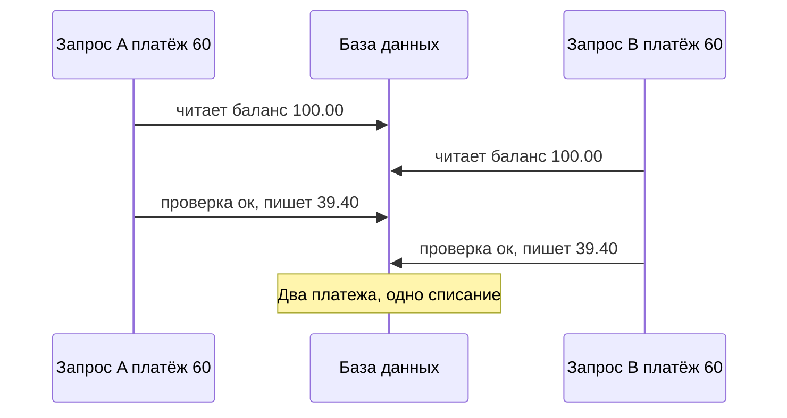
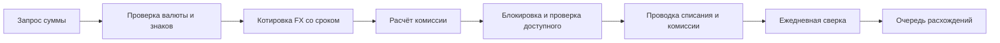

# Деньги: балансы, округление, комиссии, валюта

В области 02 мы разобрали, как деньги *учитываются*. Эта страница — о том, как деньги
*вычисляются и показываются* в продукте: как сумма живёт в коде, как её округляют и делят,
как считаются комиссии и конвертация валют, что значит «баланс», и как блокировки,
идемпотентность и ежедневная сверка удерживают цифры честными. Большинство денежных дефектов —
это ошибка на один цент, повторённая миллион раз.

## Как это работает

### Как хранить сумму

**Сумма (amount)** — это всегда пара: число и **валюта (currency)**. «100» ничего не значит;
«EUR 100.00» — значит.

1. **Никогда не используйте двоичную плавающую точку (`float`, `double`) для денег.** Float не
   хранит 0.1 точно: в Python `0.1 + 0.2` даёт `0.30000000000000004`, а `round(2.675, 2)` даёт
   `2.67`, а не `2.68`. Используйте **десятичный тип (decimal)** — Python `Decimal`, Java
   `BigDecimal`, SQL `NUMERIC` — или целые числа.
2. **Или храните минорные единицы целым числом.** **Минорная единица (minor unit)** — самая
   мелкая единица валюты (цент, грош). EUR 10.99 хранится как `1099`. Так работает API Stripe.
3. **Знайте экспоненту каждой валюты.** ISO 4217 — стандарт кодов валют — даёт каждой валюте
   буквенный код (EUR), цифровой код (978) и число знаков минорной единицы — **экспоненту
   (exponent)**:

| Валюта | Цифровой код ISO | Знаков после запятой | Целое 100 в минорных единицах — это |
|---|---|---|---|
| EUR, USD, PLN | 978, 840, 985 | 2 | 1.00 |
| JPY, KRW | 392, 410 | 0 | 100 иен / вон |
| BHD, KWD, JOD | 048, 414, 400 | 3 | 0.100 |
| ISK | 352 | 0 по ISO 4217 | Stripe всё ещё ждёт два знака, оканчивающиеся на `00` |

Строка ISK — реальная ловушка: стандарт и API провайдера могут расходиться, поэтому перевод
«основные ↔ минорные единицы» должен жить в одном протестированном месте, отдельно для каждого
партнёра. Код с зашитым «делить на 100» покажет JPY 500 как JPY 5.00, а BHD 1.250 как BHD 12.50.

**На границе API** суммы передаются строками (`"100.00"`) или целыми в минорных единицах, а не
JSON-числами с плавающей точкой. Валидация решает: сколько знаков допустимо для этой валюты,
минимум, максимум, ноль и отрицательные — а `"10.005"` в EUR отклоняется, а не молча
округляется.

### Режимы округления

**Округление (rounding)** превращает вычисленное значение (1.505) в сумму к оплате (1.50 или 1.51).

| Значение | Половина вверх (half-up) | Банковское (half-even) |
|---|---|---|
| 2.345 | 2.35 | 2.34 |
| 2.355 | 2.36 | 2.36 |
| 1.505 | 1.51 | 1.50 |

- **Половина вверх (half-up)**: «ничья» (ровно 5 в отбрасываемом разряде) уходит от нуля; на
  множестве ничьих даёт смещение вверх.
- **Банковское округление (half-even, banker's rounding)**: ничья идёт к чётной цифре, поэтому
  ничьи округляются вверх и вниз одинаково часто. Это режим по умолчанию модуля `decimal` в
  Python — код, который «использует Decimal», но забыл выставить half-up, — классический дефект.
- **Вниз / вверх (round down / up)**: применяются намеренно, например чтобы округлять
  сконвертированную сумму в пользу компании.

Режим — это **бизнес-правило**. Разницу показывают только точные ничьи (x.xx5), поэтому они
обязаны быть в тестовых данных.

### Где округлять: построчно или на итоге

Комиссия 1.5 %, три платежа по EUR 0.55:

- построчно: 0.55 × 1.5 % = 0.00825 → 0.01, трижды → **EUR 0.03**;
- на итоге: 1.65 × 1.5 % = 0.02475 → **EUR 0.02**.

Ни один способ не ошибочен; ошибочно их смешивать. Если движок комиссий округляет каждый
платёж, а месячный счёт — итог, они никогда не сойдутся. Округляйте один раз, на
задокументированном шаге (как разница попадает в главную книгу (ledger):
[Учёт для тестировщиков](../02-accounting/ru.md#округление)).

### Распределение: делим 100.00 на троих

EUR 100.00 / 3 = 33.333…; если округлить каждую долю, 33.33 × 3 = 99.99 — цент пропал.
**Распределение (allocation)** делает так, чтобы части сходились: каждую долю округляем вниз
(33.33 × 3), затем оставшиеся минорные единицы (здесь 1 цент) раздаём по одной по
фиксированному правилу — первому участнику или с наибольшим отброшенным остатком:
**33.34 + 33.33 + 33.33 = 100.00**. То же для деления в пропорции, рассрочки и возврата,
разложенного по позициям. Инвариант: **сумма частей = целое**, в том числе когда сумма меньше
числа частей (EUR 0.02 на троих → 0.01 + 0.01 + 0.00).

### Модели комиссий

| Модель | Формула | Пример |
|---|---|---|
| Процент с минимумом | max(ставка × сумма, минимум) | 1 %, мин. 0.50: EUR 10.00 → 0.50; EUR 100.00 → 1.00 |
| Процент с минимумом и потолком (cap) | min(max(ставка × сумма, мин.), макс.) | + макс. 5.00: EUR 1,000.00 → 5.00 |
| Фиксированная + процент | фикс. + ставка × сумма | 0.25 + 1.4 %: EUR 20.00 → 0.25 + 0.28 = 0.53 |
| Ступенчатая, по частям (marginal) | каждая часть по ставке своей ступени | 1 % до 1,000.00, 0.5 % выше: EUR 1,500.00 → 10.00 + 2.50 = 12.50 |
| Ступенчатая, на всю сумму | вся сумма по ставке достигнутой ступени | те же ступени: EUR 1,500.00 → 7.50 |

Ставки условные; реальные комиссии берутся из тарифов конкретной компании. Тестируйте
**границы**: где перестаёт действовать минимум (1 %, мин. 0.50: при 50.49 комиссия 0.50, при
50.50 — 0.51), где начинается потолок (1 %, макс. 5.00: при half-up 1 % впервые превышает 5.00 на 500.50, поэтому проверяйте 500.49 и 500.50), границы ступеней (1,000.00 и 1,000.01).
Проверяйте также базу и валюту комиссии.

**Комиссия при возврате (refund)** должна быть записанным правилом: вернуть всю комиссию,
пропорциональную часть или ничего. У провайдеров по-разному — например, Stripe не возвращает
свою комиссию за исходный платёж, когда мерчант делает возврат. При частичных возвратах и
минимальной комиссии «пропорционально» и «пересчитать на оставшуюся сумму» расходятся на малых
суммах. Инварианты: возвращено всего ≤ оплачено; возвращённая комиссия ≤ взятой.

### Виды баланса и холды

- **Учётный (ledger, booked) баланс** — сумма всех проведённых операций.
- **Холд (hold)** — деньги, заблокированные под одобренную, но ещё не проведённую операцию,
  например авторизацию по карте ([Карточный платёж](../01-card-payment/ru.md)).
- **Доступный баланс (available balance)** = учётный − активные холды (+ лимит овердрафта, если
  есть). Проверки на списание должны использовать именно его.
- **Ожидающие поступления (pending)** — объявлены, но не рассчитаны, обычно тратить их нельзя.
  Stripe показывает входящие карточные средства как *pending* до расчёта, затем как *available*.

Пример: учётный EUR 200.00, холд отеля 50.00 → доступно 150.00. Платёж 160.00 отклоняется, хотя
учётный баланс 200.00. Когда отель списывает (capture) 45.00, учётный баланс становится 155.00,
холд снимается.

**Отрицательный баланс.** Действия клиента не должны уводить кошелёк электронных денег ниже
нуля, но системные события могут: поздняя комиссия, чарджбэк, карточный платёж, пришедший в
клиринге без авторизации, курсовая разница при клиринге. Stripe отмечает, что возвраты,
комиссии и споры могут сделать баланс отрицательным. Продукту нужно правило на каждый случай
(взыскать, заблокировать, списать). **Овердрафт (overdraft)** — это отдельная согласованная
кредитная линия со своим лимитом.

### Конкурентность и двойная трата

**Двойная трата (double spending)** — трата одних и тех же денег дважды. В ПО она возникает из
**состояния гонки (race condition)**: два запроса выполняются одновременно и оба видят старый
баланс.

При комиссии 1 % (0.60) это **потерянное обновление (lost update)**: два одобренных платежа,
баланс 39.40, компания потеряла 60.60. Если же оба вычитают из текущего значения после
устаревшей проверки, баланс становится −21.20. Защита:

- **Блокировка или атомарное обновление** — заблокировать строку счёта на время проверки и
  списания (`SELECT … FOR UPDATE`) или одна условная команда (`UPDATE … SET balance = balance −
  60.60 WHERE … AND balance >= 60.60`) с проверкой, что изменилась одна строка.
- **Ключ идемпотентности (idempotency key)** — уникальный id запроса клиента; повтор возвращает
  первый результат, тот же ключ с другим телом — ошибка (так работает API Stripe). Ключ
  сохраняется в той же транзакции БД, что и списание.
- **Ограничения базы данных** как последний рубеж: баланс ≥ 0, уникальный ключ идемпотентности.

### Сверка глазами продукта

Бухгалтерские детали — в [области 02](../02-accounting/ru.md#сверка-reconciliation). Для
продукта **сверка (reconciliation)** — это **ежедневная задача**, сравнивающая наши операции с
файлом партнёра (банковская выписка, отчёт о расчётах платёжной системы, отчёт о выплатах PSP).

- **Ключи сопоставления (matching keys)**: наш id или референс партнёра (для карт —
  acquirer reference number или retrieval reference number; для переводов — end-to-end id),
  плюс сумма, валюта и дата. Суммы совпадают точно; для дат может понадобиться окно (платёж в
  23:58 может попасть в завтрашний файл).
- **Типы сопоставления**: один к одному; один ко многим (строка выплаты = много платежей минус
  комиссии).
- **Результат**: сопоставленные записи и **расхождения (breaks)** — нет у нас, нет у них,
  отличается сумма, дубль — с возрастом и ответственным.

Тестировщик подкладывает каждый тип расхождения, проверяет, что задача никогда не сопоставляет
только по сумме, и запускает её дважды за один день (результат тот же).

### Валюта: конвертация (FX)

- **Источники курса**: поставщик рыночных данных или поставщик ликвидности (liquidity provider)
  даёт торгуемые курсы. **Референсные курсы евро ЕЦБ (ECB euro reference rates)** публикуются
  около 16:00 CET в рабочие дни только для информации; ЕЦБ настоятельно не рекомендует
  использовать их для сделок. Право ЕС использует их как *ориентир (benchmark)*.
- **Средний курс (mid rate)** — середина между рыночными курсами покупки и продажи. **Курс для
  клиента (customer rate)** — средний курс, ухудшенный на **наценку (mark-up)**, разную для
  покупки и продажи.
- **Котировка и срок действия (quote, expiry)** — клиент видит курс, суммы, комиссию и время
  истечения. После истечения система делает новую котировку или отказывает; молча применять
  новый курс нельзя. Id котировки связывает показанный курс с исполненным.
- **Округление** до экспоненты *целевой* валюты: EUR 100.00 по условному курсу 160.123 →
  JPY 16,012; по 0.41234 → BHD 41.234.
- **Показ курса (ЕС)**: PSD2, статья 59(2) — если конвертацию предлагают в банкомате, в точке
  продаж или через получателя, плательщику заранее сообщают все сборы и курс. Регламент (ЕС)
  2019/518 добавил правила о сборах за конвертацию в Регламент о трансграничных платежах, ныне
  кодифицированный как Регламент (ЕС) 2021/1230. Для карточных платежей и снятия в банкоматах
  (статья 4) общие сборы за конвертацию показываются как **процентная наценка к последнему
  референсному курсу евро ЕЦБ** до платежа и публикуются онлайн, а после получения платёжного
  поручения в другой валюте ЕС эмитент отправляет электронное сообщение с этой наценкой. Для
  кредитовых переводов, начатых онлайн (статья 5), до отправки показываются расчётные сборы и
  суммы.

**Пример с цифрами** (курсы условные). Кошелёк Анны в EUR. Во вторник 10 ноября 2026 в 18:20
CET она платит PLN 430.00 в Кракове.

1. Последний курс ЕЦБ, опубликованный днём, — 1 EUR = 4.3000 PLN: ориентир
   430.00 / 4.3000 = EUR 100.00.
2. Эмитент списывает EUR 101.50, курс для клиента 430.00 / 101.50 = 4.2365 PLN за EUR.
3. Наценка = 101.50 / 100.00 − 1 = **1.50 %** к курсу ЕЦБ — та же цифра должна быть в тарифах,
   в приложении до платежа и в сообщении после него.
4. Если клиринг в четверг 12 ноября идёт по курсу того дня, проведённая сумма может отличаться от
   заблокированных 101.50; разницу нужно объяснить и сверить.

**Эксплойт округления.** Курсы для клиента: покупка EUR по 162.00 JPY, продажа EUR по 158.00
JPY. JPY 1 → EUR: 1 / 162 = 0.00617 → half-up **EUR 0.01**. EUR 0.01 → JPY: 1.58 → half-up
**JPY 2**. Клиент удваивает деньги, несмотря на наценку. Защита: минимальная сумма конвертации,
округление в пользу компании и тест, что круговая конвертация никогда не даёт прибыли.

## Участники и потоки денег

| Участник | Роль | Что отправляет / получает и когда | Кто несёт риск |
|---|---|---|---|
| Клиент | Платит, конвертирует, получает возвраты | Видит сумму, комиссию, курс и наценку до подтверждения | Клиент, если показано ≠ списано |
| Кошелёк / эмитент электронных денег | Проверяет, округляет, берёт комиссии, ведёт балансы | Списывает при платеже; возвращает комиссию по своим правилам | Эмитент — за каждый потерянный цент, двойную трату, неверную комиссию |
| Настройки тарифов | Ставки, минимумы, потолки, ступени | Читаются при каждом расчёте; меняются продуктовой командой | Эмитент, если изменение не протестировано |
| Поставщик ликвидности FX | Даёт торгуемые курсы | Передаёт курсы; рассчитывается по купленной валюте | Эмитент между котировкой и хеджированием |
| ЕЦБ | Публикует референсные курсы | Около 16:00 CET в рабочие дни | — (только ориентир) |
| Банк / платёжная система / PSP | Внешняя сторона движения денег | Ежедневные выписки и файлы расчётов | Эмитент, пока не сверено |
| Команда сверки | Разбирает расхождения | Ежедневно, после задачи сверки | Операционный риск, пока расхождения стареют |

## Бизнес-риски

**Компания**
- Комиссия не взята или не применён минимум — BUG-01 в card-wallet теряет 0.40 на каждом
  платеже EUR 10.00.
- Двойная трата из-за гонок или повторов: выплачены деньги, которые не были списаны.
- Эксплойты округления в круговой конвертации или при делении платежей.
- Неверная экспонента для JPY или BHD: суммы ошибаются в 100 или 10 раз.
- Расхождения найдены после закрытия окна претензий у партнёра.

**Клиент**
- Списано не то, что показали (истёкшая котировка молча переоценена, необъяснённая разница
  между авторизацией и клирингом).
- Неверный доступный баланс: трата заблокирована устаревшим холдом или разрешена в минус.
- Комиссия не возвращена при возврате, хотя условия это обещают.

**Регулятор / комплаенс**
- Наценка к курсу ЕЦБ не показана, не опубликована или не отправлено сообщение после платежа
  (Регламент (ЕС) 2021/1230).
- Сборы и курс не раскрыты до конвертации (PSD2, статья 59).
- Тарифы и фактические списания расходятся.

## Что тестировать

- [ ] Валидация суммы по экспоненте валюты: ноль, отрицательные, максимум, `"10.005"` в EUR отклоняется.
- [ ] В API суммы — строки или целые, не float; хвостовые нули сохраняются (`"10.50"`).
- [ ] Перевод в минорные единицы для валют с 0, 2 и 3 знаками и особые случаи каждого партнёра.
- [ ] Режим округления соответствует требованию; точные ничьи есть в тестовых данных.
- [ ] Округление выполняется один раз; построчные и итоговые отчёты сходятся.
- [ ] Распределение: части всегда в сумме дают целое.
- [ ] Границы комиссии: конец минимума, начало потолка, границы ступеней ± 0.01.
- [ ] Правило комиссии при полном, частичном и многократном возврате; возвращено ≤ оплачено.
- [ ] Проверки списания используют доступный баланс; холды снимаются при списании, отмене и истечении.
- [ ] Действия клиента не создают отрицательный баланс; системные минусы следуют правилу.
- [ ] Параллельные списания не уводят в минус; один ключ идемпотентности списывает один раз даже параллельно.
- [ ] FX: исполненный курс = курс котировки; истёкшая котировка обновляется или отклоняется; круговая конвертация не даёт прибыли.
- [ ] Наценка к курсу ЕЦБ показана до платежа и в сообщении после него и равна тарифам.
- [ ] Сверка находит каждый подложенный тип расхождения и безопасна при повторном запуске.

| ID | Условие / шаги | Ожидаемый результат |
|---|---|---|
| MN-01 | Комиссия 1 %, мин. 0.50, half-up; платежи EUR 50.49, 50.50, 150.50 | Комиссии 0.50, 0.51, 1.51 (half-even дал бы 1.50 для 150.50) |
| MN-02 | Платёж `"10.005"` EUR; платежи `"500"` и `"500.5"` JPY | EUR 10.005 и JPY 500.5 отклонены; JPY 500 сохранён как 500 минорных единиц |
| MN-03 | Разделить EUR 100.00 и EUR 0.02 на троих | 33.34 + 33.33 + 33.33; 0.01 + 0.01 + 0.00 |
| MN-04 | Учётный 200.00, холд 50.00, комиссия 1 %; платёж 160.00, затем 140.00 | Первый отклонён (доступно 150.00); второй одобрен, комиссия 1.40; учётный 58.60, доступный 8.60 |
| MN-05 | Баланс 100.00; два параллельных платежа по 60.00 с разными ключами | Один одобрен, другой отклонён; баланс 39.40 |
| MN-06 | Пять параллельных платежей 10.00 с одним ключом идемпотентности | Одна транзакция и одно списание; одинаковые ответы |
| MN-07 | Котировка EUR 100.00 → USD на 30 с; подтверждение на 31-й секунде | Отказ или новая котировка с показом нового курса |
| MN-08 | Конвертировать JPY 1 → EUR → JPY много раз | У клиента никогда не становится больше, чем было |
| MN-09 | Карточный платёж PLN 430.00 с EUR-кошелька; ЕЦБ 4.3000; списано 101.50 | Наценка 1.50 % показана до платежа, в сообщении после, равна тарифам |
| MN-10 | Удалить строку из банковского файла, продублировать другую; запустить сверку дважды | Два расхождения со ссылками; второй запуск даёт тот же результат |

## Типичные дефекты

- **Float в одном месте** — фронтенд или отчёт считает `amount * 0.01` с плавающей точкой.
  Как поймать: сравнить комиссию на экране и в API на ничьих вроде 150.50.
- **Не тот режим округления** — `Decimal` с half-even по умолчанию там, где нужен half-up. Как
  поймать: ничьи в юнит-тестах.
- **Нет минимума** — card-wallet
  [BUG-01](https://github.com/Tomullya/card-wallet/blob/main/docs/qa/bug-reports/BUG-01.md):
  1 % без минимума 0.50. Как поймать: границы около минимума и потолка.
- **Ошибка на единицу на денежном лимите** — card-wallet
  [BUG-02](https://github.com/Tomullya/card-wallet/blob/main/docs/qa/bug-reports/BUG-02.md):
  платёж, ровно достигающий дневного лимита, отклоняется. Как поймать: лимит − 0.01, лимит, + 0.01.
- **Зашитая экспонента 2** — суммы в JPY или BHD ошибаются в 100 или 10 раз. Как поймать: один сквозной тест
  на каждый класс экспоненты (0, 2, 3), включая файлы партнёров.
- **Потерянное обновление под нагрузкой** — проверка и списание без блокировки. Как поймать:
  параллельные запросы с барьером, затем баланс против суммы операций.
- **Не соблюдается срок котировки** — исполнено по курсу, которого клиент не видел. Как поймать:
  подождать истечения, сравнить исполненный курс с котировкой.

## В card-wallet

[card-wallet](https://github.com/Tomullya/card-wallet) — упрощённый демо-проект. Что в нём есть:

- [wallet-api/app/services/money.py](https://github.com/Tomullya/card-wallet/blob/main/wallet-api/app/services/money.py)
  — `Decimal`, округление до 0.01 с явно заданным `ROUND_HALF_UP`, комиссия 1 % с
  `MIN_COMMISSION` 0.50 ([NFR-01](https://github.com/Tomullya/card-wallet/blob/main/docs/requirements/NFR.md):
  decimal, 2 знака, никогда float, half-up;
  [BR-PAY-03](https://github.com/Tomullya/card-wallet/blob/main/docs/requirements/BR-payments.md)).
  [tests/unit/test_money.py](https://github.com/Tomullya/card-wallet/blob/main/tests/unit/test_money.py)
  покрывает ничью 150.50 → 1.51.
- [wallet-api/app/schemas/common.py](https://github.com/Tomullya/card-wallet/blob/main/wallet-api/app/schemas/common.py)
  — суммы в запросе > 0, ≤ 10000.00, не более 2 знаков; в ответах — строки с 2 знаками.
- [wallet-api/app/models.py](https://github.com/Tomullya/card-wallet/blob/main/wallet-api/app/models.py)
  — деньги в `Numeric(12, 2)`; валюты EUR, USD, PLN (у всех экспонента 2); один счёт на
  пользователя в каждой валюте.
- [wallet-api/app/services/payments.py](https://github.com/Tomullya/card-wallet/blob/main/wallet-api/app/services/payments.py)
  — блокирует счёт, затем карту (`with_for_update`), проверяет баланс ≥ сумма + комиссия,
  сохраняет запись идемпотентности в той же транзакции БД и обрабатывает гонку по уникальному
  ключу.
- [tests/api/test_concurrency.py](https://github.com/Tomullya/card-wallet/blob/main/tests/api/test_concurrency.py)
  — два параллельных платежа 60.00 при балансе 100.00 (баланс 39.40) и пять параллельных
  запросов с одним ключом (одна строка, баланс 89.50);
  [tests/api/test_idempotency.py](https://github.com/Tomullya/card-wallet/blob/main/tests/api/test_idempotency.py)
  покрывает последовательные повторы.
- [tests/db/test_balance_consistency.py](https://github.com/Tomullya/card-wallet/blob/main/tests/db/test_balance_consistency.py)
  — хранимый баланс = сумма одобренных операций.
- [BUG-01](https://github.com/Tomullya/card-wallet/blob/main/docs/qa/bug-reports/BUG-01.md),
  [BUG-02](https://github.com/Tomullya/card-wallet/blob/main/docs/qa/bug-reports/BUG-02.md) —
  денежные граничные дефекты.

Чего нет: **нет FX** (платёж всегда в валюте счёта; нет конвертации между счетами
пользователя); нет холдов, поэтому учётный = доступный; нет потолка и ступеней комиссии; нет
возвратов; нет сверки; масштаб 2 знака одинаков для всех валют; нет проверки в БД, что баланс
≥ 0 (защищают блокировка и проверка в приложении). Что можно добавить:

- FX-перевод между своими счетами: id котировки, срок 30 секунд, наценка, округление до целевой
  валюты и тест круговой конвертации;
- таблицу валют с экспонентами ISO 4217 и счёт в JPY;
- холды с доступным и учётным балансом и истечением холда;
- ночную сверку с фиктивной банковской выпиской CSV с записью расхождений в таблицу.

## Источники

- [SIX — коды валют ISO 4217 (агентство по поддержке стандарта)](https://www.six-group.com/en/products-services/financial-information/market-reference-data/data-standards.html)
  — коды и число знаков минорной единицы (JPY/KRW 0, BHD/KWD/JOD 3, ISK 0).
- [Документация Python — decimal](https://docs.python.org/3/library/decimal.html)
  — точная десятичная арифметика, `quantize`, режимы округления; по умолчанию ROUND_HALF_EVEN.
- [Документация Python — round()](https://docs.python.org/3/library/functions.html#round)
  — `round(2.675, 2)` даёт 2.67 из-за представления float.
- [Stripe Docs — Supported currencies](https://docs.stripe.com/currencies)
  — суммы в минорных единицах, валюты без дробной части, особые случаи ISK и HUF.
- [Stripe Docs — Balances and settlement time](https://docs.stripe.com/payments/balances)
  — pending и available; возвраты, комиссии и споры могут увести баланс в минус.
- [Stripe Docs — Refunds](https://docs.stripe.com/refunds)
  — комиссия за исходный платёж не возвращается; возврат не больше исходной суммы.
- [Stripe API — Idempotent requests](https://docs.stripe.com/api/idempotent_requests)
  — тот же ключ возвращает сохранённый результат; другие параметры — ошибка.
- [ЕЦБ — референсные курсы евро](https://www.ecb.europa.eu/stats/policy_and_exchange_rates/euro_reference_exchange_rates/html/index.en.html)
  — около 16:00 CET в рабочие дни, только для информации.
- [legislation.gov.uk — Регламент (ЕС) 2019/518](https://www.legislation.gov.uk/eur/2019/518)
  — наценка к курсам ЕЦБ, сообщение после платежа, оценки для кредитовых переводов (ныне статьи 4–5 Регламента (ЕС) 2021/1230; нумерация статей подтверждается в [EBA Q&A 2023_6777](https://www.eba.europa.eu/single-rule-book-qa/qna/view/publicId/2023_6777)).
- [legislation.gov.uk — PSD2 (ЕС) 2015/2366, статья 59](https://www.legislation.gov.uk/eudr/2015/2366/article/59)
  — сборы и курс раскрываются до конвертации в банкомате, в точке продаж или через получателя.
