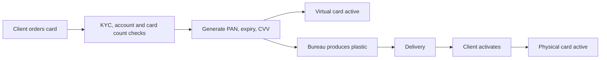
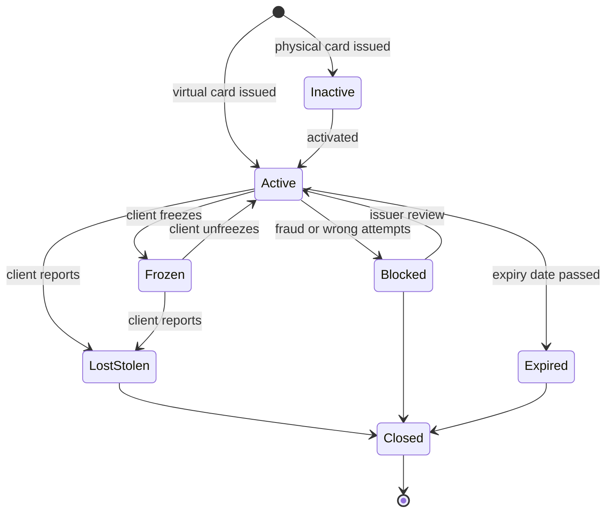

# Card lifecycle

A card is not just a number: it is an object with data elements, a status and a history. It is
ordered, produced, delivered, activated, frozen, blocked, reissued, renewed and finally closed —
and every change of status decides which payments are still allowed. This page explains the card
data, the issuing flow, the statuses and their transitions, reissue and tokenisation, and what
happens to recurring payments and holds when a card changes.

## How it works

### Card data elements

| Element | What it is | Where it may be kept |
|---|---|---|
| **PAN** (Primary Account Number) | The card number, usually 16 digits (other lengths exist) | Stored only in protected form (encrypted, tokenised, truncated or keyed hash); shown masked |
| **BIN / IIN** | The first digits of the PAN that identify the issuer: Issuer Identification Number in ISO/IEC 7812, called BIN (Bank Identification Number) in payments. The industry is moving from 6-digit to 8-digit BINs | Not secret; used for routing and card type detection |
| **Individual account number** | The digits between the BIN and the last digit; chosen by the issuer | Part of the PAN |
| **Check digit** | The last digit, calculated with the **Luhn algorithm** so that typos are caught. Details are in [Test data](../09-test-data/en.md) | Part of the PAN |
| **Expiry date** | Month and year printed as `MM/YY`; it is commonly read as valid through the last day of that month, but the exact rule is set by the scheme and the issuer — test your requirement (card-wallet uses the last day of the month) | Can be stored with the PAN |
| **CVV2 / CVC2** (card verification code; also CID, CAV2, CVN2 by brand) | 3 or 4 digits on the card, used for card-not-present payments | **Never stored after authorisation** — see below |
| **PIN** (Personal Identification Number) | Secret code for ATMs and chip-and-PIN payments | Never stored after authorisation, not even encrypted as a PIN block |

**Why CVV2 must never be stored.** PCI DSS (Payment Card Industry Data Security Standard) calls
the card verification code, the PIN / PIN block and full track or chip data **sensitive
authentication data**. It must not be kept after the payment is authorised — not encrypted, not
for card-on-file or recurring payments, not even with the customer's consent (Requirement 3.3.1;
PCI SSC FAQ). Only issuers and companies that support issuing services may keep it when they
have a legitimate issuing need, and then securely (Requirement 3.3.3). The reason: with PAN + expiry + CVV2 a thief can pay online. So a
merchant that saves a card for later asks for CVV2 again or pays without it.

**Masking and storage of the PAN.** PCI DSS Requirement 3.4.1 allows a screen or report to show
at most the BIN and the last four digits unless there is a documented business need.
Requirement 3.5.1 requires a stored PAN to be unreadable; if a hash is used, hashes created
after 31 March 2025 must be **keyed** cryptographic hashes (3.5.1.1). A plain hash of a card
number is easy to reverse: the BIN and the last four digits are known, so only a few digits
remain to guess.

### Virtual and physical cards

- **Virtual card** — exists only as data in the app. It can be issued and used within seconds:
  shown in the app (often only after re-authentication) and added to a mobile wallet.
- **Physical card** — a plastic or metal card with a chip (and often contactless). It must be
  produced, delivered and activated; until then it is inactive.

Whether the physical card shares the virtual card's PAN is a product decision — test the rule
your product defines.

### Issuing flow

1. **Order** — the client asks for a card in the app or branch; the issuer checks that the
   account and the client are allowed (KYC done, account open, card count limit not reached).
2. **Card data generation** — the issuer's processor creates the PAN from its BIN range, the
   expiry date and the verification codes.
3. **Production and personalisation** (physical only) — a card bureau prints the card and writes
   the chip data and keys. PCI SSC has separate Card Production and Provisioning security
   requirements for this work.
4. **Delivery** — by post or courier; the PIN is sent separately or shown in the app.
5. **Activation** — the client activates the card (app, first chip-and-PIN transaction, or a
   call), so a card stolen from the mail cannot be used. Activation rules differ by issuer.

### Statuses and transitions

Status names differ between issuers; the meanings below are typical.

| Status | Meaning | New authorisations |
|---|---|---|
| Inactive | Produced or sent, not activated yet | Declined |
| Active | Normal use | Allowed |
| Frozen (temporary block) | Client paused the card in the app, for example while searching for it | Declined; client can unfreeze |
| Blocked (by issuer) | Suspected fraud, too many wrong PIN/CVV attempts, a legal or compliance reason | Declined; only the issuer can unblock |
| Lost / Stolen | Reported by the client; **permanent** | Declined; never reactivated, a new card with a new PAN is issued |
| Expired | Past the expiry date | Declined |
| Closed | Card ended (account closed, replaced) | Declined |

The rule that matters most for testing: **temporary statuses can go back to Active, permanent
ones cannot.** In the EEA, PSD2 Article 68 lets the payment provider block a payment instrument
for objectively justified security reasons (for example suspected fraud), requires it to inform
the payer, and to unblock or replace the instrument once the reasons no longer exist.
Article 70 requires the provider to give the payer a way to report loss or theft at any time
and to prevent any use of the card after the report.

A blocked card stops **new** authorisations. It does not cancel what already happened: an
existing hold stays on the account until it is cleared or released, and a clearing record for a
payment authorised before the block is normally still processed — the exact handling follows
scheme rules and the issuer's settings (see [area 01](../01-card-payment/en.md)).

### Wrong PIN and CVV counters

The issuer counts failed attempts and blocks after a limit it sets; chip cards also keep their
own PIN try counter for offline PIN checks. Ask the requirements: what resets the counter; are
attempts counted in a row or per day; do declines for other reasons (insufficient funds) count
(they should not); is malformed input (letters, wrong length) a validation error rather than a
wrong attempt; after the limit, is the whole card blocked or only the PIN/CVV check, and who can
unblock?

### Reissue, renewal and replacement

| Case | PAN | Expiry | CVV2 | Old card |
|---|---|---|---|---|
| **Renewal** (card is close to expiry) | Usually same | New | New | Works until its own expiry or until the new card is activated, by issuer rule |
| **Reissue for damage** | Same or new, by issuer rule | New | New | Blocked when the new card is activated or at once |
| **Replacement after loss, theft or compromise** | **New** | New | New | Permanently blocked at once |

A new card usually also gets a new CVV2 (issuer practice; check your rule), and saved-card
payments with the old expiry may fail even when the PAN stays the same. Card settings — limits, contactless on/off,
online on/off, wallet tokens — must be carried over or reset by a clear rule.

### Limits per card

A card can have its own limits per transaction, day or month and per channel (ATM, online,
contactless, abroad), on top of account limits. They must survive reissue. Limit boundaries are
tested in [area 01](../01-card-payment/en.md) and area 06.

### Tokenisation

A **payment token** is a different number that stands in for the PAN. With a **network token**
the card scheme (Visa Token Service, Mastercard MDES) or another token service provider
creates the token, stores the link token ↔ PAN in a vault, and can limit the token to one
device, one merchant or one channel (domain restriction). The EMVCo Payment Tokenisation
framework describes the roles: **token requestor** (a wallet such as Apple Pay or Google Pay,
or a merchant) and **token service provider**.

- In Apple Pay the issuer creates a **Device Account Number**, stored in the phone's secure
  element; Apple does not store the full card number. Each payment uses a one-time dynamic
  security code.
- The issuer can **suspend, resume or delete** a token (Visa Token Service lists these issuer
  controls; MDES offers token lifecycle management services). So freezing the plastic card does not
  automatically mean the phone token is frozen — it depends on the issuer's integration. Test
  both directions.

### Recurring payments and account updaters

When a card is replaced, merchants that saved the old PAN (subscriptions, card on file) get
declines. **Account updater** services pass on new card data: Visa Account Updater (VAU) lets
issuers, acquirers and qualified merchants exchange updated PANs, expiry dates and closed-account
data; in Mastercard Automatic Billing Updater (ABU) issuers report account creation, updates and
closures, and registered merchants receive them (push or pull). A merchant that saved a network
token instead of the PAN may avoid the decline, depending on the scheme and the issuer's
integration. None of this works unless the issuer and the merchant (or its acquirer) take part. For a **stolen** card the
issuer must decide whether to pass the new PAN on at all: a fraudster may have set up a
subscription with the old one.

### Worked example: lost card

Anna has a EUR debit account with ledger balance EUR 900.00 and a physical card issued in
November 2026 (expiry 11/29). She pays a streaming subscription of EUR 12.99 on the 15th of each
month with the card saved at the merchant.

| Date and time (CET) | Event | Card status | Holds | Available |
|---|---|---|---|---|
| 3 Nov 2026 10:00 | Card ordered; virtual card in the app at once | Virtual: Active; physical: Inactive | 0.00 | 900.00 |
| 6 Nov 2026 18:20 | Plastic delivered, activated in the app | Active | 0.00 | 900.00 |
| 12 Nov 2026 15:00 | Hotel pre-authorisation EUR 120.00 | Active | 120.00 | 780.00 |
| 13 Nov 2026 22:40 | Cannot find the wallet; freezes the card in the app | Frozen | 120.00 | 780.00 |
| 14 Nov 2026 08:15 | Still lost; reports it lost. Old PAN blocked for ever, new card ordered with a new PAN | Old: Lost; new: Inactive | 120.00 | 780.00 |
| 14 Nov 2026 11:00 | Hotel captures EUR 120.00 at check-out (authorised before the block) | Old: Lost | 120.00 | 780.00 |
| 15 Nov 2026 00:05 | Subscription EUR 12.99 on the old PAN | Old: Lost — declined | 120.00 | 780.00 |
| 15 Nov 2026 06:00 | Hotel clearing EUR 120.00 posted, hold released; ledger 780.00 | Old: Lost | 0.00 | 780.00 |
| 18 Nov 2026 17:30 | New card delivered and activated; limits copied from the old card | New: Active | 0.00 | 780.00 |
| 19 Nov 2026 09:00 | Merchant retries with the new PAN received through an account updater, or Anna re-enters the card | New: Active | 0.00 | 767.01 |

Points to notice:

- Freezing was reversible; reporting the card lost was not.
- The block did not stop the hotel clearing: it was authorised before the block.
- Under PSD2 Article 74 the payer may bear losses up to EUR 50 from unauthorised payments with a
  lost or stolen instrument before reporting it (with exceptions), and none after the report,
  unless the payer acted fraudulently. A payment approved on the old PAN after 08:15 on 14 Nov
  would not be Anna's loss; toward her the issuer bears it.
- Renewal in November 2029 would usually keep the PAN and change expiry and CVV2 (issuer rule).

## Participants and money flows

| Participant | Role | Sends / receives and when | Risk carried |
|---|---|---|---|
| Cardholder | Uses the card | Orders, activates, freezes, reports loss; pays card fees if the tariff has them | Unauthorised payments before reporting a loss (in the EEA limited by PSD2 Art. 74) |
| Issuer (bank or e-money institution, often with a BIN sponsor) | Owns the card and its status | Generates card data, sets statuses and limits, answers authorisations, reports updates to account updaters | Fraud on a card that should have been blocked; costs of production and delivery; complaints |
| Issuer processor | Runs card systems for the issuer | Stores card data, applies status and counters at authorisation | Operational: a status change not applied in time |
| Card bureau and courier | Produce and deliver plastic | Receive card data, return production and dispatch files | Theft of cards or data |
| Card scheme | Network, BIN ranges, token service, account updater | Routes authorisations; issues and updates network tokens; passes PAN updates | Operational; sets rules for the others |
| Token requestor (wallet, merchant) | Holds a token instead of the PAN | Requests a token, receives lifecycle updates | Using a token that the issuer suspended |
| Merchant with card on file | Charges recurring payments | Charges the saved card; asks the updater for new card data | Lost revenue on declines; chargebacks if it keeps charging a closed card |

Money moves only through payments (area 01) and card fees. The card lifecycle decides **whether a
payment can be approved** and **who pays for fraud**.

## Business risks

### Company (issuer)

- A lost or stolen card still approves payments because the status did not reach all channels
  (plastic, tokens, ATM) → fraud loss for the issuer.
- Card data stored wrongly (CVV2 after authorisation, PAN in clear or as a plain hash) → PCI DSS
  non-compliance, scheme fines, a data breach.
- Counters that are too strict block good customers → support calls, lost spending.
- Activation without checks → cards stolen from the mail are used.

### Customer

- Cannot pay because the card was blocked by mistake or cannot be unfrozen.
- A frozen card still works in the phone wallet.
- Subscriptions stop after a renewal — or keep charging after a stolen-card replacement because
  an updater passed the new card on.

### Regulator / compliance

- PSD2 Art. 68–70 and 74: blocking only for justified reasons, with information to the payer;
  a way to report loss at any time; no use after the report; liability limits.
- PCI DSS Requirement 3: no sensitive authentication data after authorisation; masking; keyed
  hashes.
- GDPR for the client's personal data on the card and in delivery data (area 08).

## What to test

- [ ] A new card gets a PAN from the right BIN range, a valid Luhn check digit, the right expiry and a CVV.
- [ ] Full PAN and CVV are shown only where allowed (issue response, secure reveal), masked everywhere else.
- [ ] CVV2 and PIN are not stored after authorisation (database, logs, idempotency tables, queues); stored PAN is encrypted, tokenised or a keyed hash.
- [ ] Card count limit per account; which statuses count against it.
- [ ] Physical card cannot be used before activation; activation only by the owner.
- [ ] Every allowed transition works; every forbidden transition is rejected (state transition table, including invalid pairs).
- [ ] Permanent statuses (Lost, Stolen, Closed) can never become Active.
- [ ] Freeze and block apply to all channels: card present, online, ATM, phone wallet tokens.
- [ ] Expiry boundary: valid on the last day of the expiry month, declined the next day; in the defined time zone.
- [ ] Wrong PIN/CVV counter: increments, blocks at the limit, resets by the rule, ignores other declines and malformed input.
- [ ] Renewal keeps the PAN and changes expiry and CVV; replacement after loss changes the PAN.
- [ ] Limits and settings are carried over to the reissued card.
- [ ] Holds and clearings of the old card are still processed after a block or reissue.
- [ ] Recurring payment on the old card after replacement: decline code, updater flow, no charge after a stolen report if that is the rule.
- [ ] Another client cannot read, freeze or block my card (object-level authorisation).
- [ ] Concurrent requests: freeze and payment at the same moment; two "issue card" calls at the card limit.

| ID | Condition / steps | Expected result |
|---|---|---|
| CL-01 | Account has 3 active cards (limit 3); issue a 4th | Rejected; after blocking one card a new card can be issued |
| CL-02 | Card expiry 11/29; pay on 30 Nov 2029 23:59 UTC and on 1 Dec 2029 00:00 UTC | First approved, second declined as expired |
| CL-03 | Wrong CVV twice, correct once, wrong twice | Card stays Active (counter reset by the success) |
| CL-04 | Wrong CVV 3 times in a row | 3rd attempt declined for wrong CVV; card Blocked with reason "too many attempts"; 4th attempt declined as blocked, counter unchanged |
| CL-05 | Freeze the card; pay by plastic and by phone wallet; unfreeze; pay again | Both declined while frozen; approved after unfreeze |
| CL-06 | Report card lost; try to unfreeze or activate it | Rejected; status stays Lost; new card has a new PAN |
| CL-07 | Hold EUR 120.00 on 12 Nov, card reported lost 14 Nov, clearing 15 Nov | Clearing posted, hold released; no new authorisation on the old PAN |
| CL-08 | Renewal: old card 11/29, new card issued; check PAN, expiry, CVV, limits, tokens | Same PAN, new expiry and CVV; limits and tokens carried over by rule |
| CL-09 | Client B calls "block card" with client A's card id | 404 like a non-existing card; A's card unchanged |
| CL-10 | Two parallel "issue card" requests when the account has 2 active cards | Exactly one card issued; the other rejected with the limit error |

## Typical defects

1. **Counter not reset after success.** Occasional typos add up and block a good customer.
   Catch with a sequence test (wrong, wrong, right, wrong, wrong). Seen in card-wallet:
   [BUG-03](https://github.com/Tomullya/card-wallet/blob/main/docs/qa/bug-reports/BUG-03.md).
2. **Another client's card is visible or changeable (IDOR).** The API checks login but not
   ownership. Catch by calling every card endpoint with another user's token. Seen in
   card-wallet: [BUG-04](https://github.com/Tomullya/card-wallet/blob/main/docs/qa/bug-reports/BUG-04.md).
3. **PAN recoverable from storage.** A plain hash of the PAN can be brute-forced because the BIN
   and last four digits are known. Catch by reviewing what is stored and trying to reverse it.
   Seen in card-wallet: [BUG-10](https://github.com/Tomullya/card-wallet/blob/main/docs/qa/bug-reports/BUG-10.md);
   CVV leaking into technical storage:
   [BUG-11](https://github.com/Tomullya/card-wallet/blob/main/docs/qa/bug-reports/BUG-11.md).
4. **Invalid input counted as a wrong attempt.** Non-Latin digits or a wrong length pass
   validation and increase the counter. Catch with input classes for PIN/CVV fields. Seen in
   card-wallet: [BUG-12](https://github.com/Tomullya/card-wallet/blob/main/docs/qa/bug-reports/BUG-12.md).
5. **Transition allowed from the wrong state.** An expired, closed or lost card can be blocked,
   unfrozen or activated. Catch with a state transition table that lists invalid pairs too.
   Seen in card-wallet (an expired card can still be blocked by the client): [BUG-13](https://github.com/Tomullya/card-wallet/blob/main/docs/qa/bug-reports/BUG-13.md).
6. **Expiry off by one or in the wrong time zone.** Declined on the last valid day, or works a
   day too long. Catch with the last day of the month around midnight UTC and local time.
7. **Status not applied to all channels.** The plastic card is frozen, but the phone token or
   ATM channel still works. Catch by testing each channel after each status change.
8. **Reissue loses settings.** The new card gets default limits, or the old card keeps working
   after the new one is activated. Catch by comparing old and new card settings and paying with
   the old card after the switch.

## In card-wallet

[card-wallet](https://github.com/Tomullya/card-wallet) has **virtual cards only**, with three
effective statuses: `ACTIVE`, `BLOCKED` and `EXPIRED`.

- Requirements BR-CARD-01…06 — issue, card data, view, block by client, expiry, 3 wrong CVV:
  [BR-cards.md](https://github.com/Tomullya/card-wallet/blob/main/docs/requirements/BR-cards.md).
- At most 3 active cards per account; blocked and expired cards do not count; the status is
  computed (`BLOCKED` wins, then `EXPIRED` when today in UTC is after the expiry date):
  [cards.py](https://github.com/Tomullya/card-wallet/blob/main/wallet-api/app/services/cards.py).
- PAN with the fictional prefix `400000` and a Luhn check digit; expiry = last day of the issue
  month 3 years later; PAN kept as last 4 digits plus an HMAC-SHA256 keyed hash:
  [card_numbers.py](https://github.com/Tomullya/card-wallet/blob/main/wallet-api/app/services/card_numbers.py),
  [test_card_numbers.py](https://github.com/Tomullya/card-wallet/blob/main/tests/unit/test_card_numbers.py),
  [test_cards_storage.py](https://github.com/Tomullya/card-wallet/blob/main/tests/db/test_cards_storage.py).
- Full PAN and CVV only in the issue response; CVV stored only as a hash.
- 3 wrong CVV in a row → `BLOCKED` / `TOO_MANY_FAILED_ATTEMPTS`; unblocking is not supported:
  [payments.py](https://github.com/Tomullya/card-wallet/blob/main/wallet-api/app/services/payments.py),
  [test_cvv_attempts.py](https://github.com/Tomullya/card-wallet/blob/main/tests/api/test_cvv_attempts.py).
- Card API tests (limit 3, slot freed by block or expiry, valid on the expiry day, block twice,
  masking, other user's card → 404):
  [test_cards.py](https://github.com/Tomullya/card-wallet/blob/main/tests/api/test_cards.py),
  test cases [TC-cards.md](https://github.com/Tomullya/card-wallet/blob/main/docs/qa/test-cases/TC-cards.md).
- Practise state transition testing on the card statuses in the ISTQB Lab trainer:
  [section 4.2, trainer](https://tomullya.github.io/card-wallet/istqb/#/s/4.2/trainer).

Could be added (honest gaps — card-wallet is a simplified demo):

- Freeze / unfreeze by the client as a temporary status, separate from a permanent block.
- Reissue and renewal: same PAN with new expiry and CVV vs new PAN after loss; carry over limits.
- A physical card with an `INACTIVE` status and activation.
- A simple token table (token ↔ card) with suspend and resume, to test status sync.

## Sources

- [ISO/IEC 7812-1:2017 — Identification of issuers, numbering system](https://www.iso.org/standard/70484.html) — the standard that defines the IIN and the PAN structure.
- [PCI SSC FAQ: Can card verification codes be stored for card-on-file or recurring transactions?](https://www.pcisecuritystandards.org/faqs/1280/) — CVV2/CVC2 must not be stored after authorisation, even encrypted or with consent; issuer exception.
- [PCI SSC FAQ: PAN masking and truncation with 8-digit BINs](https://www.pcisecuritystandards.org/faqs/1492/) — Requirement 3.4.1 masking (BIN and last four), 3.5.1 unreadable storage, keyed hashes after 31 March 2025.
- [PCI SSC Document Library](https://www.pcisecuritystandards.org/document_library/) — PCI DSS v4.0.1 and the Card Production and Provisioning requirements.
- [Directive (EU) 2015/2366 (PSD2)](https://eur-lex.europa.eu/eli/dir/2015/2366/oj) — Art. 68 blocking a payment instrument, Art. 69–70 reporting loss and theft, Art. 74 payer liability.
- [Visa Token Service](https://visa.ca/en_CA/partner-with-us/payment-technology/visa-token-service.html) — token vault, domain restrictions, issuer controls to suspend, resume or delete tokens.
- [Mastercard Digital Enablement Service (MDES)](https://developer.mastercard.com/product/mdes) — Mastercard tokenisation and token lifecycle services for wallets and card on file.
- [Apple Pay security and privacy overview](https://support.apple.com/101554) — Device Account Number in the secure element, one-time dynamic security code, suspending cards when a device is lost.
- [Visa Account Updater overview](https://developer.visa.com/capabilities/vau/overview) — issuers, acquirers and qualified merchants exchange updated PAN, expiry and closed-account data for card-on-file and recurring payments.
- [Mastercard Automatic Billing Updater](https://developer.mastercard.com/automatic-billing-updater/documentation/) — issuers report account creation, updates and closures; merchants receive updated credentials.
