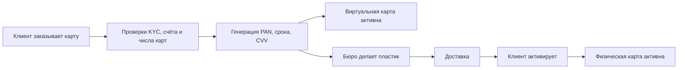
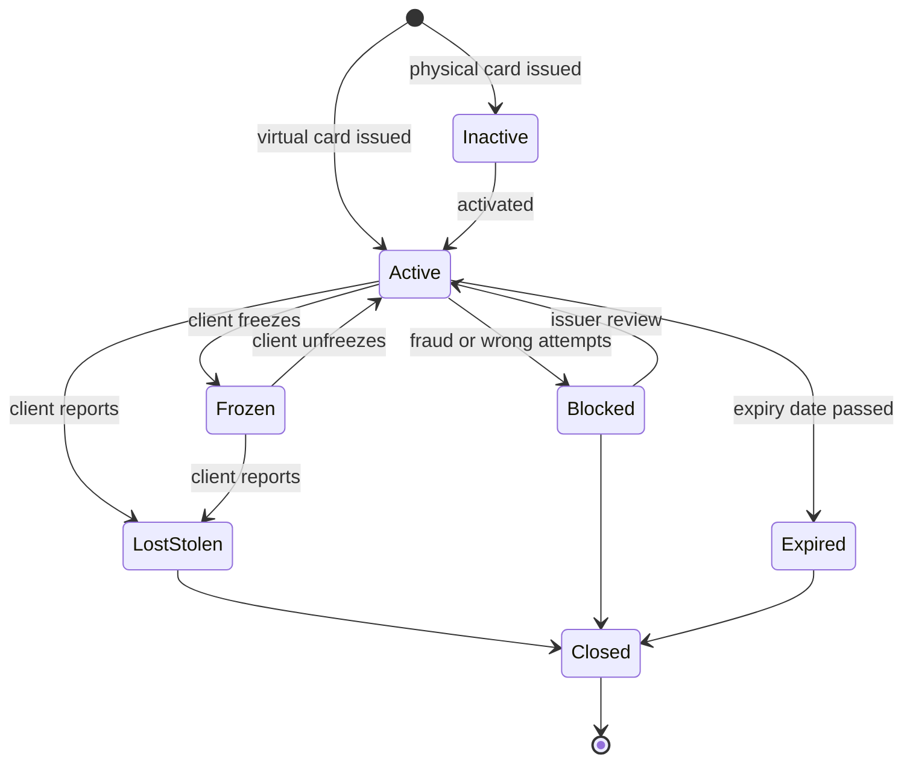

# Жизненный цикл карты

Карта — не просто номер, а объект с реквизитами, статусом и историей. Её заказывают,
изготавливают, доставляют, активируют, замораживают, блокируют, перевыпускают, продлевают и в
конце закрывают — и каждая смена статуса решает, какие платежи ещё разрешены. Эта страница
объясняет реквизиты карты, выпуск, статусы и переходы между ними, перевыпуск и токенизацию, и что
происходит с регулярными платежами и холдами, когда карта меняется.

## Как это работает

### Реквизиты карты

| Реквизит | Что это | Где можно хранить |
|---|---|---|
| **PAN** (Primary Account Number, номер карты) | Номер карты, обычно 16 цифр (бывают и другие длины) | Только в защищённом виде (шифрование, токен, усечение или хеш с ключом); показывается маскированным |
| **BIN / IIN** | Первые цифры PAN, которые определяют эмитента: идентификационный номер эмитента (Issuer Identification Number) в ISO/IEC 7812, в платежах его называют BIN (Bank Identification Number). Индустрия переходит с 6-значных на 8-значные BIN | Не секрет; используется для маршрутизации и определения типа карты |
| **Номер счёта внутри PAN (individual account number)** | Цифры между BIN и последней цифрой; выбирает эмитент | Часть PAN |
| **Контрольная цифра (check digit)** | Последняя цифра, считается по **алгоритму Луна (Luhn)**, чтобы ловить опечатки. Подробно — в [Тестовых данных](../09-test-data/ru.md) | Часть PAN |
| **Срок действия (expiry date)** | Месяц и год в формате `MM/YY`; обычно его понимают как «действует по последний день этого месяца», но точное правило задают платёжная система и эмитент — тестируйте своё требование (в card-wallet — до последнего дня месяца) | Можно хранить вместе с PAN |
| **CVV2 / CVC2** (код проверки карты, card verification code; у разных брендов также CID, CAV2, CVN2) | 3 или 4 цифры на карте для платежей без присутствия карты (card-not-present) | **Никогда не хранится после авторизации** — см. ниже |
| **PIN** (Personal Identification Number, ПИН-код) | Секретный код для банкоматов и платежей с чипом и ПИН | Не хранится после авторизации, даже в зашифрованном виде как PIN-блок |

**Почему CVV2 нельзя хранить.** PCI DSS (Payment Card Industry Data Security Standard, стандарт
безопасности данных индустрии платёжных карт) относит код проверки карты, PIN / PIN-блок и
полные данные дорожки или чипа к **чувствительным аутентификационным данным (sensitive
authentication data)**. Их нельзя хранить после авторизации платежа — ни в зашифрованном виде, ни
для сохранённой карты (card-on-file) или регулярных платежей, ни даже с согласия клиента
(требование 3.3.1; FAQ PCI SSC). Исключение — эмитенты и компании, обслуживающие выпуск карт,
при законной необходимости и с защитой этих данных (требование 3.3.3).
Причина: с PAN + сроком + CVV2 вор может платить онлайн. Поэтому мерчант, сохранивший карту,
спрашивает CVV2 заново или платит без него.

**Маскирование и хранение PAN.** Требование PCI DSS 3.4.1 разрешает показывать на экране или в
отчёте не больше BIN и последних четырёх цифр, если нет задокументированной бизнес-необходимости.
Требование 3.5.1 обязывает хранить PAN в нечитаемом виде; если используется хеш, то хеши,
созданные после 31 марта 2025 года, должны быть **ключевыми (keyed)** криптографическими хешами
(3.5.1.1). Простой хеш номера карты легко обратить: BIN и последние четыре цифры известны,
перебрать нужно лишь несколько цифр.

### Виртуальные и физические карты

- **Виртуальная карта (virtual card)** — существует только как данные в приложении. Её можно
  выпустить и использовать за секунды: показать в приложении (часто только после повторной
  аутентификации) и добавить в мобильный кошелёк.
- **Физическая карта (physical card)** — пластиковая или металлическая карта с чипом (часто и с
  бесконтактом). Её нужно изготовить, доставить и активировать; до этого она неактивна.

Будет ли у физической карты тот же PAN, что у виртуальной, — продуктовое решение; тестируйте то
правило, которое задал ваш продукт.

### Выпуск карты

1. **Заказ (order)** — клиент заказывает карту в приложении или отделении; эмитент проверяет, что
   счёт и клиент это позволяют (KYC пройден, счёт открыт, лимит количества карт не превышен).
2. **Генерация реквизитов** — процессинг эмитента создаёт PAN из диапазона своего BIN, срок
   действия и коды проверки.
3. **Изготовление и персонализация (production and personalisation)** (только физическая) —
   карточное бюро печатает карту и записывает данные и ключи в чип. У PCI SSC есть отдельные
   требования безопасности к изготовлению и выпуску карт (Card Production and Provisioning).
4. **Доставка (delivery)** — почтой или курьером; PIN отправляется отдельно или показывается в
   приложении.
5. **Активация (activation)** — клиент активирует карту (в приложении, первой операцией с чипом и
   ПИН или звонком), чтобы украденную из почты карту нельзя было использовать. Правила активации
   у эмитентов разные.

### Статусы и переходы

Названия статусов у эмитентов разные; ниже — типичные значения.

| Статус | Значение | Новые авторизации |
|---|---|---|
| Неактивна (inactive) | Изготовлена или отправлена, ещё не активирована | Отклоняются |
| Активна (active) | Обычная работа | Разрешены |
| Заморожена (frozen, временная блокировка) | Клиент приостановил карту в приложении, например пока ищет её | Отклоняются; клиент может разморозить |
| Заблокирована эмитентом (blocked) | Подозрение на мошенничество, слишком много неверных PIN/CVV, юридическая или комплаенс-причина | Отклоняются; разблокировать может только эмитент |
| Утеряна / украдена (lost / stolen) | Клиент сообщил; статус **окончательный** | Отклоняются; карта больше не активируется, выпускается новая с новым PAN |
| Истёк срок (expired) | Срок действия прошёл | Отклоняются |
| Закрыта (closed) | Карта прекращена (счёт закрыт, карта заменена) | Отклоняются |

Главное правило для тестирования: **временные статусы могут вернуться в «Активна»,
окончательные — нет.** В ЕЭЗ статья 68 PSD2 разрешает поставщику платёжных услуг блокировать
платёжный инструмент по объективно обоснованным причинам безопасности (например, при подозрении
на мошенничество), обязывает сообщить об этом плательщику и разблокировать или заменить
инструмент, когда причины отпали. Статья 70 требует дать плательщику возможность в любое время
сообщить об утере или краже и не допускать никакого использования карты после такого сообщения.

Блокировка останавливает **новые** авторизации. Она не отменяет то, что уже произошло:
существующий холд остаётся на счёте, пока его не спишет клиринг или не снимут, а клиринговая
запись по платежу, авторизованному до блокировки, обычно всё равно обрабатывается — точный
порядок задают правила платёжной системы и настройки эмитента (см.
[область 01](../01-card-payment/ru.md)).

### Счётчики неверных PIN и CVV

Эмитент считает неудачные попытки и блокирует карту после заданного им лимита; у чиповых карт
есть ещё и собственный счётчик попыток PIN на чипе для офлайн-проверки. Уточните в требованиях:
что сбрасывает счётчик; считаются ли попытки подряд или за день; влияют ли отказы по другим
причинам (недостаточно средств) — не должны; является ли некорректный ввод (буквы, не та длина)
ошибкой валидации, а не неверной попыткой; после лимита блокируется вся карта или только
проверка PIN/CVV, и кто может разблокировать?

### Перевыпуск, продление и замена

| Случай | PAN | Срок | CVV2 | Старая карта |
|---|---|---|---|---|
| **Продление (renewal)** (срок скоро истекает) | Обычно тот же | Новый | Новый | Работает до своего срока или до активации новой — по правилу эмитента |
| **Перевыпуск из-за повреждения (reissue)** | Тот же или новый — по правилу эмитента | Новый | Новый | Блокируется при активации новой или сразу |
| **Замена после утери, кражи или компрометации (replacement)** | **Новый** | Новый | Новый | Сразу блокируется навсегда |

Новая карта обычно получает и новый CVV2 (практика эмитента; уточните правило), а платежи по
сохранённой карте со старым сроком могут не пройти, даже если PAN тот же. Настройки карты — лимиты, бесконтакт вкл/выкл,
онлайн вкл/выкл, токены кошельков — должны переноситься или сбрасываться по ясному правилу.

### Лимиты по карте

У карты могут быть свои лимиты на операцию, день или месяц и по каналам (банкомат, онлайн,
бесконтакт, за границей) поверх лимитов счёта. Они должны сохраняться при перевыпуске. Граничные
значения лимитов разобраны в [области 01](../01-card-payment/ru.md) и области 06.

### Токенизация

**Платёжный токен (payment token)** — другой номер, который заменяет PAN. Для **сетевого токена
(network token)** платёжная система (Visa Token Service, Mastercard MDES) или другой поставщик
токенов создаёт токен, хранит связь токен ↔ PAN в хранилище (vault) и может ограничить токен
одним устройством, одним мерчантом или одним каналом (domain restriction). Фреймворк EMVCo
Payment Tokenisation описывает роли: **запросчик токена (token requestor)** — кошелёк вроде
Apple Pay или Google Pay или мерчант — и **поставщик токенов (token service provider)**.

- В Apple Pay эмитент создаёт **номер счёта устройства (Device Account Number)**, который
  хранится в защищённом элементе (secure element) телефона; Apple не хранит полный номер карты.
  Каждый платёж использует одноразовый динамический код безопасности.
- Эмитент может **приостановить, возобновить или удалить** токен (Visa Token Service называет
  эти возможности эмитента; MDES предлагает сервисы управления жизненным циклом токенов). Поэтому заморозка пластиковой карты не
  означает автоматически заморозку токена в телефоне — это зависит от интеграции эмитента.
  Проверяйте оба направления.

### Регулярные платежи и сервисы обновления карт

Когда карту заменяют, мерчанты, сохранившие старый PAN (подписки, card on file), получают
отказы. **Сервисы обновления реквизитов (account updater)** передают новые данные карты: через
Visa Account Updater (VAU) эмитенты, эквайеры и допущенные мерчанты обмениваются новыми PAN,
сроками и данными о закрытых счетах; в Mastercard Automatic Billing Updater (ABU) эмитенты
сообщают о создании, изменении и закрытии счетов, а зарегистрированные мерчанты получают эти
обновления (push или pull). Мерчант, сохранивший сетевой токен вместо PAN, может избежать
отказа — это зависит от платёжной системы и интеграции эмитента. Ничего из этого не работает,
если эмитент и мерчант (или его эквайер) не участвуют. Для
**украденной** карты эмитент должен решить, передавать ли новый PAN вообще: мошенник мог
оформить подписку на старую карту.

### Разбор примера: потерянная карта

У Анны дебетовый счёт в EUR с балансом по книге EUR 900.00 и физическая карта, выпущенная в
ноябре 2026 года (срок 11/29). Она платит за стриминговую подписку EUR 12.99 15-го числа каждого
месяца картой, сохранённой у мерчанта.

| Дата и время (CET) | Событие | Статус карты | Холды | Доступно |
|---|---|---|---|---|
| 3 ноя 2026 10:00 | Карта заказана; виртуальная карта сразу в приложении | Виртуальная: активна; физическая: неактивна | 0.00 | 900.00 |
| 6 ноя 2026 18:20 | Пластик доставлен, активирован в приложении | Активна | 0.00 | 900.00 |
| 12 ноя 2026 15:00 | Предавторизация отеля EUR 120.00 | Активна | 120.00 | 780.00 |
| 13 ноя 2026 22:40 | Не может найти кошелёк; замораживает карту в приложении | Заморожена | 120.00 | 780.00 |
| 14 ноя 2026 08:15 | Карта не нашлась; сообщает об утере. Старый PAN заблокирован навсегда, заказана новая карта с новым PAN | Старая: утеряна; новая: неактивна | 120.00 | 780.00 |
| 14 ноя 2026 11:00 | Отель при выезде списывает (capture) EUR 120.00 (авторизовано до блокировки) | Старая: утеряна | 120.00 | 780.00 |
| 15 ноя 2026 00:05 | Подписка EUR 12.99 на старый PAN | Старая: утеряна — отказ | 120.00 | 780.00 |
| 15 ноя 2026 06:00 | Клиринг отеля EUR 120.00 проведён, холд снят; баланс по книге 780.00 | Старая: утеряна | 0.00 | 780.00 |
| 18 ноя 2026 17:30 | Новая карта доставлена и активирована; лимиты скопированы со старой | Новая: активна | 0.00 | 780.00 |
| 19 ноя 2026 09:00 | Мерчант повторяет платёж с новым PAN, полученным через account updater, или Анна вводит карту заново | Новая: активна | 0.00 | 767.01 |

На что обратить внимание:

- Заморозка была обратимой; сообщение об утере — нет.
- Блокировка не остановила клиринг отеля: платёж был авторизован до неё.
- По статье 74 PSD2 плательщик может нести убытки до EUR 50 от неавторизованных платежей с
  утерянного или украденного инструмента до сообщения об утере (с исключениями) и никаких — после
  сообщения, если не действовал мошеннически. Платёж, одобренный по старому PAN после 08:15
  14 ноября, — не убыток Анны; перед ней его несёт эмитент.
- Продление в ноябре 2029 года обычно сохранило бы PAN и сменило бы срок и CVV2 (по правилу эмитента).

## Участники и потоки денег

| Участник | Роль | Что отправляет / получает и когда | Какой риск несёт |
|---|---|---|---|
| Держатель карты (cardholder) | Пользуется картой | Заказывает, активирует, замораживает, сообщает об утере; платит комиссии за карту, если они есть в тарифе | Неавторизованные платежи до сообщения об утере (в ЕЭЗ ограничено статьёй 74 PSD2) |
| Эмитент (issuer: банк или эмитент электронных денег, часто со спонсором BIN) | Владеет картой и её статусом | Генерирует реквизиты, ставит статусы и лимиты, отвечает на авторизации, передаёт обновления в account updater | Мошенничество по карте, которую должны были заблокировать; расходы на изготовление и доставку; жалобы |
| Процессинг эмитента (issuer processor) | Ведёт карточные системы для эмитента | Хранит данные карт, применяет статус и счётчики при авторизации | Операционный: смена статуса применена не вовремя |
| Карточное бюро и курьер | Изготавливают и доставляют пластик | Получают данные карт, возвращают файлы изготовления и отправки | Кража карт или данных |
| Платёжная система (card scheme) | Сеть, диапазоны BIN, сервис токенов, account updater | Маршрутизирует авторизации; выпускает и обновляет сетевые токены; передаёт обновления PAN | Операционный; устанавливает правила для остальных |
| Запросчик токена (кошелёк, мерчант) | Хранит токен вместо PAN | Запрашивает токен, получает обновления жизненного цикла | Использование токена, приостановленного эмитентом |
| Мерчант с сохранённой картой | Списывает регулярные платежи | Списывает с сохранённой карты; запрашивает новые реквизиты в updater | Потеря выручки из-за отказов; чарджбэки, если продолжает списывать с закрытой карты |

Деньги двигаются только через платежи (область 01) и комиссии за карту. Жизненный цикл карты
решает, **можно ли одобрить платёж** и **кто платит за мошенничество**.

## Бизнес-риски

### Компания (эмитент)

- Утерянная или украденная карта всё ещё одобряет платежи, потому что статус дошёл не до всех
  каналов (пластик, токены, банкомат) → убыток от мошенничества несёт эмитент.
- Данные карты хранятся неправильно (CVV2 после авторизации, PAN открытым текстом или простым
  хешем) → несоответствие PCI DSS, штрафы платёжных систем, утечка данных.
- Слишком строгие счётчики блокируют добросовестных клиентов → звонки в поддержку, потерянные
  траты.
- Активация без проверок → карты, украденные из почты, используются.

### Клиент

- Не может платить, потому что карту заблокировали по ошибке или её нельзя разморозить.
- Замороженная карта продолжает работать в кошельке телефона.
- Подписки останавливаются после продления — или продолжают списывать после замены украденной
  карты, потому что updater передал новую карту.

### Регулятор / комплаенс

- PSD2, статьи 68–70 и 74: блокировка только по обоснованным причинам и с уведомлением
  плательщика; возможность в любое время сообщить об утере; никакого использования после
  сообщения; пределы ответственности.
- PCI DSS, требование 3: никаких чувствительных аутентификационных данных после авторизации;
  маскирование; ключевые хеши.
- GDPR для персональных данных клиента на карте и в данных доставки (область 08).

## Что тестировать

- [ ] Новая карта получает PAN из нужного диапазона BIN, верную контрольную цифру Луна, правильный срок и CVV.
- [ ] Полный PAN и CVV показываются только там, где разрешено (ответ на выпуск, защищённый просмотр), везде остальное — маска.
- [ ] CVV2 и PIN не хранятся после авторизации (база, логи, таблицы идемпотентности, очереди); PAN хранится зашифрованным, токеном или ключевым хешем.
- [ ] Лимит количества карт на счёт; какие статусы в него входят.
- [ ] Физическую карту нельзя использовать до активации; активировать может только владелец.
- [ ] Каждый разрешённый переход работает; каждый запрещённый отклоняется (таблица переходов, включая недопустимые пары).
- [ ] Окончательные статусы (утеряна, украдена, закрыта) никогда не становятся «Активна».
- [ ] Заморозка и блокировка действуют во всех каналах: с присутствием карты, онлайн, банкомат, токены в телефоне.
- [ ] Граница срока: карта действует в последний день месяца срока и отклоняется на следующий день; в заданном часовом поясе.
- [ ] Счётчик неверных PIN/CVV: растёт, блокирует на лимите, сбрасывается по правилу, не реагирует на другие отказы и некорректный ввод.
- [ ] Продление сохраняет PAN и меняет срок и CVV; замена после утери меняет PAN.
- [ ] Лимиты и настройки переносятся на перевыпущенную карту.
- [ ] Холды и клиринги старой карты обрабатываются и после блокировки или перевыпуска.
- [ ] Регулярный платёж на старую карту после замены: код отказа, поток updater, отсутствие списания после сообщения о краже, если таково правило.
- [ ] Другой клиент не может прочитать, заморозить или заблокировать мою карту (авторизация на уровне объекта).
- [ ] Параллельные запросы: заморозка и платёж одновременно; два запроса «выпустить карту» на границе лимита.

| ID | Условие / шаги | Ожидаемый результат |
|---|---|---|
| CL-01 | На счёте 3 активные карты (лимит 3); выпустить 4-ю | Отказ; после блокировки одной карты новую выпустить можно |
| CL-02 | Срок карты 11/29; платёж 30 ноя 2029 23:59 UTC и 1 дек 2029 00:00 UTC | Первый одобрен, второй отклонён — срок истёк |
| CL-03 | Неверный CVV дважды, верный один раз, неверный дважды | Карта остаётся активной (успех сбросил счётчик) |
| CL-04 | Неверный CVV 3 раза подряд | 3-я попытка отклонена как неверный CVV; карта заблокирована с причиной «слишком много попыток»; 4-я отклонена как заблокированная, счётчик не меняется |
| CL-05 | Заморозить карту; платить пластиком и кошельком телефона; разморозить; платить снова | Пока заморожена — оба отказа; после разморозки одобрено |
| CL-06 | Сообщить об утере; попробовать разморозить или активировать карту | Отказ; статус остаётся «утеряна»; у новой карты новый PAN |
| CL-07 | Холд EUR 120.00 12 ноя, карта утеряна 14 ноя, клиринг 15 ноя | Клиринг проведён, холд снят; новых авторизаций по старому PAN нет |
| CL-08 | Продление: старая карта 11/29, выпущена новая; проверить PAN, срок, CVV, лимиты, токены | Тот же PAN, новые срок и CVV; лимиты и токены перенесены по правилу |
| CL-09 | Клиент B вызывает «заблокировать карту» с id карты клиента A | 404, как для несуществующей карты; карта A не изменилась |
| CL-10 | Два параллельных запроса «выпустить карту», когда на счёте 2 активные карты | Выпущена ровно одна карта; второй запрос отклонён с ошибкой лимита |

## Типичные дефекты

1. **Счётчик не сбрасывается после успеха.** Случайные опечатки накапливаются и блокируют
   добросовестного клиента. Ловится тестом последовательности (неверно, неверно, верно, неверно,
   неверно). Найдено в card-wallet:
   [BUG-03](https://github.com/Tomullya/card-wallet/blob/main/docs/qa/bug-reports/BUG-03.md).
2. **Чужая карта видна или изменяема (IDOR).** API проверяет вход, но не владельца. Ловится
   вызовом каждого карточного эндпоинта с токеном другого пользователя. Найдено в card-wallet:
   [BUG-04](https://github.com/Tomullya/card-wallet/blob/main/docs/qa/bug-reports/BUG-04.md).
3. **PAN восстанавливается из хранилища.** Простой хеш PAN перебирается, потому что BIN и
   последние четыре цифры известны. Ловится ревью того, что хранится, и попыткой это обратить.
   Найдено в card-wallet: [BUG-10](https://github.com/Tomullya/card-wallet/blob/main/docs/qa/bug-reports/BUG-10.md);
   утечка CVV в техническое хранилище:
   [BUG-11](https://github.com/Tomullya/card-wallet/blob/main/docs/qa/bug-reports/BUG-11.md).
4. **Некорректный ввод считается неверной попыткой.** Нелатинские цифры или неверная длина
   проходят валидацию и увеличивают счётчик. Ловится классами входных данных для полей PIN/CVV.
   Найдено в card-wallet:
   [BUG-12](https://github.com/Tomullya/card-wallet/blob/main/docs/qa/bug-reports/BUG-12.md).
5. **Переход разрешён из неправильного состояния.** Просроченную, закрытую или утерянную карту
   можно заблокировать, разморозить или активировать. Ловится таблицей переходов, где есть и
   недопустимые пары. Найдено в card-wallet (клиент может заблокировать карту с истёкшим сроком):
   [BUG-13](https://github.com/Tomullya/card-wallet/blob/main/docs/qa/bug-reports/BUG-13.md).
6. **Срок действия с ошибкой на единицу или в неверном часовом поясе.** Отказ в последний
   действующий день или лишний день работы. Ловится последним днём месяца около полуночи по UTC и
   по местному времени.
7. **Статус применён не во всех каналах.** Пластик заморожен, а токен в телефоне или банкомат
   работает. Ловится проверкой каждого канала после каждой смены статуса.
8. **Перевыпуск теряет настройки.** Новая карта получает лимиты по умолчанию, или старая карта
   работает после активации новой. Ловится сравнением настроек старой и новой карты и платежом
   старой картой после переключения.

## В card-wallet

В [card-wallet](https://github.com/Tomullya/card-wallet) **только виртуальные карты** с тремя
итоговыми статусами: `ACTIVE`, `BLOCKED` и `EXPIRED`.

- Требования BR-CARD-01…06 — выпуск, реквизиты, просмотр, блокировка клиентом, срок, 3 неверных
  CVV: [BR-cards.md](https://github.com/Tomullya/card-wallet/blob/main/docs/requirements/BR-cards.md).
- Не больше 3 активных карт на счёт; заблокированные и просроченные не считаются; статус
  вычисляется (`BLOCKED` важнее, затем `EXPIRED`, если сегодняшняя дата по UTC позже срока):
  [cards.py](https://github.com/Tomullya/card-wallet/blob/main/wallet-api/app/services/cards.py).
- PAN с вымышленным префиксом `400000` и контрольной цифрой Луна; срок = последний день месяца
  выпуска через 3 года; PAN хранится как последние 4 цифры плюс ключевой хеш HMAC-SHA256:
  [card_numbers.py](https://github.com/Tomullya/card-wallet/blob/main/wallet-api/app/services/card_numbers.py),
  [test_card_numbers.py](https://github.com/Tomullya/card-wallet/blob/main/tests/unit/test_card_numbers.py),
  [test_cards_storage.py](https://github.com/Tomullya/card-wallet/blob/main/tests/db/test_cards_storage.py).
- Полный PAN и CVV — только в ответе на выпуск; CVV хранится только как хеш.
- 3 неверных CVV подряд → `BLOCKED` / `TOO_MANY_FAILED_ATTEMPTS`; разблокировка не поддерживается:
  [payments.py](https://github.com/Tomullya/card-wallet/blob/main/wallet-api/app/services/payments.py),
  [test_cvv_attempts.py](https://github.com/Tomullya/card-wallet/blob/main/tests/api/test_cvv_attempts.py).
- API-тесты карт (лимит 3, место освобождается блокировкой или истечением срока, карта действует в
  день окончания срока, повторная блокировка, маскирование, чужая карта → 404):
  [test_cards.py](https://github.com/Tomullya/card-wallet/blob/main/tests/api/test_cards.py),
  тест-кейсы [TC-cards.md](https://github.com/Tomullya/card-wallet/blob/main/docs/qa/test-cases/TC-cards.md).
- Потренироваться в тестировании переходов состояний на статусах карты можно в тренажёре ISTQB Lab:
  [раздел 4.2, тренажёр](https://tomullya.github.io/card-wallet/istqb/#/s/4.2/trainer).

Можно добавить (честно о пробелах — card-wallet упрощённое демо):

- Заморозку и разморозку клиентом как временный статус, отдельный от окончательной блокировки.
- Перевыпуск и продление: тот же PAN с новыми сроком и CVV против нового PAN после утери; перенос лимитов.
- Физическую карту со статусом `INACTIVE` и активацией.
- Простую таблицу токенов (токен ↔ карта) с приостановкой и возобновлением, чтобы тестировать синхронизацию статусов.

## Источники

- [ISO/IEC 7812-1:2017 — идентификация эмитентов, система нумерации](https://www.iso.org/standard/70484.html) — стандарт, который определяет IIN и структуру PAN.
- [FAQ PCI SSC: можно ли хранить коды проверки карты для card-on-file и регулярных платежей](https://www.pcisecuritystandards.org/faqs/1280/) — CVV2/CVC2 нельзя хранить после авторизации, даже зашифрованными или с согласия клиента; исключение для эмитентов.
- [FAQ PCI SSC: маскирование и усечение PAN при 8-значных BIN](https://www.pcisecuritystandards.org/faqs/1492/) — требование 3.4.1 о маскировании (BIN и последние четыре цифры), 3.5.1 о нечитаемом хранении, ключевые хеши после 31 марта 2025.
- [Библиотека документов PCI SSC](https://www.pcisecuritystandards.org/document_library/) — PCI DSS v4.0.1 и требования Card Production and Provisioning.
- [Директива (ЕС) 2015/2366 (PSD2)](https://eur-lex.europa.eu/eli/dir/2015/2366/oj) — ст. 68 о блокировке платёжного инструмента, ст. 69–70 о сообщении об утере и краже, ст. 74 об ответственности плательщика.
- [Visa Token Service](https://visa.ca/en_CA/partner-with-us/payment-technology/visa-token-service.html) — хранилище токенов, ограничения по домену, возможность эмитента приостановить, возобновить или удалить токен.
- [Mastercard Digital Enablement Service (MDES)](https://developer.mastercard.com/product/mdes) — токенизация Mastercard и управление жизненным циклом токенов для кошельков и сохранённых карт.
- [Apple Pay: обзор безопасности и конфиденциальности](https://support.apple.com/101554) — Device Account Number в защищённом элементе, одноразовый динамический код, приостановка карт при потере устройства.
- [Visa Account Updater, обзор](https://developer.visa.com/capabilities/vau/overview) — эмитенты, эквайеры и допущенные мерчанты обмениваются обновлёнными PAN, сроками и данными о закрытых счетах для сохранённых карт и регулярных платежей.
- [Mastercard Automatic Billing Updater](https://developer.mastercard.com/automatic-billing-updater/documentation/) — эмитенты сообщают о создании, изменении и закрытии счетов; мерчанты получают обновлённые реквизиты.
