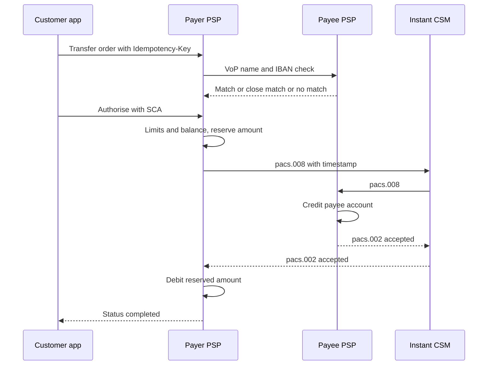

# Transfers: SEPA, instant payments, R-transactions, idempotency, cut-off times

A bank transfer looks simple: an IBAN, a name and an amount. Underneath there are two schemes
with different clocks: the standard SEPA credit transfer works on banking business days and
cut-off times, and the instant one works around the clock with a 10-second limit. Plus rejects,
returns and recalls that come back days later. This page follows one euro transfer through both
schemes and shows where duplicates, holidays and time zones cause defects.

## How it works

### Credit transfer vs direct debit

| | Credit transfer | Direct debit |
|---|---|---|
| Who starts it | The **payer** (the one who pays) "pushes" money | The **payee** (creditor) "pulls" money from the payer's account |
| Consent | The payer authorises each transfer | The payer signs a **mandate** once: permission for this creditor to collect |
| Typical use | Rent, salary, paying an invoice | Utility bills, subscriptions, loan instalments |
| SEPA scheme | SCT and SCT Inst | SDD Core (consumers) and SDD B2B (businesses) |
| Money back | Only by recall or a new transfer from the payee | For an authorised direct debit, the payer can ask for a refund within 8 weeks of the debit (PSD2 Article 77) |

A **mandate** is defined in the SEPA Regulation (EU) 260/2012 as the payer's consent to the
payee and to the payer's bank to collect from a specified account. The payer can tell their bank
to limit collections by amount or frequency. The rest of this page is about credit transfers.

### SEPA and the schemes

**SEPA (Single Euro Payments Area)** is a set of countries where euro payments work the same way
across borders as at home. The rules for each payment type are a **scheme rulebook**
published by the **European Payments Council (EPC)**, an association of payment service providers.
Banks and other payment service providers (PSPs) join a scheme; this commitment to make and
receive payments is called **reachability**.

- **SCT (SEPA Credit Transfer)**. The payer's PSP must get the money to the payee's PSP
  **within one banking business day** after it receives the order (D+1), the same limit as PSD2
  Article 83. A **banking business day** in the SCT rulebook equals a **T2 day**: a day when
  T2, the Eurosystem's large-value settlement system, is open. Current rulebook: SCT 2025,
  effective 5 October 2025.
- **SCT Inst (SEPA Instant Credit Transfer)**. Available 24 hours a day on every calendar day.
  Under the SEPA Regulation as amended by the **Instant Payments Regulation (IPR), (EU)
  2024/886**, the payee's PSP must credit the payee and confirm to the payer's PSP **within
  10 seconds** of the moment the payer's PSP received the order. If no confirmation arrives in
  10 seconds, the payer's PSP must immediately restore the payer's account, for example by
  lifting the reserved amount (EPC status update, June 2026). The 2025 SCT Inst rulebook
  has also been effective since 5 October 2025.
- **Amount limits.** The SCT rulebook says value limits may exist between participants and that
  a PSP may set its own limits for its products. For instant transfers the IPR adds a customer
  right: on request, the PSP must let the customer set a **maximum amount per day or per
  transaction**, change it at any time, and not execute an order that exceeds it but tell the payer
  (IPR Article 5a). Older
  SCT Inst rulebook versions had a scheme-wide maximum amount; check the current rulebook
  before quoting a figure.

### What the IPR changed, with dates

| Obligation (IPR article) | Euro-area PSPs | Non-euro-area PSPs |
|---|---|---|
| Receive instant credit transfers (5a) | 9 Jan 2025 | 9 Jan 2027 |
| Send instant credit transfers (5a) | 9 Oct 2025 | 9 Jul 2027 |
| E-money and payment institutions: receive and send (5a) | 9 Apr 2027 | receive 9 Apr 2027, send 9 Jul 2027 |
| Instant no more expensive than standard (5b) | 9 Jan 2025 | 9 Jan 2027 |
| Verification of payee (5c) | 9 Oct 2025 | 9 Jul 2027 |

Dates are from the ECB's IPR page (Table 1). Rules differ for non-euro countries in other
details too (for example, a later deadline, 9 June 2028, for sending instant transfers outside
business hours from accounts in national currency).

**Verification of payee (VoP)** applies to **all** credit transfers, standard and instant. Right
after the payer enters the IBAN and the payee's name, and **before** the payer authorises the
transfer, the payer's PSP asks the payee's PSP whether they match. The outcome is a **match**,
a **close match** (the payer is shown the real name), **no match** (warning: the money may go to
someone else), or **check not possible**. The service is free, it must not block the payer from
authorising, and business customers may opt out for bulk files. If the payer's PSP skips VoP and
money goes to the wrong person as a result, the PSP must refund the payer (IPR Article 5c).
The EPC runs a separate VOP scheme; its rulebook version 1.1 became effective on 20 September 2026.

**Sanctions screening** for instant transfers moved from "check every payment" to "check your own
customers": PSPs must check their customers against EU sanctions lists at least once every
calendar day and whenever the lists change, and must not screen payer and payee against EU
sanctions lists during the instant transfer itself (IPR Article 5d). Limits, fraud and AML
screening are covered in [area 06](../06-limits-fraud-aml/en.md).

### IBAN, BIC and the end-to-end ID

- **IBAN (International Bank Account Number)** identifies one payment account; its format is set
  by ISO (ISO 13616). Validating it is covered in [Test data](../09-test-data/en.md).
- **BIC (Business Identifier Code)** identifies a PSP. Since 1 February 2016 (cross-border) PSPs
  must not require customers to give the BIC: the IBAN is enough (SEPA Regulation Article 5(7)).
- **End-to-end ID** (`EndToEndId`, up to 35 characters) is the payer's own reference. It travels
  unchanged through the whole chain and is meant for reconciliation; if the payer has none, the
  value `NOTPROVIDED` is used (EPC inter-PSP implementation guidelines).

### ISO 20022 messages (names and roles)

**ISO 20022** is the standard for financial XML messages. SEPA, T2 and many other systems use it.

| Message | Name | Between | Role |
|---|---|---|---|
| pain.001 | Customer Credit Transfer Initiation | Customer → own PSP | "Please pay": one or many transfers |
| pain.002 | Customer Payment Status Report | PSP → customer | Status of the order, for example a reject |
| pacs.008 | FI to FI Customer Credit Transfer | PSP → clearing → PSP | The transfer itself between PSPs |
| pacs.002 | FI to FI Payment Status Report | PSP ↔ PSP | Reject (status `RJCT`); in SCT Inst also the confirmation |
| pacs.004 | Payment Return | Payee's PSP → payer's PSP | Return of a settled transfer, or positive answer to a recall |
| camt.056 | FI to FI Payment Cancellation Request | Payer's PSP → payee's PSP | Recall |
| camt.029 | Resolution of Investigation | Payee's PSP → payer's PSP | Negative answer to a recall |
| camt.054 | Bank to Customer Debit Credit Notification | Bank → account holder | Notice of single debits and credits |
| camt.053 | Bank to Customer Statement | Bank → account holder | End-of-day account statement |

### R-transactions: when a transfer does not go through

The SEPA Regulation calls every exception an **R-transaction**. For SCT (EPC rulebook 2025):

- **Reject**: refused **before** inter-PSP settlement (wrong format, invalid IBAN, closed
  account found early). It goes back the same way with a reason code, usually the same day,
  at the latest the next banking business day.
- **Return**: the money was already settled between PSPs, but the payee's PSP cannot credit the
  account (wrong account number, account closed: codes like `AC04` ClosedAccountNumber). It
  must be sent within **3 banking business days** after the settlement date. Not to be used when
  the payee simply wants to give the money back: that is a new transfer.
- **Recall**: the payer's PSP asks to cancel a transfer it sent, only for **duplicate sending**
  (`DUPL`), **technical problems** (`TECH`), within 10 banking business days, or
  **fraud** (`FRAD`), within 13 months. Only one recall per transfer; the payee's PSP must
  answer within 15 banking business days; a positive answer comes as a pacs.004.
- **Request for recall by the originator**: the customer wants money back for another reason
  (wrong amount, wrong payee). It succeeds only if the payee agrees.
- For direct debits the rulebooks add the **refund** (payer gets money back from their own bank:
  8 weeks for authorised debits under PSD2 Article 77; the payer must report an unauthorised one
  within 13 months under Article 71), plus refusal, reversal and request for cancellation.

For SCT Inst the outcome is known in seconds: confirmed or rejected. After that, only a recall or
a request for recall can bring money back.

### Cut-off times, business days and value date

- **Cut-off time**: the latest time of day at which an order counts as received "today". PSD2
  Article 78 lets a PSP set it **near the end of a business day**; anything later, and anything
  received on a non-business day, counts as received on the next business day. The SCT rulebook
  leaves cut-off times to each PSP, which must tell its customers. **Rules differ by PSP.**
- **TARGET closing days** (ECB calendar): Saturdays, Sundays, 1 January, Good Friday, Easter
  Monday, 1 May, 25 and 26 December. In 2026: 3 April, 6 April, 1 May, 25 December (Friday) and
  26 December (Saturday). SCT Inst does not stop on these days.
- **Value date**: the date from which money counts for interest. The payee's credit value date is
  no later than the business day the money reaches the payee's PSP (PSD2 Article 87); for instant
  transfers it is the same date the payee's account is credited (IPR).
- **Time zone**: the cut-off is defined in the PSP's time (usually CET/CEST for euro schemes),
  not the customer's. A customer in Lisbon at 15:30 local time is at 16:30 in Frankfurt.

### Idempotency and duplicate detection

A mobile app can send the same "pay" request twice: a timeout, a double tap, a retry. Three
layers protect against double payment:

1. **API idempotency.** The client sends an `Idempotency-Key` header. Same key and same body:
   the stored response comes back and nothing new is created. Same key and different body:
   error. The check and the debit must happen in one database transaction, or two parallel
   requests can both pass.
2. **Business duplicate check.** A new key, but the same IBAN, amount and reference within a
   short window. Usually the app **warns** ("you sent this 2 minutes ago") rather than blocks,
   because rent paid twice in a month can be real.
3. **Scheme level.** One customer order produces exactly one pacs.008 with one end-to-end ID.
   After a timeout, the system asks for the status; it never resends a new pacs.008. If a
   duplicate does get out, the remedy is a recall with reason `DUPL`.

### Worked example: rent before Christmas 2026

Anna lives in Lisbon and pays EUR 850.00 rent to her landlord Ben, who banks in Germany. Her
wallet provider's SCT cut-off is 16:00 CET (illustrative; each PSP sets its own).

**A. Standard SCT**

| Time (CET) | Event |
|---|---|
| Thu 24 Dec 2026, 16:30:00 | Anna taps "Send" at 15:30 her time. The app shows "15:30" and she thinks it is before the cut-off. In CET it is 16:30: after the cut-off |
| Thu 24 Dec, 16:30:01 | VoP returns "match" for IBAN `DE..` and "Ben Weber" |
| Fri 25 Dec, Sat 26 Dec, Sun 27 Dec | TARGET closing days and weekend: no SCT processing |
| Mon 28 Dec 2026 | Order counts as received: day D. Debit value date 28 Dec. pacs.008 sent in the first batch |
| Tue 29 Dec 2026 | Latest day (D+1) for the money to reach Ben's PSP. Ben's credit value date: no later than this day |
| Wed 30 Dec 2026 | The wallet's bank sends camt.053 for 29 Dec; the line with end-to-end ID `RENT-2026-12` matches the outgoing transfer |

What the tester checks: the app tells Anna the expected date **28–29 Dec**, not "tomorrow";
the amount is reserved from 24 Dec, so her available balance drops at once; reports that use UTC
show 15:30 UTC on 24 Dec, and both ledger and statement agree on the booking dates.

If Ben's account were closed, Ben's PSP would send a **return** (pacs.004, reason `AC04`)
within 3 banking business days after settlement on 29 Dec. Fri 1 January 2027 is a TARGET
closing day, so the 3 days are 30 Dec, 31 Dec and Mon 4 Jan 2027, not 30 Dec to 1 Jan. Anna's EUR 850.00 is credited back
when the return arrives, linked to the original transfer.

**B. The same order as SCT Inst**

| Time (CET) | Event |
|---|---|
| Thu 24 Dec 2026, 16:30:00.000 | Order received: the 10-second clock starts; amount reserved |
| 16:30:00.400 | pacs.008 sent with a timestamp |
| 16:30:02.100 | Ben's PSP credits Ben, value date 24 Dec, sends pacs.002 accepted |
| 16:30:02.300 | Confirmation received; reservation becomes a debit; app shows "Completed" |

**C. The retry.** Anna's phone loses the network at 16:30:01, and the app retries at 16:30:06
with the **same** `Idempotency-Key`. The server returns the stored result of the first request:
one transfer, one pacs.008, one debit. If the retry had come **without** the key, the business
duplicate check would show "You sent EUR 850.00 to Ben Weber 6 seconds ago. Send again?".
Had the confirmation not arrived by 16:30:10.000, the reservation would be lifted and the app
would show "Failed"; a late pacs.002 must then not create a debit.

## Participants and money flows

| Participant | Role | Sends / receives and when | Who carries the risk |
|---|---|---|---|
| Payer (Anna) | Starts the credit transfer | Sends the order (app or pain.001); receives status and statement | Anna, if she ignores a VoP "no match" warning |
| Payer's PSP (the wallet or Anna's bank) | Checks, debits, sends | VoP, limits, sanctions-list status, debit; sends pacs.008; receives pacs.002, pacs.004, camt.029 | The payer's PSP for duplicates, lost orders, skipped VoP and late execution |
| CSM (clearing and settlement mechanism) | Routes and settles between PSPs | Batches for SCT on business days; 24/7 for SCT Inst | Operational risk: outages, late confirmations |
| T2 / TIPS (Eurosystem) | Settlement in central bank money | T2: large-value, real-time gross settlement on T2 days; TIPS: instant settlement | — |
| Payee's PSP (Ben's bank) | Credits the payee | Answers VoP; credits Ben; sends confirmation, reject or return; answers recalls | The payee's PSP if it credits late or answers VoP wrongly |
| Payee (Ben) | Receives money | Gets the credit with remittance information and end-to-end ID | Ben, if a mistaken payment must be returned |
| Wallet's partner bank | Holds the wallet's safeguarding account | Sends camt.054 during the day and camt.053 at end of day | The wallet, until each item is reconciled |

## Business risks

**Company**
- Duplicate transfer after a retry: the money is gone; a `DUPL` recall needs the payee's PSP to
  agree and takes days.
- Late execution after a missed holiday or cut-off: the PSP is liable for late execution
  (PSD2 Article 89) and may owe interest or fees.
- A late SCT Inst confirmation after the reservation was lifted, handled as a success: the
  customer is debited twice or not at all.
- Returns and recalls not linked to the original: money sits in suspense (area 02).

**Customer**
- Rent paid on 28 Dec instead of 24 Dec because the cut-off was shown in the wrong time zone.
- Money sent to the wrong person because VoP was skipped or its result hidden.
- Instant limit set by the customer ignored, or impossible to change.

**Regulator / compliance**
- Instant transfers more expensive than standard ones, or not offered after the IPR deadline.
- VoP missing in one channel (for example the web app has it, the API does not).
- Sanctions screening missing between daily runs, or customers not re-checked after a list
  update.
- From **15 November 2026** EPC messages accept only structured or hybrid addresses; payment
  files with unstructured addresses are rejected (EPC status update, June 2026).

## What to test

- [ ] IBAN validation (format, length, check digits) and no BIC required.
- [ ] VoP is called before authorisation in every channel; each outcome (match, close match, no match, not possible) shows the right message and still lets the payer authorise.
- [ ] Customer instant limit per day and per transaction: set, change, exceed, error text.
- [ ] Same `Idempotency-Key` + same body → same response, one transfer, one debit.
- [ ] Same key + different body → error, nothing created.
- [ ] Parallel requests with one key → exactly one transfer.
- [ ] Business duplicate warning for same IBAN, amount and reference within the window.
- [ ] One order → one pacs.008 → one end-to-end ID; a timeout leads to a status request, not a resend.
- [ ] Cut-off: orders 1 second before and after, in CET and CEST, from clients in other time zones.
- [ ] Business days: weekends and every TARGET closing day; execution date and value dates shown and stored correctly.
- [ ] Future-dated orders that fall on a closing day move to the next business day.
- [ ] SCT Inst: 10-second timeout lifts the reservation; a late confirmation is not booked as a success.
- [ ] Statuses: each status change is allowed by the state model; no jump from rejected to completed.
- [ ] Reject, return and recall each restore the balance once, linked to the original, with the reason code shown.
- [ ] Reconciliation: every outgoing transfer matches one camt.054/camt.053 line by end-to-end ID and amount; unmatched lines become breaks.
- [ ] Instant price is not higher than standard price.
- [ ] Unstructured address in a payment file is rejected with a clear error.

| ID | Condition / steps | Expected result |
|---|---|---|
| TR-01 | SCT order at 15:59:59 and at 16:00:01 CET on Wed 23 Dec 2026, cut-off 16:00 | First: D = 23 Dec. Second: D = 24 Dec. Execution dates shown to the customer match |
| TR-02 | Client in Lisbon (UTC+0) orders at 15:30 local on Thu 24 Dec 2026 | Counts as 16:30 CET, after cut-off; D = Mon 28 Dec (25–27 Dec closed) |
| TR-03 | Future-dated SCT for Fri 1 May 2026 | Executed Mon 4 May; customer told in advance |
| TR-04 | Two identical requests in parallel with one `Idempotency-Key` | One transfer, one pacs.008, one debit; both responses identical |
| TR-05 | Same key, amount changed from 850.00 to 580.00 | Error (for example 409), no second transfer |
| TR-06 | Instant transfer, payee PSP does not answer within 10 seconds | Reservation lifted at the 10-second mark; status failed; a pacs.002 arriving at 12 s does not debit |
| TR-07 | VoP returns close match "Ben Weber" for entered "Ben Webber" | Real name shown; payer can still send; choice logged |
| TR-08 | Customer instant limit EUR 500 per transaction, order EUR 850 | Not executed; message says how to change the limit |
| TR-09 | Return pacs.004 with `AC04` for a settled SCT | Balance restored once; original shows "returned"; link and reason stored |
| TR-10 | camt.053 has a credit line with no matching transfer, and one transfer has no line | Two breaks with amount, end-to-end ID and age; nothing auto-matched by amount only |

## Typical defects

- **Retry creates a second transfer.** The key is checked before the lock, or the key is saved
  after the payment is sent. Catch: parallel same-key test; count pacs.008 messages per order.
- **Cut-off checked in the client's or server's local time.** Catch: run TR-01/TR-02 with the
  server in UTC and the client in another zone, in both summer and winter time.
- **Holiday calendar hard-coded or out of date.** Next year's closing days missing, or Easter
  wrong. Catch: test against the ECB calendar for the next two years; Good Friday and Easter
  Monday move.
- **Late instant confirmation booked as success** after the 10-second rollback. Catch: stub the
  payee PSP to answer at 9.9 s and at 10.1 s.
- **Return or recall not linked to the original**, so the customer sees two unrelated credits or
  the original stays "completed". Catch: assert status and link after each R-transaction.
- **Reconciliation matches by amount only**, so two EUR 850.00 transfers swap. Catch: test with
  equal amounts and different end-to-end IDs.
- **End-to-end ID truncated or changed** (longer than 35 characters, special characters).
  Catch: boundary test at 35 and 36 characters; compare outgoing and statement values.
- **Idempotency record leaks sensitive data**: card-wallet
  [BUG-11](https://github.com/Tomullya/card-wallet/blob/main/docs/qa/bug-reports/BUG-11.md)
  found that the stored request hash included the CVV. Catch: review what goes into the stored
  request and response.

## In card-wallet

[card-wallet](https://github.com/Tomullya/card-wallet) is a simplified demo with top-ups and
card payments. It has **no transfers**: no IBAN, no SEPA messages, no cut-off. What it has
that this area builds on:

- [docs/requirements/BR-accounts.md](https://github.com/Tomullya/card-wallet/blob/main/docs/requirements/BR-accounts.md)
  (BR-ACC-03) — top-up: amount limits and an `APPROVED` `TOP_UP` transaction. The top-up
  endpoint in
  [wallet-api/app/routers/accounts.py](https://github.com/Tomullya/card-wallet/blob/main/wallet-api/app/routers/accounts.py)
  has **no** idempotency key (BR-ACC-03 does not ask for one), so a retried top-up is credited
  twice; a real incoming SEPA
  credit would be matched by end-to-end ID instead.
- [docs/requirements/BR-payments.md](https://github.com/Tomullya/card-wallet/blob/main/docs/requirements/BR-payments.md)
  (BR-PAY-07) — `Idempotency-Key` required, same key and body → same response, different body →
  `409 IDEMPOTENCY_KEY_REUSED`; BR-PAY-08 — after a `503` the key is not used up.
- [wallet-api/app/services/idempotency.py](https://github.com/Tomullya/card-wallet/blob/main/wallet-api/app/services/idempotency.py)
  and [wallet-api/app/services/payments.py](https://github.com/Tomullya/card-wallet/blob/main/wallet-api/app/services/payments.py)
  — key per client, hash of the validated request, a second key check **after** taking the
  account lock, key saved in the same database transaction as the payment.
- [tests/api/test_idempotency.py](https://github.com/Tomullya/card-wallet/blob/main/tests/api/test_idempotency.py)
  and [tests/api/test_concurrency.py](https://github.com/Tomullya/card-wallet/blob/main/tests/api/test_concurrency.py)
  — replay, `409`, `"10"` = `"10.00"`, declined result replayed, keys per user, key reusable after
  `503`, five parallel requests with one key → one charge.
- [docs/requirements/NFR.md](https://github.com/Tomullya/card-wallet/blob/main/docs/requirements/NFR.md)
  (NFR-02) — all timestamps in UTC, the base you need before adding a CET cut-off.

Could be added:

- an outgoing transfer endpoint (`POST /transfers`) with IBAN check, the existing idempotency
  service, and statuses `RECEIVED → SENT → COMPLETED / REJECTED / RETURNED`;
- a business-day calendar (TARGET closing days) and a CET cut-off, with tests TR-01 to TR-03;
- a fake instant CSM stub that answers in configurable time, to test the 10-second rollback;
- a camt.053-like CSV statement and a reconciliation job that matches by end-to-end ID.

## Sources

- [EPC — SEPA Credit Transfer Rulebook 2025, version 1.0 (PDF)](https://europeanpaymentscouncil.eu/sites/default/files/kb/file/2024-11/EPC125-05%202025%20SCT%20Rulebook%20version%201.0.pdf)
  — D+1 execution, cut-off out of scope, reject, return (3 days), recall reasons and periods,
  banking business day = T2 day; effective 5 October 2025.
- [EPC — SCT Inter-PSP Implementation Guidelines 2025 (PDF)](https://www.europeanpaymentscouncil.eu/sites/default/files/kb/file/2025-10/EPC115-06%20SCT%20Inter-PSP%20IG%202025%20V1.0.pdf)
  — roles of pacs.008, pacs.002, pacs.004, camt.056, camt.029; recall codes DUPL, TECH, FRAD;
  return code AC04; `NOTPROVIDED` when the payer gives no end-to-end reference.
- [EPC — SCT Customer-to-PSP Implementation Guidelines 2025 (PDF)](https://www.europeanpaymentscouncil.eu/sites/default/files/kb/file/2025-10/EPC132-08%20SCT%20C2PSP%20IG%202025%20V1.0.pdf)
  — pain.001 and pain.002; `EndToEndId` up to 35 characters, passed on unchanged.
- [EUR-Lex — Regulation (EU) 2024/886 (Instant Payments Regulation)](https://eur-lex.europa.eu/eli/reg/2024/886/oj)
  — Articles 5a–5d: 10 seconds, customer limits, price parity, VoP, sanctions screening.
- [ECB — Instant Payments Regulation](https://www.ecb.europa.eu/paym/retail/instant_payments/html/instant_payments_regulation.en.html)
  — table of deadlines for euro and non-euro PSPs and for e-money and payment institutions.
- [ECB — EPC status update for the ERPB, June 2026 (PDF)](https://www.ecb.europa.eu/paym/groups/erpb/shared/pdf/25th-ERPB%20meeting%20on%2018%20June%202026/Status_update_on_payment_and_payment-related_schemes.pdf)
  — SCT Inst rollback at 10 seconds, VOP rulebook 1.1 effective 20 September 2026,
  structured addresses from 15 November 2026.
- [EUR-Lex — Regulation (EU) 260/2012 (SEPA Regulation)](https://eur-lex.europa.eu/eli/reg/2012/260/oj)
  — definitions of mandate and R-transaction; no BIC required (Article 5(7)).
- [EUR-Lex — Directive (EU) 2015/2366 (PSD2)](https://eur-lex.europa.eu/eli/dir/2015/2366/oj)
  — Article 78 cut-off, Article 83 D+1, Article 87 value date, Article 77 8-week refund.
- [ECB — Working hours and TARGET closing days](https://www.ecb.europa.eu/ecb/contacts/working-hours/html/index.en.html)
  — TARGET closing days for 2026 and 2027.
- [ECB — What is T2?](https://www.ecb.europa.eu/paym/target/t2/html/index.en.html)
  — T2 as the Eurosystem's real-time gross settlement system, ISO 20022 based.
