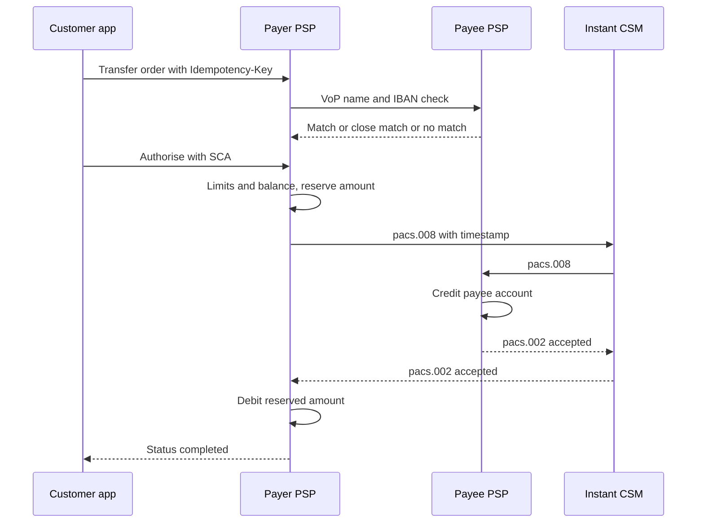

# Переводы: SEPA, мгновенные платежи, R-транзакции, идемпотентность, время отсечения

Банковский перевод выглядит просто: IBAN, имя и сумма. Внутри — две схемы с разными «часами»:
обычный SEPA-перевод живёт по банковским рабочим дням и времени отсечения (cut-off; в российских правилах — время окончания приёма
распоряжений), а
мгновенный работает круглосуточно с пределом в 10 секунд. Плюс отказы, возвраты и отзывы,
которые приходят через несколько дней. Эта страница проводит один перевод в евро через обе схемы
и показывает, где дубли, праздники и часовые пояса порождают дефекты.

## Как это работает

### Кредитовый перевод и прямое дебетование

| | Кредитовый перевод (credit transfer) | Прямое дебетование (direct debit) |
|---|---|---|
| Кто инициирует | **Плательщик (payer)** «толкает» деньги | **Получатель (payee, creditor)** «тянет» деньги со счёта плательщика |
| Согласие | Плательщик авторизует каждый перевод | Плательщик один раз подписывает **мандат (mandate)** — разрешение этому кредитору списывать |
| Типичное применение | Аренда, зарплата, оплата счёта | Коммунальные услуги, подписки, платежи по кредиту |
| Схема SEPA | SCT и SCT Inst | SDD Core (потребители) и SDD B2B (бизнес) |
| Как вернуть деньги | Только отзыв (recall) или новый перевод от получателя | По авторизованному дебетованию плательщик может запросить возврат в течение 8 недель после списания (PSD2, статья 77) |

**Мандат** определён в Регламенте SEPA (EU) 260/2012 как согласие плательщика, данное
получателю и своему банку, на списания с указанного счёта. Плательщик может попросить банк
ограничить списания по сумме или периодичности. Дальше страница — о кредитовых переводах.

### SEPA и схемы

**SEPA (Single Euro Payments Area, единая зона платежей в евро)** — набор стран, где платежи в
евро между странами работают так же, как внутри страны. Правила для каждого вида платежа —
это **свод правил схемы (scheme rulebook)**, который публикует **Европейский платёжный совет
(European Payments Council, EPC)**, объединение поставщиков платёжных услуг. Банки и другие
поставщики платёжных услуг (payment service providers, PSP) присоединяются к схеме; обязательство
отправлять и принимать платежи называется **достижимостью (reachability)**.

- **SCT (SEPA Credit Transfer)**. PSP плательщика обязан довести деньги до PSP получателя
  **в течение одного банковского рабочего дня** после получения поручения (D+1) — тот же срок,
  что в статье 83 PSD2. **Банковский рабочий день (banking business day)** в своде правил SCT
  равен **дню T2**: дню, когда открыта T2 — система крупных расчётов Евросистемы. Действующий
  свод: SCT 2025, вступил в силу 5 октября 2025 года.
- **SCT Inst (SEPA Instant Credit Transfer)**. Работает 24 часа в сутки в любой календарный
  день. По Регламенту SEPA в редакции **Регламента о мгновенных платежах (Instant Payments
  Regulation, IPR), (EU) 2024/886**, PSP получателя должен зачислить деньги и подтвердить это PSP
  плательщика **в течение 10 секунд** с момента, когда PSP плательщика получил поручение. Если
  подтверждения нет за 10 секунд, PSP плательщика обязан сразу восстановить счёт плательщика —
  например, снять резерв суммы (отчёт EPC, июнь 2026). Свод SCT Inst 2025 тоже действует с
  5 октября 2025 года.
- **Лимиты сумм.** Свод SCT говорит, что лимиты могут существовать между участниками и что PSP
  может устанавливать свои лимиты на продукты. Для мгновенных переводов IPR добавляет право
  клиента: по его запросу PSP должен дать установить **максимальную сумму в день или на одну
  операцию**, менять её в любой момент, а поручение сверх лимита — не исполнять и сообщать об
  этом плательщику (IPR, статья 5a). В прежних версиях свода SCT Inst был общий максимум суммы по схеме;
  прежде чем называть цифру, проверьте действующую версию.

### Что изменил IPR и когда

| Обязанность (статья IPR) | PSP в еврозоне | PSP вне еврозоны |
|---|---|---|
| Принимать мгновенные переводы (5a) | 9 янв 2025 | 9 янв 2027 |
| Отправлять мгновенные переводы (5a) | 9 окт 2025 | 9 июл 2027 |
| Эмитенты электронных денег и платёжные организации: принимать и отправлять (5a) | 9 апр 2027 | принимать 9 апр 2027, отправлять 9 июл 2027 |
| Мгновенный перевод не дороже обычного (5b) | 9 янв 2025 | 9 янв 2027 |
| Проверка получателя (5c) | 9 окт 2025 | 9 июл 2027 |

Даты — со страницы ЕЦБ об IPR (таблица 1). Для стран вне еврозоны отличаются и другие детали
(например, более поздний срок, 9 июня 2028 года, для отправки мгновенных переводов вне рабочих
часов со счетов в национальной валюте).

**Проверка получателя (verification of payee, VoP)** применяется ко **всем** кредитовым
переводам — обычным и мгновенным. Сразу после того как плательщик ввёл IBAN и имя получателя и
**до** авторизации PSP плательщика спрашивает PSP получателя, совпадают ли они. Результат:
**совпадение (match)**, **почти совпадение (close match)** — плательщику показывают настоящее
имя, **несовпадение (no match)** — предупреждение, что деньги могут уйти другому человеку, или
**проверка невозможна**. Услуга бесплатна, не должна мешать плательщику авторизовать перевод, а
бизнес-клиенты могут отказаться от неё для пакетных файлов. Если PSP плательщика не выполнил VoP
и из-за этого деньги ушли не тому, PSP обязан вернуть плательщику сумму (IPR, статья 5c).
У EPC есть отдельная схема VOP; версия 1.1 её свода вступила в силу 20 сентября 2026 года.

**Санкционный скрининг (sanctions screening)** для мгновенных переводов перешёл от «проверять
каждый платёж» к «проверять своих клиентов»: PSP сверяет клиентов с санкционными списками ЕС не
реже раза в календарный день и сразу после изменения списков, а во время самого мгновенного
перевода не проверяет плательщика и получателя по санкционным спискам ЕС (IPR, статья 5d).
Лимиты, антифрод и AML-проверки — в [области 06](../06-limits-fraud-aml/ru.md).

### IBAN, BIC и end-to-end ID

- **IBAN (International Bank Account Number, международный номер счёта)** определяет один
  платёжный счёт; формат задаёт ISO (ISO 13616). Валидация IBAN — в [Тестовых данных](../09-test-data/ru.md).
- **BIC (Business Identifier Code)** определяет PSP. С 1 февраля 2016 года (трансграничные
  платежи) PSP не вправе требовать от клиента BIC — достаточно IBAN (Регламент SEPA, статья 5(7)).
- **End-to-end ID** (`EndToEndId`, до 35 символов) — собственная ссылка плательщика. Она проходит
  всю цепочку без изменений и нужна для сверки; если у плательщика её нет, ставится значение
  `NOTPROVIDED` (руководство EPC по межбанковским сообщениям, inter-PSP implementation guidelines).

### Сообщения ISO 20022 (названия и роли)

**ISO 20022** — стандарт финансовых XML-сообщений. Его используют SEPA, T2 и многие другие системы.

| Сообщение | Название | Между кем | Роль |
|---|---|---|---|
| pain.001 | Customer Credit Transfer Initiation | Клиент → свой PSP | «Заплатите»: один или много переводов |
| pain.002 | Customer Payment Status Report | PSP → клиент | Статус поручения, например отказ |
| pacs.008 | FI to FI Customer Credit Transfer | PSP → клиринг → PSP | Сам перевод между PSP |
| pacs.002 | FI to FI Payment Status Report | PSP ↔ PSP | Отказ (статус `RJCT`); в SCT Inst — также подтверждение |
| pacs.004 | Payment Return | PSP получателя → PSP плательщика | Возврат рассчитанного перевода или положительный ответ на отзыв |
| camt.056 | FI to FI Payment Cancellation Request | PSP плательщика → PSP получателя | Отзыв (recall) |
| camt.029 | Resolution of Investigation | PSP получателя → PSP плательщика | Отрицательный ответ на отзыв |
| camt.054 | Bank to Customer Debit Credit Notification | Банк → владелец счёта | Уведомление об отдельных списаниях и зачислениях |
| camt.053 | Bank to Customer Statement | Банк → владелец счёта | Выписка по счёту на конец дня |

### R-транзакции: когда перевод не проходит

Регламент SEPA называет любое исключение **R-транзакцией (R-transaction)**. Для SCT (свод EPC 2025):

- **Отказ (reject)** — перевод отклонён **до** межбанковского расчёта (неверный формат,
  невалидный IBAN, закрытый счёт обнаружен рано). Идёт обратно тем же путём с кодом причины,
  обычно в тот же день, не позднее следующего банковского рабочего дня.
- **Возврат (return)** — деньги уже рассчитаны между PSP, но PSP получателя не может зачислить
  их на счёт (неверный номер, счёт закрыт — коды вроде `AC04` ClosedAccountNumber). Должен
  быть отправлен в течение **3 банковских рабочих дней** после даты расчёта. Не применяется, если
  получатель просто хочет вернуть деньги: это новый перевод.
- **Отзыв (recall)** — PSP плательщика просит отменить отправленный перевод, только при
  **повторной отправке** (`DUPL`), **технической ошибке** (`TECH`) — в течение 10 банковских
  рабочих дней, или **мошенничестве** (`FRAD`) — в течение 13 месяцев. Один отзыв на перевод;
  PSP получателя должен ответить в течение 15 банковских рабочих дней; положительный ответ
  приходит как pacs.004. Не путать с российским «отзывом распоряжения»: по
  [Положению Банка России № 762-П](https://legalacts.ru/doc/polozhenie-banka-rossii-ot-29062021-n-762-p-o-pravilakh/)
  (п. 1.7) распоряжение можно отозвать только до наступления безотзывности перевода, а SEPA
  recall — это запрос уже после расчёта.
- **Запрос на отзыв по инициативе плательщика (request for recall by the originator)** —
  клиент хочет вернуть деньги по другой причине (не та сумма, не тот получатель). Удаётся,
  только если согласен получатель.
- Для прямого дебетования своды правил добавляют **возмещение (refund)**: плательщик получает
  деньги обратно от своего банка — 8 недель для авторизованных списаний по статье 77 PSD2; о
  неавторизованном списании нужно сообщить в течение 13 месяцев по статье 71. Есть также отказ
  плательщика (refusal), сторно (reversal) и запрос на отмену (request for cancellation).

В SCT Inst итог известен через секунды: подтверждён или отклонён. После этого вернуть деньги
можно только отзывом или запросом на отзыв.

### Время отсечения, рабочие дни и дата валютирования

- **Время отсечения (cut-off time)** — последний момент дня, когда поручение считается
  полученным «сегодня». Статья 78 PSD2 позволяет PSP установить его **ближе к концу рабочего
  дня**; всё, что пришло позже или в нерабочий день, считается полученным в следующий рабочий
  день. Свод SCT оставляет cut-off на усмотрение PSP, который обязан сообщить его клиентам.
  **Правила разных PSP различаются.**
- **Нерабочие дни TARGET (TARGET closing days)** по календарю ЕЦБ: субботы, воскресенья,
  1 января, Страстная пятница, Пасхальный понедельник, 1 мая, 25 и 26 декабря. В 2026 году:
  3 апреля, 6 апреля, 1 мая, 25 декабря (пятница) и 26 декабря (суббота). SCT Inst в эти дни
  не останавливается.
- **Дата валютирования (value date)** — дата, с которой деньги учитываются для начисления
  процентов. Для получателя — не позднее рабочего дня, когда деньги поступили его PSP (статья 87
  PSD2); для мгновенного перевода — тот же день, когда зачислены на счёт получателя (IPR).
- **Часовой пояс**: cut-off задаётся во времени PSP (для схем в евро обычно CET/CEST), а не
  клиента. У клиента в Лиссабоне 15:30 — во Франкфурте 16:30.

### Идемпотентность и выявление дублей

Мобильное приложение может отправить один и тот же запрос «заплатить» дважды: таймаут, двойное
нажатие, повтор. От двойного платежа защищают три уровня:

1. **Идемпотентность API (idempotency).** Клиент передаёт заголовок `Idempotency-Key`. Тот же
   ключ и то же тело — возвращается сохранённый ответ, ничего нового не создаётся. Тот же ключ и
   другое тело — ошибка. Проверка ключа и списание должны быть в одной транзакции БД, иначе два
   параллельных запроса пройдут оба.
2. **Бизнес-проверка дублей (duplicate detection).** Новый ключ, но тот же IBAN, сумма и
   назначение в коротком окне. Обычно приложение **предупреждает** («вы отправили это 2 минуты
   назад»), а не блокирует: аренда, оплаченная дважды за месяц, бывает и настоящей.
3. **Уровень схемы.** Одно поручение клиента — ровно один pacs.008 с одним end-to-end ID. После
   таймаута система запрашивает статус, а не отправляет новый pacs.008. Если дубль всё же ушёл,
   средство — отзыв с кодом `DUPL`.

### Пример: аренда перед Рождеством 2026

Анна живёт в Лиссабоне и платит EUR 850.00 за аренду арендодателю Бену, у которого счёт в
Германии. Cut-off её кошелька для SCT — 16:00 CET (условно; каждый PSP задаёт свой).

**A. Обычный SCT**

| Время (CET) | Событие |
|---|---|
| Чт 24 дек 2026, 16:30:00 | Анна нажимает «Отправить» в 15:30 по своему времени. Приложение показывает «15:30», и она думает, что успела до cut-off. По CET это 16:30 — после cut-off |
| Чт 24 дек, 16:30:01 | VoP возвращает «совпадение» для IBAN `DE..` и «Ben Weber» |
| Пт 25, Сб 26, Вс 27 дек | Нерабочие дни TARGET и выходные: SCT не обрабатывается |
| Пн 28 дек 2026 | Поручение считается полученным — день D. Дата валютирования списания 28 дек. pacs.008 уходит в первом пакете |
| Вт 29 дек 2026 | Последний день (D+1), когда деньги должны дойти до PSP Бена. Дата валютирования зачисления Бену — не позднее этого дня |
| Ср 30 дек 2026 | Банк кошелька присылает camt.053 за 29 дек; строка с end-to-end ID `RENT-2026-12` сопоставляется с исходящим переводом |

Что проверяет тестировщик: приложение называет Анне ожидаемую дату **28–29 дек**, а не
«завтра»; сумма зарезервирована с 24 дек, поэтому доступный баланс уменьшается сразу; отчёты в
UTC показывают 15:30 UTC 24 дек, а леджер и выписка согласны в датах проводки.

Если бы счёт Бена был закрыт, PSP Бена отправил бы **возврат** (pacs.004, код `AC04`) в течение
3 банковских рабочих дней после расчёта 29 дек. Пт 1 января 2027 — нерабочий день TARGET,
поэтому эти 3 дня — 30 дек, 31 дек и Пн 4 янв 2027, а не 30 дек – 1 янв. EUR 850.00 вернутся
Анне при получении возврата, со ссылкой на исходный перевод.

**B. То же поручение как SCT Inst**

| Время (CET) | Событие |
|---|---|
| Чт 24 дек 2026, 16:30:00.000 | Поручение получено — 10-секундный отсчёт пошёл; сумма зарезервирована |
| 16:30:00.400 | Отправлен pacs.008 с отметкой времени |
| 16:30:02.100 | PSP Бена зачисляет деньги, дата валютирования 24 дек, отправляет pacs.002 «принято» |
| 16:30:02.300 | Подтверждение получено; резерв превращается в списание; приложение показывает «Выполнен» |

**C. Повтор.** У Анны пропадает сеть в 16:30:01, и приложение повторяет запрос в 16:30:06 с
**тем же** `Idempotency-Key`. Сервер возвращает сохранённый результат первого запроса: один
перевод, один pacs.008, одно списание. Если бы повтор пришёл **без** ключа, бизнес-проверка
дублей показала бы «Вы отправили EUR 850.00 Ben Weber 6 секунд назад. Отправить ещё раз?».
Если бы подтверждение не пришло к 16:30:10.000, резерв сняли бы, а приложение показало бы
«Не выполнен»; пришедший позже pacs.002 не должен создавать списание.

## Участники и потоки денег

| Участник | Роль | Что отправляет / получает и когда | Кто несёт риск |
|---|---|---|---|
| Плательщик (Анна) | Инициирует кредитовый перевод | Отправляет поручение (приложение или pain.001); получает статус и выписку | Анна, если проигнорировала предупреждение VoP «несовпадение» |
| PSP плательщика (кошелёк или банк Анны) | Проверяет, списывает, отправляет | VoP, лимиты, статус по санкционным спискам, списание; отправляет pacs.008; получает pacs.002, pacs.004, camt.029 | PSP плательщика — за дубли, потерянные поручения, пропущенный VoP и просрочку |
| CSM (clearing and settlement mechanism, механизм клиринга и расчётов) | Маршрутизирует и рассчитывает между PSP | Пакеты SCT в рабочие дни; SCT Inst круглосуточно | Операционный риск: сбои, поздние подтверждения |
| T2 / TIPS (Евросистема) | Расчёты в деньгах центрального банка | T2 — крупные платежи, валовые расчёты в реальном времени в дни T2; TIPS — мгновенные расчёты | — |
| PSP получателя (банк Бена) | Зачисляет получателю | Отвечает на VoP; зачисляет Бену; отправляет подтверждение, отказ или возврат; отвечает на отзывы | PSP получателя — если зачислил поздно или неверно ответил на VoP |
| Получатель (Бен) | Получает деньги | Получает зачисление с назначением платежа и end-to-end ID | Бен — если ошибочный платёж придётся вернуть |
| Банк-партнёр кошелька | Ведёт счёт защиты средств клиентов (safeguarding account) | Присылает camt.054 в течение дня и camt.053 в конце дня | Кошелёк — пока каждая позиция не сверена |

## Бизнес-риски

**Компания**
- Двойной перевод после повтора: деньги ушли; отзыв `DUPL` требует согласия PSP получателя и
  занимает дни.
- Просрочка исполнения из-за пропущенного праздника или cut-off: PSP отвечает за несвоевременное
  исполнение (PSD2, статья 89) и может быть должен проценты или комиссии.
- Позднее подтверждение SCT Inst после снятия резерва обработано как успех: клиенту списали
  дважды или не списали вовсе.
- Возвраты и отзывы не связаны с исходным переводом: деньги висят на транзитном счёте
  (suspense, область 02).

**Клиент**
- Аренда ушла 28 дек вместо 24 дек, потому что cut-off показан не в том часовом поясе.
- Деньги ушли не тому человеку, потому что VoP пропущен или его результат не показан.
- Лимит на мгновенные переводы, заданный клиентом, игнорируется или его нельзя изменить.

**Регулятор / комплаенс**
- Мгновенный перевод дороже обычного или не предлагается после срока IPR.
- VoP есть не во всех каналах (например, в веб-приложении есть, в API нет).
- Санкционный скрининг пропущен между ежедневными прогонами, или клиентов не перепроверили после
  обновления списков.
- С **15 ноября 2026** сообщения EPC принимают только структурированный или гибридный адрес;
  платёжные файлы с неструктурированным адресом отклоняются (отчёт EPC, июнь 2026).

## Что тестировать

- [ ] Валидация IBAN (формат, длина, контрольные цифры); BIC не требуется.
- [ ] VoP вызывается до авторизации во всех каналах; каждый результат (совпадение, почти совпадение, несовпадение, проверка невозможна) показывает нужное сообщение и не мешает авторизовать.
- [ ] Лимит клиента на мгновенные переводы в день и на операцию: установить, изменить, превысить, текст ошибки.
- [ ] Тот же `Idempotency-Key` + то же тело → тот же ответ, один перевод, одно списание.
- [ ] Тот же ключ + другое тело → ошибка, ничего не создано.
- [ ] Параллельные запросы с одним ключом → ровно один перевод.
- [ ] Предупреждение о дубле при том же IBAN, сумме и назначении в пределах окна.
- [ ] Одно поручение → один pacs.008 → один end-to-end ID; таймаут ведёт к запросу статуса, а не к повторной отправке.
- [ ] Cut-off: поручения за 1 секунду до и после, в CET и CEST, от клиентов из других часовых поясов.
- [ ] Рабочие дни: выходные и каждый нерабочий день TARGET; дата исполнения и даты валютирования показаны и сохранены правильно.
- [ ] Поручения на будущую дату, попавшую на нерабочий день, переносятся на следующий рабочий день.
- [ ] SCT Inst: таймаут 10 секунд снимает резерв; позднее подтверждение не проводится как успех.
- [ ] Статусы: каждый переход разрешён моделью состояний; нет перехода из «отклонён» в «выполнен».
- [ ] Отказ, возврат и отзыв восстанавливают баланс ровно один раз, со ссылкой на исходный перевод и с кодом причины.
- [ ] Сверка: каждый исходящий перевод сопоставлен ровно с одной строкой camt.054/camt.053 по end-to-end ID и сумме; несопоставленные строки становятся расхождениями (breaks).
- [ ] Мгновенный перевод не дороже обычного.
- [ ] Неструктурированный адрес в платёжном файле отклоняется с понятной ошибкой.

| ID | Условие / шаги | Ожидаемый результат |
|---|---|---|
| TR-01 | Поручение SCT в 15:59:59 и в 16:00:01 CET в ср 23 дек 2026, cut-off 16:00 | Первое: D = 23 дек. Второе: D = 24 дек. Даты исполнения, показанные клиенту, совпадают |
| TR-02 | Клиент в Лиссабоне (UTC+0) отправляет в 15:30 местного времени в чт 24 дек 2026 | Считается 16:30 CET, после cut-off; D = пн 28 дек (25–27 дек нерабочие) |
| TR-03 | SCT на будущую дату пт 1 мая 2026 | Исполнен в пн 4 мая; клиент предупреждён заранее |
| TR-04 | Два одинаковых запроса параллельно с одним `Idempotency-Key` | Один перевод, один pacs.008, одно списание; оба ответа одинаковы |
| TR-05 | Тот же ключ, сумма изменена с 850.00 на 580.00 | Ошибка (например, 409), второго перевода нет |
| TR-06 | Мгновенный перевод, PSP получателя не отвечает 10 секунд | Резерв снят на 10-й секунде; статус «не выполнен»; pacs.002, пришедший на 12-й секунде, не создаёт списание |
| TR-07 | VoP возвращает почти совпадение «Ben Weber» для введённого «Ben Webber» | Показано настоящее имя; плательщик может отправить; выбор записан в журнал |
| TR-08 | Лимит клиента на мгновенные переводы EUR 500 на операцию, поручение EUR 850 | Не исполнено; сообщение объясняет, как изменить лимит |
| TR-09 | Возврат pacs.004 с `AC04` по рассчитанному SCT | Баланс восстановлен один раз; исходный перевод в статусе «возвращён»; ссылка и причина сохранены |
| TR-10 | В camt.053 есть зачисление без парного перевода, а у одного перевода нет строки | Два расхождения с суммой, end-to-end ID и возрастом; ничего не сопоставлено только по сумме |

## Типичные дефекты

- **Повтор создаёт второй перевод.** Ключ проверяется до блокировки, или сохраняется после
  отправки платежа. Как поймать: параллельный тест с одним ключом; считать pacs.008 на поручение.
- **Cut-off проверяется в локальном времени клиента или сервера.** Как поймать: TR-01/TR-02 с
  сервером в UTC и клиентом в другом поясе, летом и зимой.
- **Календарь праздников зашит в код или устарел.** Нет нерабочих дней следующего года или
  неверная Пасха. Как поймать: сверить с календарём ЕЦБ на два года вперёд; Страстная пятница и
  Пасхальный понедельник каждый год на новых датах.
- **Позднее мгновенное подтверждение проведено как успех** после отката на 10-й секунде. Как
  поймать: заглушка PSP получателя отвечает на 9,9 и на 10,1 секунде.
- **Возврат или отзыв не связан с исходным переводом** — клиент видит два несвязанных
  зачисления, или исходный перевод остаётся «выполненным». Как поймать: проверять статус и связь
  после каждой R-транзакции.
- **Сверка сопоставляет только по сумме** — два перевода по EUR 850.00 меняются местами. Как
  поймать: тест с равными суммами и разными end-to-end ID.
- **End-to-end ID обрезан или изменён** (длиннее 35 символов, спецсимволы). Как поймать:
  граничный тест на 35 и 36 символов; сравнить исходящее значение и значение в выписке.
- **Запись идемпотентности хранит чувствительные данные**: в card-wallet
  [BUG-11](https://github.com/Tomullya/card-wallet/blob/main/docs/qa/bug-reports/BUG-11.md) —
  хеш запроса включал CVV. Как поймать: ревью того, что попадает в сохранённый запрос и ответ.

## В card-wallet

[card-wallet](https://github.com/Tomullya/card-wallet) — упрощённое демо с пополнениями и
карточными платежами. **Переводов в нём нет**: ни IBAN, ни сообщений SEPA, ни cut-off. Что есть
и на что опирается эта область:

- [docs/requirements/BR-accounts.md](https://github.com/Tomullya/card-wallet/blob/main/docs/requirements/BR-accounts.md)
  (BR-ACC-03) — пополнение: лимиты суммы и транзакция `TOP_UP` со статусом `APPROVED`.
  Эндпоинт пополнения в
  [wallet-api/app/routers/accounts.py](https://github.com/Tomullya/card-wallet/blob/main/wallet-api/app/routers/accounts.py)
  **не** принимает ключ идемпотентности (BR-ACC-03 его и не требует), поэтому повторённое
  пополнение зачислится дважды;
  настоящее входящее SEPA-зачисление сопоставлялось бы по end-to-end ID.
- [docs/requirements/BR-payments.md](https://github.com/Tomullya/card-wallet/blob/main/docs/requirements/BR-payments.md)
  (BR-PAY-07) — `Idempotency-Key` обязателен; тот же ключ и тело → тот же ответ, другое тело →
  `409 IDEMPOTENCY_KEY_REUSED`; BR-PAY-08 — после `503` ключ не расходуется.
- [wallet-api/app/services/idempotency.py](https://github.com/Tomullya/card-wallet/blob/main/wallet-api/app/services/idempotency.py)
  и [wallet-api/app/services/payments.py](https://github.com/Tomullya/card-wallet/blob/main/wallet-api/app/services/payments.py)
  — ключ на клиента, хеш валидированного запроса, повторная проверка ключа **после** блокировки
  счёта, ключ сохраняется в той же транзакции БД, что и платёж.
- [tests/api/test_idempotency.py](https://github.com/Tomullya/card-wallet/blob/main/tests/api/test_idempotency.py)
  и [tests/api/test_concurrency.py](https://github.com/Tomullya/card-wallet/blob/main/tests/api/test_concurrency.py)
  — повтор, `409`, `"10"` = `"10.00"`, повтор отклонённого результата, ключи по пользователям,
  ключ снова доступен после `503`, пять параллельных запросов с одним ключом → одно списание.
- [docs/requirements/NFR.md](https://github.com/Tomullya/card-wallet/blob/main/docs/requirements/NFR.md)
  (NFR-02) — все отметки времени в UTC: основа, нужная до добавления cut-off в CET.

Что можно добавить:

- эндпоинт исходящего перевода (`POST /transfers`) с проверкой IBAN, существующим сервисом
  идемпотентности и статусами `RECEIVED → SENT → COMPLETED / REJECTED / RETURNED`;
- календарь рабочих дней (нерабочие дни TARGET) и cut-off в CET, с тестами TR-01–TR-03;
- заглушку мгновенного CSM, отвечающую за настраиваемое время, чтобы тестировать откат на
  10-й секунде;
- выписку в CSV по образцу camt.053 и задачу сверки, сопоставляющую по end-to-end ID.

## Источники

- [EPC — SEPA Credit Transfer Rulebook 2025, версия 1.0 (PDF)](https://europeanpaymentscouncil.eu/sites/default/files/kb/file/2024-11/EPC125-05%202025%20SCT%20Rulebook%20version%201.0.pdf)
  — исполнение D+1, cut-off вне свода, отказ, возврат (3 дня), причины и сроки отзыва,
  банковский рабочий день = день T2; действует с 5 октября 2025.
- [EPC — SCT Inter-PSP Implementation Guidelines 2025 (PDF)](https://www.europeanpaymentscouncil.eu/sites/default/files/kb/file/2025-10/EPC115-06%20SCT%20Inter-PSP%20IG%202025%20V1.0.pdf)
  — роли pacs.008, pacs.002, pacs.004, camt.056, camt.029; коды отзыва DUPL, TECH, FRAD;
  код возврата AC04; `NOTPROVIDED`, если плательщик не дал end-to-end ссылку.
- [EPC — SCT Customer-to-PSP Implementation Guidelines 2025 (PDF)](https://www.europeanpaymentscouncil.eu/sites/default/files/kb/file/2025-10/EPC132-08%20SCT%20C2PSP%20IG%202025%20V1.0.pdf)
  — pain.001 и pain.002; `EndToEndId` до 35 символов, передаётся без изменений.
- [EUR-Lex — Регламент (EU) 2024/886 (Instant Payments Regulation)](https://eur-lex.europa.eu/eli/reg/2024/886/oj)
  — статьи 5a–5d: 10 секунд, лимиты клиента, равная цена, VoP, санкционный скрининг.
- [ЕЦБ — Instant Payments Regulation](https://www.ecb.europa.eu/paym/retail/instant_payments/html/instant_payments_regulation.en.html)
  — таблица сроков для PSP в еврозоне и вне её, для эмитентов электронных денег и платёжных организаций.
- [ЕЦБ — отчёт EPC для ERPB, июнь 2026 (PDF)](https://www.ecb.europa.eu/paym/groups/erpb/shared/pdf/25th-ERPB%20meeting%20on%2018%20June%202026/Status_update_on_payment_and_payment-related_schemes.pdf)
  — откат SCT Inst на 10-й секунде, свод VOP 1.1 с 20 сентября 2026, структурированные адреса
  с 15 ноября 2026.
- [EUR-Lex — Регламент (EU) 260/2012 (Регламент SEPA)](https://eur-lex.europa.eu/eli/reg/2012/260/oj)
  — определения мандата и R-транзакции; BIC не требуется (статья 5(7)).
- [EUR-Lex — Директива (EU) 2015/2366 (PSD2)](https://eur-lex.europa.eu/eli/dir/2015/2366/oj)
  — статья 78 cut-off, статья 83 D+1, статья 87 дата валютирования, статья 77 возмещение за 8 недель.
- [ЕЦБ — Working hours и нерабочие дни TARGET](https://www.ecb.europa.eu/ecb/contacts/working-hours/html/index.en.html)
  — нерабочие дни TARGET на 2026 и 2027 годы.
- [ЕЦБ — What is T2?](https://www.ecb.europa.eu/paym/target/t2/html/index.en.html)
  — T2 как система валовых расчётов в реальном времени Евросистемы на базе ISO 20022.
