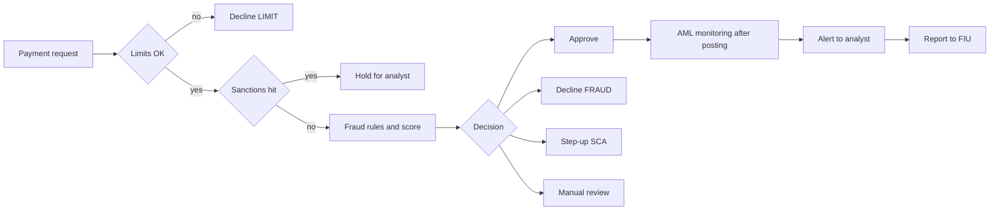

# Limits, fraud and AML

Every payment passes through three filters before and after the money moves: **limits** (is this
amount allowed for this card or account?), **fraud controls** (is the customer really the one paying,
and are they being tricked?) and **anti-money laundering (AML)** controls (is this money clean, and is
the counterparty under sanctions?). This page explains how the three work, where their decisions
come from, and how to test boundaries, rule order, time windows and the audit trail behind each
decision.

## How it works

### Three layers, two moments

| Layer | Question | When it runs | Typical outcome |
|---|---|---|---|
| Limits | Is the amount or count allowed? | Before the payment, synchronously | Approve or decline with a clear reason |
| Fraud | Is this payment unauthorised or a scam? | Before the payment (real time), plus after it (case review) | Approve, decline, step-up, review |
| AML/CFT | Is this money laundering or terrorist financing? Is anyone sanctioned? | Sanctions: before the payment (exception: SEPA instant transfers, see below). Monitoring: mostly after it, over many payments | Alert → investigation → report to the FIU, or close |

**AML/CFT** means anti-money laundering and countering the financing of terrorism.

### Limits

A **limit** is a maximum the system enforces. Common kinds:

- **Per-transaction limit** — one payment may not exceed, for example, EUR 2,000.00.
- **Daily / monthly limit** — the sum of approved payments in a period, for example EUR 1,000.00 per day.
- **Per card vs per account** — a family account with two cards can have a limit per card *and* a
  shared limit per account; both must be checked.
- **Velocity limit** — a maximum *count* of events in a time window, for example no more than 3
  card-not-present payments in 10 minutes, or 5 failed CVV attempts (illustrative numbers; card-wallet
  blocks the card after 3 wrong CVVs in a row, see [Card lifecycle](../04-card-lifecycle/en.md)).

Every period limit needs three precise definitions, and most limit bugs come from one of them:

1. **What counts** — approved only? Fees? Pending holds? Reversed or refunded payments?
2. **The window** — calendar day (00:00–23:59:59) or rolling 24 hours?
3. **The time zone** — UTC, the bank's time zone, or the customer's? What happens on the days when
   daylight saving time starts or ends (for example 29 March 2026 and 25 October 2026 in the EU),
   when a local day has 23 or 25 hours?

### Fraud: types

- **Card-not-present (CNP) fraud** — stolen card details are used online or by phone, where nobody sees the card.
- **Account takeover (ATO)** — a criminal gets into the customer's online banking or wallet (phished
  password, SIM swap), often changes the phone number or e-mail first, and then pays out.
- **Authorised push payment (APP) scam** — the customer *themselves* sends a transfer because they
  were tricked (fake investment, "your bank's security team", fake invoice). The payment is
  correctly authenticated, so strong customer authentication (SCA) does not stop it. The EBA and ECB call
  this **manipulation of the payer**.
- **Friendly fraud (first-party fraud)** — the real cardholder makes a purchase and then disputes it
  as "not me" to get the money back through a chargeback (see
  [Card payment → chargeback](../01-card-payment/en.md)).

### Fraud: how a decision is made

- **Rules engine** — readable `if … then …` rules, checked in a defined order: "amount > 5000.00 →
  decline", "merchant category gambling → decline", "new device and new payee and amount > 500.00 → step-up".
  Easy to explain and to test with boundary values; easy for fraudsters to learn and stay just under.
- **Scoring / machine learning (ML)** — a model gives a **risk score** (for example 0–100) from many
  signals (device, location, history, merchant). Thresholds turn the score into a decision. It
  catches patterns that no single rule describes, but it must return **reason codes** so that an
  analyst — and the customer, where required — can understand the decision.
- In practice both run together: hard rules first (blocklists, legal limits), then the score.

**Decisions:**

| Decision | Meaning | Customer sees |
|---|---|---|
| Approve | Payment goes ahead | Success |
| Decline | Payment refused | A decline reason (generic for fraud) |
| Step-up | Ask for stronger authentication — one-time code, biometric, SCA | An extra challenge |
| Review | Hold the payment for an analyst | "Processing" — the payment waits |

### False positives, false negatives, feedback

- **False positive** — a genuine payment is declined or held. Cost: lost sale and fee income,
  call-centre time, an annoyed customer who may switch to another card.
- **False negative** — a fraudulent payment is approved. Cost: the fraud loss itself, chargeback fees,
  APP reimbursement where required, scheme and regulator attention.
- Tuning a threshold always trades one against the other. Measure both: **precision** (of flagged
  payments, how many were fraud) and **recall** (of all fraud, how much was flagged).
- **Feedback loop** — confirmed outcomes (customer reports, fraud chargebacks, analyst decisions) are
  fed back as labels to tune rules and retrain models. Labels arrive late: a chargeback can come
  weeks after the payment, so the latest data looks "cleaner" than it is.
- **Shadow mode** — a new rule or model runs on live traffic and *records* what it would have decided,
  but the live decision still comes from the old version. Compare the two before switching.
  **Champion/challenger** is the same idea with a small share of live traffic.

### AML/CFT

- **Risk-based approach** — controls are stronger where risk is higher (customer type, country,
  product, channel). This is the first FATF Recommendation and the base of EU law; the EBA ML/TF risk factor
  guidelines list concrete factors.
- **Customer due diligence (CDD)** — knowing who the customer is and what activity to expect — is
  covered in [Onboarding and KYC](../07-onboarding-kyc/en.md). Monitoring compares real activity with that expectation.
- **Transaction monitoring scenarios** — rules over many payments, for example:
  - **Structuring (smurfing)** — many payments just below a threshold to avoid attention.
  - **Rapid movement of funds (pass-through)** — money comes in and goes out within hours, the account
    holds almost nothing.
  - **High-risk countries** — payments to or from jurisdictions that FATF or the EU lists as having strategic AML deficiencies.
- **Sanctions screening** — names of customers and payment counterparties are compared with
  sanctions lists (UN, EU, national). Names are spelled many ways (transliteration, word order,
  missing middle names), so screening uses **fuzzy matching**: a similarity score and a threshold.
  A match above the threshold is a **hit**; most hits are **false hits** that an analyst closes
  using date of birth, country or ID. A true match means the funds must not be made available —
  details differ by jurisdiction.
- **Exception for SEPA instant credit transfers.** The Instant Payments Regulation (EU) 2024/886
  (Article 5d) replaces transaction-by-transaction screening of payer and payee against EU
  targeted financial sanctions lists with screening of the PSP's own customers at least once every
  calendar day and immediately when the EU lists change; during the instant transfer itself, payer
  and payee are not screened against these EU lists. So "screen before every payment" is not the
  rule for this flow — test the daily and list-change runs instead. Details:
  [Transfers](../05-transfers/en.md).
- **Suspicious activity report (SAR / STR)** — when the firm suspects money laundering, its
  compliance officer reports to the national **Financial Intelligence Unit (FIU)**.
- **Tipping-off prohibition** — the firm must not tell the customer or third parties that a report
  was made or that an analysis is under way (Article 73 of the AML Regulation). For testers: no screen,
  push message, e-mail, API error or support macro may reveal it.
- **Record keeping** — keep CDD data and transaction records for 5 years after the end of the
  relationship or the occasional transaction (today Article 40 of Directive (EU) 2015/849 (AMLD);
  from 10 July 2027 Article 77 AMLR; FATF Recommendation 11). Under the AMLD, Member States may
  allow or require keeping them for up to 5 more years.

**EU law status.** Today the rules come from Directive (EU) 2015/849 (the 4th AML Directive, as
amended), transposed into national laws. The single rulebook **Regulation (EU) 2024/1624 (AMLR)**
applies directly from **10 July 2027**, and the Directive is repealed from the same date by
Directive (EU) 2024/1640. A new EU authority, **AMLA**, is created by Regulation (EU) 2024/1620.

### Worked example

Card with a **daily limit of EUR 1,000.00 per UTC calendar day** (approved amounts only, fees not
counted, exact limit allowed). Customer lives in Berlin (CET = UTC+1 in March). Fraud rules: R1
amount > 5,000.00 → decline; R2 velocity: 4th card-not-present payment within 10 minutes → step-up.

| Local time (Berlin) | UTC | Payment | UTC-day total before | Result |
|---|---|---|---|---|
| 14 Mar 00:30 | 13 Mar 23:30 | 400.00 online | 13 Mar: 0.00 | Approved — counts to **13 March** |
| 14 Mar 10:00 | 14 Mar 09:00 | 600.00 | 14 Mar: 0.00 | Approved, total 600.00 |
| 14 Mar 18:00 | 14 Mar 17:00 | 400.00 | 600.00 | Approved, total **1,000.00 = limit** |
| 14 Mar 18:05 | 14 Mar 17:05 | 0.01 | 1,000.00 | Declined `DAILY_LIMIT_EXCEEDED` |
| 15 Mar 01:10 | 15 Mar 00:10 | 50.00 | 15 Mar: 0.00 | Approved — new UTC day |

Velocity: on 15 March the customer makes online payments at 01:10, 01:12, 01:15 and 01:19 (UTC
00:10–00:19). The fourth is within 10 minutes of the first → step-up; after a passed SCA challenge
it is approved. A fifth payment at exactly 01:20:00 is 10 min 00 s after the first — the window must be
defined to say whether that boundary is still inside.

AML (illustrative scenario settings, not legal thresholds): between 2 June 18:00 and 3 June 15:00 the
account receives five transfers of EUR 1,950.00, 1,980.00, 1,900.00, 1,990.00 and 1,960.00 from five
different senders (total 9,780.00). At 3 June 16:40 the customer sends EUR 9,600.00 to a new
payee abroad. Scenarios "structuring: ≥ 5 credits of 1,900–1,999.99 in 48 h" and "rapid movement:
≥ 90% of credits sent out within 24 h" both fire → one alert. The payee name **"Ivan Petrovski
Testov"** (fictional) scores 0.91 against list entry **"Ivan Petrovsky Testoff"** (fictional), threshold
0.85 → sanctions hit, payment held. The analyst sees a different date of birth → **false hit**, released
with a recorded reason. The structuring alert stays open, is escalated, and the compliance officer
files a report to the FIU. The customer's app shows only "payment processing" — no word about AML.

### Shadow-mode example (illustrative numbers)

A new rule runs in shadow mode for one week on 100,000 payments. It would have flagged 1,200; 24
of those turn out to be fraud. Total confirmed fraud that week: 40. Precision = 24 / 1,200 = 2 %;
recall = 24 / 40 = 60 %; 1,176 genuine customers would have been blocked. The team lowers the
false positives (for example, step-up instead of decline) before switching it live.

## Participants and money flows

| Participant | Role | Sends / receives and when | Risk carried |
|---|---|---|---|
| Customer | Pays or receives | Sends payment orders; receives declines, step-up challenges, holds | Scam losses (APP) unless reimbursed; blocked genuine payments |
| Issuer / sending PSP | Runs limits, fraud and AML checks | Decides in real time; holds or returns money; reports fraud statistics to its regulator | Unauthorised payments it approved; APP reimbursement where the law requires it; AML fines |
| Receiving PSP | Holds the payee's account | Receives the money; must monitor incoming funds (mule accounts) | In the UK, shares the cost of reimbursing APP scams |
| Merchant / acquirer | Accepts cards | Gets chargebacks for fraud on card-not-present payments, unless liability shifts after SCA | Lost goods and chargeback fees |
| Fraud and AML analysts | Human review | Work review queues and alerts; record decisions and reasons | Wrong release of real fraud; missed report deadlines |
| Compliance officer | Owns AML programme | Decides whether to file a report; answers FIU requests | Personal and firm liability for failures |
| FIU | National authority | Receives suspicious activity reports; may ask for more data | — |
| Sanctions list owners | UN, EU, national authorities | Publish and update lists; firms re-screen after each update | — |

Who carries fraud losses depends on the type: card fraud losses move along the chain through
chargebacks and liability shift ([area 01](../01-card-payment/en.md)); for credit transfers, the EBA–ECB report for 2024 found
that users themselves bore about 85 % of fraud losses, mainly from payer manipulation scams. In the
UK, since 7 October 2024 PSPs must reimburse APP scam victims for Faster Payments and CHAPS
transfers up to GBP 85,000 per claim.

## Business risks

### Company

- **Fraud losses and chargebacks** — a rule that never triggers, or a limit that is checked in the
  wrong time zone, lets fraud through at scale.
- **False positives** — too strict rules cut revenue and trigger complaints; customers move to another card.
- **Mandatory reimbursement** — e.g. UK APP reimbursement: a missed scam becomes a direct cost.
- **Operational overload** — a bad rule release floods the review queue; real alerts wait for days.
- **Scheme penalties** — high fraud rates put acquirers and merchants into scheme fraud monitoring programmes.

### Customer

- Genuine payment declined abroad or at night; account frozen without explanation.
- Losing savings to a scam that the bank's controls could have spotted (a new payee plus an unusual amount).
- Limits changed by the customer in the app not applied, or applied to the wrong card.

### Regulator / compliance

- Failure to monitor, to report suspicions to the FIU, or to keep records for the retention period — fines and
  restrictions from the AML supervisor.
- **Tipping-off** through a message or an API error — a legal breach, and it can destroy an investigation.
- Making funds available to a sanctioned person — a sanctions breach; penalties differ by country.
- Wrong fraud statistics: PSPs report fraud data under PSD2 Article 96(6) using the EBA fraud
  reporting guidelines; these data also matter for the SCA transaction-risk exemption ([area 08](../08-regulation/en.md)).
- Decisions that cannot be explained or reconstructed — audit findings.

## What to test

- [ ] Every limit type: per transaction, daily, monthly, per card, per account, velocity count.
- [ ] Boundary values on every limit: limit − 0.01, limit, limit + 0.01; count N−1, N, N+1.
- [ ] What counts towards the limit: declined, reversed, refunded payments and fees — as specified.
- [ ] Window start and end in the specified time zone; rolling vs calendar window.
- [ ] Daylight-saving days and month ends (28/29/30/31 days) for daily and monthly limits.
- [ ] Limit changes take effect immediately and only for the right card or account.
- [ ] Two parallel payments cannot both use the last part of a limit.
- [ ] Rule order: when two rules match, the specified first rule gives the reason; every rule is reachable.
- [ ] Score thresholds: score exactly at each threshold gives the specified decision.
- [ ] Step-up: passed, failed and abandoned challenges each lead to the right final state.
- [ ] Review: held payment can be released or rejected; holds expire per the specification.
- [ ] Fraud service timeout or error leads to the specified fail-closed or fail-open behaviour.
- [ ] Shadow rule logs its would-be decision and never changes the live decision.
- [ ] Each decision stores rule/model version, inputs, score, reason codes, time and request id (audit trail).
- [ ] Sanctions screening: exact, transliterated, reordered, diacritic and truncated name variants; threshold boundary.
- [ ] Re-screening runs after a list update for existing customers.
- [ ] AML scenarios fire at their thresholds and not below; one alert per pattern, not one per payment.
- [ ] No tipping-off: customer UI, notifications, statements, API errors and support texts are neutral.
- [ ] Records stay retrievable for the retention period; deletion jobs skip records under retention.

| ID | Condition / steps | Expected result |
|---|---|---|
| LF-01 | Daily limit 1,000.00; approved 600.00 today; pay 400.00, then 0.01 | 400.00 approved (total = limit); 0.01 declined `DAILY_LIMIT_EXCEEDED` |
| LF-02 | Limit per UTC day; pay at 23:59:59 UTC and at 00:00:00 UTC | First counts to the old day, second to the new day |
| LF-03 | Customer time zone Europe/Berlin, limit per local day; payments on 29 Mar 2026 (23-hour day) | Day boundaries follow local midnight; no payment counted twice or lost |
| LF-04 | Velocity 3 CNP payments per 10 min; 4th at 9 min 59 s, another test at exactly 10 min 00 s | 4th → step-up; at 10:00 per the written window definition |
| LF-05 | Amount 6,000.00 at a gambling merchant (both rules match) | Reason is the first rule in order: `HIGH_AMOUNT`, not `BLOCKED_CATEGORY` |
| LF-06 | Remaining limit 400.00; two parallel payments of 300.00 | Exactly one approved; total never above the limit |
| LF-07 | Declined payment 500.00, then pay 600.00 on a 1,000.00 limit | 600.00 approved — declined amounts do not count |
| LF-08 | New rule enabled in shadow mode; send 10 payments that it would decline | All live decisions unchanged; 10 shadow records with rule version and reason |
| LF-09 | Payee "Ivan Petrovski Testov" vs fictional list entry "Ivan Petrovsky Testoff"; score at threshold − 0.01, threshold, + 0.01 | No hit, hit, hit; each hit held and logged with score and analyst outcome |
| LF-10 | Account under an open AML alert / reported to the FIU; customer opens app, calls support, calls API | Only neutral texts like "processing"; no AML, FIU or "suspicious" wording anywhere |

## Typical defects

1. **Off-by-one at a limit.** A payment that brings the total exactly to the limit is declined (`>=`
   instead of `>`). Catch with limit −0.01 / limit / +0.01. Seen in card-wallet:
   [BUG-02](https://github.com/Tomullya/card-wallet/blob/main/docs/qa/bug-reports/BUG-02.md).
2. **Unreachable rule.** An earlier check (here, the daily limit) always declines first, so a fraud
   rule can never fire — a requirements defect. Catch by reviewing the order of checks against the
   value ranges. Seen in card-wallet:
   [BUG-05](https://github.com/Tomullya/card-wallet/blob/main/docs/qa/bug-reports/BUG-05.md).
3. **Wrong time zone for the window.** Server local time is used instead of UTC or the customer's
   zone, so payments near midnight count to the wrong day. Catch with payments at 23:59:59 and 00:00:00 in each zone.
4. **Limit race.** Two parallel payments read the same "spent today" value and both pass. Catch with
   parallel requests on the last part of the limit.
5. **Screening misses variants.** Exact-match or case-sensitive comparison; diacritics or a swapped
   first/last name slip through. Catch with a table of fictional name variants around the threshold.
6. **Tipping-off leak.** An API returns `AML_HOLD` or the app says "under investigation". Catch by
   reviewing every customer-visible text and error code for held or reported accounts.
7. **Decision cannot be traced.** No rule version, reason or request id is stored, so nobody can
   explain a decline. Catch by looking up a decision by its id after the fact. Related in
   card-wallet: [BUG-19](https://github.com/Tomullya/card-wallet/blob/main/docs/qa/bug-reports/BUG-19.md)
   (request id missing in gRPC trailers).
8. **Rule released without shadow run.** A new rule declines a large share of genuine payments on day
   one. Catch by requiring a shadow-mode report (flag rate, precision) before go-live.

## In card-wallet

[card-wallet](https://github.com/Tomullya/card-wallet) has a separate anti-fraud service called by the
wallet over gRPC before each card payment. It is a rules engine with a fixed risk score; there is no
ML, no step-up, no review queue and no AML monitoring.

- Rules, checked in order, first match wins: amount > 5000.00 → `DECLINE HIGH_AMOUNT` (score 90),
  merchant category `GAMBLING` → `DECLINE BLOCKED_CATEGORY` (score 80), otherwise `APPROVE` (score 10):
  [rules.py](https://github.com/Tomullya/card-wallet/blob/main/fraud-service/fraud_service/rules.py),
  [BR-fraud.md](https://github.com/Tomullya/card-wallet/blob/main/docs/requirements/BR-fraud.md).
- Order of checks in the wallet (daily limit is check 5, anti-fraud is check 6) and the daily limit
  per card per UTC day with the exact limit allowed (BR-PAY-02, BR-PAY-04):
  [BR-payments.md](https://github.com/Tomullya/card-wallet/blob/main/docs/requirements/BR-payments.md).
- Boundary and rule-order unit tests (5000.00 approved, 5000.01 declined, 6000.00 gambling →
  `HIGH_AMOUNT`):
  [test_fraud_rules.py](https://github.com/Tomullya/card-wallet/blob/main/tests/unit/test_fraud_rules.py).
- End-to-end through the wallet, including the regression test for BUG-05 and fraud-service timeout
  → 503 with nothing saved:
  [test_fraud_integration.py](https://github.com/Tomullya/card-wallet/blob/main/tests/integration/test_fraud_integration.py);
  daily-limit tests in
  [test_payments.py](https://github.com/Tomullya/card-wallet/blob/main/tests/api/test_payments.py);
  parallel payments (balance check, not the daily limit) in
  [test_concurrency.py](https://github.com/Tomullya/card-wallet/blob/main/tests/api/test_concurrency.py).
- gRPC-level tests of the service:
  [test_fraud_service.py](https://github.com/Tomullya/card-wallet/blob/main/tests/grpc/test_fraud_service.py);
  decision lookup by transaction id (a small audit trail):
  [decisions.py](https://github.com/Tomullya/card-wallet/blob/main/fraud-service/fraud_service/decisions.py).
- Planted gRPC bugs in the fraud service:
  [BUG-17](https://github.com/Tomullya/card-wallet/blob/main/docs/qa/bug-reports/BUG-17.md) (wrong auth status),
  [BUG-18](https://github.com/Tomullya/card-wallet/blob/main/docs/qa/bug-reports/BUG-18.md) (stream never ends),
  [BUG-19](https://github.com/Tomullya/card-wallet/blob/main/docs/qa/bug-reports/BUG-19.md) (request id lost).
  Try them in the [gRPC trainer](https://tomullya.github.io/card-wallet/grpc-lab/).

Could be added (honest gaps — card-wallet is a simplified demo):

- A velocity rule (count per 10 minutes) and a monthly limit, with time-window tests.
- `STEP_UP` and `REVIEW` decisions, a review queue, and a shadow-mode flag that logs would-be decisions.
- Sanctions screening of `merchant_name` against a small fictional list with fuzzy matching.
- A simple AML monitoring job (structuring, rapid movement) with neutral customer-facing statuses.

## Sources

- [FATF Recommendations](https://www.fatf-gafi.org/en/publications/Fatfrecommendations/Fatf-recommendations.html) — risk-based approach (R.1), targeted financial sanctions (R.6), CDD (R.10), record keeping (R.11), higher-risk countries (R.19), suspicious transaction reporting (R.20), tipping-off (R.21).
- [Directive (EU) 2015/849 (4th AML Directive)](https://eur-lex.europa.eu/eli/dir/2015/849/oj) — current EU AML/CFT framework, transposed into national laws.
- [Regulation (EU) 2024/1624 (AML Regulation)](https://eur-lex.europa.eu/eli/reg/2024/1624/oj) — single rulebook from 10 July 2027: monitoring (Art. 26), reporting of suspicions (Art. 69), prohibition of disclosure (Art. 73), 5-year record retention (Art. 77).
- [EBA Guidelines on ML/TF risk factors, EBA/GL/2021/02, consolidated (PDF)](https://eba.europa.eu/sites/default/files/2023-11/EBA%20GL%202021%2002%20-%20consolidated%20%28amended%20by%20EBA%20GL%202023%2003%29_EN.pdf) — risk-based approach in practice: customer, country, product and channel risk factors; monitoring.
- [EBA Guidelines on fraud reporting under PSD2, EBA/GL/2018/05 (PDF)](https://www.eba.europa.eu/sites/default/files/2024-09/767ddecf-75a1-4210-bf48-fc7d0950a7b4/Guidelines%20on%20fraud%20reporting%20%28EBA%20GL-2018-05%29_EN.pdf) — fraud statistics PSPs report under PSD2 Art. 96(6): unauthorised transactions and manipulation of the payer.
- [EBA–ECB joint report on payment fraud, press release, 15 December 2025](https://www.eba.europa.eu/publications-and-media/press-releases/joint-eba-ecb-report-payment-fraud-strong-authentication-remains-effective-fraudsters-are-adapting) — SCA effective against the fraud it targets; payer manipulation rising; users bore about 85 % of credit transfer fraud losses in 2024.
- [UK PSR: APP fraud reimbursement protections](https://www.psr.org.uk/information-for-consumers/app-fraud-reimbursement-protections/) — reimbursement for Faster Payments and CHAPS scams from 7 October 2024, up to GBP 85,000 per claim.
- [EU Sanctions Map](https://www.sanctionsmap.eu/) and [EU consolidated financial sanctions list](https://data.europa.eu/data/datasets/consolidated-list-of-persons-groups-and-entities-subject-to-eu-financial-sanctions) — the official EU lists that screening compares names against (use fictional names in tests).
- [Directive (EU) 2015/2366 (PSD2)](https://eur-lex.europa.eu/eli/dir/2015/2366/oj) — Art. 96(6) fraud data reporting; framework for strong customer authentication.
