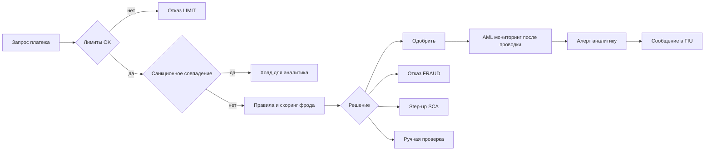

# Лимиты, фрод и AML

Каждый платёж проходит три фильтра — до и после движения денег: **лимиты** (разрешена ли такая
сумма для этой карты или счёта?), **антифрод** (действительно ли платит клиент и не обманывают ли
его?) и **противодействие отмыванию денег (AML, anti-money laundering)** (чистые ли это деньги и не
под санкциями ли контрагент?). Эта страница объясняет, как работают три слоя, откуда берутся их
решения и как тестировать границы, порядок правил, временные окна и аудиторский след каждого решения.

## Как это работает

### Три слоя, два момента

| Слой | Вопрос | Когда работает | Типичный результат |
|---|---|---|---|
| Лимиты | Разрешены ли сумма или количество? | До платежа, синхронно | Одобрить или отклонить с понятной причиной |
| Фрод | Это неавторизованный платёж или мошенническая схема? | До платежа (в реальном времени) и после него (разбор кейсов) | Одобрить, отклонить, усилить аутентификацию, отправить на проверку |
| AML/ПОД/ФТ | Это отмывание денег или финансирование терроризма? Есть ли санкционные лица? | Санкции — до платежа (исключение — мгновенные переводы SEPA, см. ниже). Мониторинг — в основном после, по многим платежам | Алерт → расследование → сообщение в подразделение финансовой разведки (FIU) либо закрытие |

**AML/CFT** (по-русски ПОД/ФТ) — противодействие отмыванию доходов и финансированию терроризма.

### Лимиты

**Лимит (limit)** — максимум, который система не даёт превысить. Основные виды:

- **Лимит на операцию (per-transaction limit)** — один платёж не больше, например, EUR 2 000.00.
- **Дневной / месячный лимит (daily / monthly limit)** — сумма одобренных платежей за период,
  например EUR 1 000.00 в день.
- **На карту и на счёт (per card / per account)** — у семейного счёта с двумя картами может быть
  лимит на каждую карту *и* общий лимит на счёт; проверять нужно оба.
- **Лимит частоты (velocity limit)** — максимальное *количество* событий в окне времени, например не
  больше 3 платежей без присутствия карты за 10 минут или 5 неверных CVV (числа условные; card-wallet
  блокирует карту после 3 неверных CVV подряд, см. [Жизненный цикл карты](../04-card-lifecycle/ru.md)).

Каждому лимиту за период нужны три точных определения, и большинство дефектов лимитов — в одном из них:

1. **Что считается** — только одобренные? Комиссии? Холды? Отменённые и возвращённые платежи?
2. **Окно** — календарные сутки (00:00–23:59:59) или скользящие 24 часа (rolling window)?
3. **Часовой пояс** — UTC, пояс банка или клиента? Что происходит в дни перехода на летнее и зимнее
   время (например, 29 марта 2026 и 25 октября 2026 в ЕС), когда местные сутки длятся 23 или 25 часов?

### Фрод: виды

- **Мошенничество без присутствия карты (card-not-present, CNP fraud)** — украденные реквизиты
  используют онлайн или по телефону, где карту никто не видит.
- **Захват аккаунта (account takeover, ATO)** — преступник получает доступ к интернет-банку или
  кошельку клиента (фишинг пароля, подмена SIM-карты), часто сначала меняет телефон или e-mail, потом выводит деньги.
- **Мошенничество с переводом, совершённым с согласия клиента под влиянием обмана (социальная
  инженерия; authorised push payment scam, APP scam)**, кратко — **APP-мошенничество** — клиент
  *сам* отправляет перевод, потому что его обманули (фальшивые инвестиции, «служба безопасности
  банка», поддельный счёт). Платёж правильно аутентифицирован, поэтому строгая аутентификация
  клиента (SCA) его не останавливает. EBA и ЕЦБ называют это **манипуляцией плательщиком
  (manipulation of the payer)**.
- **«Дружественный» фрод (friendly fraud, first-party fraud)** — настоящий держатель карты делает
  покупку, а потом оспаривает её как «это не я», чтобы вернуть деньги через чарджбэк (см.
  [Карточный платёж → чарджбэк](../01-card-payment/ru.md)).

### Фрод: как принимается решение

- **Движок правил (rules engine)** — понятные правила «если … то …», проверяемые в заданном порядке:
  «сумма > 5000.00 → отказ», «категория мерчанта (торгово-сервисного предприятия, ТСП) азартные игры → отказ», «новое устройство, новый
  получатель и сумма > 500.00 → step-up». Их легко объяснить и протестировать граничными значениями;
  мошенникам тоже легко их выучить и держаться чуть ниже порога.
- **Скоринг / машинное обучение (scoring / machine learning, ML)** — модель выдаёт **риск-скор
  (risk score)**, например 0–100, по множеству сигналов (устройство, геолокация, история, мерчант).
  Пороги превращают скор в решение. Модель ловит шаблоны, которые не описать одним правилом, но
  должна возвращать **коды причин (reason codes)**, чтобы аналитик — и клиент, где это требуется — понял решение.
- На практике работают вместе: сначала жёсткие правила (стоп-листы, лимиты по закону), потом скор.

**Решения:**

| Решение | Смысл | Что видит клиент |
|---|---|---|
| Одобрить (approve) | Платёж проходит | Успех |
| Отклонить (decline) | Платёж отклонён | Причину отказа (для фрода — общую) |
| Усилить аутентификацию (step-up) | Запросить более сильную аутентификацию — одноразовый код, биометрию, SCA | Дополнительную проверку |
| Ручная проверка (review) | Задержать платёж для аналитика | «В обработке» — платёж ждёт |

### Ложные срабатывания, пропуски, обратная связь

- **Ложноположительное срабатывание (false positive)** — честный платёж отклонён или задержан.
  Цена: потерянная продажа и комиссия, время колл-центра, раздражённый клиент, который может перейти на другую карту.
- **Ложноотрицательное (false negative)** — мошеннический платёж одобрен. Цена: сама потеря, комиссии
  за чарджбэки, компенсация жертвам APP-мошенничества, где она обязательна, внимание платёжных систем и регулятора.
- Настройка порога — всегда обмен одного на другое. Измеряйте оба: **точность (precision)** — какая
  доля помеченных платежей оказалась фродом, и **полноту (recall)** — какую долю всего фрода поймали.
- **Петля обратной связи (feedback loop)** — подтверждённые исходы (жалобы клиентов, чарджбэки по
  фроду, решения аналитиков) возвращаются как разметка для настройки правил и переобучения моделей.
  Разметка приходит поздно: чарджбэк может прийти через недели после платежа, поэтому свежие данные кажутся «чище», чем есть.
- **Теневой режим (shadow mode)** — новое правило или модель работает на живом трафике и только
  *записывает*, что решило бы, а реальное решение всё ещё принимает старая версия. Сравните их до
  переключения. **Чемпион/претендент (champion/challenger)** — та же идея на небольшой доле живого трафика.

### AML/ПОД/ФТ

- **Риск-ориентированный подход (risk-based approach)** — контроль сильнее там, где риск выше (тип
  клиента, страна, продукт, канал). Это первая Рекомендация FATF и основа права ЕС; руководство EBA
  по факторам риска ОД/ФТ перечисляет конкретные факторы.
- **Надлежащая проверка клиента (customer due diligence, CDD)** — кто клиент и какой активности от
  него ждать — описана в [Онбординг и KYC](../07-onboarding-kyc/ru.md). Мониторинг сравнивает
  реальную активность с этим ожиданием.
- **Сценарии мониторинга транзакций (transaction monitoring scenarios)** — правила по многим платежам, например:
  - **Дробление (structuring, smurfing)** — много платежей чуть ниже порога, чтобы не привлекать внимания.
  - **Быстрый транзит средств (rapid movement of funds, pass-through)** — деньги приходят и уходят
    за несколько часов, на счёте почти ничего не остаётся.
  - **Страны повышенного риска (high-risk countries)** — платежи в юрисдикции и из юрисдикций,
    которые FATF или ЕС включили в списки стран со стратегическими недостатками в AML.
- **Санкционный скрининг (sanctions screening)** — имена клиентов и контрагентов сравнивают с
  санкционными списками (ООН, ЕС, национальными). Имена пишутся по-разному (транслитерация, порядок
  слов, пропущенное отчество), поэтому используют **нечёткое сравнение (fuzzy matching)**: оценку
  похожести и порог. Совпадение выше порога — **срабатывание (hit)**; большинство из них —
  **ложные срабатывания (false hits)**, которые аналитик закрывает по дате рождения, стране или
  документу. При настоящем совпадении средства нельзя предоставлять лицу — детали зависят от юрисдикции.
- **Исключение для мгновенных кредитовых переводов SEPA.** Регламент о мгновенных платежах
  (EU) 2024/886 (IPR, статья 5d) заменяет проверку плательщика и получателя по санкционным
  спискам ЕС (целевые финансовые санкции) в каждом переводе проверкой собственных клиентов PSP не
  реже раза в календарный день и сразу после изменения списков ЕС; во время самого мгновенного
  перевода плательщика и получателя по этим спискам ЕС не проверяют. Поэтому правило «скрининг
  перед каждым платежом» для этого потока не действует — тестируйте ежедневный прогон и прогон
  после обновления списков. Подробнее — в [Переводах](../05-transfers/ru.md).
- **Сообщение о подозрительной операции (suspicious activity report, SAR / STR)** — если фирма
  подозревает отмывание, её ответственный сотрудник по комплаенсу (compliance officer) сообщает в
  национальное **подразделение финансовой разведки (Financial Intelligence Unit, FIU)**.
- **Запрет на разглашение (tipping-off prohibition)** — нельзя сообщать клиенту или
  третьим лицам, что сообщение отправлено или идёт анализ (статья 73 Регламента AML). Для
  тестировщика: ни экран, ни пуш, ни e-mail, ни ошибка API, ни шаблон ответа поддержки не должны это выдавать.
- **Хранение записей (record keeping)** — данные CDD и записи об операциях хранятся 5 лет после
  окончания отношений или разовой операции (сейчас статья 40 Директивы (EU) 2015/849 (AMLD);
  с 10 июля 2027 года статья 77 AMLR; Рекомендация FATF 11). По AMLD государства-члены могут
  разрешить или потребовать хранить их ещё до 5 лет.

**Статус права ЕС.** Сейчас правила идут из Директивы (ЕС) 2015/849 (4-я AML-директива, с
изменениями), перенесённой в национальные законы. Единый свод правил **Регламент (ЕС) 2024/1624
(AMLR)** применяется напрямую с **10 июля 2027**, и с той же даты Директива отменяется Директивой
(ЕС) 2024/1640. Новый орган ЕС, **AMLA**, создан Регламентом (ЕС) 2024/1620.

### Пример с цифрами

Карта с **дневным лимитом EUR 1 000.00 на календарные сутки UTC** (считаются только одобренные
суммы, комиссия не считается, ровно лимит разрешён). Клиент живёт в Берлине (CET = UTC+1 в марте).
Правила фрода: R1 сумма > 5 000.00 → отказ; R2 частота: 4-й платёж без присутствия карты за 10 минут → step-up.

| Местное время (Берлин) | UTC | Платёж | Сумма за сутки UTC до платежа | Результат |
|---|---|---|---|---|
| 14 мар 00:30 | 13 мар 23:30 | 400.00 онлайн | 13 мар: 0.00 | Одобрен — считается в **13 марта** |
| 14 мар 10:00 | 14 мар 09:00 | 600.00 | 14 мар: 0.00 | Одобрен, итого 600.00 |
| 14 мар 18:00 | 14 мар 17:00 | 400.00 | 600.00 | Одобрен, итого **1 000.00 = лимит** |
| 14 мар 18:05 | 14 мар 17:05 | 0.01 | 1 000.00 | Отказ `DAILY_LIMIT_EXCEEDED` |
| 15 мар 01:10 | 15 мар 00:10 | 50.00 | 15 мар: 0.00 | Одобрен — новые сутки UTC |

Частота: 15 марта клиент платит онлайн в 01:10, 01:12, 01:15 и 01:19 (UTC 00:10–00:19). Четвёртый
платёж — в пределах 10 минут от первого → step-up; после пройденной проверки SCA он одобрен. Пятый
платёж ровно в 01:20:00 — через 10 мин 00 с после первого: определение окна должно явно сказать, входит ли эта граница в окно.

AML (иллюстративные настройки сценариев, не пороги из закона): с 2 июня 18:00 до 3 июня 15:00 на
счёт приходят пять переводов на EUR 1 950.00, 1 980.00, 1 900.00, 1 990.00 и 1 960.00 от пяти разных
отправителей (итого 9 780.00). 3 июня в 16:40 клиент отправляет EUR 9 600.00 новому получателю за
границу. Сценарии «дробление: ≥ 5 поступлений по 1 900–1 999.99 за 48 ч» и «быстрый транзит: ≥ 90 %
поступлений ушло в течение 24 ч» срабатывают → один алерт. Имя получателя **«Ivan Petrovski Testov»**
(вымышленное) получает оценку 0.91 против записи списка **«Ivan Petrovsky Testoff»** (вымышленной),
порог 0.85 → санкционное срабатывание, платёж задержан. Аналитик видит другую дату рождения →
**ложное срабатывание**, платёж отпущен с записанной причиной. Алерт по дроблению остаётся открытым,
эскалируется, и ответственный сотрудник отправляет сообщение в FIU. В приложении клиент видит только
«платёж в обработке» — ни слова об AML.

### Пример теневого режима (иллюстративные цифры)

Новое правило неделю работает в теневом режиме на 100 000 платежей. Оно пометило бы 1 200; из них
24 оказались фродом. Всего подтверждённого фрода за неделю: 40. Точность = 24 / 1 200 = 2 %;
полнота = 24 / 40 = 60 %; 1 176 честных клиентов были бы заблокированы. Команда снижает число ложных
срабатываний (например, step-up вместо отказа), прежде чем включить правило.

## Участники и потоки денег

| Участник | Роль | Что отправляет / получает и когда | Какой риск несёт |
|---|---|---|---|
| Клиент | Платит или получает | Отправляет платёжные поручения; получает отказы, проверки step-up, холды | Потери от APP-мошенничества, если их не компенсируют; заблокированные честные платежи |
| Эмитент / банк отправителя (PSP) | Проверяет лимиты, фрод и AML | Решает в реальном времени; задерживает или возвращает деньги; отчитывается регулятору по статистике фрода | Неавторизованные платежи, которые он одобрил; компенсация за APP-мошенничество, где её требует закон; штрафы за AML |
| Банк получателя (receiving PSP) | Ведёт счёт получателя | Получает деньги; должен мониторить входящие средства (счета дропов, money mules) | В Великобритании делит расходы на компенсацию APP-мошенничества |
| Мерчант / эквайер | Принимает карты | Получает чарджбэки по фроду в платежах без присутствия карты, если ответственность не сдвинулась после SCA | Потерянный товар и комиссии за чарджбэки |
| Аналитики фрода и AML | Ручная проверка | Разбирают очереди и алерты; записывают решения и причины | Ошибочно отпущенный фрод; пропущенные сроки сообщений |
| Ответственный сотрудник по комплаенсу | Владелец AML-программы | Решает, отправлять ли сообщение; отвечает на запросы FIU | Личная ответственность и ответственность фирмы |
| Подразделение финансовой разведки (FIU) | Государственный орган | Получает сообщения о подозрительных операциях; может запросить дополнительные данные | — |
| Владельцы санкционных списков | ООН, ЕС, национальные органы | Публикуют и обновляют списки; фирмы пересканируют клиентов после каждого обновления | — |

Кто несёт потери от фрода, зависит от вида: по картам потери передаются по цепочке через
чарджбэки и сдвиг ответственности ([раздел 01](../01-card-payment/ru.md)); по кредитовым переводам, по отчёту EBA–ЕЦБ за 2024
год, около 85 % потерь понесли сами пользователи — в основном из-за манипуляции плательщиком. В
Великобритании с 7 октября 2024 PSP обязаны компенсировать жертвам APP-мошенничества переводы по
Faster Payments и CHAPS до GBP 85 000 на одно требование.

## Бизнес-риски

### Компания

- **Потери от фрода и чарджбэки** — правило, которое никогда не срабатывает, или лимит, проверяемый
  не в том часовом поясе, массово пропускают фрод.
- **Ложные срабатывания** — слишком жёсткие правила режут выручку и вызывают жалобы; клиенты уходят к другой карте.
- **Обязательная компенсация** — например, компенсация за APP-мошенничество в Великобритании: пропущенная мошенническая схема становится прямым расходом.
- **Операционная перегрузка** — неудачный релиз правила заваливает очередь проверки; настоящие алерты ждут днями.
- **Штрафы платёжных систем** — при высоком уровне фрода эквайеры и мерчанты попадают в программы мониторинга фрода платёжных систем.

### Клиент

- Честный платёж отклонён за границей или ночью; счёт заморожен без объяснений.
- Потеря сбережений из-за мошенника, которого контроль банка мог заметить (новый получатель плюс необычная сумма).
- Лимит, изменённый клиентом в приложении, не применился или применился не к той карте.

### Регулятор / комплаенс

- Нет мониторинга, нет сообщений в FIU, записи не хранятся положенный срок — штрафы и ограничения от AML-надзора.
- **Разглашение клиенту (tipping-off)** через сообщение или ошибку API — нарушение закона, которое может сорвать расследование.
- Предоставление средств санкционному лицу — нарушение санкций; наказания различаются по странам.
- Неверная статистика фрода: PSP отчитываются о фроде по статье 96(6) PSD2 по руководству EBA о
  фрод-отчётности; эти данные важны и для исключения из SCA по анализу риска транзакции ([раздел 08](../08-regulation/ru.md)).
- Решения, которые нельзя объяснить или восстановить, — замечания аудита.

## Что тестировать

- [ ] Все виды лимитов: на операцию, дневной, месячный, на карту, на счёт, по частоте.
- [ ] Граничные значения каждого лимита: лимит − 0.01, лимит, лимит + 0.01; количество N−1, N, N+1.
- [ ] Что учитывается в лимите: отклонённые, отменённые, возвращённые платежи и комиссии — по спецификации.
- [ ] Начало и конец окна в заданном часовом поясе; скользящее окно против календарного.
- [ ] Дни перехода на летнее/зимнее время и концы месяцев (28/29/30/31 день) для дневных и месячных лимитов.
- [ ] Изменение лимита действует сразу и только для нужной карты или счёта.
- [ ] Два параллельных платежа не могут оба использовать остаток лимита.
- [ ] Порядок правил: если совпали два правила, причину даёт указанное первым; каждое правило достижимо.
- [ ] Пороги скора: скор ровно на пороге даёт указанное решение.
- [ ] Step-up: пройденная, проваленная и брошенная проверка приводят к правильному итоговому статусу.
- [ ] Ручная проверка: задержанный платёж можно отпустить или отклонить; холды истекают по спецификации.
- [ ] Таймаут или ошибка антифрод-сервиса ведут к заданному поведению: отказ (fail-closed) или пропуск (fail-open).
- [ ] Теневое правило пишет своё решение и никогда не меняет живое.
- [ ] Каждое решение хранит версию правила/модели, входные данные, скор, коды причин, время и id запроса (аудиторский след, audit trail).
- [ ] Санкционный скрининг: точное, транслитерированное, переставленное, с диакритикой и усечённое имя; граница порога.
- [ ] Повторный скрининг существующих клиентов после обновления списка.
- [ ] AML-сценарии срабатывают на пороге и не срабатывают ниже; один алерт на шаблон, а не на каждый платёж.
- [ ] Нет tipping-off: интерфейс, уведомления, выписки, ошибки API и тексты поддержки нейтральны.
- [ ] Записи доступны весь срок хранения; задачи удаления пропускают записи, которые ещё нужно хранить.

| ID | Условие / шаги | Ожидаемый результат |
|---|---|---|
| LF-01 | Дневной лимит 1 000.00; сегодня одобрено 600.00; платим 400.00, затем 0.01 | 400.00 одобрен (итого = лимит); 0.01 отклонён `DAILY_LIMIT_EXCEEDED` |
| LF-02 | Лимит на сутки UTC; платежи в 23:59:59 UTC и в 00:00:00 UTC | Первый — в старые сутки, второй — в новые |
| LF-03 | Пояс клиента Europe/Berlin, лимит на местные сутки; платежи 29 мар 2026 (сутки 23 часа) | Границы суток по местной полуночи; ни один платёж не посчитан дважды и не потерян |
| LF-04 | Частота: 3 CNP-платежа за 10 мин; 4-й через 9 мин 59 с, отдельный тест — ровно через 10 мин 00 с | 4-й → step-up; на 10:00 — по письменному определению окна |
| LF-05 | Сумма 6 000.00 у мерчанта азартных игр (совпали оба правила) | Причина — первое по порядку правило: `HIGH_AMOUNT`, а не `BLOCKED_CATEGORY` |
| LF-06 | Остаток лимита 400.00; два параллельных платежа по 300.00 | Одобрен ровно один; сумма никогда не выше лимита |
| LF-07 | Отклонённый платёж 500.00, затем платёж 600.00 при лимите 1 000.00 | 600.00 одобрен — отклонённые суммы не считаются |
| LF-08 | Новое правило включено в теневом режиме; отправить 10 платежей, которые оно отклонило бы | Все живые решения не изменились; 10 теневых записей с версией правила и причиной |
| LF-09 | Получатель «Ivan Petrovski Testov» против вымышленной записи «Ivan Petrovsky Testoff»; оценка на пороге − 0.01, на пороге, + 0.01 | Нет совпадения, совпадение, совпадение; каждое совпадение задержано и записано со скором и решением аналитика |
| LF-10 | Счёт с открытым AML-алертом / сообщением в FIU; клиент открывает приложение, звонит в поддержку, вызывает API | Только нейтральные тексты вроде «в обработке»; нигде нет слов AML, FIU, «подозрительный» |

## Типичные дефекты

1. **Ошибка на единицу на границе лимита.** Платёж, доводящий сумму ровно до лимита, отклоняется
   (`>=` вместо `>`). Ловится значениями лимит −0.01 / лимит / +0.01. Есть в card-wallet:
   [BUG-02](https://github.com/Tomullya/card-wallet/blob/main/docs/qa/bug-reports/BUG-02.md).
2. **Недостижимое правило.** Более ранняя проверка (здесь — дневной лимит) всегда отклоняет первой,
   и антифрод-правило не может сработать — дефект требований. Ловится ревью порядка проверок против
   диапазонов значений. Есть в card-wallet:
   [BUG-05](https://github.com/Tomullya/card-wallet/blob/main/docs/qa/bug-reports/BUG-05.md).
3. **Не тот часовой пояс окна.** Используется локальное время сервера вместо UTC или пояса клиента,
   и платежи около полуночи попадают не в те сутки. Ловится платежами в 23:59:59 и 00:00:00 в каждом поясе.
4. **Гонка за лимит.** Два параллельных платежа читают одно и то же «потрачено сегодня» и оба
   проходят. Ловится параллельными запросами на остаток лимита.
5. **Скрининг пропускает варианты имени.** Точное или регистрозависимое сравнение; диакритика или
   переставленные имя и фамилия проскакивают. Ловится таблицей вымышленных вариантов имени вокруг порога.
6. **Утечка tipping-off.** API возвращает `AML_HOLD` или приложение пишет «идёт расследование».
   Ловится проверкой всех видимых клиенту текстов и кодов ошибок для задержанных счетов.
7. **Решение нельзя отследить.** Не сохранены версия правила, причина или id запроса — никто не может
   объяснить отказ. Ловится поиском решения по его id задним числом. Похожее в card-wallet:
   [BUG-19](https://github.com/Tomullya/card-wallet/blob/main/docs/qa/bug-reports/BUG-19.md)
   (id запроса не возвращается в gRPC trailers).
8. **Правило выпущено без теневого прогона.** Новое правило в первый день отклоняет большую долю
   честных платежей. Ловится обязательным отчётом теневого режима (доля срабатываний, точность) до запуска.

## В card-wallet

В [card-wallet](https://github.com/Tomullya/card-wallet) есть отдельный антифрод-сервис, который
кошелёк вызывает по gRPC перед каждым карточным платежом. Это движок правил с фиксированным
риск-скором; нет ML, нет step-up, нет очереди ручной проверки и нет AML-мониторинга.

- Правила проверяются по порядку, побеждает первое совпадение: сумма > 5000.00 → `DECLINE HIGH_AMOUNT`
  (скор 90), категория мерчанта `GAMBLING` → `DECLINE BLOCKED_CATEGORY` (скор 80), иначе `APPROVE`
  (скор 10):
  [rules.py](https://github.com/Tomullya/card-wallet/blob/main/fraud-service/fraud_service/rules.py),
  [BR-fraud.md](https://github.com/Tomullya/card-wallet/blob/main/docs/requirements/BR-fraud.md).
- Порядок проверок в кошельке (дневной лимит — проверка 5, антифрод — проверка 6) и дневной лимит на
  карту на сутки UTC, ровно лимит разрешён (BR-PAY-02, BR-PAY-04):
  [BR-payments.md](https://github.com/Tomullya/card-wallet/blob/main/docs/requirements/BR-payments.md).
- Юнит-тесты границ и порядка правил (5000.00 одобрен, 5000.01 отклонён, 6000.00 у GAMBLING →
  `HIGH_AMOUNT`):
  [test_fraud_rules.py](https://github.com/Tomullya/card-wallet/blob/main/tests/unit/test_fraud_rules.py).
- Сквозные тесты через кошелёк, включая регрессионный тест на BUG-05 и таймаут антифрода → 503 без
  сохранения:
  [test_fraud_integration.py](https://github.com/Tomullya/card-wallet/blob/main/tests/integration/test_fraud_integration.py);
  тесты дневного лимита в
  [test_payments.py](https://github.com/Tomullya/card-wallet/blob/main/tests/api/test_payments.py);
  параллельные платежи (проверка баланса, не дневного лимита) в
  [test_concurrency.py](https://github.com/Tomullya/card-wallet/blob/main/tests/api/test_concurrency.py).
- Тесты сервиса на уровне gRPC:
  [test_fraud_service.py](https://github.com/Tomullya/card-wallet/blob/main/tests/grpc/test_fraud_service.py);
  поиск решения по id транзакции (небольшой аудиторский след):
  [decisions.py](https://github.com/Tomullya/card-wallet/blob/main/fraud-service/fraud_service/decisions.py).
- Специально заложенные gRPC-баги в антифрод-сервисе:
  [BUG-17](https://github.com/Tomullya/card-wallet/blob/main/docs/qa/bug-reports/BUG-17.md) (неверный статус аутентификации),
  [BUG-18](https://github.com/Tomullya/card-wallet/blob/main/docs/qa/bug-reports/BUG-18.md) (поток не завершается),
  [BUG-19](https://github.com/Tomullya/card-wallet/blob/main/docs/qa/bug-reports/BUG-19.md) (теряется id запроса).
  Попробуйте их в [gRPC-тренажёре](https://tomullya.github.io/card-wallet/grpc-lab/).

Что можно добавить (честно о пробелах — card-wallet упрощённое демо):

- Правило частоты (количество за 10 минут) и месячный лимит с тестами временных окон.
- Решения `STEP_UP` и `REVIEW`, очередь ручной проверки и флаг теневого режима, который пишет несостоявшиеся решения.
- Санкционный скрининг `merchant_name` по маленькому вымышленному списку с нечётким сравнением.
- Простая задача AML-мониторинга (дробление, быстрый транзит) с нейтральными статусами для клиента.

## Источники

- [Рекомендации FATF](https://www.fatf-gafi.org/en/publications/Fatfrecommendations/Fatf-recommendations.html) — риск-ориентированный подход (Р.1), целевые финансовые санкции (Р.6), CDD (Р.10), хранение записей (Р.11), страны повышенного риска (Р.19), сообщения о подозрительных операциях (Р.20), запрет на разглашение (Р.21).
- [Директива (ЕС) 2015/849 (4-я AML-директива)](https://eur-lex.europa.eu/eli/dir/2015/849/oj) — действующая рамка ПОД/ФТ в ЕС, перенесённая в национальные законы.
- [Регламент (ЕС) 2024/1624 (AML Regulation)](https://eur-lex.europa.eu/eli/reg/2024/1624/oj) — единый свод правил с 10 июля 2027: мониторинг (ст. 26), сообщения о подозрениях (ст. 69), запрет на раскрытие (ст. 73), хранение записей 5 лет (ст. 77).
- [Руководство EBA по факторам риска ОД/ФТ, EBA/GL/2021/02, консолидированная версия (PDF)](https://eba.europa.eu/sites/default/files/2023-11/EBA%20GL%202021%2002%20-%20consolidated%20%28amended%20by%20EBA%20GL%202023%2003%29_EN.pdf) — риск-ориентированный подход на практике: факторы риска клиента, страны, продукта и канала; мониторинг.
- [Руководство EBA по фрод-отчётности по PSD2, EBA/GL/2018/05 (PDF)](https://www.eba.europa.eu/sites/default/files/2024-09/767ddecf-75a1-4210-bf48-fc7d0950a7b4/Guidelines%20on%20fraud%20reporting%20%28EBA%20GL-2018-05%29_EN.pdf) — статистика фрода, которую PSP сдают по ст. 96(6) PSD2: неавторизованные операции и манипуляция плательщиком.
- [Совместный отчёт EBA–ЕЦБ о платёжном фроде, пресс-релиз 15 декабря 2025](https://www.eba.europa.eu/publications-and-media/press-releases/joint-eba-ecb-report-payment-fraud-strong-authentication-remains-effective-fraudsters-are-adapting) — SCA эффективна против фрода, для которого создана; манипуляция плательщиком растёт; пользователи понесли около 85 % потерь от фрода по кредитовым переводам в 2024.
- [UK PSR: защита и компенсация при APP-мошенничестве](https://www.psr.org.uk/information-for-consumers/app-fraud-reimbursement-protections/) — компенсация по Faster Payments и CHAPS с 7 октября 2024, до GBP 85 000 на требование.
- [EU Sanctions Map](https://www.sanctionsmap.eu/) и [консолидированный список финансовых санкций ЕС](https://data.europa.eu/data/datasets/consolidated-list-of-persons-groups-and-entities-subject-to-eu-financial-sanctions) — официальные списки ЕС, с которыми сравнивает скрининг (в тестах используйте вымышленные имена).
- [Директива (ЕС) 2015/2366 (PSD2)](https://eur-lex.europa.eu/eli/dir/2015/2366/oj) — ст. 96(6) об отчётности по фроду; рамка строгой аутентификации клиента.
