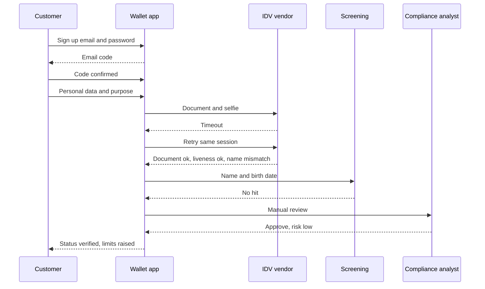
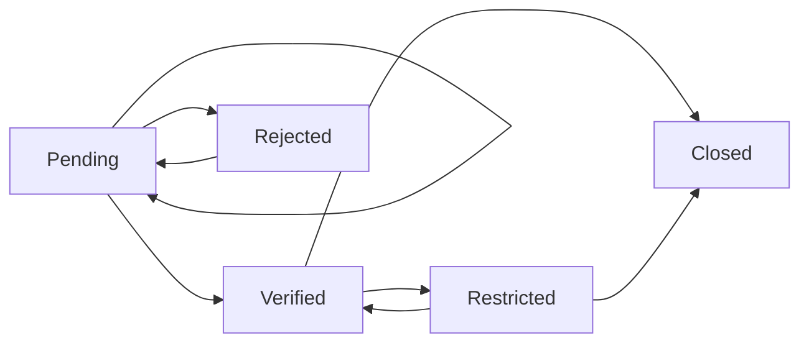

# Onboarding and KYC

Before a payment or e-money company lets a person hold and move money, the law requires it to
know who that person is: **KYC** (know your customer). This page follows one consumer from
sign-up to a verified account, explains due diligence levels, remote identity checks and customer
statuses, and lists what testers check — status transitions, limits by status, document edge cases
and vendor failures.

## How it works

### Words first

- **Onboarding** — the whole sign-up funnel: create a login, confirm contact details, verify
  identity, assess risk, open the account.
- **CDD** (customer due diligence) — the legal duty behind KYC. In the EU, Article 13(1) of the
  Anti-Money Laundering Directive (EU) 2015/849 (**AMLD**) lists four measures: (a) identify the
  customer and **verify** the identity from a reliable, independent source; (b) identify the
  **beneficial owner** and take reasonable measures to verify them; (c) understand the purpose and
  intended nature of the relationship; (d) **ongoing monitoring** of the relationship.
- **Identification** vs **verification** — identification is collecting who the person says they
  are (name, date of birth, address); verification is proving it (a document, an eID, a database).
- **Obliged entity** — a company that must apply AML rules: banks, payment institutions,
  e-money institutions and others.
- **IDV vendor** (identity verification provider) — an outside company that checks documents and
  selfies for the obliged entity. The obliged entity stays responsible for the result.

The new EU AML Regulation (EU) 2024/1624 (**AMLR**) applies from 10 July 2027 and will replace most
of the AMLD rules with one directly applicable rulebook. The ideas on this page stay the same;
article numbers will change. Outside the EU, FATF Recommendation 10 sets the same core CDD
measures as an international standard.

### Step by step

1. **Sign-up.** Email or phone, password, consent to terms. No money yet.
2. **Contact verification.** A one-time code to the email or phone proves the person controls it.
   This is not identity verification.
3. **Identification data.** Name, date of birth, address, nationality, purpose of the account
   (CDD measure c), expected activity.
4. **Identity verification.** One of the remote methods below, or a branch visit.
5. **Screening.** Name checks against sanctions lists and **PEP** lists (politically exposed
   persons — people with prominent public functions; their family members and close associates are
   screened too, as AMLD Article 23 extends PEP measures to them).
   Sanctions and screening logic are covered in [area 06 (limits, fraud and AML)](../06-limits-fraud-aml/en.md).
6. **Risk assessment.** A risk score (low / medium / high) from country, product, channel,
   PEP status, expected volumes. It decides the CDD level.
7. **Decision and account opening.** Verified, rejected, or sent to manual review.
8. **Ongoing monitoring and periodic review** for the whole life of the relationship.

AMLD Article 14(1) says verification happens **before** the business relationship starts.
Article 14(3) lets Member States allow an account to be opened earlier if transactions are blocked
until identification and verification are complete — this is why many products have a "pending"
status in which the customer can log in but cannot move money. If CDD cannot be completed, Article
14(4) says the relationship must not start (or must end) and a suspicious transaction report must
be considered.

### Due diligence levels

| Level | When | What changes |
|---|---|---|
| **SDD** — simplified due diligence | The firm has assessed and documented lower risk (AMLD Art. 15) | Lighter or later checks; monitoring must still detect unusual transactions |
| **Standard CDD** | Default | All four Article 13 measures |
| **EDD** — enhanced due diligence | Higher risk: PEPs, high-risk third countries, unusual transactions, other high-risk factors (AMLD Art. 18–24) | More information (source of funds and wealth for PEPs), senior management approval, closer monitoring |

A separate narrow rule exists for **e-money**: AMLD Article 12 lets a Member State allow an issuer to
skip some CDD measures for low-risk e-money products when all conditions are met — among them, no
more than EUR 150 stored, and either not reloadable or a monthly payment limit of EUR 150 usable
only in that Member State; purchases only; and monitoring in place. The derogation does not apply
to cash redemption over EUR 50 or remote payments over EUR 50 per transaction. Whether it is
available depends on national law — do not assume it.

**PEPs.** AMLD Article 3(9) lists the functions (heads of state, ministers, members of parliament,
supreme court judges, central bank board members, ambassadors and others; middle-ranking or junior officials are excluded). A person who leaves
office stays under PEP measures for at least 12 months (Article 22), and longer while the risk
remains. A PEP is not refused automatically — EDD applies.

**Business customers (KYB).** For a company, "KYC" becomes **KYB** (know your business): verify the
company in its register, check who may act for it, and identify **beneficial owners** — the natural
persons who ultimately own or control it. AMLD Article 3(6) treats more than 25% ownership as an
indication of ownership; Member States may set a lower percentage. If no owner can be found, the
senior managing official is recorded, and the firm keeps records of the steps it took.

**Ongoing monitoring and periodic review.** CDD is not one-off: AMLD Article 14(5) requires it for
existing customers at appropriate times on a risk basis and when circumstances change. In practice:
review cycles by risk level, re-screening when lists change, and **document expiry** handling — an
expired passport does not make the person unknown, but the firm's policy decides whether to ask for
a new document and what to restrict if it does not arrive. Policies differ.

### Remote identity verification

Accepted methods **differ by country and regulator**; some national regulators publish their own
lists. The EBA Guidelines on remote customer onboarding (EBA/GL/2022/15, applicable from
2 October 2023) set common expectations without endorsing a technology:

- **Document + selfie with liveness** (unattended). The customer photographs an ID document and
  takes a selfie or video. The guidelines expect: images taken at the moment of verification,
  adequate quality, **liveness detection** (proof that a live person is present, active — "turn
  your head" — or passive), and reliable face matching to the document photo. Document checks
  include security features, tampering, the **MRZ** (machine-readable zone) check digits, and
  detecting a photo of a screen. Where the document has a chip (read by NFC) and access is technically feasible, firms should
  consider using its data.
- **Video identification** (attended). A trained employee talks to the customer on video, following
  an interview guide; random assignment of staff reduces collusion.
- **eID**. A notified electronic identification scheme under the **eIDAS** Regulation (EU)
  No 910/2014 at assurance level "substantial" or "high", or a qualified trust service. AMLD
  Article 13(1)(a) explicitly allows these means. Regulation (EU) 2024/1183 amended eIDAS to add
  EU Digital Identity Wallets, which Member States are rolling out.

Common rules for all methods: if quality is insufficient or the connection drops, the process
**stops and restarts** or moves to face-to-face; evidence is **time-stamped and stored** so that it
can be checked later; firms must test the solution before use, including fraud and end-to-end tests;
outsourcing to a vendor does not move responsibility. Extra controls may include requiring the
first payment from an account in the customer's own name at an EEA-regulated bank or payment
provider, or a single-use, time-limited passcode.

### Personal data

Onboarding collects documents, face images and addresses. A face image processed to identify a person
is biometric data — a special category under GDPR. Collect only what the CDD policy needs (data
minimisation) and keep CDD records for five years after the relationship ends (AMLD Article 40),
then delete unless national law says otherwise. Details: [area 08 (regulation: GDPR)](../08-regulation/en.md).

Statuses used in this example (names differ between companies):

| Status | Meaning | Allowed |
|---|---|---|
| Pending | Signed up, verification not finished or in review | Log in, complete KYC; no money movement |
| Verified | CDD complete for the risk level | Full product within limits |
| Restricted | Verified earlier, but something is missing or suspicious: expired document, overdue review, screening hit | Depends on reason, often incoming only or read-only |
| Rejected | Verification failed or the firm declined | No account; new attempt only if policy allows (arrow back to Pending) |
| Closed | Relationship ended | No transactions; records kept for the retention period |

### Worked example: Yuliia opens a wallet

A synthetic customer (no real person): Yuliia Testenko, born 14 Mar 1994, Ukrainian passport
expiring 30 Jun 2027. Product rules below are **invented for this example**; the IDV vendor timeout
of 30 seconds is a configuration value, not a legal rule.

| Date and time (Warsaw local time) | Event | Status | Money allowed |
|---|---|---|---|
| 12 Nov 2026 09:00 | Signs up with email, password | Pending | None |
| 12 Nov 2026 09:02 | Enters 6-digit email code; contact verified | Pending | None |
| 12 Nov 2026 09:05 | Enters name "Yulia Testenko", address in Warsaw, purpose: everyday payments | Pending | None |
| 12 Nov 2026 09:07 | Uploads passport and selfie; vendor does not answer within 30 s | Pending | None |
| 12 Nov 2026 09:08 | App retries with the same verification session id — no second vendor case | Pending | None |
| 12 Nov 2026 09:09 | Vendor: document genuine, MRZ valid, liveness passed, face match; name on document "YULIIA" ≠ entered "Yulia" | Pending, manual review | None |
| 12 Nov 2026 09:09 | Screening: no sanctions or PEP hit; risk score low → standard CDD | Pending | None |
| 12 Nov 2026 10:30 | Analyst accepts: transliteration variant of the same name; record keeps both spellings and the reason | Verified | Top-up and payments |
| 12 Nov 2026 10:35 | Top-up EUR 200.00 from a bank account in her own name | Verified | — |
| 1 Apr 2027 | Periodic job: passport expires in 90 days → reminder | Verified | Unchanged |
| 1 Jul 2027 00:00 | Passport expired, no new document → restricted by product policy | Restricted | Incoming only |
| 3 Jul 2027 14:20 | New passport uploaded and verified | Verified | Full |

Points to notice: the retry reused the session id, so there is one vendor case and one fee; the
name mismatch went to a human instead of an auto-reject; the audit trail shows who decided and why;
and any top-up attempt before 10:30 must fail because the status is still Pending.

## Participants and money flows

KYC moves little money itself; it decides whether money may move.

| Participant | Role | Sends / receives and when | Risk carried |
|---|---|---|---|
| Customer | Applicant | Sends personal data, documents, selfie; receives status and limits | Identity theft if someone else onboards in their name; wrongful rejection |
| E-money / payment institution | Obliged entity | Collects data, decides status, sets limits, keeps records; pays the vendor per check | Full legal responsibility for CDD, even when outsourced; fines and licence risk |
| IDV vendor | Outsourced verification | Receives document and selfie; returns checks and scores; charges per check | Contractual; the obliged entity still answers to the regulator |
| Screening data provider | Sanctions and PEP lists | Supplies list data; matches names at onboarding and on list updates | Missing or late list updates become the firm's problem |
| eID scheme / trust service | Identity proof | Confirms identity at an eIDAS assurance level | Scheme's assurance; firm still checks impersonation and revoked evidence |
| Customer's bank | Source of first top-up | Sends the first payment; its name match can be an extra control | — |
| FIU (financial intelligence unit) and supervisor | Authorities | Receive suspicious transaction reports; inspect CDD files | — |

## Business risks

### Company

- **Onboarding a criminal or a fake identity** (stolen documents, deepfake selfie, synthetic
  identity) → money laundering through the firm, fraud losses, supervisor fines.
- **Money moving before verification** because a status check is missing on one channel (API,
  card, transfer) → breach of AMLD Article 14.
- **Vendor costs** doubled by retries that open new vendor cases.
- **Funnel loss**: too strict matching or a broken camera flow rejects good customers.

### Customer

- Wrongful rejection because of transliteration, a diacritic or a double surname.
- Account restricted without clear reason or a way to fix it; salary stuck.
- Leak of passport scans and face images — they cannot be "changed" like a password.

### Regulator / compliance

- Incomplete CDD records, no time stamps, no evidence of who approved a manual decision.
- PEP not detected, or EDD not applied; former PEP dropped before 12 months.
- Keeping documents longer than allowed, or collecting more than needed (GDPR).
- Using a remote method the national regulator does not accept.

## What to test

- [ ] Every status allows only the actions in the status table — on every channel (app, API, cards, transfers).
- [ ] Transitions: only allowed arrows; an illegal jump (Rejected → Verified) is refused.
- [ ] Limits change exactly when the status changes, not one request later.
- [ ] Contact verification codes: expiry, single use, attempt limit, resend.
- [ ] Expired document is rejected at upload; document expiring tomorrow is accepted per policy.
- [ ] Name matching: transliteration, diacritics, double surnames, order of names, case — go to review, not auto-reject.
- [ ] Date of birth: minor under the product's minimum age rejected; birthday today is the boundary.
- [ ] Resubmission after "retry" result: allowed count, old evidence kept, no duplicate customer.
- [ ] Vendor timeout or 5xx: status stays Pending, safe retry with the same session, no duplicate case.
- [ ] Late vendor callback for an old session does not overwrite a newer decision.
- [ ] Screening hit sends to review; PEP gets EDD fields and approval step.
- [ ] Periodic review and document expiry jobs run on time across time zones.
- [ ] Audit trail: who, when, what evidence, which rule version for every status change.
- [ ] Duplicate identity: same document number on two accounts is detected.
- [ ] Accessibility: camera steps with screen readers, text alternatives, enough time, a non-camera path.
- [ ] Personal data: not in logs, deleted after the retention period, masked in support tools.
- [ ] Tests use synthetic identities and vendor sandbox documents only — never real people's data.

| ID | Condition / steps | Expected result |
|---|---|---|
| KY-01 | Pending customer calls the top-up API with EUR 10.00 | Rejected with a clear error; no transaction, no balance change |
| KY-02 | Document expires 12 Nov 2026; upload at 23:59 CET on 12 Nov, then at 00:01 CET on 13 Nov | First accepted, second rejected (policy: valid through the expiry date); result does not depend on the server time zone |
| KY-03 | Date of birth 12 Nov 2008, product minimum age 18, onboarding on 12 Nov 2026 | Accepted — turns 18 today; 13 Nov 2008 is rejected |
| KY-04 | Document name "YULIIA", entered "Yulia" | Manual review with both spellings shown; not an automatic reject |
| KY-05 | Vendor does not answer in 30 s; app retries | One vendor case, status Pending, customer sees "we are checking", no second charge |
| KY-06 | Two vendor callbacks for the same session arrive at once (approve and reject) | One final decision by documented rule; the other is logged, not applied |
| KY-07 | Verified customer's document is valid through 30 Jun 2027; clock passes 00:00 local time on 1 Jul 2027 | Status Restricted at the right moment; limits drop; customer notified |
| KY-08 | Rejected customer tries to sign up again with the same document | Detected as same identity; handled per policy, not a fresh clean account |
| KY-09 | Screening list adds the customer's name after onboarding | Re-screening flags the customer; review case created |
| KY-10 | Daily reconciliation of vendor invoices vs verification sessions | Counts match; no paid checks without a session, no sessions without a decision |

## Typical defects

1. **Status not checked on one channel.** The app blocks Pending customers but the card or API does
   not. Catch by running the same action on every channel for each status.
2. **Retry creates a second case.** Timeout handling opens a new vendor session and the old answer
   arrives later. Catch with a stub that answers late, then answers twice.
3. **Strict name equality.** "Yuliia" vs "Yulia" or "Müller" vs "Mueller" is auto-rejected. Catch
   with a table of transliteration and diacritic pairs.
4. **Unvalidated input crashes sign-up.** A NUL character or a very long password gives 500 instead
   of 422. Catch with fuzzing and schema-based contract tests. Seen in card-wallet:
   [BUG-06](https://github.com/Tomullya/card-wallet/blob/main/docs/qa/bug-reports/BUG-06.md),
   [BUG-08](https://github.com/Tomullya/card-wallet/blob/main/docs/qa/bug-reports/BUG-08.md).
5. **Expiry and age off by one day or zone.** Date compared in UTC while the rule is local, or
   `<` instead of `<=`. Catch with boundary dates around midnight.
6. **Restriction never lifted.** The new document is verified but the status stays Restricted
   because the job only moves customers one way. Catch by testing every arrow in both directions.
7. **Personal data in logs or test data.** Document numbers in logs; production copies used in test
   environments. Catch by searching logs for synthetic document numbers; review test data sources.
8. **No audit trail for manual decisions.** An analyst approves, but the record has no reason or
   name. Catch by checking the history after each manual action.

## In card-wallet

[card-wallet](https://github.com/Tomullya/card-wallet) has **registration and login only — no KYC**.
A registered client can open an account and top it up at once; there is no verification status.

- Registration rules: email format, stored lower case and unique (`409 EMAIL_ALREADY_REGISTERED`),
  name 1–100 characters, password rules, no password in the response — BR-AUTH-01 in
  [BR-auth.md](https://github.com/Tomullya/card-wallet/blob/main/docs/requirements/BR-auth.md);
  tests in [test_auth.py](https://github.com/Tomullya/card-wallet/blob/main/tests/api/test_auth.py)
  and cases in [TC-auth.md](https://github.com/Tomullya/card-wallet/blob/main/docs/qa/test-cases/TC-auth.md).
- Account opening without any verification step:
  [BR-accounts.md](https://github.com/Tomullya/card-wallet/blob/main/docs/requirements/BR-accounts.md).
- Sign-up input defects that apply here: a password over 72 bytes (bcrypt limit) gave 500 —
  [BUG-06](https://github.com/Tomullya/card-wallet/blob/main/docs/qa/bug-reports/BUG-06.md);
  a NUL character in the name gave 500 —
  [BUG-08](https://github.com/Tomullya/card-wallet/blob/main/docs/qa/bug-reports/BUG-08.md),
  regression tests in [test_errors.py](https://github.com/Tomullya/card-wallet/blob/main/tests/api/test_errors.py).
  [BUG-14](https://github.com/Tomullya/card-wallet/blob/main/docs/qa/bug-reports/BUG-14.md)
  (lower-case `bearer` rejected) is about access after login, not onboarding.
- Synthetic data only: NFR-04 in
  [NFR.md](https://github.com/Tomullya/card-wallet/blob/main/docs/requirements/NFR.md) requires
  fictional data, and [helpers.py](https://github.com/Tomullya/card-wallet/blob/main/tests/helpers.py)
  generates unique `@example.com` emails for every test.

Could be added (honest gaps — card-wallet is a simplified demo):

- A `verification_status` (pending, verified, restricted, rejected, closed) with allowed
  transitions, and a check on top-up, card and payment endpoints.
- Limits by status: no top-up while Pending, full limits when Verified, incoming only when Restricted.
- A stub IDV service with configurable delay, timeout and late callbacks — like the existing
  fraud-service stub — to test retries and duplicate decisions.
- An audit table for status changes and a periodic job for document expiry.

## Sources

- [Directive (EU) 2015/849 (AMLD), EUR-Lex](https://eur-lex.europa.eu/eli/dir/2015/849/oj) — CDD measures (Art. 13), timing and account opening with blocked transactions (Art. 14), e-money derogation (Art. 12), SDD (Art. 15), EDD (Art. 18–24) and PEPs (Art. 20–23), beneficial owner and PEP definitions (Art. 3), record retention (Art. 40).
- [Regulation (EU) 2024/1624 (AMLR), EUR-Lex](https://eur-lex.europa.eu/eli/reg/2024/1624/oj) — the single EU AML rulebook that will replace most AMLD rules.
- [CSSF: the new AML/CFT Regulation, the sixth AML Directive and AMLA](https://www.cssf.lu/en/2024/06/the-new-aml-cft-regulation-the-sixth-aml-cft-directive-and-the-future-eu-aml-cft-supervisor/) — AMLR applies from 10 July 2027; summary of CDD and beneficial ownership changes.
- [EBA Guidelines on the use of remote customer onboarding solutions (EBA/GL/2022/15)](https://www.eba.europa.eu/legacy/regulation-and-policy/regulatory-activities/anti-money-laundering-and-countering-financing-4) — pre-implementation testing, liveness, document authenticity, interruption handling, time-stamped records, outsourcing, eIDAS means.
- [EBA Guidelines on ML/TF risk factors (EBA/GL/2021/02)](https://www.eba.europa.eu/legacy/regulation-and-policy/regulatory-activities/anti-money-laundering-and-countering-financing-1) — risk factors for SDD and EDD, with a sector guideline for e-money issuers.
- [FATF Recommendations](https://www.fatf-gafi.org/en/publications/Fatfrecommendations/Fatf-recommendations.html) — Recommendation 10 (customer due diligence) and 12 (PEPs) as the international standard.
- [FATF Guidance on Digital ID (2020)](https://www.fatf-gafi.org/en/publications/Financialinclusionandnpoissues/Digital-identity-guidance.html) — how digital ID with assurance levels can support CDD, including tiered CDD.
- [Regulation (EU) No 910/2014 (eIDAS), EUR-Lex](https://eur-lex.europa.eu/eli/reg/2014/910/oj) — electronic identification schemes and assurance levels low, substantial, high.
- [Regulation (EU) 2024/1183 (eIDAS amendment), EUR-Lex](https://eur-lex.europa.eu/eli/reg/2024/1183/oj) — adds European Digital Identity Wallets to the eIDAS framework.
- [Regulation (EU) 2016/679 (GDPR), EUR-Lex](https://eur-lex.europa.eu/eli/reg/2016/679/oj) — data minimisation and storage limitation (Art. 5), biometric data as a special category (Art. 9).
