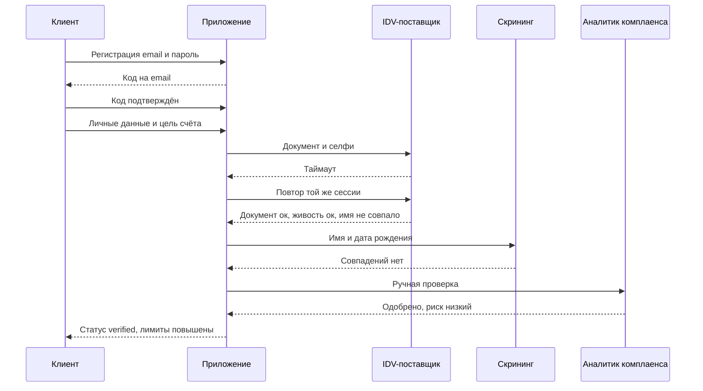
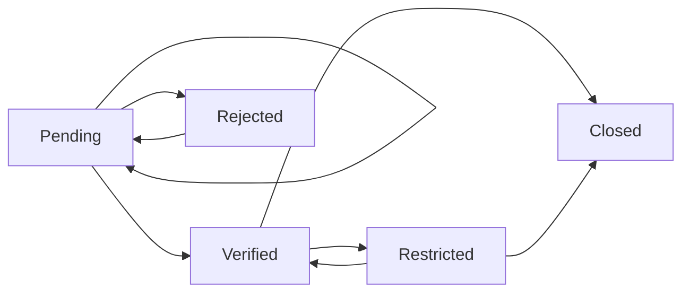

# Онбординг и KYC

Прежде чем платёжная компания или эмитент электронных денег позволит человеку хранить и переводить
деньги, закон требует знать, кто это: **KYC** (know your customer, «знай своего клиента»). Эта
страница проводит одного клиента от регистрации до верифицированного счёта, объясняет уровни
проверки, удалённую идентификацию и статусы клиента и перечисляет, что проверяют тестировщики:
переходы статусов, лимиты по статусу, пограничные случаи с документами и сбои у поставщика.

## Как это работает

### Сначала термины

- **Онбординг** (onboarding) — вся воронка подключения: создать логин, подтвердить контакты,
  проверить личность, оценить риск, открыть счёт.
- **Надлежащая проверка клиента** (CDD, customer due diligence) — юридическая обязанность, стоящая
  за KYC. В ЕС статья 13(1) Директивы о противодействии отмыванию денег (EU) 2015/849 (**AMLD**)
  перечисляет четыре меры: (a) идентифицировать клиента и **верифицировать** личность по надёжному
  независимому источнику; (b) установить **бенефициарного владельца** (beneficial owner) и принять
  разумные меры для его проверки; (c) понять цель и характер отношений; (d) вести **постоянный
  мониторинг** (ongoing monitoring) отношений.
- **Идентификация** (identification) и **верификация** (verification) — идентификация: собрать,
  кем человек себя называет (имя, дата рождения, адрес); верификация: доказать это (документ, eID,
  база данных).
- **Обязанное лицо** (obliged entity) — компания, которая должна применять правила AML: банки,
  платёжные институты, эмитенты электронных денег и другие.
- **IDV-поставщик** (identity verification provider) — внешняя компания, которая проверяет
  документы и селфи по заказу обязанного лица. Ответственность за результат остаётся на
  обязанном лице.

Новый Регламент ЕС о противодействии отмыванию (EU) 2024/1624 (**AMLR**) применяется с 10 июля
2027 года и заменит большую часть правил AMLD единым правилом прямого действия. Идеи этой страницы
не меняются, меняются номера статей. За пределами ЕС те же базовые меры CDD задаёт как
международный стандарт Рекомендация 10 FATF.

### Шаг за шагом

1. **Регистрация** (sign-up). Email или телефон, пароль, согласие с условиями. Денег пока нет.
2. **Подтверждение контактов** (contact verification). Одноразовый код на email или телефон
   доказывает, что человек ими владеет. Это ещё не проверка личности.
3. **Данные для идентификации.** Имя, дата рождения, адрес, гражданство, цель счёта (мера CDD c),
   ожидаемая активность.
4. **Проверка личности.** Один из удалённых способов ниже или визит в отделение.
5. **Скрининг** (screening). Проверка имени по санкционным спискам и спискам **PEP** (politically
   exposed persons, публичные должностные лица, ПДЛ — люди с видными государственными функциями; их
   родственников и близких партнёров тоже проверяют, так как статья 23 AMLD распространяет на них
   меры для PEP). Санкции и логика скрининга — в [области 06 (лимиты, фрод и AML)](../06-limits-fraud-aml/ru.md).
6. **Оценка риска** (risk assessment). Риск-балл (низкий / средний / высокий) по стране, продукту,
   каналу, статусу PEP, ожидаемым объёмам. Он определяет уровень CDD.
7. **Решение и открытие счёта.** Верифицирован, отклонён или отправлен на ручную проверку.
8. **Постоянный мониторинг и периодический пересмотр** (periodic review) на всём протяжении
   отношений.

Статья 14(1) AMLD требует верификации **до** начала деловых отношений. Статья 14(3) разрешает
государствам допускать более раннее открытие счёта, если операции заблокированы до завершения
идентификации и верификации, — поэтому во многих продуктах есть статус «pending», в котором клиент
может войти, но не может двигать деньги. Если CDD провести невозможно, по статье 14(4) отношения не
начинаются (или прекращаются) и нужно рассмотреть сообщение о подозрительной операции.

### Уровни проверки

| Уровень | Когда | Что меняется |
|---|---|---|
| **SDD** — упрощённые меры надлежащей проверки клиента (simplified due diligence) | Компания оценила и задокументировала низкий риск (ст. 15 AMLD) | Проверки легче или позже; мониторинг всё равно должен находить необычные операции |
| **Стандартная CDD** | По умолчанию | Все четыре меры статьи 13 |
| **EDD** — усиленные меры надлежащей проверки клиента (enhanced due diligence) | Повышенный риск: PEP, высокорисковые третьи страны, необычные операции, другие факторы (ст. 18–24 AMLD) | Больше информации (источник средств и состояния для PEP), одобрение высшего руководства, более плотный мониторинг |

Для **электронных денег** (e-money) есть отдельное узкое правило: статья 12 AMLD позволяет
государству разрешить эмитенту не применять часть мер CDD к низкорисковому продукту, если выполнены
все условия — среди них: хранится не более EUR 150, и инструмент либо непополняемый, либо имеет
месячный лимит платежей EUR 150 только в этом государстве; только покупка товаров и услуг; есть
мониторинг. Исключение не действует для выдачи наличных свыше EUR 50 и удалённых платежей свыше
EUR 50 за операцию. Доступно ли оно, зависит от национального закона — не считайте это данностью.

**PEP.** Статья 3(9) AMLD перечисляет функции (главы государств, министры, депутаты, судьи высших
судов, члены правлений центральных банков, послы и другие; должностные лица среднего и младшего уровня не включаются). Человек, покинувший должность, остаётся
под мерами для PEP не менее 12 месяцев (статья 22) и дольше, пока риск сохраняется. PEP не
отклоняют автоматически — применяется EDD.

**Клиенты-компании (KYB).** Для компании KYC превращается в **KYB** (know your business, «знай
бизнес клиента»): проверить компанию в реестре, кто вправе действовать от её имени, и установить
**бенефициарных владельцев** — физических лиц, которые в конечном счёте владеют ею или её
контролируют. Статья 3(6) AMLD считает владение более 25% признаком владения; государство может
установить меньший процент. Если владельца найти нельзя, записывают высшее должностное лицо
(senior managing official), а компания хранит записи о предпринятых шагах.

**Постоянный мониторинг и периодический пересмотр.** CDD — не разовое действие: статья 14(5) AMLD
требует применять её к существующим клиентам в подходящие моменты с учётом риска и при изменении
обстоятельств. На практике: циклы пересмотра по уровню риска, повторный скрининг при обновлении
списков и обработка **истечения срока документа** (document expiry) — просроченный паспорт не
делает человека неизвестным, но политика компании решает, просить ли новый документ и что
ограничить, если его не прислали. Политики различаются.

### Удалённая проверка личности

Допустимые способы **различаются по странам и регуляторам**; некоторые национальные регуляторы
публикуют свои перечни. Руководство EBA по удалённому онбордингу клиентов (EBA/GL/2022/15,
применяется с 2 октября 2023 года) задаёт общие ожидания, не продвигая конкретную технологию:

- **Документ + селфи с проверкой «живости»** (без оператора, unattended). Клиент фотографирует
  удостоверение личности и делает селфи или видео. Руководство ожидает: снимки сделаны в момент
  проверки, качество достаточное, есть **проверка живости** (liveness detection — доказательство,
  что перед камерой живой человек; активная — «поверните голову» — или пассивная) и надёжное
  сравнение лица с фото в документе. Проверка документа включает защитные элементы, следы
  подделки, контрольные цифры **MRZ** (machine-readable zone, машиночитаемая зона) и распознавание
  снимка с экрана. Если в документе есть чип (читается по NFC) и доступ к нему технически
  возможен, компании следует рассмотреть использование его данных.
- **Видеоидентификация** (video identification, с оператором). Обученный сотрудник говорит с
  клиентом по видео по сценарию интервью; случайное назначение сотрудников снижает риск сговора.
- **eID** (электронная идентификация). Нотифицированная схема электронной идентификации по
  регламенту **eIDAS** (EU) No 910/2014 с уровнем доверия «substantial» или «high» либо
  квалифицированный доверительный сервис. Статья 13(1)(a) AMLD прямо допускает такие средства.
  Регламент (EU) 2024/1183 изменил eIDAS и добавил европейские кошельки цифровой
  идентичности (EU Digital Identity Wallets), которые государства ЕС сейчас внедряют.

Общие правила для всех способов: если качество недостаточное или связь оборвалась, процесс
**останавливают и начинают заново** или переводят в очный формат; доказательства **снабжают
отметкой времени и хранят**, чтобы их можно было проверить позже; компания должна протестировать
решение до запуска, включая тесты на мошенничество и сквозные (end-to-end) тесты; передача функции
поставщику (outsourcing) не снимает ответственности. Дополнительные меры: первый платёж со счёта на
имя клиента в регулируемом банке или платёжном учреждении ЕЭЗ или одноразовый код с
ограниченным сроком действия.

### Персональные данные

Онбординг собирает документы, изображения лица и адреса. Изображение лица, обрабатываемое для
идентификации человека, — биометрические данные, особая категория по GDPR. Собирайте только то, что
требует политика CDD (минимизация данных, data minimisation), и храните записи CDD пять лет после
окончания отношений (статья 40 AMLD; с 10 июля 2027 года статья 77 AMLR; по AMLD государства-члены
могут продлить срок ещё до пяти лет), затем удаляйте.
Подробнее — в [области 08 (регулирование: GDPR)](../08-regulation/ru.md).

Статусы в этом примере (названия в компаниях различаются):

| Статус | Значение | Что разрешено |
|---|---|---|
| Pending (ожидает) | Зарегистрирован, проверка не завершена или на ручном разборе | Вход, прохождение KYC; движения денег нет |
| Verified (верифицирован) | CDD завершена для уровня риска | Весь продукт в пределах лимитов |
| Restricted (ограничен) | Был верифицирован, но чего-то не хватает или есть подозрение: просрочен документ, пропущен пересмотр, совпадение при скрининге | Зависит от причины, часто только входящие или только просмотр |
| Rejected (отклонён) | Проверка не пройдена или компания отказала | Счёта нет; новая попытка — только если политика разрешает (стрелка обратно в Pending) |
| Closed (закрыт) | Отношения прекращены | Операций нет; записи хранятся в течение срока хранения |

### Пример: Юлия открывает кошелёк

Синтетический клиент (не реальный человек): Yuliia Testenko, родилась 14 марта 1994 года, паспорт
Украины действует до 30 июня 2027 года. Правила продукта ниже **придуманы для примера**; таймаут
IDV-поставщика 30 секунд — значение настройки, а не норма закона.

| Дата и время (местное время Варшавы) | Событие | Статус | Деньги |
|---|---|---|---|
| 12 ноя 2026 09:00 | Регистрируется с email и паролем | Pending | Нельзя |
| 12 ноя 2026 09:02 | Вводит 6-значный код из письма; контакт подтверждён | Pending | Нельзя |
| 12 ноя 2026 09:05 | Вводит имя «Yulia Testenko», адрес в Варшаве, цель: повседневные платежи | Pending | Нельзя |
| 12 ноя 2026 09:07 | Загружает паспорт и селфи; поставщик не отвечает 30 с | Pending | Нельзя |
| 12 ноя 2026 09:08 | Приложение повторяет запрос с тем же id сессии проверки — второго дела у поставщика нет | Pending | Нельзя |
| 12 ноя 2026 09:09 | Поставщик: документ подлинный, MRZ верна, живость пройдена, лицо совпало; имя в документе «YULIIA» ≠ введённому «Yulia» | Pending, ручная проверка | Нельзя |
| 12 ноя 2026 09:09 | Скрининг: совпадений с санкциями и PEP нет; риск низкий → стандартная CDD | Pending | Нельзя |
| 12 ноя 2026 10:30 | Аналитик принимает: вариант транслитерации того же имени; в записи оба написания и причина | Verified | Пополнение и платежи |
| 12 ноя 2026 10:35 | Пополнение EUR 200.00 с банковского счёта на её имя | Verified | — |
| 1 апр 2027 | Периодическая задача: паспорт истекает через 90 дней → напоминание | Verified | Без изменений |
| 1 июл 2027 00:00 | Паспорт истёк, нового нет → ограничение по политике продукта | Restricted | Только входящие |
| 3 июл 2027 14:20 | Новый паспорт загружен и проверен | Verified | Полностью |

На что обратить внимание: повтор использовал тот же id сессии, поэтому у поставщика одно дело и
одна оплата; несовпадение имени ушло человеку, а не в автоматический отказ; журнал аудита показывает,
кто и почему принял решение; любая попытка пополнения до 10:30 должна отклоняться, потому что статус
ещё Pending.

## Участники и потоки денег

KYC сам почти не двигает деньги — он решает, можно ли их двигать.

| Участник | Роль | Что отправляет / получает и когда | Какой риск несёт |
|---|---|---|---|
| Клиент | Заявитель | Отправляет личные данные, документы, селфи; получает статус и лимиты | Кража личности, если кто-то пройдёт онбординг от его имени; ошибочный отказ |
| Эмитент электронных денег / платёжный институт | Обязанное лицо | Собирает данные, решает статус, ставит лимиты, хранит записи; платит поставщику за каждую проверку | Полная юридическая ответственность за CDD, даже при аутсорсинге; штрафы и риск для лицензии |
| IDV-поставщик | Проверка на аутсорсинге | Получает документ и селфи; возвращает результаты и баллы; берёт плату за проверку | Договорной; перед регулятором всё равно отвечает обязанное лицо |
| Поставщик данных для скрининга | Санкционные списки и PEP | Поставляет списки; сверяет имена при онбординге и при обновлении списков | Пропущенные или запоздавшие обновления становятся проблемой компании |
| Схема eID / доверительный сервис | Подтверждение личности | Подтверждает личность на уровне доверия eIDAS | Гарантия схемы; компания всё равно проверяет подмену личности и отозванные документы |
| Банк клиента | Источник первого пополнения | Отправляет первый платёж; совпадение имени может быть дополнительной мерой | — |
| Подразделение финансовой разведки (FIU, financial intelligence unit) и надзорный орган | Органы власти | Получают сообщения о подозрительных операциях; проверяют досье CDD | — |

## Бизнес-риски

### Компания

- **Онбординг преступника или фальшивой личности** (украденные документы, дипфейк-селфи,
  синтетическая личность, synthetic identity) → отмывание денег через компанию, потери от фрода,
  штрафы надзора.
- **Деньги двигаются до верификации**, потому что проверка статуса пропущена в одном канале (API,
  карта, перевод) → нарушение статьи 14 AMLD.
- **Расходы на поставщика** удваиваются, если повторы открывают новые дела у поставщика.
- **Потери в воронке**: слишком строгое сравнение или сломанный шаг с камерой отсекают хороших
  клиентов.

### Клиент

- Ошибочный отказ из-за транслитерации, диакритики или двойной фамилии.
- Счёт ограничен без понятной причины и способа исправить; зарплата «застряла».
- Утечка сканов паспорта и изображений лица — их нельзя «сменить», как пароль.

### Регулятор / комплаенс

- Неполные записи CDD, нет отметок времени, нет доказательства, кто одобрил ручное решение.
- PEP не выявлен или EDD не применена; бывший PEP снят с мер раньше 12 месяцев.
- Документы хранятся дольше разрешённого или собрано больше нужного (GDPR).
- Используется удалённый способ, который национальный регулятор не принимает.

## Что тестировать

- [ ] Каждый статус разрешает только действия из таблицы статусов — во всех каналах (приложение, API, карты, переводы).
- [ ] Переходы: только разрешённые стрелки; недопустимый прыжок (Rejected → Verified) отклоняется.
- [ ] Лимиты меняются ровно в момент смены статуса, а не на запрос позже.
- [ ] Коды подтверждения контактов: срок действия, однократность, лимит попыток, повторная отправка.
- [ ] Просроченный документ отклоняется при загрузке; документ, истекающий завтра, принимается по политике.
- [ ] Сравнение имён: транслитерация, диакритика, двойные фамилии, порядок имён, регистр — на ручную проверку, а не автоотказ.
- [ ] Дата рождения: несовершеннолетний младше минимального возраста продукта отклоняется; день рождения сегодня — граница.
- [ ] Повторная подача (resubmission) после результата «повторить»: допустимое число попыток, старые доказательства сохранены, нет дубля клиента.
- [ ] Таймаут или 5xx у поставщика: статус остаётся Pending, безопасный повтор с той же сессией, нет второго дела.
- [ ] Поздний callback от поставщика по старой сессии не перезаписывает более новое решение.
- [ ] Совпадение при скрининге отправляет на ручную проверку; для PEP есть поля EDD и шаг одобрения.
- [ ] Задачи периодического пересмотра и истечения документов запускаются вовремя с учётом часовых поясов.
- [ ] Журнал аудита (audit trail): кто, когда, какие доказательства, какая версия правила — для каждой смены статуса.
- [ ] Дубль личности: один номер документа на двух аккаунтах выявляется.
- [ ] Доступность (accessibility): шаги с камерой работают с экранным диктором, есть текстовые альтернативы, достаточно времени, есть путь без камеры.
- [ ] Персональные данные: не попадают в логи, удаляются после срока хранения, маскируются в инструментах поддержки.
- [ ] В тестах — только синтетические личности и тестовые документы песочницы поставщика, никогда данные реальных людей.

| ID | Условие / шаги | Ожидаемый результат |
|---|---|---|
| KY-01 | Клиент в статусе Pending вызывает API пополнения на EUR 10.00 | Отказ с понятной ошибкой; нет операции, баланс не меняется |
| KY-02 | Документ истекает 12 ноя 2026; загрузка в 23:59 CET 12 ноября, затем в 00:01 CET 13 ноября | Первая принята, вторая отклонена (политика: действителен по дату истечения включительно); результат не зависит от часового пояса сервера |
| KY-03 | Дата рождения 12 ноя 2008, минимальный возраст 18, онбординг 12 ноя 2026 | Принят — сегодня исполняется 18; 13 ноя 2008 отклоняется |
| KY-04 | Имя в документе «YULIIA», введено «Yulia» | Ручная проверка с показом обоих написаний; не автоматический отказ |
| KY-05 | Поставщик не отвечает 30 с; приложение повторяет запрос | Одно дело у поставщика, статус Pending, клиент видит «мы проверяем», второй оплаты нет |
| KY-06 | Два callback по одной сессии приходят одновременно (одобрить и отклонить) | Одно итоговое решение по задокументированному правилу; второе записано в журнал, но не применено |
| KY-07 | Документ верифицированного клиента действителен по 30 июн 2027 включительно; наступает 00:00 по местному времени 1 июл 2027 | Статус Restricted в нужный момент; лимиты снижены; клиент уведомлён |
| KY-08 | Отклонённый клиент снова регистрируется с тем же документом | Выявлена та же личность; обработка по политике, а не новый «чистый» аккаунт |
| KY-09 | Имя клиента добавлено в список скрининга после онбординга | Повторный скрининг помечает клиента; создано дело на проверку |
| KY-10 | Ежедневная сверка счетов поставщика с сессиями проверки | Количество совпадает; нет оплаченных проверок без сессии и сессий без решения |

## Типичные дефекты

1. **Статус не проверяется в одном канале.** Приложение блокирует Pending, а карта или API — нет.
   Как поймать: выполнить одно и то же действие во всех каналах для каждого статуса.
2. **Повтор создаёт второе дело.** Обработка таймаута открывает новую сессию у поставщика, а старый
   ответ приходит позже. Как поймать: заглушка, которая отвечает поздно, а потом дважды.
3. **Строгое равенство имён.** «Yuliia» и «Yulia» или «Müller» и «Mueller» отклоняются
   автоматически. Как поймать: таблица пар транслитерации и диакритики.
4. **Непроверенный ввод роняет регистрацию.** Символ NUL или очень длинный пароль дают 500 вместо
   422. Как поймать: фаззинг и контрактные тесты по схеме. Найдено в card-wallet:
   [BUG-06](https://github.com/Tomullya/card-wallet/blob/main/docs/qa/bug-reports/BUG-06.md),
   [BUG-08](https://github.com/Tomullya/card-wallet/blob/main/docs/qa/bug-reports/BUG-08.md).
5. **Срок документа и возраст сдвинуты на день или пояс.** Дата сравнивается в UTC, а правило в
   местном времени, или `<` вместо `<=`. Как поймать: граничные даты около полуночи.
6. **Ограничение не снимается.** Новый документ проверен, а статус остаётся Restricted, потому что
   задача переводит клиентов только в одну сторону. Как поймать: проверить каждую стрелку в обе
   стороны.
7. **Персональные данные в логах или тестовых данных.** Номера документов в логах; копии продакшена
   в тестовых средах. Как поймать: искать в логах синтетические номера документов; проверять
   источники тестовых данных.
8. **Нет журнала аудита для ручных решений.** Аналитик одобрил, но в записи нет причины и имени.
   Как поймать: проверять историю после каждого ручного действия.

## В card-wallet

В [card-wallet](https://github.com/Tomullya/card-wallet) есть **только регистрация и вход — KYC
нет**. Зарегистрированный клиент сразу может открыть счёт и пополнить его; статуса верификации нет.

- Правила регистрации: формат email, хранение в нижнем регистре и уникальность
  (`409 EMAIL_ALREADY_REGISTERED`), имя 1–100 символов, правила пароля, пароль не возвращается —
  BR-AUTH-01 в [BR-auth.md](https://github.com/Tomullya/card-wallet/blob/main/docs/requirements/BR-auth.md);
  тесты в [test_auth.py](https://github.com/Tomullya/card-wallet/blob/main/tests/api/test_auth.py)
  и кейсы в [TC-auth.md](https://github.com/Tomullya/card-wallet/blob/main/docs/qa/test-cases/TC-auth.md).
- Открытие счёта без какой-либо проверки:
  [BR-accounts.md](https://github.com/Tomullya/card-wallet/blob/main/docs/requirements/BR-accounts.md).
- Дефекты ввода при регистрации, которые сюда относятся: пароль длиннее 72 байт (ограничение
  bcrypt) давал 500 —
  [BUG-06](https://github.com/Tomullya/card-wallet/blob/main/docs/qa/bug-reports/BUG-06.md);
  символ NUL в имени давал 500 —
  [BUG-08](https://github.com/Tomullya/card-wallet/blob/main/docs/qa/bug-reports/BUG-08.md),
  регрессионные тесты в [test_errors.py](https://github.com/Tomullya/card-wallet/blob/main/tests/api/test_errors.py).
  [BUG-14](https://github.com/Tomullya/card-wallet/blob/main/docs/qa/bug-reports/BUG-14.md)
  (схема `bearer` в нижнем регистре отклоняется) касается доступа после входа, а не онбординга.
- Только синтетические данные: NFR-04 в
  [NFR.md](https://github.com/Tomullya/card-wallet/blob/main/docs/requirements/NFR.md) требует
  вымышленных данных, а [helpers.py](https://github.com/Tomullya/card-wallet/blob/main/tests/helpers.py)
  генерирует уникальный email на `@example.com` для каждого теста.

Что можно добавить (честно о пробелах — card-wallet упрощённое демо):

- Поле `verification_status` (pending, verified, restricted, rejected, closed) с разрешёнными
  переходами и проверкой в эндпоинтах пополнения, карт и платежей.
- Лимиты по статусу: в Pending пополнение запрещено, в Verified — полные лимиты, в Restricted —
  только входящие.
- Заглушка IDV-сервиса с настраиваемой задержкой, таймаутом и поздними callback — по образцу
  существующей заглушки fraud-service — для тестов повторов и дублей решений.
- Таблица аудита смен статуса и периодическая задача для истечения документов.

## Источники

- [Директива (EU) 2015/849 (AMLD), EUR-Lex](https://eur-lex.europa.eu/eli/dir/2015/849/oj) — меры CDD (ст. 13), сроки и открытие счёта с блокировкой операций (ст. 14), исключение для электронных денег (ст. 12), SDD (ст. 15), EDD (ст. 18–24) и PEP (ст. 20–23), определения бенефициара и PEP (ст. 3), хранение записей (ст. 40).
- [Регламент (EU) 2024/1624 (AMLR), EUR-Lex](https://eur-lex.europa.eu/eli/reg/2024/1624/oj) — единый свод правил ЕС по AML, который заменит большую часть правил AMLD.
- [CSSF: новый регламент AML/CFT, шестая директива AML и AMLA](https://www.cssf.lu/en/2024/06/the-new-aml-cft-regulation-the-sixth-aml-cft-directive-and-the-future-eu-aml-cft-supervisor/) — AMLR применяется с 10 июля 2027 года; обзор изменений CDD и бенефициарного владения.
- [Руководство EBA по удалённому онбордингу клиентов (EBA/GL/2022/15)](https://www.eba.europa.eu/legacy/regulation-and-policy/regulatory-activities/anti-money-laundering-and-countering-financing-4) — тестирование до запуска, проверка живости, подлинность документов, прерывание процесса, записи с отметкой времени, аутсорсинг, средства eIDAS.
- [Руководство EBA по факторам риска ОД/ФТ (EBA/GL/2021/02)](https://www.eba.europa.eu/legacy/regulation-and-policy/regulatory-activities/anti-money-laundering-and-countering-financing-1) — факторы риска для SDD и EDD, отраслевое руководство для эмитентов электронных денег.
- [Рекомендации FATF](https://www.fatf-gafi.org/en/publications/Fatfrecommendations/Fatf-recommendations.html) — Рекомендация 10 (надлежащая проверка клиента) и 12 (PEP) как международный стандарт.
- [Руководство FATF по цифровой идентификации (2020)](https://www.fatf-gafi.org/en/publications/Financialinclusionandnpoissues/Digital-identity-guidance.html) — как цифровая идентификация с уровнями доверия поддерживает CDD, включая многоуровневую CDD.
- [Регламент (EU) No 910/2014 (eIDAS), EUR-Lex](https://eur-lex.europa.eu/eli/reg/2014/910/oj) — схемы электронной идентификации и уровни доверия low, substantial, high.
- [Регламент (EU) 2024/1183 (изменения eIDAS), EUR-Lex](https://eur-lex.europa.eu/eli/reg/2024/1183/oj) — добавляет в eIDAS европейские кошельки цифровой идентичности.
- [Регламент (EU) 2016/679 (GDPR), EUR-Lex](https://eur-lex.europa.eu/eli/reg/2016/679/oj) — минимизация данных и ограничение хранения (ст. 5), биометрические данные как особая категория (ст. 9).
