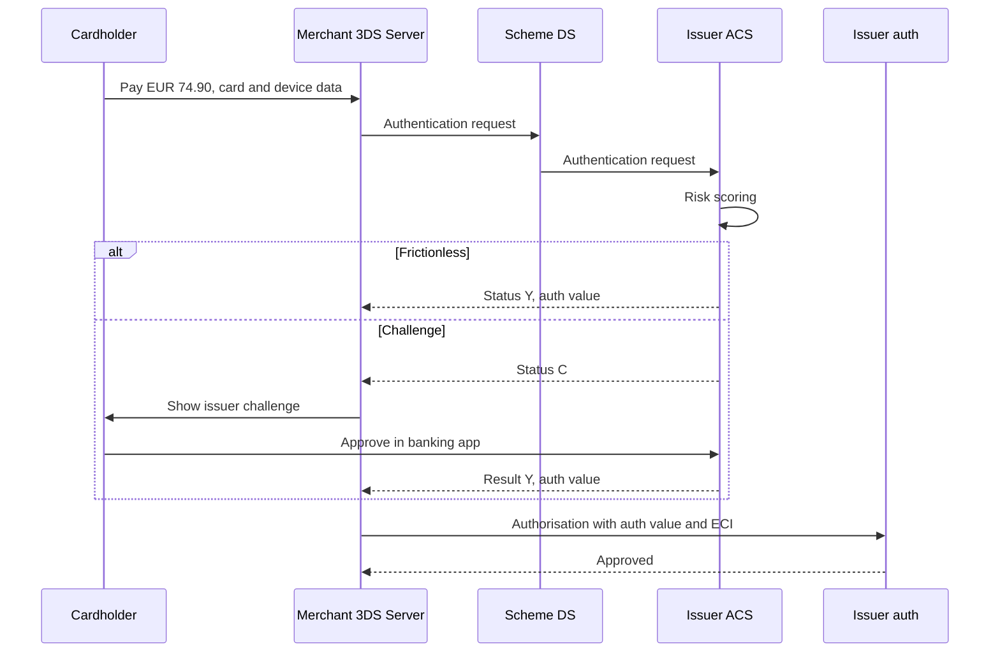

# Regulation for testers: PSD2 / SCA / 3-D Secure, PCI DSS, GDPR

Three sets of rules shape almost every fintech feature: **PSD2** with its technical standard on
Strong Customer Authentication (when the customer must prove who they are, and how), **PCI DSS**
(how card data may be stored, shown and logged) and **GDPR** (how personal data may be used and
how long it may be kept). This page explains what a tester needs to know to design tests and
catch compliance defects. It is not legal advice: the legal texts, your compliance team and your
scheme or acquirer contracts decide; rules also differ by country and scheme.

## How it works

### PSD2 and Strong Customer Authentication

**PSD2** (Directive (EU) 2015/2366) is the EU law on payment services. Its Article 97 requires
**Strong Customer Authentication (SCA)** when the payer accesses a payment account online,
initiates an electronic payment, or does anything through a remote channel that may imply a risk
of fraud. The detailed rules are in the **RTS on SCA** (regulatory technical standards,
Delegated Regulation (EU) 2018/389); they have applied since 14 September 2019.

SCA means at least **two elements from two different categories**:

| Category | Meaning | Examples |
|---|---|---|
| Knowledge | Something only the user knows | PIN, password |
| Possession | Something only the user has | Phone bound to the account, hardware token |
| Inherence | Something the user is | Fingerprint, face |

Two passwords are one category, so they are not SCA. The EBA Opinion of 21 June 2019 (EBA-Op-2019-06) also says
that card details printed on the card (number, expiry, CVV) are neither knowledge nor possession —
so "card number + CVV" is not SCA. The elements must be independent: breaking one must not break
the other (RTS Art. 9); if both live on one phone, the app needs extra protection.

Rules a tester can check directly (RTS Art. 4):

- No more than **five** consecutive failed attempts within a period, then a temporary or
  permanent block; the user is warned before a permanent block.
- The error message must not say **which** element was wrong.
- An online banking session ends after at most **5 minutes** of inactivity.

**Dynamic linking** (RTS Art. 5) applies to remote payments: the payer sees the amount and the
payee, the authentication code is tied to exactly that amount and payee, and any change to either
makes the code invalid. For a batch, the code is tied to the total and the payees; for a card
payment with an unknown final amount, to the amount the payer agreed to block.

### Exemptions: when SCA may be skipped

Exemptions are optional ("may"), not a right of the merchant: the payer's PSP — for cards, the
issuer — can always ask for SCA anyway. Thresholds from the RTS:

| Exemption (RTS article) | Condition |
|---|---|
| Contactless at point of sale (Art. 11) | Payment ≤ EUR 50, and since the last SCA either the cumulative amount ≤ EUR 150 or ≤ 5 consecutive contactless payments |
| Unattended terminal for transport or parking (Art. 12) | Allowed at such terminals |
| Trusted beneficiaries (Art. 13) | Payee is on a list the payer created; creating or changing the list needs SCA |
| Recurring payments (Art. 14) | Same amount and same payee; SCA when the series is created or changed |
| Own accounts (Art. 15) | Credit transfer between accounts of the same person at the same PSP |
| Low-value remote (Art. 16) | Payment ≤ EUR 30, and since the last SCA either previous remote payments total ≤ EUR 100 or ≤ 5 consecutive payments |
| Secure corporate processes (Art. 17) | Dedicated processes for non-consumers that the regulator accepts as equally secure |
| Transaction risk analysis, TRA (Art. 18) | Real-time risk analysis finds nothing unusual, and the PSP's fraud rate is within the reference rate for the amount band |

TRA bands for remote card payments (RTS Annex): fraud rate ≤ 0.13% allows up to EUR 100,
≤ 0.06% up to EUR 250, ≤ 0.01% up to EUR 500 (for credit transfers 0.015%, 0.01%, 0.005%).
The fraud rate is the value of fraudulent remote transactions divided by the value of all remote
transactions of that type, on a rolling 90-day basis (Art. 19). If it exceeds the reference rate
for two consecutive quarters, the PSP must stop using the exemption at once (Art. 20).

Account information access (Art. 10 and 10a, amended by Delegated Regulation (EU) 2022/2360):
viewing the balance and recent transactions can be done without SCA each time, but SCA is needed
again after 180 days.

**Out of scope rather than exempt:** payments initiated by the payee alone under a mandate
(merchant-initiated transactions, for example a variable subscription charge). The EBA Q&A
2018_4031 says these are not subject to SCA, but setting up the mandate remotely is.

### 3-D Secure 2

**EMV 3-D Secure (3DS2)**, written by **EMVCo**, is the protocol most card issuers use for SCA in
online payments. Its parts: the merchant's **3DS Server** (often run by the PSP), the scheme's
**Directory Server (DS)** and the issuer's **Access Control Server (ACS)**.

- **Frictionless flow** — the merchant sends rich data (device, address, history); the issuer
  scores the risk and approves authentication without asking the customer anything.
- **Challenge flow** — the issuer asks the customer to authenticate (app approval, one-time code,
  biometrics).

The result comes back as a transaction status: authenticated (Y), not authenticated (N),
attempted (A), unable to perform (U), rejected (R), challenge required (C); version 2.2 adds decoupled
authentication (D) and informational only (I). The authorisation then carries the authentication value and an **ECI** (electronic
commerce indicator). Successful 3DS usually **shifts liability** for fraud chargebacks from the
merchant to the issuer; an approved exemption usually does not. Stripe stresses that liability
shift is expected but never guaranteed — scheme rules decide. See
[Card payment](../01-card-payment/en.md) for chargebacks.

### Open banking in one paragraph

PSD2 also lets licensed third parties reach a customer's bank account with the customer's
consent: **AIS** (account information service, PSD2 Art. 67) reads balances and transactions;
**PIS** (payment initiation service, Art. 66) starts a credit transfer from the account. The
bank authenticates the customer with SCA and must offer a secure interface (RTS Art. 30–33).
Testers check consent scope and expiry, SCA redirects, and the 180-day re-authentication.

**PSD3 / PSR.** The Commission proposed a new directive (PSD3) and a Payment Services Regulation
(PSR) in June 2023. Parliament and Council reached a provisional agreement on 27 November 2025,
and the Parliament's ECON committee approved the agreed text on 5 May 2026. The Parliament's
Legislative Train page (updated 25 October 2026) shows no final adoption or Official Journal
publication yet, so treat them as upcoming, not law. Check the current status before relying on them.

### PCI DSS

**PCI DSS** (Payment Card Industry Data Security Standard, current version v4.0.1) is a
standard from the PCI Security Standards Council, enforced through scheme and acquirer
contracts, not a law. It applies to the **cardholder data environment (CDE)**: every system that
stores, processes or transmits account data, plus systems connected to them. Fewer systems that
touch card data means a smaller scope — that is why tokenisation and hosted payment pages exist.

**Account data** has two parts:

- **Cardholder data**: PAN (card number), cardholder name, expiry date, service code. May be
  stored if protected.
- **Sensitive authentication data (SAD)**: full track or chip data, card verification code
  (CVV2/CVC2), PIN and PIN block. **Must not be stored after authorisation, even encrypted**
  (Req. 3.3.1). Issuers may keep SAD only for a legitimate issuing need and secured (Req. 3.3.3).

What testers touch most:

- **Display (Req. 3.4.1):** PAN masked wherever shown — screens, reports, logs, receipts — at most
  the BIN and last four digits unless there is a documented business need. Historically "first six
  and last four"; with 8-digit BINs the PCI SSC FAQ ties it to the BIN.
- **Storage (Req. 3.5.1):** stored PAN made unreadable — truncation, tokens, strong encryption,
  or a hash. Hashes must be **keyed** (Req. 3.5.1.1, mandatory since 31 March 2025): a plain
  SHA-256 of a PAN can be brute-forced.
- **Test data (Req. 6.5.5–6.5.6):** no live PANs in pre-production environments unless they are
  in scope and protected as the CDE; test data and test accounts removed before production.
- **Logs (Req. 10):** audit logs kept at least 12 months, the last 3 months immediately
  available (Req. 10.5.1). Logs are storage too: SAD must never be in them (Req. 3.3.1), and a
  full PAN only if unreadable (Req. 3.5.1).

### GDPR

**GDPR** (Regulation (EU) 2016/679) covers any personal data: name, e-mail, IBAN, IP address,
device id, transaction history.

- **Lawful basis (Art. 6):** each processing needs one — contract, legal obligation (KYC/AML),
  legitimate interest, consent and others. Consent is only one option and can be withdrawn.
- **Data minimisation and storage limitation (Art. 5):** collect only what is needed; keep it no
  longer than needed.
- **Rights:** access (Art. 15), erasure (Art. 17), rectification, portability, objection.
- **Erasure vs AML:** Art. 17(3)(b) allows keeping data when a legal obligation requires it.
  The anti-money-laundering directive (EU) 2015/849 Art. 40 requires keeping customer due
  diligence and transaction records for five years after the business relationship ends (Member
  States may allow or require up to five more years); from 10 July 2027 the AML Regulation
  (EU) 2024/1624, Art. 77, sets the same five years. So "delete me" for a closed account usually means: delete marketing data,
  restrict and keep AML records until their retention date, then delete. AML and KYC records
  are covered in [Limits, fraud and AML](../06-limits-fraud-aml/en.md) and
  [Onboarding and KYC](../07-onboarding-kyc/en.md).
- **Pseudonymisation vs anonymisation:** pseudonymised data (a key can link it back) is still
  personal data; truly anonymous data is outside GDPR (Recital 26). A masked PAN plus customer id
  is pseudonymised, not anonymous.
- **Breach notification (Art. 33):** to the supervisory authority without undue delay and,
  where feasible, within **72 hours** of becoming aware, unless the breach is unlikely to result
  in a risk to people; every breach is documented.
- **Fines (Art. 83):** up to EUR 20 million or 4% of worldwide annual turnover, whichever is
  higher, for the most serious breaches.

### Worked example: counting the low-value exemption

An issuer applies the Art. 16 exemption with the **amount counter** (previous remote payments
since the last SCA must not exceed EUR 100). Last SCA: 2 Nov 2026, 09:00 CET.

| Date and time (CET) | Payment | Previous since SCA | Decision | Counter after |
|---|---|---|---|---|
| 3 Nov 10:15 | 25.00 | 0.00 | Exempt | 25.00 |
| 4 Nov 19:40 | 30.00 | 25.00 | Exempt — exactly 30.00 is allowed | 55.00 |
| 5 Nov 08:05 | 28.00 | 55.00 | Exempt | 83.00 |
| 6 Nov 13:30 | 17.00 | 83.00 | Exempt | 100.00 |
| 7 Nov 21:10 | 12.00 | 100.00 | Exempt — 100.00 does not exceed 100 | 112.00 |
| 8 Nov 11:00 | 9.00 | 112.00 | SCA — 3DS challenge, approved | 0.00 (reset) |
| 9 Nov 18:20 | 30.01 | 0.00 | SCA — above 30.00, counters do not help | 0.00 |

With the **count counter** instead, the payment on 8 Nov would still be exempt (five previous
payments do not exceed five). Both readings are legal; the requirement must say which counter is
used, whether the current payment is included (the RTS counts only previous ones) and whether
declined payments count — otherwise developers and testers will disagree.

TRA in numbers: if the acquirer's fraud rate for remote card payments over the last 90 days is
0.05%, it may exempt payments up to EUR 250.00 (needs ≤ 0.06%), but not EUR 250.01 (the EUR 500
band needs ≤ 0.01%).

## Participants and money flows

| Participant | Role | Sends / receives and when | Risk carried |
|---|---|---|---|
| Payer / cardholder | Authenticates | Gives card data, approves the challenge in the bank app | Under PSD2 Art. 74(2), bears no loss if SCA was not required, unless the payer acted fraudulently |
| Merchant | Sells | Sends 3DS data and authorisation; may request exemptions | Fraud chargebacks when no liability shift (exemption, failed or no 3DS) |
| Acquirer / PSP (3DS Server) | Runs authentication for merchants | Sends authentication requests, applies TRA within its fraud rate | If the payee side fails to accept SCA, it refunds the payer's PSP (Art. 74(2)); loses TRA if fraud grows |
| Card scheme (Directory Server) | Routes 3DS messages, writes liability rules | Passes requests to the ACS | Sets liability shift and fines |
| Issuer (ACS) | Payer's PSP | Decides frictionless or challenge, returns result, authorises | Fraud on SCA-authenticated payments; loss when it skipped SCA |
| AISP / PISP | Third-party providers | Access the account with consent via the bank's interface | Consent scope, data protection |
| Regulators | National competent authority, data protection authority | Receive fraud reports, breach notifications | Issue fines and orders |
| PCI QSA / acquirer | Assess PCI DSS compliance | Receive reports on compliance | Scheme penalties pass to the merchant or PSP |

No money moves in authentication itself; it decides **who pays for fraud** later.

## Business risks

### Company

- Missing SCA where it was required → under PSD2 Art. 74(2) the payer's PSP refunds the payer
  (unless the payer acted fraudulently) and may recover the loss from the payee side if that side
  did not accept SCA; fraud chargebacks without liability shift for merchants.
- Too much SCA → lost sales at checkout; an exemption engine that never fires is a business bug.
- TRA fraud rate above the reference rate for two quarters → the exemption must stop immediately.
- Card data leak → PCI DSS findings, scheme fines passed through acquirers, forensic costs, loss of
  the right to process cards.
- GDPR breach → fines up to EUR 20 million or 4% of turnover; notification within 72 hours where feasible.

### Customer

- Account takeover when authentication is weak or the error reveals which factor was wrong.
- Blocked forever after failed attempts with no secure way to recover.
- Card data or personal data exposed in an export, log or screenshot.
- Request to erase data ignored, or data deleted that the customer still needs (statements).

### Regulator / compliance

- Breaking the RTS (no dynamic linking, wrong exemption thresholds, missing fraud monitoring).
- Storing CVV after authorisation; live PANs in test environments.
- Keeping personal data past the retention period, or deleting AML records too early.
- Late or missing breach notification.

## What to test

- [ ] Two factors from two different categories; two knowledge factors are rejected as SCA.
- [ ] Failed attempts: 5th failure blocks, the warning comes before a permanent block, unblocking is secure.
- [ ] Error message after failed authentication does not say which factor was wrong.
- [ ] Online banking session ends after 5 minutes of inactivity; not at 4:59.
- [ ] Dynamic linking: the code is valid only for the shown amount and payee; changing either invalidates it.
- [ ] Each exemption at its boundary: EUR 30.00 / 30.01, EUR 50.00 / 50.01, counters at the limit and one over.
- [ ] Counters reset only after a successful SCA, and are shared across channels as the requirement says.
- [ ] Issuer soft decline asking for SCA leads to a 3DS challenge and a retry, not a hard failure.
- [ ] Every 3DS outcome (Y, N, A, U, R, C, timeout) leads to the specified authorisation decision.
- [ ] Authentication result and ECI are stored with the payment for later disputes.
- [ ] Trusted beneficiary list and recurring series creation require SCA; later payments follow the rule.
- [ ] PAN masked everywhere: UI, API responses, logs, exports, e-mails, error messages, analytics.
- [ ] No CVV, track data or PIN in database, logs, caches, queues, idempotency tables or backups after authorisation.
- [ ] Stored PAN unreadable; any PAN hash is keyed, not a plain hash.
- [ ] Test environments use official test card numbers and synthetic or pseudonymised personal data.
- [ ] Retention job deletes or anonymises data on the right date, and keeps AML-held records until theirs.
- [ ] Erasure request: marketing data deleted, AML-held data restricted, customer informed.
- [ ] Consent records: who, when, what text version, withdrawal stops the processing.

| ID | Condition / steps | Expected result |
|---|---|---|
| RG-01 | Remote payment EUR 30.00, previous since SCA EUR 70.00 (amount counter) | Exempt; counter becomes 100.00 |
| RG-02 | Remote payment EUR 30.01, no previous payments | SCA required |
| RG-03 | Amount counter at EUR 112.00, payment EUR 9.00 | SCA required; after success counter resets to 0.00 |
| RG-04 | Contactless EUR 50.00, 6th consecutive contactless payment since last SCA, issuer uses the count counter | SCA required (PIN at terminal) |
| RG-05 | Authentication code generated for EUR 120.00 to payee A; amount changed to EUR 121.00 before submission | Code rejected; new authentication needed |
| RG-06 | Wrong OTP five times within the period | Access blocked; no hint which factor failed; user notified per rules |
| RG-07 | 3DS ACS does not answer within the timeout | Payment follows the specified rule (decline or retry); no authorisation sent as "authenticated" |
| RG-08 | Pay with a test card, then search all logs, exports and database tables for the full PAN and CVV | Full PAN only where allowed and unreadable; CVV nowhere |
| RG-09 | Erasure request from a customer whose account closed 2 years ago | Marketing data deleted; KYC and transaction records kept and restricted until 5 years after closure (longer if national law extends it); response within the GDPR deadline |
| RG-10 | Retention job runs at 00:00 UTC on the day records reach their retention date (time zone boundary) | Exactly those records removed; none a day early, none left a day late |

## Typical defects

1. **Sensitive data in a "technical" table.** CVV ends up in an idempotency request hash or a
   retry queue. Catch by searching every table for the test CVV and hashing guesses. Seen in
   card-wallet: [BUG-11](https://github.com/Tomullya/card-wallet/blob/main/docs/qa/bug-reports/BUG-11.md).
2. **Unkeyed PAN hash.** A plain SHA-256 of a 16-digit PAN with a known prefix and last four is
   brute-forced in seconds. Catch by recomputing the plain hash in a test and asserting it differs.
   Seen in card-wallet: [BUG-10](https://github.com/Tomullya/card-wallet/blob/main/docs/qa/bug-reports/BUG-10.md).
3. **Masking only in the UI.** The screen shows the last four, but the API, CSV export or error log
   returns the full PAN. Catch by checking every output channel, not only the page.
4. **Exemption off by one.** EUR 30.00 is challenged, or EUR 30.01 is exempt (`<` vs `<=`);
   counters are not reset after SCA or are reset after a failed one. Catch with boundary tables.
5. **Dynamic linking broken.** The amount is changed after authentication (tip, currency
   conversion, basket edit) and the old code is still accepted. Catch by tampering with the amount
   between authentication and submission.
6. **3DS outcome mishandled.** Status U or A treated as fully authenticated, or a timeout sent to
   authorisation as success; the ECI is not stored, so a fraud dispute cannot be defended.
7. **Retention job deletes too much or too little.** AML records deleted on an erasure request, or
   nothing is ever deleted because the job silently fails. Catch with dated test records on both
   sides of the retention date and a job run report.
8. **Real data in test.** A production copy with live PANs or customer e-mails is loaded into a
   test environment. Catch with a data scan of test databases and a rule that test cards come
   from scheme or PSP test ranges only.

## In card-wallet

[card-wallet](https://github.com/Tomullya/card-wallet) is a simplified demo: it has **no SCA,
no 3-D Secure, no exemptions and no GDPR features** (consent, erasure, retention). What it does
have is card data protection in the PCI DSS spirit:

- NFR-04: full PAN and CVV never in logs; CVV and passwords stored only as hashes; only fictional
  data — [NFR.md](https://github.com/Tomullya/card-wallet/blob/main/docs/requirements/NFR.md).
- Full PAN and CVV are returned only once, in the card issue response; card views show
  `**** **** **** 1234` (BR-CARD-02, BR-CARD-03) —
  [BR-cards.md](https://github.com/Tomullya/card-wallet/blob/main/docs/requirements/BR-cards.md).
  This shows only the last four, stricter than the PCI DSS maximum.
- Fake card prefix `400000`, Luhn-valid numbers, keyed HMAC PAN hash —
  [card_numbers.py](https://github.com/Tomullya/card-wallet/blob/main/wallet-api/app/services/card_numbers.py),
  [test_card_numbers.py](https://github.com/Tomullya/card-wallet/blob/main/tests/unit/test_card_numbers.py).
- Log scan after approved, wrong-CVV and error payments —
  [test_no_sensitive_logs.py](https://github.com/Tomullya/card-wallet/blob/main/tests/api/test_no_sensitive_logs.py).
- Database checks: no full PAN or plaintext CVV in the row, bcrypt CVV hash, keyed PAN hash —
  [test_cards_storage.py](https://github.com/Tomullya/card-wallet/blob/main/tests/db/test_cards_storage.py);
  CVV not part of the idempotency hash —
  [test_idempotency_hash.py](https://github.com/Tomullya/card-wallet/blob/main/tests/unit/test_idempotency_hash.py).
- Checklist "Card data (NFR-04)" —
  [security.md](https://github.com/Tomullya/card-wallet/blob/main/docs/qa/checklists/security.md).

A PCI DSS note: card-wallet acts like an issuer that generates the CVV, so keeping a bcrypt hash
to verify it later is closest to the issuer exception (Req. 3.3.3) — a simplification: real
issuers usually recompute the CVV with keys in a hardware security module instead of storing it.
A merchant or PSP may not keep the CVV after authorisation in any form.

Could be added (honest gaps):

- A mock 3DS step: frictionless or challenge by test card, with status and ECI saved on the payment.
- Low-value exemption counters with boundary tests (EUR 30.00 / 30.01, EUR 100 cumulative).
- A retention job and an erasure endpoint that respects an AML hold.
- A scan of exports and API error bodies for full PANs, not only service logs.

## Sources

- [Directive (EU) 2015/2366 (PSD2)](https://eur-lex.europa.eu/eli/dir/2015/2366/oj) — Art. 97 when SCA applies; Art. 74(2) who bears the loss without SCA; Art. 66–67 PIS and AIS.
- [Delegated Regulation (EU) 2018/389, RTS on SCA](https://eur-lex.europa.eu/eli/reg_del/2018/389/oj) — Art. 4 attempts and timeout, Art. 5 dynamic linking, Art. 9 independence, Art. 10–18 exemptions, Art. 19–20 fraud rate, Annex TRA bands. Readable copy: [legislation.gov.uk, as adopted](https://www.legislation.gov.uk/eur/2018/389/contents/adopted).
- [EBA Opinion on the elements of SCA, EBA-Op-2019-06 (PDF)](https://www.eba.europa.eu/sites/default/files/documents/10180/2622242/4bf4e536-69a5-44a5-a685-de42e292ef78/EBA%20Opinion%20on%20SCA%20elements%20under%20PSD2%20.pdf) — which approaches count as SCA elements; card details printed on the card are not a valid element. [Press release, 21 June 2019](https://www.eba.europa.eu/publications-and-media/press-releases/eba-publishes-opinion-elements-strong-customer-authentication).
- [EBA Q&A 2018_4031](https://www.eba.europa.eu/single-rule-book-qa/qna/view/publicId/2018_4031) — payee-initiated card payments outside SCA; mandate set-up needs SCA.
- [European Commission: financial data access and payments package (June 2023)](https://finance.ec.europa.eu/publications/financial-data-access-and-payments-package_en) — PSD3 and PSR proposals. Status: [European Parliament Legislative Train, PSD3](https://www.europarl.europa.eu/legislative-train/theme-an-economy-that-works-for-people/file-payment-services-and-electronic-money-services-(directive)).
- [Stripe: 3D Secure authentication](https://docs.stripe.com/payments/3d-secure/authentication-flow) — frictionless vs challenge, outcomes, test cards, liability shift is not guaranteed. transStatus values: [Adyen 3DS API reference](https://docs.adyen.com/online-payments/3d-secure/api-reference).
- [Stripe: SCA exemptions](https://docs.stripe.com/payments/3d-secure/strong-customer-authentication-exemptions) — exemptions in practice; no liability shift when an exemption is approved; MIT.
- [PCI SSC document library](https://www.pcisecuritystandards.org/document_library/) — PCI DSS v4.0.1 standard.
- [PCI SSC FAQ 1492: masking and truncation with 8-digit BINs](https://www.pcisecuritystandards.org/faqs/1492/) — Req. 3.4.1 display (BIN and last four), Req. 3.5.1 storage, keyed hashes (3.5.1.1).
- [Regulation (EU) 2016/679 (GDPR)](https://eur-lex.europa.eu/eli/reg/2016/679/oj) — Art. 5, 6, 15, 17(3)(b), 33, 83; Recital 26. AML retention: [Directive (EU) 2015/849, Art. 40](https://www.legislation.gov.uk/eudr/2015/849/article/40).
