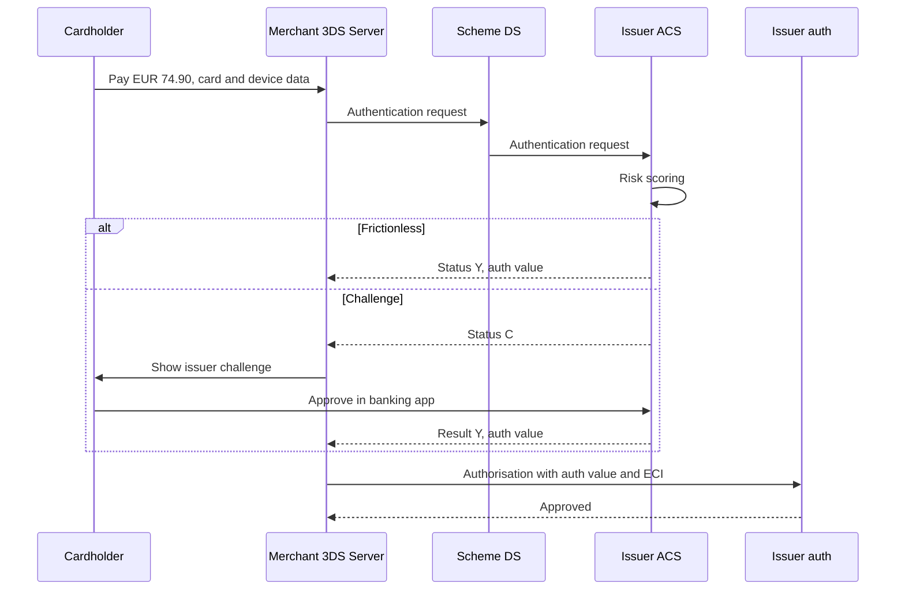

# Регулирование для тестировщика: PSD2 / SCA / 3-D Secure, PCI DSS, GDPR

Три набора правил определяют почти любую финтех-функцию: **PSD2** с техническим стандартом о
строгой аутентификации клиента (когда клиент должен подтвердить, что это он, и как), **PCI DSS**
(как карточные данные можно хранить, показывать и писать в логи) и **GDPR** (как можно
использовать персональные данные и сколько их хранить). Эта страница объясняет, что нужно знать
тестировщику, чтобы проектировать тесты и ловить дефекты соответствия требованиям (compliance).
Это не юридическая консультация: решают юридические тексты, ваш комплаенс и договоры с
платёжными системами и эквайером; правила также различаются по странам и платёжным системам.

## Как это работает

### PSD2 и строгая аутентификация клиента

**PSD2** (Директива (EU) 2015/2366) — закон ЕС о платёжных услугах. Её статья 97 требует
**строгой аутентификации клиента (Strong Customer Authentication, SCA)**, когда плательщик
заходит в платёжный счёт онлайн, инициирует электронный платёж или делает через удалённый канал
что-то, что может нести риск мошенничества. Подробные правила — в **RTS по SCA** (regulatory
technical standards, регуляторные технические стандарты, Делегированный регламент (EU)
2018/389); они действуют с 14 сентября 2019 года.

SCA — это минимум **два элемента из двух разных категорий**:

| Категория | Смысл | Примеры |
|---|---|---|
| Знание (knowledge) | То, что знает только пользователь | PIN, пароль |
| Владение (possession) | То, что есть только у пользователя | Телефон, привязанный к счёту, аппаратный токен |
| Неотъемлемость (inherence) | То, чем пользователь является | Отпечаток пальца, лицо |

Два пароля — одна категория, значит, это не SCA. Мнение EBA (EBA Opinion) от 21 июня 2019 года (EBA-Op-2019-06)
также говорит, что напечатанные на карте данные (номер, срок, CVV) не являются ни знанием, ни
владением — значит, «номер карты + CVV» не SCA. Элементы должны быть независимыми: взлом одного не
должен ломать другой (RTS ст. 9); если оба живут на одном телефоне, приложению нужна
дополнительная защита.

Правила, которые тестировщик может проверить напрямую (RTS ст. 4):

- Не больше **пяти** неудачных попыток подряд за период, затем временная или постоянная
  блокировка; перед постоянной блокировкой пользователя предупреждают.
- Сообщение об ошибке не должно говорить, **какой** элемент неверен.
- Сессия онлайн-банка завершается максимум через **5 минут** бездействия.

**Динамическая привязка (dynamic linking)** (RTS ст. 5) применяется к удалённым платежам:
плательщик видит сумму и получателя, код аутентификации привязан именно к этой сумме и этому
получателю, и любое их изменение делает код недействительным. Для пакета платежей код привязан к
общей сумме и получателям; для карточного платежа с неизвестной итоговой суммой — к сумме,
которую плательщик согласился заблокировать.

### Исключения (exemptions): когда SCA можно не применять

Исключения — это возможность («может»), а не право мерчанта: PSP плательщика — для карт эмитент —
всегда может всё равно запросить SCA. Пороги из RTS:

| Исключение (статья RTS) | Условие |
|---|---|
| Бесконтактная оплата в точке продаж (ст. 11) | Платёж ≤ EUR 50 и с последней SCA либо накопленная сумма ≤ EUR 150, либо ≤ 5 бесконтактных платежей подряд |
| Автоматический терминал для оплаты проезда или парковки (ст. 12) | Разрешено на таких терминалах |
| Доверенные получатели (trusted beneficiaries) (ст. 13) | Получатель в списке, созданном плательщиком; создание или изменение списка требует SCA |
| Регулярные платежи (recurring) (ст. 14) | Та же сумма и тот же получатель; SCA при создании или изменении серии |
| Свои счета (ст. 15) | Перевод между счетами одного лица в одном PSP |
| Малые удалённые платежи (low-value) (ст. 16) | Платёж ≤ EUR 30 и с последней SCA либо предыдущие удалённые платежи в сумме ≤ EUR 100, либо ≤ 5 платежей подряд |
| Защищённые корпоративные процессы (ст. 17) | Выделенные процессы для не-потребителей, признанные регулятором столь же безопасными |
| Анализ риска транзакции (transaction risk analysis, TRA) (ст. 18) | Анализ риска в реальном времени не нашёл ничего необычного, и уровень мошенничества PSP в пределах эталонного для диапазона суммы |

Диапазоны TRA для удалённых карточных платежей (приложение к RTS): уровень мошенничества
≤ 0,13% позволяет до EUR 100, ≤ 0,06% — до EUR 250, ≤ 0,01% — до EUR 500 (для кредитовых
переводов 0,015%, 0,01%, 0,005%). Уровень мошенничества — сумма мошеннических удалённых операций,
делённая на сумму всех удалённых операций этого типа, в скользящем окне 90 дней (ст. 19). Если он
превышает эталонный два квартала подряд, PSP должен немедленно прекратить применять исключение
(ст. 20).

Доступ к информации о счёте (ст. 10 и 10a, изменены Делегированным регламентом (EU) 2022/2360):
смотреть баланс и недавние операции можно без SCA каждый раз, но через 180 дней SCA нужна снова.

**Вне сферы SCA, а не исключение:** платежи, которые инициирует только получатель по мандату
(merchant-initiated transactions, MIT — например, списание по подписке с меняющейся суммой).
Ответ EBA Q&A 2018_4031: на них SCA не распространяется, но удалённое оформление мандата требует
SCA.

### 3-D Secure 2

**EMV 3-D Secure (3DS2)** от **EMVCo** — протокол, через который большинство эмитентов применяют
SCA в онлайн-платежах. Его части: **3DS Server** мерчанта (часто его ведёт PSP),
**Directory Server (DS)** платёжной системы и **Access Control Server (ACS)** эмитента.

- **Без участия клиента (frictionless flow)** — мерчант отправляет богатые данные (устройство,
  адрес, история); эмитент оценивает риск и подтверждает аутентификацию, ничего не спрашивая.
- **С проверкой (challenge flow)** — эмитент просит клиента пройти аутентификацию (подтверждение
  в приложении, одноразовый код, биометрия).

Результат возвращается как статус транзакции: аутентифицирован (Y), не аутентифицирован (N),
попытка (A), невозможно выполнить (U), отклонено (R), нужна проверка (C); версия 2.2 добавляет раздельную
аутентификацию (decoupled, D) и «только для информации» (informational only, I). Авторизация затем несёт значение аутентификации и **ECI** (electronic commerce indicator,
индикатор электронной коммерции). Успешный 3DS обычно **переносит ответственность (liability
shift)** за мошеннические чарджбэки с мерчанта на эмитента; одобренное исключение обычно — нет.
Stripe подчёркивает, что перенос ответственности ожидаем, но никогда не гарантирован — решают
правила платёжных систем. О чарджбэках — в разделе [Карточный платёж](../01-card-payment/ru.md).

### Открытый банкинг одним абзацем

PSD2 также позволяет лицензированным третьим сторонам получать доступ к банковскому счёту клиента
с его согласия: **AIS** (account information service, сервис информации о счёте, PSD2 ст. 67)
читает балансы и операции; **PIS** (payment initiation service, сервис инициирования платежа,
ст. 66) запускает кредитовый перевод со счёта. Банк аутентифицирует клиента через SCA и обязан
предоставить защищённый интерфейс (RTS ст. 30–33). Тестировщик проверяет объём и срок согласия,
редиректы на SCA и повторную аутентификацию через 180 дней.

**PSD3 / PSR.** Еврокомиссия предложила новую директиву (PSD3) и Регламент о платёжных услугах
(Payment Services Regulation, PSR) в июне 2023 года. Парламент и Совет достигли
предварительного соглашения 27 ноября 2025 года, а комитет ECON Европарламента одобрил
согласованный текст 5 мая 2026 года. Страница Legislative Train Европарламента (обновлена
25 октября 2026 года) пока не показывает окончательного принятия и публикации в Официальном
журнале ЕС, поэтому считайте их будущими правилами, а не действующим законом. Проверьте текущий
статус, прежде чем на них опираться.

### PCI DSS

**PCI DSS** (Payment Card Industry Data Security Standard, стандарт безопасности данных
индустрии платёжных карт, текущая версия v4.0.1) — стандарт Совета PCI SSC, который
обеспечивается договорами с платёжными системами и эквайерами, а не законом. Он применяется к
**среде данных держателей карт (cardholder data environment, CDE)**: каждой системе, которая
хранит, обрабатывает или передаёт данные счёта, плюс системам, подключённым к ним. Чем меньше
систем касается карточных данных, тем меньше область (scope) — поэтому и существуют токенизация
и платёжные страницы на стороне провайдера.

**Данные счёта (account data)** состоят из двух частей:

- **Данные держателя карты (cardholder data)**: PAN (номер карты), имя держателя, срок
  действия, сервисный код. Можно хранить, если они защищены.
- **Чувствительные аутентификационные данные (sensitive authentication data, SAD)**: полные
  данные дорожки или чипа, код проверки карты (CVV2/CVC2), PIN и PIN-блок. **Нельзя хранить после
  авторизации, даже в зашифрованном виде** (треб. 3.3.1). Эмитенты могут хранить SAD только при
  законной потребности эмиссионного бизнеса и в защищённом виде (треб. 3.3.3).

С чем тестировщик сталкивается чаще всего:

- **Отображение (треб. 3.4.1):** PAN маскируется (masking) везде, где показывается, — экраны,
  отчёты, логи, чеки — максимум BIN и последние четыре цифры, если нет документированной
  бизнес-необходимости. Исторически «первые шесть и последние четыре»; с 8-значными BIN FAQ
  PCI SSC привязывает правило к BIN.
- **Хранение (треб. 3.5.1):** хранимый PAN делается нечитаемым — усечение (truncation), токены,
  стойкое шифрование или хеш. Хеши должны быть **с ключом (keyed)** (треб. 3.5.1.1, обязательно с
  31 марта 2025 года): простой SHA-256 от PAN перебирается.
- **Тестовые данные (треб. 6.5.5–6.5.6):** никаких реальных PAN (live PANs) в
  пре-продакшн-средах, если они не входят в область и не защищены как CDE; тестовые данные и
  тестовые учётные записи удаляются до выхода в продакшн.
- **Логи (треб. 10):** журналы аудита хранятся не меньше 12 месяцев, последние 3 месяца доступны
  сразу (треб. 10.5.1). Логи — тоже хранение: SAD в них быть не должно никогда (треб. 3.3.1), а
  полный PAN — только в нечитаемом виде (треб. 3.5.1).

### GDPR

**GDPR** (Регламент (EU) 2016/679, общий регламент по защите данных) охватывает любые
персональные данные: имя, e-mail, IBAN, IP-адрес, идентификатор устройства, историю операций.

- **Законное основание (lawful basis) (ст. 6):** для каждой обработки нужно основание — договор,
  юридическая обязанность (KYC/AML), законный интерес, согласие и другие. Согласие — лишь один
  вариант, и его можно отозвать.
- **Минимизация данных (data minimisation) и ограничение хранения (storage limitation) (ст. 5):**
  собирать только нужное; хранить не дольше, чем нужно.
- **Права:** доступ (ст. 15), удаление (ст. 17), исправление, переносимость, возражение.
- **Удаление против AML:** ст. 17(3)(b) разрешает хранить данные, если этого требует
  юридическая обязанность. Директива о противодействии отмыванию денег (EU) 2015/849, ст. 40,
  требует хранить данные проверки клиента (customer due diligence) и записи об операциях пять лет
  после окончания деловых отношений (государства могут разрешить или потребовать хранить ещё до
  пяти лет); с 10 июля 2027 года те же пять лет задаёт AML-регламент (EU) 2024/1624, ст. 77. Поэтому «удалите меня» для
  закрытого счёта обычно означает: удалить маркетинговые данные, ограничить обработку и хранить
  AML-записи до их даты, затем удалить. Об AML и KYC — в разделах
  [Лимиты, фрод и AML](../06-limits-fraud-aml/ru.md) и [Онбординг и KYC](../07-onboarding-kyc/ru.md).
- **Псевдонимизация (pseudonymisation) и анонимизация (anonymisation):** псевдонимизированные
  данные (по ключу их можно связать обратно) остаются персональными; по-настоящему анонимные
  данные вне GDPR (преамбула, п. 26). Маскированный PAN плюс id клиента — это псевдонимизация, а
  не анонимность.
- **Уведомление об утечке (breach notification) (ст. 33):** надзорному органу без неоправданной
  задержки и, где возможно, в течение **72 часов** с момента, когда стало известно, если только
  утечка вряд ли создаст риск для людей; каждая утечка документируется.
- **Штрафы (ст. 83):** до EUR 20 млн или 4% мирового годового оборота, что больше, за самые
  серьёзные нарушения.

### Пример с расчётом: счётчик исключения для малых платежей

Эмитент применяет исключение ст. 16 со **счётчиком суммы** (предыдущие удалённые платежи с
последней SCA не должны превышать EUR 100). Последняя SCA: 2 ноября 2026, 09:00 CET.

| Дата и время (CET) | Платёж | Предыдущие с SCA | Решение | Счётчик после |
|---|---|---|---|---|
| 3 ноя 10:15 | 25.00 | 0.00 | Исключение | 25.00 |
| 4 ноя 19:40 | 30.00 | 25.00 | Исключение — ровно 30.00 разрешено | 55.00 |
| 5 ноя 08:05 | 28.00 | 55.00 | Исключение | 83.00 |
| 6 ноя 13:30 | 17.00 | 83.00 | Исключение | 100.00 |
| 7 ноя 21:10 | 12.00 | 100.00 | Исключение — 100.00 не превышает 100 | 112.00 |
| 8 ноя 11:00 | 9.00 | 112.00 | SCA — проверка 3DS, успешно | 0.00 (сброс) |
| 9 ноя 18:20 | 30.01 | 0.00 | SCA — больше 30.00, счётчики не помогают | 0.00 |

Если вместо этого используется **счётчик количества**, платёж 8 ноября всё ещё попадает под
исключение (пять предыдущих платежей не превышают пяти). Оба прочтения законны; требование должно
говорить, какой счётчик используется, входит ли в него текущий платёж (RTS считает только
предыдущие) и учитываются ли отклонённые платежи — иначе разработчики и
тестировщики будут спорить.

TRA в цифрах: если уровень мошенничества эквайера по удалённым карточным платежам за последние
90 дней — 0,05%, он может применять исключение к платежам до EUR 250.00 (нужно ≤ 0,06%), но не к
EUR 250.01 (диапазону до EUR 500 нужно ≤ 0,01%).

## Участники и потоки денег

| Участник | Роль | Что отправляет / получает и когда | Какой риск несёт |
|---|---|---|---|
| Плательщик / держатель карты | Проходит аутентификацию | Вводит данные карты, подтверждает проверку в приложении банка | По PSD2 ст. 74(2) не несёт убытков, если SCA не потребовали, кроме случаев мошенничества самого плательщика |
| Мерчант | Продаёт | Отправляет данные 3DS и авторизацию; может запрашивать исключения | Мошеннические чарджбэки без переноса ответственности (исключение, неуспешный 3DS или без 3DS) |
| Эквайер / PSP (3DS Server) | Проводит аутентификацию для мерчантов | Отправляет запросы аутентификации, применяет TRA в пределах своего уровня мошенничества | Если сторона получателя не принимает SCA, она возмещает PSP плательщика (ст. 74(2)); теряет TRA при росте мошенничества |
| Платёжная система (Directory Server) | Маршрутизирует сообщения 3DS, пишет правила ответственности | Передаёт запросы в ACS | Устанавливает перенос ответственности и штрафы |
| Эмитент (ACS) | PSP плательщика | Решает: без участия клиента или с проверкой; возвращает результат, авторизует | Мошенничество по платежам с SCA; убыток, если сам пропустил SCA |
| AISP / PISP | Сторонние провайдеры | Получают доступ к счёту с согласия клиента через интерфейс банка | Объём согласия, защита данных |
| Регуляторы | Национальный надзорный орган, орган по защите данных | Получают отчёты о мошенничестве, уведомления об утечках | Штрафы и предписания |
| PCI QSA / эквайер | Оценивают соответствие PCI DSS | Получают отчёты о соответствии | Штрафы платёжных систем переходят на мерчанта или PSP |

В самой аутентификации деньги не двигаются; она решает, **кто потом платит за мошенничество**.

## Бизнес-риски

### Компания

- Нет SCA там, где она была обязательна → по PSD2 ст. 74(2) PSP плательщика возмещает убыток
  плательщику (если тот не действовал мошеннически) и может взыскать его со стороны получателя,
  если она не приняла SCA; мошеннические чарджбэки без переноса ответственности для мерчантов.
- Слишком много SCA → потерянные продажи на оплате; движок исключений, который никогда не
  срабатывает, — это бизнес-баг.
- Уровень мошенничества по TRA выше эталонного два квартала → исключение надо немедленно
  прекратить.
- Утечка карточных данных → замечания по PCI DSS, штрафы платёжных систем через эквайеров,
  расходы на расследование, потеря права принимать карты.
- Нарушение GDPR → штрафы до EUR 20 млн или 4% оборота; уведомление в течение 72 часов, где это возможно.

### Клиент

- Захват аккаунта (account takeover) при слабой аутентификации или при ошибке, раскрывающей,
  какой фактор неверен.
- Вечная блокировка после неудачных попыток без безопасного способа восстановления.
- Карточные или персональные данные раскрыты в выгрузке, логе или скриншоте.
- Запрос на удаление проигнорирован — или удалены данные, которые клиенту ещё нужны (выписки).

### Регулятор / комплаенс

- Нарушение RTS (нет динамической привязки, неверные пороги исключений, нет мониторинга
  мошенничества).
- Хранение CVV после авторизации; реальные PAN в тестовых средах.
- Хранение персональных данных дольше срока — или слишком раннее удаление AML-записей.
- Опоздавшее или отсутствующее уведомление об утечке.

## Что тестировать

- [ ] Два фактора из двух разных категорий; два фактора «знания» не принимаются как SCA.
- [ ] Неудачные попытки: 5-я блокирует, предупреждение приходит до постоянной блокировки, разблокировка безопасна.
- [ ] Сообщение после неудачной аутентификации не говорит, какой фактор неверен.
- [ ] Сессия онлайн-банка завершается после 5 минут бездействия; не на 4:59.
- [ ] Динамическая привязка: код действителен только для показанных суммы и получателя; изменение любого делает его недействительным.
- [ ] Каждое исключение на границе: EUR 30.00 / 30.01, EUR 50.00 / 50.01, счётчики на пределе и на один больше.
- [ ] Счётчики сбрасываются только после успешной SCA и общие для каналов так, как сказано в требовании.
- [ ] Мягкий отказ (soft decline) эмитента с запросом SCA ведёт к проверке 3DS и повтору, а не к окончательной ошибке.
- [ ] Каждый исход 3DS (Y, N, A, U, R, C, тайм-аут) ведёт к заданному решению по авторизации.
- [ ] Результат аутентификации и ECI сохраняются вместе с платежом для будущих споров.
- [ ] Создание списка доверенных получателей и серии регулярных платежей требует SCA; дальнейшие платежи следуют правилу.
- [ ] PAN маскирован везде: UI, ответы API, логи, выгрузки, письма, сообщения об ошибках, аналитика.
- [ ] Нет CVV, данных дорожки или PIN в базе, логах, кешах, очередях, таблицах идемпотентности и бэкапах после авторизации.
- [ ] Хранимый PAN нечитаем; любой хеш PAN — с ключом, а не простой.
- [ ] Тестовые среды используют официальные тестовые номера карт и синтетические или псевдонимизированные персональные данные.
- [ ] Задача хранения (retention job) удаляет или анонимизирует данные в правильную дату и сохраняет записи под AML до их даты.
- [ ] Запрос на удаление: маркетинговые данные удалены, данные под AML ограничены, клиент проинформирован.
- [ ] Записи о согласиях: кто, когда, какая версия текста; отзыв согласия останавливает обработку.

| ID | Условие / шаги | Ожидаемый результат |
|---|---|---|
| RG-01 | Удалённый платёж EUR 30.00, предыдущие с SCA EUR 70.00 (счётчик суммы) | Исключение; счётчик становится 100.00 |
| RG-02 | Удалённый платёж EUR 30.01, предыдущих платежей нет | Нужна SCA |
| RG-03 | Счётчик суммы EUR 112.00, платёж EUR 9.00 | Нужна SCA; после успеха счётчик сбрасывается в 0.00 |
| RG-04 | Бесконтактный платёж EUR 50.00, 6-й бесконтактный подряд с последней SCA, эмитент использует счётчик количества | Нужна SCA (PIN на терминале) |
| RG-05 | Код аутентификации создан для EUR 120.00 получателю A; сумма изменена на EUR 121.00 до отправки | Код отклонён; нужна новая аутентификация |
| RG-06 | Неверный OTP пять раз за период | Доступ заблокирован; нет подсказки, какой фактор неверен; пользователь уведомлён по правилам |
| RG-07 | ACS 3DS не отвечает в пределах тайм-аута | Платёж следует заданному правилу (отказ или повтор); авторизация не отправляется как «аутентифицированная» |
| RG-08 | Оплатить тестовой картой, затем искать во всех логах, выгрузках и таблицах базы полный PAN и CVV | Полный PAN только там, где разрешено, и в нечитаемом виде; CVV нигде |
| RG-09 | Запрос на удаление от клиента, чей счёт закрыт 2 года назад | Маркетинговые данные удалены; KYC и записи об операциях хранятся с ограничением до 5 лет после закрытия (дольше, если так требует национальный закон); ответ в срок по GDPR |
| RG-10 | Задача хранения запускается в 00:00 UTC в день, когда записи достигают даты окончания хранения (граница часового пояса) | Удалены ровно эти записи; ни одной на день раньше, ни одной не осталось на день позже |

## Типичные дефекты

1. **Чувствительные данные в «технической» таблице.** CVV попадает в хеш запроса идемпотентности
   или в очередь повторов. Ловить поиском тестового CVV во всех таблицах и перебором хешей.
   Найдено в card-wallet:
   [BUG-11](https://github.com/Tomullya/card-wallet/blob/main/docs/qa/bug-reports/BUG-11.md).
2. **Хеш PAN без ключа.** Простой SHA-256 от 16-значного PAN с известным префиксом и последними
   четырьмя цифрами перебирается за секунды. Ловить пересчётом простого хеша в тесте и проверкой,
   что он отличается. Найдено в card-wallet:
   [BUG-10](https://github.com/Tomullya/card-wallet/blob/main/docs/qa/bug-reports/BUG-10.md).
3. **Маскирование только в UI.** Экран показывает последние четыре цифры, а API, CSV-выгрузка или
   лог ошибок возвращают полный PAN. Ловить проверкой каждого канала вывода, а не только страницы.
4. **Исключение с ошибкой на единицу.** EUR 30.00 отправляется на проверку, или EUR 30.01 проходит
   без SCA (`<` вместо `<=`); счётчики не сбрасываются после SCA или сбрасываются после неуспешной.
   Ловить таблицами граничных значений.
5. **Сломана динамическая привязка.** Сумма меняется после аутентификации (чаевые, конвертация
   валюты, правка корзины), а старый код всё ещё принимается. Ловить подменой суммы между
   аутентификацией и отправкой.
6. **Неверная обработка исхода 3DS.** Статус U или A считается полной аутентификацией, или
   тайм-аут уходит в авторизацию как успех; ECI не сохраняется, и мошеннический спор нечем защитить.
7. **Задача хранения удаляет слишком много или слишком мало.** AML-записи удалены по запросу на
   удаление, или ничего не удаляется, потому что задача молча падает. Ловить датированными
   тестовыми записями по обе стороны от даты окончания хранения и отчётом о запуске задачи.
8. **Реальные данные в тесте.** Копия продакшна с реальными PAN или e-mail клиентов загружена в
   тестовую среду. Ловить сканированием тестовых баз и правилом, что тестовые карты берутся только
   из тестовых диапазонов платёжных систем или PSP.

## В card-wallet

[card-wallet](https://github.com/Tomullya/card-wallet) — упрощённый демо-проект: в нём **нет
SCA, нет 3-D Secure, нет исключений и нет функций GDPR** (согласия, удаление, сроки хранения).
Зато есть защита карточных данных в духе PCI DSS:

- NFR-04: полный PAN и CVV никогда не попадают в логи; CVV и пароли хранятся только как хеши;
  только вымышленные данные —
  [NFR.md](https://github.com/Tomullya/card-wallet/blob/main/docs/requirements/NFR.md).
- Полный PAN и CVV возвращаются один раз, в ответе на выпуск карты; просмотр карты показывает
  `**** **** **** 1234` (BR-CARD-02, BR-CARD-03) —
  [BR-cards.md](https://github.com/Tomullya/card-wallet/blob/main/docs/requirements/BR-cards.md).
  Видны только последние четыре цифры — строже максимума PCI DSS.
- Вымышленный префикс карт `400000`, номера проходят проверку Луна, хеш PAN с ключом (HMAC) —
  [card_numbers.py](https://github.com/Tomullya/card-wallet/blob/main/wallet-api/app/services/card_numbers.py),
  [test_card_numbers.py](https://github.com/Tomullya/card-wallet/blob/main/tests/unit/test_card_numbers.py).
- Сканирование логов после одобренного платежа, платежа с неверным CVV и платежа с ошибкой —
  [test_no_sensitive_logs.py](https://github.com/Tomullya/card-wallet/blob/main/tests/api/test_no_sensitive_logs.py).
- Проверки базы: нет полного PAN и CVV в открытом виде в строке, CVV-хеш bcrypt, хеш PAN с
  ключом — [test_cards_storage.py](https://github.com/Tomullya/card-wallet/blob/main/tests/db/test_cards_storage.py);
  CVV не входит в хеш идемпотентности —
  [test_idempotency_hash.py](https://github.com/Tomullya/card-wallet/blob/main/tests/unit/test_idempotency_hash.py).
- Чек-лист «Card data (NFR-04)» —
  [security.md](https://github.com/Tomullya/card-wallet/blob/main/docs/qa/checklists/security.md).

Замечание про PCI DSS: card-wallet ведёт себя как эмитент, который сам генерирует CVV, поэтому
хранение bcrypt-хеша для последующей проверки ближе всего к исключению для эмитентов (треб. 3.3.3)
— это упрощение: настоящие эмитенты обычно не хранят CVV, а заново вычисляют его ключами в
аппаратном модуле безопасности (hardware security module, HSM). Мерчант или PSP не может хранить
CVV после авторизации ни в каком виде.

Можно добавить (честные пробелы):

- Имитацию шага 3DS: без участия клиента или с проверкой в зависимости от тестовой карты, со
  статусом и ECI, сохранёнными в платеже.
- Счётчики исключения для малых платежей с граничными тестами (EUR 30.00 / 30.01, накопленные
  EUR 100).
- Задачу хранения и эндпоинт удаления, учитывающий AML-ограничение.
- Сканирование выгрузок и тел ошибок API на полный PAN, а не только логов сервисов.

## Источники

- [Директива (EU) 2015/2366 (PSD2)](https://eur-lex.europa.eu/eli/dir/2015/2366/oj) — ст. 97, когда применяется SCA; ст. 74(2), кто несёт убыток без SCA; ст. 66–67 PIS и AIS.
- [Делегированный регламент (EU) 2018/389, RTS по SCA](https://eur-lex.europa.eu/eli/reg_del/2018/389/oj) — ст. 4 попытки и тайм-аут, ст. 5 динамическая привязка, ст. 9 независимость, ст. 10–18 исключения, ст. 19–20 уровень мошенничества, приложение с диапазонами TRA. Удобная копия: [legislation.gov.uk, в принятой редакции](https://www.legislation.gov.uk/eur/2018/389/contents/adopted).
- [Мнение EBA об элементах SCA, EBA-Op-2019-06 (PDF)](https://www.eba.europa.eu/sites/default/files/documents/10180/2622242/4bf4e536-69a5-44a5-a685-de42e292ef78/EBA%20Opinion%20on%20SCA%20elements%20under%20PSD2%20.pdf) — какие способы считаются элементами SCA; напечатанные на карте данные не являются допустимым элементом. [Пресс-релиз, 21 июня 2019](https://www.eba.europa.eu/publications-and-media/press-releases/eba-publishes-opinion-elements-strong-customer-authentication).
- [EBA Q&A 2018_4031](https://www.eba.europa.eu/single-rule-book-qa/qna/view/publicId/2018_4031) — карточные платежи, инициированные получателем, вне SCA; оформление мандата требует SCA.
- [Еврокомиссия: пакет о доступе к финансовым данным и платежах (июнь 2023)](https://finance.ec.europa.eu/publications/financial-data-access-and-payments-package_en) — предложения PSD3 и PSR. Статус: [Legislative Train Европарламента, PSD3](https://www.europarl.europa.eu/legislative-train/theme-an-economy-that-works-for-people/file-payment-services-and-electronic-money-services-(directive)).
- [Stripe: 3D Secure authentication](https://docs.stripe.com/payments/3d-secure/authentication-flow) — без участия клиента и с проверкой, исходы, тестовые карты, перенос ответственности не гарантирован. Значения transStatus: [Adyen 3DS API reference](https://docs.adyen.com/online-payments/3d-secure/api-reference).
- [Stripe: SCA exemptions](https://docs.stripe.com/payments/3d-secure/strong-customer-authentication-exemptions) — исключения на практике; нет переноса ответственности при одобренном исключении; MIT.
- [Библиотека документов PCI SSC](https://www.pcisecuritystandards.org/document_library/) — стандарт PCI DSS v4.0.1.
- [PCI SSC FAQ 1492: маскирование и усечение при 8-значных BIN](https://www.pcisecuritystandards.org/faqs/1492/) — треб. 3.4.1 отображение (BIN и последние четыре), треб. 3.5.1 хранение, хеши с ключом (3.5.1.1).
- [Регламент (EU) 2016/679 (GDPR)](https://eur-lex.europa.eu/eli/reg/2016/679/oj) — ст. 5, 6, 15, 17(3)(b), 33, 83; преамбула, п. 26. Срок хранения по AML: [Директива (EU) 2015/849, ст. 40](https://www.legislation.gov.uk/eudr/2015/849/article/40).
