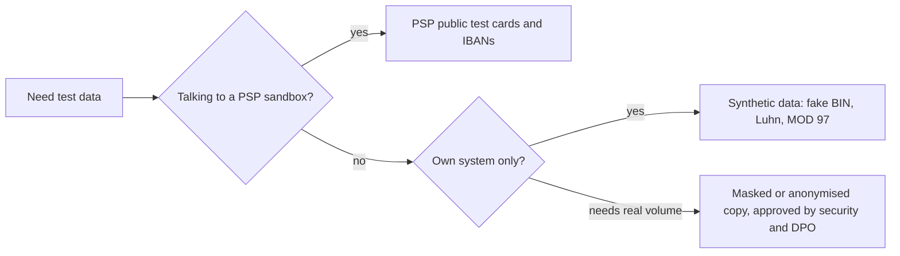

# Test data: test cards, Luhn, BIN, IBAN

Every fintech test needs a card number, an IBAN, a name, a date and an amount — and none of them
may belong to a real person. This page explains where safe test data comes from: public PSP test
cards, valid-but-fake card numbers built with the Luhn algorithm, IBANs with a correct MOD 97
checksum, and synthetic names, dates and amounts. It also lists the negative data sets that find
validation bugs and how to manage test data so tests stay independent.

## How it works

### Why real card and personal data never goes into tests

- **PCI DSS** (Payment Card Industry Data Security Standard, v4.0.1): Requirement 6.5.5 says live
  PANs (real card numbers issued by or for a payment brand) are not used in pre-production
  environments, unless those environments are inside the cardholder data environment and protected
  like production. Requirement 6.5.6: test data and test accounts are removed before a system goes
  live. Details: [Regulation for testers](../08-regulation/en.md).
- **GDPR** (Regulation (EU) 2016/679): a copy of production customers in a test database is still
  personal data. Pseudonymised data (a key can link it back) is still personal data (Recital 26);
  only truly anonymous data is outside GDPR. Testing is a new purpose, and data minimisation
  (Art. 5) applies. A leak from a test environment is a personal data breach like any other.
- **Practical reasons**: a real PAN in a test can reach a real network by a configuration mistake
  and charge a real card; real data ends up in logs, screenshots, bug reports and CI artefacts that
  have no PCI or GDPR controls.

So test data is one of three kinds: **public test data** published by a PSP for its sandbox,
**synthetic data** generated by the team (valid format, fake content), or **masked / anonymised
production data** when realistic volume or distribution is really needed.



### Public test cards from PSP sandboxes

A **PSP** (payment service provider, such as Stripe or Adyen) gives each merchant a **sandbox**
(test mode): a separate environment with test API keys where no money moves. In the sandbox,
special card numbers trigger chosen outcomes. Examples from Stripe's testing page:

| Card number | Brand | Outcome in Stripe test mode |
|---|---|---|
| `4242 4242 4242 4242` | Visa | Success |
| `5555 5555 5555 4444` | Mastercard | Success |
| `2223 0031 2200 3222` | Mastercard (2-series) | Success |
| `4000 0000 0000 0002` | Visa | Declined, `generic_decline` |
| `4000 0000 0000 9995` | Visa | Declined, `insufficient_funds` |
| `4000 0000 0000 9987` / `…9979` | Visa | Declined, `lost_card` / `stolen_card` |
| `4000 0000 0000 0069` | Visa | `expired_card` |
| `4000 0000 0000 0127` | Visa | `incorrect_cvc` |
| `4000 0000 0000 0119` | Visa | `processing_error` |
| `4242 4242 4242 4241` | Visa | `incorrect_number` — the Luhn check digit is wrong |
| `4000 0027 6000 3184` | Visa | 3-D Secure challenge on every payment |
| `4000 0000 0000 3220` | Visa | 3-D Secure required; succeeds after authentication |

Stripe: any future expiry date (for example `12/34`) and any 3-digit CVC (4 for American Express).
Stripe also recommends test PaymentMethod ids such as `pm_card_visa` instead of raw numbers on
the server, and the Stripe Services Agreement prohibits testing in live mode with real payment method
details.

**Adyen** publishes its own list: most cards use expiry `03/2030` and CVC `737`, for example
Visa `4111 1111 1111 1111`, Mastercard `5555 5555 5555 4444` and, for 3-D Secure 2, Mastercard
`5454 5454 5454 5454`. A refusal reason is chosen by the request, not by the number: holder name
`DECLINED`, `NOT_ENOUGH_BALANCE` or `CARD_EXPIRED` gives result code `Refused` with refusal reason
"Refused", "Not enough balance" or "Expired Card".

Important limits:

- Test numbers **work only in that PSP's test environment**. Adyen states its test cards do not
  work on other platforms; Stripe ties them to test API keys. A Stripe "insufficient funds" card
  means nothing to Adyen or to your own issuer processor.
- The same number can mean different things at different PSPs: `5555 5555 5555 4444` is a plain
  success card in both lists, but `4000 0000 0000 0002` is a decline only at Stripe.
- They are Luhn-valid on purpose, so they pass your own format checks. Do not use them to test
  your Luhn validator's negative path.
- Stripe also publishes test IBANs for SEPA Direct Debit, for example `DE89 3704 0044 0532 0130 00`
  (success) and `DE65 3704 0044 0002 2222 27` (`insufficient_funds`). They too work only in its
  sandbox.

### Card number anatomy: MII, BIN, length

A card number (PAN) follows ISO/IEC 7812 (card data elements: [Card lifecycle](../04-card-lifecycle/en.md)):

| Part | Example `4000 0012 3456 7899` | Meaning |
|---|---|---|
| First digit (MII, major industry identifier) | `4` | Industry; for cards in use it also hints at the brand |
| **BIN / IIN** (Bank / Issuer Identification Number) | `400000` (6 digits) or 8 digits | Which issuer and card product; used for routing |
| Individual account number | `123456789` | Chosen by the issuer |
| Check digit | `9` | Luhn, catches typos |

Brand ranges at a high level:

- **Visa** numbers start with `4` (every Visa test number at Stripe and Adyen does).
- **Mastercard** uses `51`–`55` and the 2-series `2221`–`2720`: Mastercard's developer documentation
  lists its account ranges as `222100`–`272099` and `510000`–`559999`.
- **American Express** test numbers start with `34`/`37` and are 15 digits (`3782 822463 10005`
  at Stripe, `3700 0000 0000 002` at Adyen).
- Most cards are 16 digits; other lengths exist: Amex 15, Diners `3622 720627 1667` is 14 and
  UnionPay `6205 5000 0000 0000 004` is 19 in Stripe's list. Field length and formatting must
  follow the brand, not a fixed 16.

Do not derive the brand or country with your own `if` statements in production code — use a BIN
table from the scheme or the PSP. The industry is also moving from 6-digit to 8-digit BINs
(area 04), so masking "first 6 and last 4" is no longer automatically right.

### The Luhn algorithm, step by step

The **Luhn algorithm** (mod 10) adds one check digit so that a single mistyped digit always
makes the number invalid. Rule: starting from the **rightmost digit of the full number** and moving
left, double every **second** digit; if a doubled value is over 9, subtract 9 (same as adding its
two digits); add everything up; the number is valid if the total ends in 0.

**Worked example 1 — compute the check digit** for the 15-digit prefix `400000123456789`.
The future check digit will be the rightmost digit, so in the prefix the rightmost digit (9) is
doubled, then every second digit to the left of it:

| Position | 1 | 2 | 3 | 4 | 5 | 6 | 7 | 8 | 9 | 10 | 11 | 12 | 13 | 14 | 15 |
|---|---|---|---|---|---|---|---|---|---|---|---|---|---|---|---|
| Digit | 4 | 0 | 0 | 0 | 0 | 0 | 1 | 2 | 3 | 4 | 5 | 6 | 7 | 8 | 9 |
| Doubled? | ×2 | | ×2 | | ×2 | | ×2 | | ×2 | | ×2 | | ×2 | | ×2 |
| Value | 8 | 0 | 0 | 0 | 0 | 0 | 2 | 2 | 6 | 4 | 10→1 | 6 | 14→5 | 8 | 18→9 |

Sum = 8 + 2 + 2 + 6 + 4 + 1 + 6 + 5 + 8 + 9 = **51**. Check digit = (10 − 51 mod 10) mod 10 =
(10 − 1) mod 10 = **9**. Full PAN: `4000 0012 3456 7899`.

**Worked example 2 — validate** `4000001234567899`. The doubled positions are the same (every
second digit counting from the check digit), so the total is 51 + 9 = **60**; 60 mod 10 = 0 →
**valid**. With last digit 0 (`4000001234567890`) the total is 51 → invalid.

What Luhn catches and what it does not (checked by brute force in Python):

- Every **single wrong digit** is caught.
- Every **swap of two adjacent digits** is caught **except `09` ↔ `90`**: Stripe's
  `4000000000009995` stays valid as `4000000000090995`.
- It says nothing about whether the card exists: `0000 0000 0000 0000` passes Luhn. A real check
  also needs a BIN/length rule, and only the issuer knows if the account is real.

### Generating valid-but-fake PANs

1. Take a **prefix that you control** for the test system — card-wallet uses `400000`.
2. Add random digits up to length − 1 (for 16 digits: 6 + 9 random digits).
3. Append the Luhn check digit.

```python
import secrets

def luhn_check_digit(body: str) -> str:
    total = 0
    for i, ch in enumerate(reversed(body)):
        d = int(ch)
        if i % 2 == 0:          # rightmost body digit is doubled
            d = d * 2 - 9 if d > 4 else d * 2
        total += d
    return str((10 - total % 10) % 10)

def fake_pan(prefix: str = "400000", length: int = 16) -> str:
    body = prefix + "".join(str(secrets.randbelow(10)) for _ in range(length - len(prefix) - 1))
    return body + luhn_check_digit(body)
```

Such a number passes every format check but is not issued to anyone in your system. No prefix
is guaranteed never to be a real BIN somewhere (`400000` starts with `4` like Visa), so the
protection is not the number itself but that test systems are never connected to live networks,
and that test data is labelled as test. To test **brand detection**, use the PSP's test numbers
in the PSP sandbox, or your own BIN table with fake entries.

### IBAN structure

The **IBAN** (International Bank Account Number, ISO 13616) identifies one bank account; SWIFT is
the registration authority and publishes the IBAN Registry with each country's format. It has up
to 34 characters:

| Part | `DE89 3704 0044 0532 0130 00` | `GB82 WEST 1234 5698 7654 32` |
|---|---|---|
| Country code (ISO 3166-1) | `DE` | `GB` |
| Check digits (2 digits) | `89` | `82` |
| **BBAN** (Basic Bank Account Number, national format) | `37040044` bank code + `0532013000` account | `WEST` bank + `123456` sort code + `98765432` account |
| Length | 22 | 22 |

The length and BBAN layout are fixed **per country** (Norway 15, Netherlands 18, Portugal 25 in
Stripe's test list). The electronic form has no spaces; the print form groups by 4. Some BBANs also
contain a **national check digit** with its own rules; the IBAN checksum does not replace it.

### The MOD 97-10 check (ISO 7064), worked example

The check digits use **MOD 97-10** from ISO/IEC 7064. Validation:

1. Remove spaces: `DE89370400440532013000`.
2. Move the first 4 characters to the end: `370400440532013000DE89`.
3. Replace letters by numbers, A = 10 … Z = 35 (D = 13, E = 14): `370400440532013000131489`.
4. Divide by 97: the IBAN is valid if the **remainder is 1**.

The number has 24 digits, too big for 32/64-bit integers, so systems compute the remainder in
pieces: take 9 digits, keep the remainder, put it in front of the next 7 digits.

| Piece | Remainder mod 97 |
|---|---|
| `370400440` | 23 |
| `23` + `5320130` = `235320130` | 70 |
| `70` + `0013148` = `700013148` | 38 |
| `38` + `9` = `389` | **1** → valid |

**Computing the check digits** works the same with `00` in their place: `370400440532013000131400`
mod 97 = 9; check digits = 98 − 9 = **89**. Valid check digits are always between 02 and 98.

For `GB82WEST12345698765432` the letters give W = 32, E = 14, S = 28, T = 29, G = 16, B = 11:
`WEST12345698765432GB00` → `3214282912345698765432161100`, remainder 16, check digits 98 − 16 = 82.

MOD 97 catches what Luhn misses: swapping `0532` to `0523` in the German example gives remainder
36, not 1.

**A valid fake IBAN** is built the same way: choose a BBAN of the right length and layout, compute
the check digits. With the made-up German BBAN `12345678 0000012345`:
`123456780000012345131400` mod 97 = 77 → 98 − 77 = 21 → `DE21 1234 5678 0000 0123 45`. It passes
the IBAN checksum, but the bank code may exist and the national account check is not computed —
use such IBANs only inside your own system, never towards a real bank or a PSP live API.

### BIC structure

A **BIC** (Business Identifier Code, ISO 9362, registered by SWIFT) identifies a bank or other
institution: 8 characters = 4-character business party prefix + 2-letter country code (ISO 3166-1)
+ 2-character suffix, optionally followed by a 3-character branch code (BIC11). Test cases: 8 and 11
characters accepted, other lengths rejected, country part must be letters, and in SEPA the
customer must not be forced to give a BIC (see [Transfers](../05-transfers/en.md)).

### Other test data

**Names.** Synthetic, never real customers: `Anna Demo`, `Test User`. Cover:

- Unicode letters: `Zoë Ørsted`, `Łukasz Żółć`, `Nguyễn Văn An`, Cyrillic `Анна Иванова`.
- **Transliteration** (writing a name in another alphabet): `Анна Иванова` → `Anna Ivanova`;
  `Щукина` may become `Shchukina` or `Ščukina` depending on the rule. Name matching (KYC,
  sanctions screening, payee name check) must not fail on this — see
  [Onboarding and KYC](../07-onboarding-kyc/en.md).
- Same letter in two encodings: `é` as one code point or `e` + combining accent (Unicode NFC vs
  NFD) — searches and duplicate checks must treat them as equal.
- Apostrophes and hyphens (`O'Brien`, `Smith-Jones`), one-word names, very long names, and bytes
  vs characters: 72 Cyrillic letters are 144 bytes in UTF-8.
- Dangerous characters: NUL (`\u0000`), emoji, right-to-left text, HTML/SQL special characters.

**Addresses.** Fake streets in real formats: postcode formats by country, missing house number,
PO box, 3 address lines, non-Latin scripts. Do not use real people's addresses.

**Dates and times.**

- Time zones: `31 Dec 2026 23:30 UTC` is `1 Jan 2027 00:30` in Berlin — which month's statement
  and which day's limit does the payment fall into?
- **DST** (daylight saving time): in the EU clocks go forward on 28 March 2027 and back on
  31 October 2027, both at 01:00 UTC. In Central European Time (Berlin) local 02:00–02:59 does not
  exist in March and happens twice in October; in Helsinki or Lisbon the affected local hour is
  different.
- **Leap day**: 29 Feb 2028; a card expiring `02/28` is usually valid through 29 Feb 2028
  (issuer rule); "one year after
  29 Feb 2028" needs a rule.
- Month end: 31 January + 1 month; the last banking day of the month; year end.
- Extremes: `0001-01-01`, `9999-12-31`, dates far in the past for date of birth (age 18 boundary).

**Amounts** (details: [Money](../03-money/en.md)): `0.00`, `0.01`, negative, the maximum, more
decimals than the currency allows; currencies with 0 decimals (JPY) and 3 decimals (KWD, BHD);
`1,000.00` vs `1.000,00`, `1e3`, leading `+`, amounts sent as JSON floats.

### Negative data sets

| Input | Why it must fail (or be normalised by a written rule) |
|---|---|
| `4000001234567890` | Wrong Luhn check digit |
| `400000123456789` / `40000012345678990` | Length 15 / 17 for a 16-digit range |
| `4000 0012 3456 7899`, `4000-0012-3456-7899` | Spaces/hyphens: strip or reject — decide and test both fields and API |
| `40000012345678A9` | Letter in a PAN |
| `٤٠٠٠٠٠١٢٣٤٥٦٧٨٩٩` | Non-Latin digits: `\d` in many regex engines accepts them |
| `0000000000000000` | Luhn-valid, but no BIN |
| `DE89370400440532013001` | Wrong IBAN checksum (remainder 28) |
| `DE89370400440523013000` | Transposed digits (remainder 36) |
| `DE8937040044053201300` | 21 characters, Germany needs 22 |
| `XX89370400440532013000` | Unknown country code |
| `de89 3704 0044 0532 0130 00` | Lower case and spaces: normalise or reject by rule |
| `GB82WEST123456987654321` | One character too many |

### Test data management

- **Factories / builders**: a function creates a valid object with defaults (`register_and_login()`,
  `funded_card(balance="1000.00")`), and the test overrides only what matters. Tests stay short and
  readable.
- **Data per test**: each test creates its own user, account and card with unique values (UUID in
  the e-mail), so tests can run in parallel and in any order.
- **Seeding**: a script creates a known demo or baseline data set (users, accounts, cards) for
  manual testing and demos; it must be safe to run again.
- **Cleanup**: drop or truncate after the run, use transactions that roll back, or run on a
  fresh database/container. Leftover data must never reach production (PCI DSS 6.5.6).
- **Masking production copies**: if a copy of production is unavoidable, mask before it leaves
  production: replace PANs with fake Luhn-valid numbers, names and e-mails with synthetic ones,
  shift dates, keep referential integrity (the same customer gets the same fake id everywhere).
  Remember that masked but linkable data is pseudonymised, still personal data.
- **Labels**: test accounts and cards are marked (flag, prefix, e-mail domain `example.com`) so a
  scan can find them.

## Participants and money flows

No money moves with test data; what moves is **data**, and the risk is a leak or a real charge.

| Participant | Role | Sends / receives and when | Risk carried |
|---|---|---|---|
| QA engineer / developer | Creates and uses test data | Generates synthetic data, uses PSP test cards, writes factories | Puts real data into tests by shortcut |
| PSP sandbox (Stripe, Adyen) | Simulates payment outcomes | Receives test cards from your test environment; returns success, declines, 3DS challenge | None for real money; outcomes differ from live |
| Card scheme / BIN table provider | Owns BIN ranges | Publishes ranges and BIN data | Wrong routing if your BIN table is outdated |
| SWIFT (registration authority) | IBAN Registry, BIC directory | Publishes country formats and BICs | Formats change: a new country or length breaks a hard-coded validator |
| Data owner, security officer, DPO (data protection officer) | Approve any use of production data | Approve masking rules, review test environments | GDPR breach, PCI scope growing to test systems |
| Test environment owner (DevOps) | Runs databases, logs, CI | Stores test data, artefacts, screenshots | Test environment with real data and no production controls |
| Customer (real) | Data subject | Should never appear in test data | Their data leaked from a less protected system |

## Business risks

### Company

- A real PAN in a test system brings that system into **PCI DSS scope**; an assessment finding,
  fines passed on by acquirers and schemes, or a data breach.
- A test environment wired to a live endpoint charges real cards with "test" payments.
- A validator that rejects valid IBANs or 15/19-digit PANs loses customers and payments; one that
  accepts invalid input lets payments fail later as R-transactions or declines, with fees.

### Customer

- Personal data copied to test leaks from a system with weaker controls.
- A name with a diacritic or Cyrillic letters cannot be entered or does not match the KYC record.

### Regulator / compliance

- GDPR: processing production data for testing without a basis, no minimisation, breach
  notification within 72 hours if test data leaks (area 08).
- PCI DSS Requirement 6.5.5–6.5.6: live PANs in pre-production, test data left in production.

## What to test

- [ ] Card number field: accepts valid Luhn numbers of every supported brand and length (14, 15, 16, 19); rejects wrong check digit, wrong length, letters, empty.
- [ ] Spaces and hyphens in PAN and IBAN are handled by one written rule, the same in UI and API.
- [ ] Non-Latin digits (Arabic-Indic, full-width) are rejected as format errors, not counted as wrong attempts.
- [ ] Brand detection uses a BIN table: `4…` Visa, `51–55` and `2221–2720` Mastercard, 8-digit BINs supported.
- [ ] Generated PANs: right prefix, right length, valid Luhn, unique (many generations in a loop).
- [ ] IBAN: country code known, length per country, MOD 97 remainder 1, BBAN characters per country.
- [ ] IBAN check digits outside 02–98 are rejected; lower case handled by rule.
- [ ] BIC: 8 or 11 characters, letters in the country part; not required where SEPA forbids it.
- [ ] Names: Unicode letters, combining characters, apostrophes, long names (bytes vs characters), NUL rejected.
- [ ] Dates: UTC vs local midnight, DST gap and overlap, 29 February, month end, `9999-12-31`.
- [ ] Amounts: 0, minimum unit, maximum, currency decimals 0/2/3, wrong decimal separator.
- [ ] Test environment contains no live PANs and no real customer data (scan with a PAN detector: Luhn + BIN pattern).
- [ ] Logs, screenshots and bug reports in CI contain no full PAN or CVV, even of test cards.
- [ ] PSP sandbox scenarios: success, generic decline, insufficient funds, expired card, incorrect CVC, 3DS challenge.
- [ ] Each test creates its own data; tests pass in random order and in parallel.
- [ ] Seed script can run twice without errors or duplicates.
- [ ] Masking job: no original value survives; the same input maps to the same fake value; foreign keys still match.

| ID | Condition / steps | Expected result |
|---|---|---|
| TD-01 | Enter PAN `4000 0012 3456 7899`, then `4000001234567890` | First accepted (spaces stripped if the rule says so); second rejected "invalid card number", no call to the PSP |
| TD-02 | Enter `4000000000090995` (09↔90 swap of a valid number) | Passes Luhn — documents the known Luhn blind spot; the PSP/issuer must decline it |
| TD-03 | Card number `٤٠٠٠٠٠١٢٣٤٥٦٧٨٩٩` (Arabic-Indic digits) | 422 format error; no attempt counter changes |
| TD-04 | IBAN `DE89 3704 0044 0532 0130 00`, `DE89370400440532013001`, `DE8937040044053201300` | Valid; invalid checksum; invalid length for DE — each with a clear message |
| TD-05 | IBAN `GB82WEST12345698765432` and `gb82 west 1234 5698 7654 32` | Both accepted and stored as `GB82WEST12345698765432` (if normalisation is the rule) |
| TD-06 | Stripe sandbox: pay with `4000000000009995`, then `4000002760003184` | Decline `insufficient_funds` shown to the user; 3DS challenge opened and payment completed after authentication |
| TD-07 | Payment at `31 Dec 2026 23:30 UTC` for a Berlin customer | Appears in the statement and the daily limit of the day defined by the requirement (UTC or local), consistently everywhere |
| TD-08 | Card with expiry `02/28`: pay on 29 Feb 2028 23:59 and 1 Mar 2028 00:00 (defined time zone) | First approved, second declined as expired |
| TD-09 | Register name `Zoë` written as NFC and as NFD; search for "Zoë" | Both found; duplicate check treats them as the same name |
| TD-10 | Run the test suite twice in parallel on one environment | No collisions (unique e-mails/ids); no test depends on data from another |

## Typical defects

1. **Unicode digits pass the format check.** A regex `\d` accepts `٣٤٥`, so the input reaches
   business logic. Catch with non-Latin digit inputs in every numeric field. Seen in card-wallet:
   [BUG-12](https://github.com/Tomullya/card-wallet/blob/main/docs/qa/bug-reports/BUG-12.md).
2. **Hard-coded length or brand.** PAN must be 16 digits, Mastercard "starts with 5" — 15-digit
   Amex and 2-series Mastercard are rejected. Catch with one valid test number per brand and length.
3. **IBAN checked with a generic regex only.** Wrong checksum or wrong country length accepted, the
   transfer is rejected days later. Catch with the negative IBAN set above.
4. **Formatting not normalised.** Spaces from copy-paste or lower case fail in one channel and pass
   in another. Catch by sending the same value through UI and API.
5. **Characters break storage.** NUL in a name gives a 500 from the database; 72 Cyrillic letters
   overflow a byte limit. Seen in card-wallet:
   [BUG-08](https://github.com/Tomullya/card-wallet/blob/main/docs/qa/bug-reports/BUG-08.md),
   [BUG-06](https://github.com/Tomullya/card-wallet/blob/main/docs/qa/bug-reports/BUG-06.md).
6. **Extreme dates crash.** `9999-12-31` or a time zone shift moves a date out of range. Seen in
   card-wallet: [BUG-09](https://github.com/Tomullya/card-wallet/blob/main/docs/qa/bug-reports/BUG-09.md).
7. **Real or test PAN in logs and artefacts.** Even sandbox numbers in logs teach the team bad
   habits, and a real one is a PCI finding. Catch with a log scan for Luhn-valid 13–19 digit
   sequences.
8. **Tests depend on shared data.** A test uses "user 1" created by another test; the suite fails
   in random order or in parallel. Catch by running tests shuffled and in parallel.

## In card-wallet

[card-wallet](https://github.com/Tomullya/card-wallet) uses only fictional data and generates
its own valid-but-fake card numbers.

- Requirement **NFR-04**: full PAN and CVV never in logs, CVV and passwords stored only as hashes,
  **only fictional data, card prefix `400000`**:
  [NFR.md](https://github.com/Tomullya/card-wallet/blob/main/docs/requirements/NFR.md);
  BR-CARD-02 (16 digits, prefix `400000`, Luhn):
  [BR-cards.md](https://github.com/Tomullya/card-wallet/blob/main/docs/requirements/BR-cards.md).
- PAN generation with prefix `400000` + 9 random digits + Luhn check digit, `luhn_is_valid`, keyed
  hash: [card_numbers.py](https://github.com/Tomullya/card-wallet/blob/main/wallet-api/app/services/card_numbers.py).
- Unit tests: known Luhn values (`4000000000000002` valid, `4000000000000001` invalid,
  `79927398713` valid), 1,000 generated PANs all match `400000` + 10 digits and pass Luhn, expiry on
  leap years and month ends:
  [test_card_numbers.py](https://github.com/Tomullya/card-wallet/blob/main/tests/unit/test_card_numbers.py).
- Factories with data per test: unique e-mail per user (`user-<uuid>@example.com`),
  `register_and_login`, `funded_card`:
  [helpers.py](https://github.com/Tomullya/card-wallet/blob/main/tests/helpers.py).
- Demo seeding with a fictional client "Anna Demo", EUR and PLN accounts, cards and payments; safe
  to run again (new e-mail if the default exists):
  [seed_demo.py](https://github.com/Tomullya/card-wallet/blob/main/scripts/seed_demo.py).
- Logs checked for PAN, CVV and password:
  [test_no_sensitive_logs.py](https://github.com/Tomullya/card-wallet/blob/main/tests/api/test_no_sensitive_logs.py).

Could be added (honest gaps — card-wallet is a simplified demo):

- An **IBAN validator** (country length table + MOD 97) with the negative data set above, for a
  future transfers endpoint.
- A **reusable test-data generator** (fake PANs per brand, IBANs per country, Unicode names,
  boundary dates and amounts) — the author plans this as a separate tool.
- A PAN-entry endpoint (for example, linking an external card) that uses `luhn_is_valid` and tests
  spaces, hyphens, non-Latin digits and `0000000000000000`.
- Explicit cleanup: tests rely on unique data, but the database is never truncated after a run.

## Sources

- [Stripe Docs — Testing](https://docs.stripe.com/testing) — test cards for success, declines (`insufficient_funds`, `lost_card`, `incorrect_number`), 3-D Secure; test IBANs for SEPA Direct Debit; test keys; testing in live mode with real payment method details is prohibited.
- [Adyen Docs — Test card numbers](https://docs.adyen.com/development-resources/test-cards-and-credentials/test-card-numbers) — test cards, expiry 03/2030 and CVC 737 for most cards (7373 for Amex), 3DS2 cards; they work only on Adyen's test platform.
- [Adyen Docs — Testing result codes and refusal reasons](https://docs.adyen.com/development-resources/testing/result-codes) — refusals triggered by holder name (`DECLINED`, `NOT_ENOUGH_BALANCE`, `CARD_EXPIRED`).
- [PCI SSC Document Library](https://www.pcisecuritystandards.org/document_library/) — PCI DSS v4.0.1, Requirements 6.5.5 (no live PANs in pre-production) and 6.5.6 (test data removed).
- [Regulation (EU) 2016/679 (GDPR)](https://eur-lex.europa.eu/eli/reg/2016/679/oj) — Art. 5 minimisation, Recital 26 pseudonymised vs anonymous data.
- [ISO/IEC 7812-1:2017](https://www.iso.org/standard/70484.html) — numbering system for issuer identification and the PAN.
- [Mastercard Developers — BIN Lookup support](https://developer.mastercard.com/bin-lookup/documentation/support/) — Mastercard account ranges 222100–272099 and 510000–559999.
- [SWIFT — IBAN](https://www.swift.com/standards/data-standards/iban-international-bank-account-number) — IBAN under ISO 13616, SWIFT as registration authority, the IBAN Registry of national formats.
- [Central Bank of the Republic of Türkiye — IBAN Communiqué](https://www.tcmb.gov.tr/wps/wcm/connect/EN/TCMB+EN/Bottom+Menu/IBAN/Communique) — step-by-step computation and validation of IBAN check digits (ISO 7064 MOD 97-10, remainder 1).
- [SWIFT — BIC](https://www.swift.com/standards/data-standards/bic-business-identifier-code) — BIC structure under ISO 9362: prefix, country code, suffix, optional branch code.
