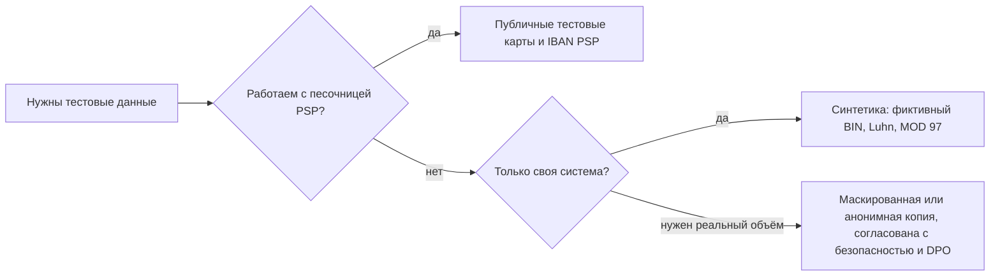

# Тестовые данные: тестовые карты, Luhn, BIN, IBAN

Любому тесту в финтехе нужны номер карты, IBAN, имя, дата и сумма — и ни одно из них не должно
принадлежать реальному человеку. Эта страница объясняет, откуда берутся безопасные тестовые данные:
публичные тестовые карты PSP, правдоподобные, но фиктивные номера карт по алгоритму Луна, IBAN с
правильной контрольной суммой MOD 97, синтетические имена, даты и суммы. А ещё — какие негативные
наборы данных находят ошибки валидации и как управлять тестовыми данными, чтобы тесты оставались
независимыми.

## Как это работает

### Почему реальные данные карт и клиентов никогда не попадают в тесты

- **PCI DSS** (Payment Card Industry Data Security Standard, v4.0.1): требование 6.5.5 — живые PAN
  (настоящие номера карт, выпущенные платёжной системой или от её имени, live PANs) не используются в
  непродуктивных средах (pre-production), если только эти среды не входят в среду данных держателей
  карт и не защищены как продакшн. Требование 6.5.6: тестовые данные и тестовые учётные записи
  удаляются до выхода системы в продакшн. Подробно — [Регулирование для тестировщика](../08-regulation/ru.md).
- **GDPR** (Регламент (ЕС) 2016/679): копия продакшн-клиентов в тестовой базе — всё ещё
  персональные данные. Псевдонимизированные данные (pseudonymised: ключ позволяет связать их с
  человеком) остаются персональными (преамбула, п. 26); вне GDPR только действительно анонимные
  данные. Тестирование — новая цель обработки, и действует минимизация данных (ст. 5). Утечка из
  тестовой среды — такая же утечка персональных данных, как любая другая.
- **Практические причины**: реальный PAN в тесте из-за ошибки конфигурации может уйти в настоящую
  сеть и списать деньги с настоящей карты; реальные данные оседают в логах, скриншотах,
  баг-репортах и артефактах CI, где нет никаких мер PCI или GDPR.

Поэтому тестовые данные бывают трёх видов: **публичные тестовые данные**, которые PSP публикует для
своей песочницы; **синтетические данные (synthetic data)**, которые генерирует команда (правильный
формат, фиктивное содержание); **маскированная / анонимизированная копия продакшна** — когда
действительно нужны реальные объёмы или распределения.



### Публичные тестовые карты из песочниц PSP

**PSP** (payment service provider, платёжный провайдер, например Stripe или Adyen) даёт каждому
мерчанту (торгово-сервисному предприятию, ТСП) **песочницу (sandbox)** — тестовый режим: отдельную среду с тестовыми API-ключами, где
деньги не двигаются. В песочнице специальные номера карт вызывают заданный результат. Примеры со
страницы тестирования Stripe:

| Номер карты | Бренд | Результат в тестовом режиме Stripe |
|---|---|---|
| `4242 4242 4242 4242` | Visa | Успех |
| `5555 5555 5555 4444` | Mastercard | Успех |
| `2223 0031 2200 3222` | Mastercard (серия 2) | Успех |
| `4000 0000 0000 0002` | Visa | Отказ, `generic_decline` |
| `4000 0000 0000 9995` | Visa | Отказ, `insufficient_funds` (недостаточно средств) |
| `4000 0000 0000 9987` / `…9979` | Visa | Отказ, `lost_card` / `stolen_card` |
| `4000 0000 0000 0069` | Visa | `expired_card` (срок истёк) |
| `4000 0000 0000 0127` | Visa | `incorrect_cvc` |
| `4000 0000 0000 0119` | Visa | `processing_error` |
| `4242 4242 4242 4241` | Visa | `incorrect_number` — неверная контрольная цифра Luhn |
| `4000 0027 6000 3184` | Visa | Челлендж 3-D Secure на каждом платеже |
| `4000 0000 0000 3220` | Visa | 3-D Secure обязателен; успех после аутентификации |

Stripe: любой будущий срок действия (например, `12/34`) и любой 3-значный CVC (4 цифры для
American Express). Stripe также советует на сервере использовать тестовые идентификаторы
PaymentMethod, например `pm_card_visa`, а не «сырые» номера, а договор Stripe Services Agreement запрещает
тестировать в боевом режиме (live mode) с реальными платёжными данными.

**Adyen** публикует свой список: у большинства карт срок `03/2030` и CVC `737`, например Visa
`4111 1111 1111 1111`, Mastercard `5555 5555 5555 4444` и, для 3-D Secure 2, Mastercard
`5454 5454 5454 5454`. Причина отказа задаётся запросом, а не номером: имя держателя `DECLINED`,
`NOT_ENOUGH_BALANCE` или `CARD_EXPIRED` даёт код результата `Refused` с причиной отказа «Refused»,
«Not enough balance» или «Expired Card».

Важные ограничения:

- Тестовые номера **работают только в тестовой среде своего PSP**. Adyen прямо пишет, что его
  тестовые карты не работают на других платформах; Stripe привязывает их к тестовым ключам.
  Карта Stripe «недостаточно средств» ничего не значит для Adyen или для вашего процессинга эмитента.
- Один и тот же номер у разных PSP означает разное: `5555 5555 5555 4444` — обычная карта «успех»
  в обоих списках, а `4000 0000 0000 0002` — отказ только у Stripe.
- Они специально проходят Luhn, поэтому проходят и ваши проверки формата. Не используйте их для
  негативных проверок вашего Luhn-валидатора.
- Stripe также публикует тестовые IBAN для SEPA Direct Debit, например
  `DE89 3704 0044 0532 0130 00` (успех) и `DE65 3704 0044 0002 2222 27` (`insufficient_funds`).
  Они тоже работают только в его песочнице.

### Устройство номера карты: MII, BIN, длина

Номер карты (PAN) устроен по ISO/IEC 7812 (реквизиты карты — в [Жизненном цикле карты](../04-card-lifecycle/ru.md)):

| Часть | Пример `4000 0012 3456 7899` | Значение |
|---|---|---|
| Первая цифра (MII, major industry identifier — идентификатор отрасли) | `4` | Отрасль; у действующих карт заодно подсказывает бренд |
| **BIN / IIN** (Bank / Issuer Identification Number) | `400000` (6 цифр) или 8 цифр | Какой эмитент и какой карточный продукт; используется для маршрутизации |
| Номер счёта внутри PAN (individual account number) | `123456789` | Выбирает эмитент |
| Контрольная цифра (check digit) | `9` | Luhn, ловит опечатки |

Диапазоны брендов в общих чертах:

- Номера **Visa** начинаются с `4` (так начинается каждый тестовый номер Visa у Stripe и Adyen).
- **Mastercard** — `51`–`55` и серия 2 — `2221`–`2720`: документация Mastercard для разработчиков
  называет диапазоны `222100`–`272099` и `510000`–`559999`.
- Тестовые номера **American Express** начинаются с `34`/`37` и состоят из 15 цифр
  (`3782 822463 10005` у Stripe, `3700 0000 0000 002` у Adyen).
- Большинство карт — 16 цифр; бывают и другие длины: Amex — 15, Diners `3622 720627 1667` — 14,
  UnionPay `6205 5000 0000 0000 004` — 19 в списке Stripe. Длина поля и форматирование должны
  зависеть от бренда, а не быть жёстко 16.

Не определяйте бренд или страну собственными `if` в продакшн-коде — используйте BIN-таблицу от
платёжной системы или PSP. К тому же индустрия переходит с 6-значных на 8-значные BIN (область 04),
поэтому маска «первые 6 и последние 4» больше не всегда правильна.

### Алгоритм Луна, шаг за шагом

**Алгоритм Луна (Luhn algorithm, mod 10)** добавляет одну контрольную цифру, так что одна
ошибочно набранная цифра всегда делает номер невалидным. Правило: начиная с **самой правой цифры
полного номера** и двигаясь влево, удваиваем каждую **вторую** цифру; если удвоенное значение
больше 9, вычитаем 9 (то же, что сложить две его цифры); всё складываем; номер валиден, если
сумма оканчивается на 0.

**Пример 1 — вычисляем контрольную цифру** для 15-значного префикса `400000123456789`.
Будущая контрольная цифра станет самой правой, поэтому в префиксе удваивается самая правая цифра (9)
и далее каждая вторая влево от неё:

| Позиция | 1 | 2 | 3 | 4 | 5 | 6 | 7 | 8 | 9 | 10 | 11 | 12 | 13 | 14 | 15 |
|---|---|---|---|---|---|---|---|---|---|---|---|---|---|---|---|
| Цифра | 4 | 0 | 0 | 0 | 0 | 0 | 1 | 2 | 3 | 4 | 5 | 6 | 7 | 8 | 9 |
| Удваиваем? | ×2 | | ×2 | | ×2 | | ×2 | | ×2 | | ×2 | | ×2 | | ×2 |
| Значение | 8 | 0 | 0 | 0 | 0 | 0 | 2 | 2 | 6 | 4 | 10→1 | 6 | 14→5 | 8 | 18→9 |

Сумма = 8 + 2 + 2 + 6 + 4 + 1 + 6 + 5 + 8 + 9 = **51**. Контрольная цифра = (10 − 51 mod 10) mod 10
= (10 − 1) mod 10 = **9**. Полный PAN: `4000 0012 3456 7899`.

**Пример 2 — проверяем** `4000001234567899`. Удваиваются те же позиции (каждая вторая, считая от
контрольной цифры), поэтому сумма = 51 + 9 = **60**; 60 mod 10 = 0 → **валиден**. С последней
цифрой 0 (`4000001234567890`) сумма 51 → невалиден.

Что Luhn ловит и чего не ловит (проверено перебором в Python):

- Ловит **любую одну неверную цифру**.
- Ловит **любую перестановку двух соседних цифр, кроме `09` ↔ `90`**: номер Stripe
  `4000000000009995` остаётся валидным как `4000000000090995`.
- Ничего не говорит о существовании карты: `0000 0000 0000 0000` проходит Luhn. Настоящей
  проверке нужны ещё правило BIN/длины, а существует ли счёт, знает только эмитент.

### Генерация правдоподобных, но фиктивных PAN

1. Берём **префикс, который контролирует команда** для тестовой системы — в card-wallet это `400000`.
2. Добавляем случайные цифры до длины − 1 (для 16 цифр: 6 + 9 случайных).
3. Дописываем контрольную цифру Luhn.

```python
import secrets

def luhn_check_digit(body: str) -> str:
    total = 0
    for i, ch in enumerate(reversed(body)):
        d = int(ch)
        if i % 2 == 0:          # rightmost body digit is doubled
            d = d * 2 - 9 if d > 4 else d * 2
        total += d
    return str((10 - total % 10) % 10)

def fake_pan(prefix: str = "400000", length: int = 16) -> str:
    body = prefix + "".join(str(secrets.randbelow(10)) for _ in range(length - len(prefix) - 1))
    return body + luhn_check_digit(body)
```

Такой номер проходит все проверки формата, но в вашей системе никому не выпущен. Ни один префикс
не гарантированно свободен от реальных BIN (`400000` начинается с `4`, как Visa), поэтому защищает
не сам номер, а то, что тестовые системы никогда не подключены к боевым сетям, а тестовые данные
помечены как тестовые. Чтобы тестировать **определение бренда**, используйте тестовые номера PSP в
его песочнице или собственную BIN-таблицу с фиктивными записями.

### Структура IBAN

**IBAN** (International Bank Account Number, международный номер банковского счёта, ISO 13616)
идентифицирует один банковский счёт; SWIFT — регистрационный орган (registration authority), он
публикует реестр IBAN (IBAN Registry) с форматом каждой страны. Длина — до 34 символов:

| Часть | `DE89 3704 0044 0532 0130 00` | `GB82 WEST 1234 5698 7654 32` |
|---|---|---|
| Код страны (ISO 3166-1) | `DE` | `GB` |
| Контрольные цифры (2 цифры) | `89` | `82` |
| **BBAN** (Basic Bank Account Number, национальный формат) | код банка `37040044` + счёт `0532013000` | банк `WEST` + sort code `123456` + счёт `98765432` |
| Длина | 22 | 22 |

Длина и раскладка BBAN фиксированы **для каждой страны** (Норвегия — 15, Нидерланды — 18,
Португалия — 25 в тестовом списке Stripe). В электронном виде пробелов нет; в печатном — группы по 4.
В некоторых BBAN есть ещё **национальная контрольная цифра** со своими правилами; контрольная сумма
IBAN её не заменяет.

### Проверка MOD 97-10 (ISO 7064), пример

Контрольные цифры считаются по **MOD 97-10** из ISO/IEC 7064. Проверка:

1. Убираем пробелы: `DE89370400440532013000`.
2. Переносим первые 4 символа в конец: `370400440532013000DE89`.
3. Заменяем буквы числами, A = 10 … Z = 35 (D = 13, E = 14): `370400440532013000131489`.
4. Делим на 97: IBAN валиден, если **остаток равен 1**.

В числе 24 цифры — слишком много для 32/64-битных целых, поэтому системы считают остаток по
частям: берут 9 цифр, сохраняют остаток, ставят его перед следующими 7 цифрами.

| Часть | Остаток mod 97 |
|---|---|
| `370400440` | 23 |
| `23` + `5320130` = `235320130` | 70 |
| `70` + `0013148` = `700013148` | 38 |
| `38` + `9` = `389` | **1** → валиден |

**Вычисление контрольных цифр** идёт так же, только на их месте `00`: `370400440532013000131400`
mod 97 = 9; контрольные цифры = 98 − 9 = **89**. Правильные контрольные цифры всегда от 02 до 98.

Для `GB82WEST12345698765432` буквы дают W = 32, E = 14, S = 28, T = 29, G = 16, B = 11:
`WEST12345698765432GB00` → `3214282912345698765432161100`, остаток 16, контрольные цифры
98 − 16 = 82.

MOD 97 ловит то, что пропускает Luhn: перестановка `0532` → `0523` в немецком примере даёт остаток
36, а не 1.

**Валидный фиктивный IBAN** строится так же: выбираем BBAN нужной длины и раскладки и вычисляем
контрольные цифры. Для придуманного немецкого BBAN `12345678 0000012345`:
`123456780000012345131400` mod 97 = 77 → 98 − 77 = 21 → `DE21 1234 5678 0000 0123 45`. Он
проходит контрольную сумму IBAN, но код банка может существовать, а национальная проверка счёта не
посчитана — используйте такие IBAN только внутри своей системы, никогда не отправляйте их в реальный
банк или в боевой API PSP.

### Структура BIC

**BIC** (Business Identifier Code, ISO 9362, регистрирует SWIFT) идентифицирует банк или другую
организацию: 8 символов = 4-символьный префикс участника (business party prefix) + 2-буквенный код
страны (ISO 3166-1) + 2-символьный суффикс; по желанию — ещё 3-символьный код филиала (BIC11).
Тест-кейсы: 8 и 11 символов принимаются, другие длины — нет, в части страны только буквы, а в SEPA
нельзя требовать от клиента BIC (см. [Переводы](../05-transfers/ru.md)).

### Другие тестовые данные

**Имена.** Только синтетические, никаких реальных клиентов: `Anna Demo`, `Test User`. Покрываем:

- Буквы Unicode: `Zoë Ørsted`, `Łukasz Żółć`, `Nguyễn Văn An`, кириллица `Анна Иванова`.
- **Транслитерация (transliteration)** — запись имени другим алфавитом: `Анна Иванова` →
  `Anna Ivanova`; `Щукина` может стать `Shchukina` или `Ščukina` в зависимости от правила.
  Сопоставление имён (KYC, санкционный скрининг, проверка имени получателя) не должно на этом
  ломаться — см. [Онбординг и KYC](../07-onboarding-kyc/ru.md).
- Одна буква в двух кодировках: `é` как один символ (code point) или `e` + комбинируемое ударение
  (Unicode NFC и NFD) — поиск и проверка дублей должны считать их одинаковыми.
- Апострофы и дефисы (`O'Brien`, `Smith-Jones`), имя из одного слова, очень длинные имена, байты
  против символов: 72 кириллические буквы — это 144 байта в UTF-8.
- Опасные символы: NUL (`\u0000`), эмодзи, текст справа налево, спецсимволы HTML/SQL.

**Адреса.** Фиктивные улицы в реальных форматах: форматы индексов по странам, нет номера дома,
абонентский ящик (PO box), 3 строки адреса, нелатинские алфавиты. Не используйте адреса реальных
людей.

**Даты и время.**

- Часовые пояса: `31 Dec 2026 23:30 UTC` — это `1 Jan 2027 00:30` в Берлине. В выписку какого
  месяца и в лимит какого дня попадает платёж?
- **Переход на летнее/зимнее время (DST, daylight saving time)**: в ЕС часы переводят вперёд
  28 марта 2027 и назад 31 октября 2027, оба раза в 01:00 UTC. По центральноевропейскому времени
  (Берлин) местного 02:00–02:59 в марте не существует, а в октябре оно случается дважды; в
  Хельсинки или Лиссабоне затронут другой местный час.
- **29 февраля**: 29 февраля 2028; карта со сроком `02/28` обычно действует по 29 февраля 2028
  включительно (правило эмитента); «через год после 29 февраля 2028» требует правила.
- Конец месяца: 31 января + 1 месяц; последний банковский день месяца; конец года.
- Крайние значения: `0001-01-01`, `9999-12-31`, далёкое прошлое для даты рождения (граница 18 лет).

**Суммы** (подробно — [Деньги](../03-money/ru.md)): `0.00`, `0.01`, отрицательные, максимум,
больше знаков после запятой, чем допускает валюта; валюты с 0 знаков (JPY) и 3 знаками (KWD, BHD);
`1,000.00` против `1.000,00`, `1e3`, ведущий `+`, суммы, переданные как float в JSON.

### Негативные наборы данных

| Ввод | Почему должен быть отклонён (или нормализован по записанному правилу) |
|---|---|
| `4000001234567890` | Неверная контрольная цифра Luhn |
| `400000123456789` / `40000012345678990` | Длина 15 / 17 для 16-значного диапазона |
| `4000 0012 3456 7899`, `4000-0012-3456-7899` | Пробелы/дефисы: убрать или отклонить — решить и проверить и в поле, и в API |
| `40000012345678A9` | Буква в PAN |
| `٤٠٠٠٠٠١٢٣٤٥٦٧٨٩٩` | Нелатинские цифры: `\d` во многих движках регулярных выражений их принимает |
| `0000000000000000` | Проходит Luhn, но нет BIN |
| `DE89370400440532013001` | Неверная контрольная сумма IBAN (остаток 28) |
| `DE89370400440523013000` | Переставлены цифры (остаток 36) |
| `DE8937040044053201300` | 21 символ, а для Германии нужно 22 |
| `XX89370400440532013000` | Неизвестный код страны |
| `de89 3704 0044 0532 0130 00` | Строчные буквы и пробелы: нормализовать или отклонить по правилу |
| `GB82WEST123456987654321` | На один символ больше |

### Управление тестовыми данными

- **Фабрики / билдеры (factories, builders)**: функция создаёт валидный объект со значениями по
  умолчанию (`register_and_login()`, `funded_card(balance="1000.00")`), а тест переопределяет только
  то, что важно. Тесты остаются короткими и читаемыми.
- **Свои данные у каждого теста (data per test)**: каждый тест создаёт своего пользователя, счёт и
  карту с уникальными значениями (UUID в e-mail), поэтому тесты можно гонять параллельно и в любом
  порядке.
- **Наполнение (seeding)**: скрипт создаёт известный демо- или базовый набор данных (пользователи,
  счета, карты) для ручного тестирования и демонстраций; его должно быть безопасно запускать
  повторно.
- **Очистка (cleanup)**: удаление или truncate после прогона, транзакции с откатом или свежая
  база/контейнер. Остатки тестовых данных не должны попасть в продакшн (PCI DSS 6.5.6).
- **Маскирование копий продакшна (masking)**: если копии продакшна не избежать, маскируйте до того,
  как данные покинут продакшн: PAN заменить фиктивными номерами с правильным Luhn, имена и e-mail —
  синтетическими, даты сдвинуть, ссылочную целостность сохранить (один клиент везде получает один и
  тот же фиктивный id). Помните: маскированные, но связываемые данные — псевдонимизированные, то есть
  всё ещё персональные.
- **Метки**: тестовые клиенты и карты помечены (флаг, префикс, домен e-mail `example.com`), чтобы
  сканирование могло их найти.

## Участники и потоки денег

С тестовыми данными деньги не двигаются; двигаются **данные**, а риск — утечка или реальное
списание.

| Участник | Роль | Что отправляет / получает и когда | Какой риск несёт |
|---|---|---|---|
| QA-инженер / разработчик | Создаёт и использует тестовые данные | Генерирует синтетику, использует тестовые карты PSP, пишет фабрики | Подкладывает реальные данные «для скорости» |
| Песочница PSP (Stripe, Adyen) | Имитирует результаты платежей | Получает тестовые карты из вашей тестовой среды; возвращает успех, отказы, челлендж 3DS | Реальных денег нет; результаты отличаются от боевых |
| Платёжная система / поставщик BIN-таблицы | Владеет диапазонами BIN | Публикует диапазоны и данные BIN | Неверная маршрутизация при устаревшей BIN-таблице |
| SWIFT (регистрационный орган) | Реестр IBAN, справочник BIC | Публикует форматы стран и BIC | Форматы меняются: новая страна или длина ломает жёстко зашитый валидатор |
| Владелец данных, офицер безопасности, DPO (data protection officer, ответственный за защиту данных) | Согласуют любое использование продакшн-данных | Утверждают правила маскирования, проверяют тестовые среды | Нарушение GDPR, расширение области PCI на тестовые системы |
| Владелец тестовой среды (DevOps) | Отвечает за базы, логи, CI | Хранит тестовые данные, артефакты, скриншоты | Тестовая среда с реальными данными и без продакшн-защиты |
| Клиент (реальный) | Субъект данных | Никогда не должен оказаться в тестовых данных | Утечка его данных из менее защищённой системы |

## Бизнес-риски

### Компания

- Реальный PAN в тестовой системе включает её в **область PCI DSS (PCI scope)**: замечание аудита,
  штрафы, которые эквайер и платёжные системы перекладывают на компанию, или утечка данных.
- Тестовая среда, подключённая к боевому адресу, списывает «тестовые» платежи с реальных карт.
- Валидатор, который отклоняет правильные IBAN или PAN из 15/19 цифр, теряет клиентов и платежи;
  валидатор, который пропускает неверный ввод, приводит к сбоям позже — R-транзакциям (R-transactions) или отказам,
  с комиссиями.

### Клиент

- Персональные данные, скопированные в тест, утекают из системы со слабой защитой.
- Имя с диакритикой или кириллицей нельзя ввести, или оно не совпадает с записью KYC.

### Регулятор / комплаенс

- GDPR: обработка продакшн-данных для тестирования без основания, без минимизации; уведомление об
  утечке в течение 72 часов, если утекли тестовые данные (область 08).
- PCI DSS, требования 6.5.5–6.5.6: живые PAN в непродуктивной среде, тестовые данные в продакшне.

## Что тестировать

- [ ] Поле номера карты: принимает валидные по Luhn номера всех поддерживаемых брендов и длин (14, 15, 16, 19); отклоняет неверную контрольную цифру, неверную длину, буквы, пустое значение.
- [ ] Пробелы и дефисы в PAN и IBAN обрабатываются по одному записанному правилу, одинаково в UI и API.
- [ ] Нелатинские цифры (арабско-индийские, полноширинные) отклоняются как ошибка формата и не считаются неверной попыткой.
- [ ] Определение бренда идёт по BIN-таблице: `4…` Visa, `51–55` и `2221–2720` Mastercard; 8-значные BIN поддерживаются.
- [ ] Сгенерированные PAN: правильный префикс, длина, валидный Luhn, уникальность (много генераций в цикле).
- [ ] IBAN: код страны известен, длина по стране, остаток MOD 97 равен 1, символы BBAN по стране.
- [ ] Контрольные цифры IBAN вне 02–98 отклоняются; строчные буквы обрабатываются по правилу.
- [ ] BIC: 8 или 11 символов, в части страны буквы; не обязателен там, где SEPA это запрещает.
- [ ] Имена: буквы Unicode, комбинируемые символы, апострофы, длинные имена (байты против символов), NUL отклоняется.
- [ ] Даты: полночь UTC против местной, «дыра» и «повтор» при DST, 29 февраля, конец месяца, `9999-12-31`.
- [ ] Суммы: 0, минимальная единица, максимум, 0/2/3 знака по валюте, неверный десятичный разделитель.
- [ ] В тестовой среде нет живых PAN и реальных данных клиентов (сканирование детектором PAN: Luhn + шаблон BIN).
- [ ] Логи, скриншоты и баг-репорты в CI не содержат полного PAN или CVV, даже тестовых карт.
- [ ] Сценарии песочницы PSP: успех, общий отказ, недостаточно средств, истёкшая карта, неверный CVC, челлендж 3DS.
- [ ] Каждый тест создаёт свои данные; тесты проходят в случайном порядке и параллельно.
- [ ] Seed-скрипт можно запустить дважды без ошибок и дублей.
- [ ] Задача маскирования: ни одно исходное значение не сохраняется; одинаковый вход даёт одинаковое фиктивное значение; внешние ключи совпадают.

| ID | Условие / шаги | Ожидаемый результат |
|---|---|---|
| TD-01 | Ввести PAN `4000 0012 3456 7899`, затем `4000001234567890` | Первый принят (пробелы убраны, если так в правиле); второй отклонён «неверный номер карты», запрос в PSP не уходит |
| TD-02 | Ввести `4000000000090995` (перестановка 09↔90 в валидном номере) | Проходит Luhn — фиксирует известное «слепое пятно» Luhn; отклонить должны PSP/эмитент |
| TD-03 | Номер карты `٤٠٠٠٠٠١٢٣٤٥٦٧٨٩٩` (арабско-индийские цифры) | 422, ошибка формата; счётчик попыток не меняется |
| TD-04 | IBAN `DE89 3704 0044 0532 0130 00`, `DE89370400440532013001`, `DE8937040044053201300` | Валиден; неверная контрольная сумма; неверная длина для DE — у каждого понятное сообщение |
| TD-05 | IBAN `GB82WEST12345698765432` и `gb82 west 1234 5698 7654 32` | Оба приняты и сохранены как `GB82WEST12345698765432` (если правило — нормализация) |
| TD-06 | Песочница Stripe: оплата `4000000000009995`, затем `4000002760003184` | Пользователь видит отказ `insufficient_funds`; открывается челлендж 3DS, платёж проходит после аутентификации |
| TD-07 | Платёж в `31 Dec 2026 23:30 UTC` для клиента в Берлине | Попадает в выписку и в дневной лимит того дня, который задан требованием (UTC или местное время), одинаково везде |
| TD-08 | Карта со сроком `02/28`: оплата 29 февраля 2028 23:59 и 1 марта 2028 00:00 (в заданном часовом поясе) | Первая одобрена, вторая отклонена как просроченная |
| TD-09 | Зарегистрировать имя `Zoë` в форме NFC и в форме NFD; искать «Zoë» | Найдены оба; проверка дублей считает их одним именем |
| TD-10 | Запустить набор тестов дважды параллельно на одной среде | Нет коллизий (уникальные e-mail/id); ни один тест не зависит от данных другого |

## Типичные дефекты

1. **Цифры Unicode проходят проверку формата.** Регулярное выражение `\d` принимает `٣٤٥`, и ввод
   доходит до бизнес-логики. Ловить: нелатинские цифры в каждом числовом поле. Найдено в
   card-wallet: [BUG-12](https://github.com/Tomullya/card-wallet/blob/main/docs/qa/bug-reports/BUG-12.md).
2. **Жёстко зашитые длина или бренд.** PAN «должен быть 16 цифр», Mastercard «начинается с 5» — Amex
   из 15 цифр и Mastercard серии 2 отклоняются. Ловить: по одному валидному тестовому номеру на
   каждый бренд и длину.
3. **IBAN проверяется только общим регулярным выражением.** Неверная контрольная сумма или длина
   для страны принимаются, а перевод отклоняется через несколько дней. Ловить негативным набором IBAN
   выше.
4. **Форматирование не нормализовано.** Пробелы из копирования или строчные буквы не проходят в
   одном канале и проходят в другом. Ловить: одно и то же значение через UI и через API.
5. **Символы ломают хранение.** NUL в имени даёт 500 от базы; 72 кириллические буквы превышают
   лимит в байтах. Найдено в card-wallet:
   [BUG-08](https://github.com/Tomullya/card-wallet/blob/main/docs/qa/bug-reports/BUG-08.md),
   [BUG-06](https://github.com/Tomullya/card-wallet/blob/main/docs/qa/bug-reports/BUG-06.md).
6. **Крайние даты роняют сервис.** `9999-12-31` или сдвиг часового пояса выводит дату за пределы
   диапазона. Найдено в card-wallet:
   [BUG-09](https://github.com/Tomullya/card-wallet/blob/main/docs/qa/bug-reports/BUG-09.md).
7. **Реальный или тестовый PAN в логах и артефактах.** Даже номера из песочницы в логах приучают
   команду к плохой привычке, а реальный — это замечание PCI. Ловить: сканирование логов на
   последовательности из 13–19 цифр, валидные по Luhn.
8. **Тесты зависят от общих данных.** Тест использует «пользователя 1», созданного другим тестом;
   набор падает при случайном порядке или параллельном запуске. Ловить: перемешанный и параллельный
   прогон.

## В card-wallet

[card-wallet](https://github.com/Tomullya/card-wallet) использует только фиктивные данные и сам
генерирует правдоподобные, но фиктивные номера карт.

- Требование **NFR-04**: полный PAN и CVV никогда не попадают в логи, CVV и пароли хранятся только
  как хеши, **только фиктивные данные, префикс карты `400000`**:
  [NFR.md](https://github.com/Tomullya/card-wallet/blob/main/docs/requirements/NFR.md);
  BR-CARD-02 (16 цифр, префикс `400000`, Luhn):
  [BR-cards.md](https://github.com/Tomullya/card-wallet/blob/main/docs/requirements/BR-cards.md).
- Генерация PAN: префикс `400000` + 9 случайных цифр + контрольная цифра Luhn, `luhn_is_valid`,
  хеш с ключом: [card_numbers.py](https://github.com/Tomullya/card-wallet/blob/main/wallet-api/app/services/card_numbers.py).
- Юнит-тесты: известные значения Luhn (`4000000000000002` валиден, `4000000000000001` нет,
  `79927398713` валиден), 1000 сгенерированных PAN — все `400000` + 10 цифр и проходят Luhn; срок
  действия в високосные годы и в конце месяца:
  [test_card_numbers.py](https://github.com/Tomullya/card-wallet/blob/main/tests/unit/test_card_numbers.py).
- Фабрики и свои данные у каждого теста: уникальный e-mail на пользователя
  (`user-<uuid>@example.com`), `register_and_login`, `funded_card`:
  [helpers.py](https://github.com/Tomullya/card-wallet/blob/main/tests/helpers.py).
- Демо-наполнение: фиктивный клиент «Anna Demo», счета в EUR и PLN, карты и платежи; безопасно
  запускать повторно (если e-mail по умолчанию занят, берётся новый):
  [seed_demo.py](https://github.com/Tomullya/card-wallet/blob/main/scripts/seed_demo.py).
- Логи проверяются на PAN, CVV и пароль:
  [test_no_sensitive_logs.py](https://github.com/Tomullya/card-wallet/blob/main/tests/api/test_no_sensitive_logs.py).

Можно добавить (честные пробелы — card-wallet упрощённый демо-проект):

- **Валидатор IBAN** (таблица длин по странам + MOD 97) с негативным набором выше — для будущего
  эндпоинта переводов.
- **Переиспользуемый генератор тестовых данных** (фиктивные PAN по брендам, IBAN по странам,
  имена в Unicode, граничные даты и суммы) — автор планирует его как отдельный инструмент.
- Эндпоинт ввода PAN (например, привязка внешней карты), который использует `luhn_is_valid`, и тесты
  на пробелы, дефисы, нелатинские цифры и `0000000000000000`.
- Явная очистка: тесты опираются на уникальные данные, но база после прогона не очищается.

## Источники

- [Stripe Docs — Testing](https://docs.stripe.com/testing) — тестовые карты для успеха, отказов (`insufficient_funds`, `lost_card`, `incorrect_number`), 3-D Secure; тестовые IBAN для SEPA Direct Debit; тестовые ключи; запрет тестов в боевом режиме с реальными платёжными данными.
- [Adyen Docs — Test card numbers](https://docs.adyen.com/development-resources/test-cards-and-credentials/test-card-numbers) — тестовые карты, срок 03/2030 и CVC 737 у большинства карт (7373 у Amex), карты 3DS2; работают только на тестовой платформе Adyen.
- [Adyen Docs — Testing result codes and refusal reasons](https://docs.adyen.com/development-resources/testing/result-codes) — отказы через имя держателя (`DECLINED`, `NOT_ENOUGH_BALANCE`, `CARD_EXPIRED`).
- [PCI SSC Document Library](https://www.pcisecuritystandards.org/document_library/) — PCI DSS v4.0.1, требования 6.5.5 (нет живых PAN вне продакшна) и 6.5.6 (тестовые данные удаляются).
- [Регламент (ЕС) 2016/679 (GDPR)](https://eur-lex.europa.eu/eli/reg/2016/679/oj) — ст. 5 минимизация, преамбула п. 26 — псевдонимизированные и анонимные данные.
- [ISO/IEC 7812-1:2017](https://www.iso.org/standard/70484.html) — система нумерации эмитентов и PAN.
- [Mastercard Developers — BIN Lookup support](https://developer.mastercard.com/bin-lookup/documentation/support/) — диапазоны Mastercard 222100–272099 и 510000–559999.
- [SWIFT — IBAN](https://www.swift.com/standards/data-standards/iban-international-bank-account-number) — IBAN по ISO 13616, SWIFT как регистрационный орган, реестр национальных форматов IBAN.
- [Центральный банк Турецкой Республики — IBAN Communiqué](https://www.tcmb.gov.tr/wps/wcm/connect/EN/TCMB+EN/Bottom+Menu/IBAN/Communique) — пошаговое вычисление и проверка контрольных цифр IBAN (ISO 7064 MOD 97-10, остаток 1).
- [SWIFT — BIC](https://www.swift.com/standards/data-standards/bic-business-identifier-code) — структура BIC по ISO 9362: префикс, код страны, суффикс, необязательный код филиала.
